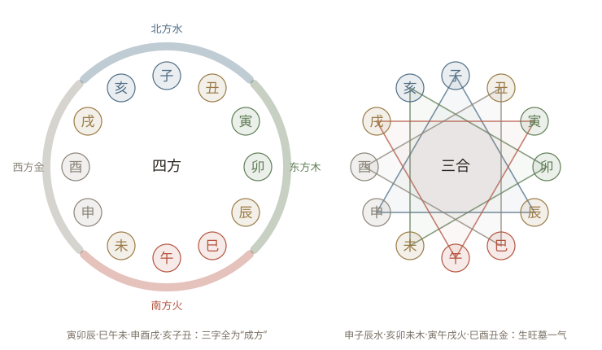

# 方局

> 【原文】方是方兮局是局，要得方，莫混局。

方是方，局是局；要成方，就不要混入局。

> 【原注】寅、卯、辰，东方也，搭一亥或卯或未，则太过，岂不为混局哉！

寅、卯、辰是东方，搭上一个亥，或卯、未，就太过了，岂不是混了局吗！

> 【任氏曰】十二支，寅、卯、辰东方，巳、午未南方，申酉、戌西方，亥、子、丑北方。凡三字全为成方，如寅、卯、辰全，其力量较胜于亥、卯、未木局、戊日遇寅月，见三字，俱以杀论；遇卯月，见三字，俱以官论，己日反是。遇辰月，视寅卯之势，较量轻重，以发杀，其余信此。若只二字，则竟不取，所言方局莫混之量 ，愚意以为不然，且如木而见亥字，为生旺之神；见未字，为我克之财，又是木盘根之地，亦何不可？即用三合木局，册有所损累耶？至于作用，则局之用多，而方之用狭，弗以论方而别生穿凿也。

十二支中，寅、卯、辰是东方，巳、午、未是南方，申、酉、戌是西方，亥、子、丑是北方。凡三字全的就成方，比如寅、卯、辰全，力量比亥、卯、未木局更胜。戊日遇寅月，见这三字，都按七杀论；遇卯月，见这三字，都按正官论；己日则相反。遇辰月，就看寅、卯的势力，比较轻重来定官杀。其余仿此。如果只有其中两字，就不取作方。原文说方局不要相混，我认为不然：比如木见亥字，是生旺之神；见未字，是我克之财，又是木盘根之地，有什么不可以？即使用三合木局，又有什么损累？至于作用，局的用处多，方的用处窄，不要因为论方而另外生出穿凿之说。

（译注：“以发杀”当作“以定官杀”，“信此”当作“仿此”，“册有所损累”当作“有何损累”。）

*图 10-1　地支四方与三合局：左为“方”，右为“局”。（译者补绘，原书无此图）*

> 【命例】甲寅 丁卯 戊辰 己未 ｜ 大运：戊辰 己巳 庚午 辛未 壬申 癸酉

> 此木方全，搭一未字为混，然无未字，则日主虚脱，且天干甲木透出作杀耑不作官，必要未字日主气贯，身杀两停，名利双辉。鼎甲出身，仕至极品，可知方混局之无害也。

这一造木方全，搭上一个未字为混；但没有未字，日主就虚脱，而且天干透出甲木，作杀而不作官，必须有未字使日主气贯，身杀两停，才名利双辉。鼎甲出身，官至极品，可知方混局是无害的。

> 【命例】丙辰 庚寅 乙卯 丁亥 ｜ 大运：辛卯 壬辰 癸巳 甲午 乙未 丙申 丁酉

> 此支类东方，火明木秀，最喜丙火紧克庚金之浊，然春初木嫩，必得亥时生助。为人风流潇洒，学问渊深。丁亥生木助火，采芹攀桂；巳运南宫报捷，名高翰苑；午运拱寅合卯，采梁栋于邓林，是难哲匠，搜琳琅于瑶圃；爰藉宗工；至酉，乙木无根，金得地，冲破东方秀气，犯事落职，若无亥水化之，岂能免大凶！

这一造地支聚成东方，火明木秀，最喜丙火紧克庚金的浊气。但初春木嫩，必须得亥时生助。为人风流潇洒，学问渊深。丁亥运生木助火，入学中举；巳运会试告捷，名高翰林；午运拱寅合卯，好比在邓林中选取栋梁，在瑶圃中搜寻美玉，凭借名家大匠而成材；到酉运，乙木无根，金得地，冲破东方秀气，犯事落职，若不是有亥水来化，岂能免于大凶！

（译注：“是难哲匠”与“爰藉宗工”两句骈文错置，当作“是赖哲匠……爰藉宗工”。）

> 【原文】局混方兮有纯疵，行运喜南或喜北

局里混入了方，就有纯有杂；大运或喜走南方，或喜走北方。

> 【原注】亥卯未木局，混一寅辰，则太强，行运南北，则有纯疵，不能俱利。

亥卯未木局，混入一个寅或辰，就太强了；大运走南走北，就有纯有杂，不能都有利。

> 【任氏曰】地支有三位相合而成局者，亥卯未木局，寅午戌火局，巳酉丑金局，申子辰水局，皆取征旺墓，一气始终也。柱中遇三支合势，吉凶之力较大。亦有取二支者，然以旺支为主，或亥卯，或卯未，皆可取，亥未次之。凡会忌冲，如亥卯未木局，杂一酉丑字于其中，而以与所冲之神紧贴，是为破局。虽冲字杂地其中，而不紧贴，或冲字处于其外而紧贴，则会局与损局瘐论，其二支会局者，以相贴为妙，逢冲即破，他字间之，亦遥隔无力，须天干领出可用。至于“局混方兮有纯疵”之说，与方“要得方莫混局”，之理相似，究其理亦无所害。见寅字是谓同气，见辰字是谓余气，又是东方湿土，能生助木神，又何损累耶？”行运南北之分须看局中意向为是。如木局，日主是甲乙，四柱纯木，不杂别字，运行南方，谓秀气流行，则纯；运行北方，谓之生助强神，无疪。或干支有火吐秀，运行南方，名利裕如；运行北方，凶灾立见。木论如此，余者可知。

地支有三位相合而成局的：亥卯未木局，寅午戌火局，巳酉丑金局，申子辰水局，都是取长生、帝旺、墓库，一气贯通始终。柱中遇到三支合势，吉凶的力量比较大。也有取两支的，但以旺支为主，或亥卯，或卯未，都可以取，亥未次之。凡会局都忌冲：比如亥卯未木局，中间杂一个酉或丑字，而与所冲之神紧贴，就是破局。如果冲字虽杂在其中但不紧贴，或者冲字在外面而紧贴，那么会局与损局要分别论。两支会局的，以相贴为妙，逢冲即破；有别的字隔开，也因遥隔而无力，须天干引出才可用。

至于“局混方兮有纯疵”的说法，与“要得方莫混局”的道理相似，推究其理也没有害处：见寅字是同气，见辰字是余气，又是东方湿土，能生助木神，又有什么损累呢？大运南北的分别，须看局中的意向为准。比如木局，日主是甲乙，四柱纯木，不杂别字，运走南方，叫秀气流行，就纯；运走北方，叫生助强神，也无瑕疵。如果干支有火吐秀，运走南方，名利充裕；运走北方，凶灾立见。木是这样论，其余可知。

（译注：“征旺墓”当作“生旺墓”，“瘐论”当作“分论”，“无疪”当作“无疵”。）

> 【命例】甲寅 乙亥 乙卯 癸未 ｜ 大运：丙子 丁丑 戊寅 己卯 庚辰 辛巳 壬午 癸未

> 此木局全，混一寅字，然四柱无金，其势从强，谓深得一方秀气。少年科第，惟庚辰辛巳运，虽有癸水之化，仍不免刑丧起倒，仕路蹭蹬。至六旬外，运走壬午癸未，由县令而迁司马。履黄堂而升观察，直如扬帆大海，谁能御之！由此观之，从强之木局，东南北运皆利，惟忌西方金运克破耳。

这一造木局全，混入一个寅字。但四柱没有金，其势从强，叫深得一方秀气。少年科第；只有庚辰、辛巳运，虽有癸水来化，仍不免刑丧起落，仕途蹭蹬。到六十岁以后，运走壬午、癸未，由县令升为同知，做知府又升道台，就像扬帆大海，谁能阻挡！由此看来，从强的木局，东、南、北运都有利，只忌西方金运克破罢了。

> 【命例】甲寅 丁卯 乙未 丁亥 ｜ 大运：戊辰 己巳 庚午 辛未 壬申 癸酉

> 此亦木局全，混一寅字，取丁火食神秀气，非前造从强论也。至巳运，丁火临官，登科发甲；庚午辛未，南方金败之地，不伤体用，仕途平坦；壬申，木火皆伤，破局，死于军中。前则从强，南北皆利；此则木火，西北有害。由此两造观之，局混方之无害也。

这一造也是木局全，混入一个寅字，取丁火食神秀气为用，不同于前造的从强论。到巳运，丁火临官，登科中进士；庚午、辛未运，南方是金的败地，不伤体用，仕途平坦；壬申运，木火都受伤，破局，死于军中。前造从强，南北运都有利；此造用木火，西北运有害。从这两造看来，局混方是无害的。

> 【原文】若然方局一齐来，须是干头无反复。

如果方和局一齐出现，必须天干没有反复。

> 【原注】木局木方全者，须要天干全顺得序，行运不背乃好。

木局、木方都全的，须要天干都顺而有序，行运不相悖才好。

> 【任氏曰】方局齐来者，承上文方混局局混方之谓也。如寅、卯辰兼未，亥卯未兼寅辰，巳、午未兼戌，寅午戌兼巳未，申、酉、戌、兼巳丑，巳酉丑兼申戌，亥、子、丑兼申辰，申子辰兼丑亥子类是也。干头无反复者，方局齐来，其气旺盛，要天干顺其气势为妙。若地支寅、卯、辰，日主是木，或再见亥之生，未之库，如地支亥卯未，日主是木，或再逢寅之禄、辰之余，旺之极矣，非金所能克也，须要天干有火，泄其精英，不见金水，则干头无反复，然后行土运，乃为全顺得序而不悖矣。如天干无火而仍生木，逢凶有解。苟有火而见水，或无火而见金，此谓干头反复，如得运程安顿，遇土则可止其逆水，遇火则可去其微金，亦不失为吉耳。如日干是土，别干得火，相生之谊，亦不反复；见金以寡敌众，见水生助强神则反复矣。所以制之以盛，不若化之以德，则其流行全顺矣。余仿此。

“方局齐来”，承接上文方混局、局混方而言。比如寅卯辰兼未，亥卯未兼寅辰；巳午未兼戌，寅午戌兼巳未；申酉戌兼巳丑，巳酉丑兼申戌；亥子丑兼申辰，申子辰兼丑亥之类都是。“干头无反复”，是说方局齐来，其气旺盛，要天干顺其气势才妙。

比如地支寅卯辰，日主是木，又见亥之生、未之库；或地支亥卯未，日主是木，又逢寅之禄、辰之余气，就旺到极点，不是金所能克的，须要天干有火泄其精英，不见金水，这就是干头无反复；然后走土运，才是全顺得序而不悖。如果天干没有火而仍是生木之物，逢凶有解。如果有火而见水，或无火而见金，这叫干头反复；如果大运安顿得好，遇土可以止住逆水，遇火可以去掉微金，也不失为吉。如果日干是土，别的天干有火，是相生之谊，也不算反复；见金是以寡敌众，见水是生助强神，就反复了。所以用强去制，不如用德去化，那么它的流行就全顺了。其余仿此。

（译注：“制之以盛”当作“制之以威”。）

> 【命例】甲寅 丁卯 乙亥 癸未 ｜ 大运：戊辰 己巳 庚午 辛未 壬申 癸酉

> 此方局齐来，得月干丁火独透，发泄菁英，何其妙也。惜乎时干癸水透露，通根亥支，紧伤丁火秀气，谓干头反复，所以一衿尚不能博，贫乏无子。设使癸水换一火土，名利皆遂矣。

这一造方局齐来，得月干丁火独透，发泄精英，多么妙啊。可惜时干癸水透露，通根于亥支，紧伤丁火秀气，这叫干头反复，所以连一个秀才都考不上，贫乏无子。假如把癸水换成火或土，就名利都遂了。

> 【命例】丁卯 甲辰 甲寅 乙亥 ｜ 大运：癸卯 壬寅 辛丑 庚子 己亥 戊戌

> 此亦方局齐来，干头无水，丁火秀气流行，行运不甚反悖。中乡榜，仕至州牧，子多财旺，赋性仁慈，品行端方，寿越八旬，夫妇齐眉。所谓木主仁，仁者寿，格名曲直仁寿者，信斯言也。由此两造观之，干头反复与全顺得序者，天渊也。

这一造也是方局齐来，天干没有水，丁火秀气流行，行运也不太悖逆。考中举人，官至知州，子多财旺，天性仁慈，品行端正，寿过八十，夫妻白头偕老。这就是所谓木主仁、仁者寿，格局名为“曲直仁寿”，这话可信。从这两造看来，干头反复与全顺得序，相差天渊。

> 【原文】成方干透一元神，生地库地皆非福。

成方而天干透出方的元神，再走长生之地、墓库之地，都不是福。

> 【原注】寅、卯、辰全者，日主甲乙木，则透元神，而又遇亥之生，未之库，决不发福，惟纯一火运略好。

寅、卯、辰全，日主是甲乙木，这是元神透出；再遇亥之生、未之库，决不发福，只有纯一的火运略好。

> 【任氏曰】成方干透元神者，日主即方之气也。如木方日主是木，火方日主是火，即为元神透出也。生地库地皆非福者，身旺不宜再助也，然亦要看其气势，不可一例而推。成方透元神，旺可知矣，固不宜再行生地库地，以帮方也。倘年月时干不杂财官，又有劫印，谓之从强，则生地库地，亦能发福。如逢纯一火运，真谓秀气流行，名利皆遂。如年月时干，财官无气，再行 生地库地之运，不但不能发福，而且刑耗多端。此屡试屡验，故志之。

“成方干透元神”，是说日主就是方的五行。比如木方而日主是木，火方而日主是火，就是元神透出。“生地库地皆非福”，是因为身旺不宜再助。但也要看它的气势，不可一概而论。成方又透元神，可知已经很旺，固然不宜再走生地库地来帮方。倘若年、月、时干不杂财官，又有劫印，这叫从强，那么走生地库地也能发福；如果逢纯一的火运，真是秀气流行，名利都遂。如果年、月、时干的财官无气，再走生地库地之运，不但不能发福，而且刑耗多端。这是屡试屡验的，所以记下来。

> 【命例】戊寅 甲寅 甲辰 丁卯 ｜ 大运：乙卯 丙辰 丁巳 戊午 己未 庚申

> 此成方，干透元神，四柱不杂金水，时干丁火吐秀，纯粹可观。初中行运火土，中乡榜，出宰名区；惜木多火炽，丁火不中以泄之，所以运至庚申，不能免祸。

这一造成方，天干透出元神，四柱不杂金水，时干丁火吐秀，纯粹可观。初运、中运走火土，考中举人，出任名县县令；可惜木多火炽，丁火不足以泄木，所以运到庚申，不能免祸。

（译注：“丁火不中以泄之”当作“丁火不足以泄之”。）

> 【命例】癸卯 丙辰 甲辰 丙寅 ｜ 大运：乙卯 甲寅 癸丑 壬子 辛亥 庚戌

> 此造财旺提纲，丙食生助，当以财星为用，丙火为喜，癸水为忌。身旺用财，遗业十余万初年水木运，一败如灰：至辛亥运，火绝木生，水临旺，冻饿而死。以此观之，不论成方成局，必先察财官之势。若财旺提纲，则以财为用；或官得财助，则以官为用；如财不通月支，官无旺财生，必须弃其寡而从其众也。余皆仿此。

这一造财星（辰）旺于月令，丙火食神生助，应当以财星为用神，丙火为喜神，癸水为忌神。身旺用财，遗产十余万；初年走水木运，一败如灰；到辛亥运，火绝木生，水临旺地，冻饿而死。由此看来，不论成方成局，必须先察看财官之势：如果财旺于月令，就以财为用；或官得财助，就以官为用；如果财不通月令，官又没有旺财来生，就必须弃其寡而从其众。其余都仿此。

> 【原文】成局干透一官星，左边右边空碌碌。

成局而天干透出一个官星，左右（相邻干支）又空而无助，就一生碌碌无成。

> 【原注】甲乙日遇亥卯未全者，庚辛乃木之官也，又见左辰右寅，则名利无成。甲乙日单遇庚辛，则亦无成。

甲乙日遇亥卯未全，庚辛是木的官杀；又见左边辰、右边寅，就名利无成。甲乙日只遇庚辛（无助），也无成。

> 【任氏曰】如地支会木局，日主元神透出，别干见辛之官、庚之杀，虚脱无气，即余干有土，土亦休囚，难以生金，须地支有一申酉丑字为美。若无申酉丑，反加之寅辰字，则木势愈盛，金势愈衰矣 ，故碌碌终身，名利无成也。若得岁运去其官星，亦可发达，必要柱中先见食伤，然后岁运去净官煞之根，名利遂矣。本局如此，余局仿此论之可也。

比如地支会成木局，日主的元神透出，别的天干见辛金之官、庚金之杀，虚脱无气；即使其余天干有土，土也休囚，难以生金，须地支有一个申、酉、丑字才好。如果没有申酉丑，反而加上寅辰字，木势就更盛，金势就更衰了，所以碌碌终身，名利无成。如果得到岁运去掉官星，也可以发达，但必须柱中先见食伤，然后岁运去净官杀之根，名利就遂了。木局是这样，其余的局仿此论就可以了。

> 【命例】辛未 辛卯 乙未 丁亥 ｜ 大运：庚寅 己丑 戊子 丁亥 丙戌 乙酉

> 此乙木归垣，亥卯未全，木势旺盛，金气虚脱，最喜时透丁火，制煞为用。故初运土金之乡，奔驰未遇；至于亥运，生木制煞，军前效力，得县佐；丙戌运中帮丁克辛，升县令。此所谓强众而敌寡，势在去其寡，非煞旺宜制而推也。至酉运，煞逢禄旺，冲破木局不禄。

这一造乙木归垣（日坐卯？此处指月令卯），亥卯未全，木势旺盛，金气虚脱，最喜时上透出丁火，以制杀为用。所以初运土金之乡，奔波不遇；到亥运，生木制杀，在军中效力，得县丞之职；丙戌运中，帮丁克辛，升为县令。这就是所谓强众而敌寡，势在去其寡，并不是按“杀旺宜制”来推的。到酉运，杀逢禄旺，冲破木局，去世。

> 【命例】辛未 辛卯 乙未 戊寅 ｜ 大运：庚寅 己丑 戊子 丁亥 丙戌 乙酉

> 此乙木归垣，虽无全会，然寅时比亥之力量胜数倍矣。以大象观之，局中三土两金，似乎财生煞旺，不知卯旺提纲，支中皆木之根旺，非金之在地也。初运土金之乡，采芹食廪，家业丰裕：一交丁亥，制煞会局，刑妻克子，破耗异常，犯事革名，忧郁而死。

这一造乙木归垣，虽然木局不全，但寅时比亥的力量胜过数倍。从大象看，局中三个土、两个金，似乎财生杀旺；殊不知卯旺于月令，地支都是木的旺根，不是金所在之地。初运土金之乡，入学食廪，家业丰裕；一交丁亥运，制杀而会成木局，刑妻克子，破耗异常，犯事革去功名，忧郁而死。

> 【命例】庚寅 己卯 乙亥 癸未 ｜ 大运：庚辰 辛巳 壬午 癸未 甲申 乙酉

> 此造正合本文成局，干透官星，左右皆空，四柱一无情致，用财则财会劫局，用官则官临绝地，用神无所着落，为人少恒一之志，多迁变之心，以致家业破耗。读书未就，而学医；医又不就，又学堪舆；自以为仲景再世，杨赖复生，而人终不信；又学巫，学易，学命，所学甚多，不能尽述。不但一无所就，而且财散人离，削发为僧矣。

这一造正合本文所说的成局而天干透出官星、左右皆空：四柱毫无情致，用财则财会成劫局，用官则官临绝地，用神没有着落。为人缺少恒心，多见异思迁，以致家业破耗。读书没有成就就去学医；学医又不成，又学风水，自以为是张仲景再世、杨筠松与赖布衣复生，而人们终究不信；又学巫术、学易卦、学算命，学的东西很多，说也说不完。不但一无所成，而且财散人离，削发为僧了。
