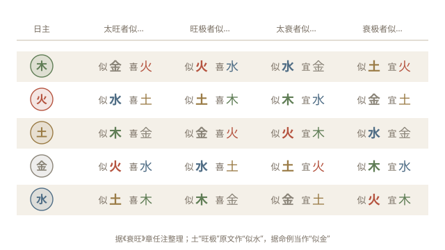

# 衰旺

> 【原文】能知衰旺之真机，其于三命之奥，思过半矣。

能懂得衰旺的真正机理，对于命理的奥妙，就已经明白一大半了。

> 【原注】旺则宜泄宜伤，衰则喜帮喜助，子平之理也。然旺中有衰者存，不可损也；衰右有旺者存，不可益也。旺之可损，以损在其中矣；衰之极者不可所当损者而损之，反凶；实所当益者而益之，反害，此真机，皆能知之，又何难于详察三微奥乎？

旺则宜泄、宜伤，衰则喜帮、喜助，这是子平的道理。但旺中有衰存在的，不可损；衰中有旺存在的，不可益。旺到极点的不可损，衰到极点的不可益。实在应当损的去损它，反而凶；实在应当益的去益它，反而有害。这种真机，如果都能知道，那么详察三命的微妙奥义又有什么难的呢？

（译注：原注文字有错乱，“衰右”当作“衰中”，“旺之可损，以损在其中矣；衰之极者不可所当损者而损之”当作“旺之极者不可损，衰之极者不可益；实所当损者而损之，反凶”。）

> 任氏曰；得时俱为旺论，失令便作衰看，虽是至理，亦死法也。夫五行之气，流行于四时，虽日干各有专令，而其实专令之中，亦有并存者在，如春木司令，甲乙虽旺，而此时休囚之戊巳，亦未尝绝于天地也；冬水司令，壬天虽旺，百此时休囚之丙丁，变未尝绝于天地也。物时当退避，不敢争先，而春实春土何尝不生万物，冬日何尝不照万国乎？况八字虽以月令迷重，而旺相休囚，年日时中，亦有损益之权，故生月即不值令，亦能值年值日值时，岂可执一而论？有如春木虽强，金太重而木亦危；干庚辛而支申酉，无火制而不富，逢土生而必夭，是得时不旺也。秋木虽弱，木根深而木亦强，干甲乙而支寅卯，遇官透而能受，逢水生而太过，是失时不弱也。是故日干不论月令休囚，只要四柱有根，便能受财官食神而当伤官七杀。长生禄旺，根之重者也；墓库余气，奶之轻者也。天干得一比肩，不如地支得一余气墓库。墓者，如甲乙逢未，丙丁逢戌，庚辛逢丑，壬癸辰之类是也。余气者，如丙丁逢未，丙丁逢戌，庚辛逢丑，壬癸逢辰之类是也。余气者，如丙丁逢未，甲乙逢辰，庚辛逢戌，壬癸逢丑之类是也，得二比肩，不如支中得一长生禄旺，如甲乙逢亥寅卯之类是也。盖比肩如朋友之相扶，通根如家室之可托，干多不如根挭，理固然也。今人不知此理，见是春土夏水秋木冬火，不问有根无根，，便谓之弱：见是春木夏火秋金冬水，不究克重克轻，便谓这旺，更有任癸逢辰，丙丁逢戌，甲乙逢未，庚辛逢丑之类，不以为通根峰库，甚至求刑冲以开之，竟不思刑冲伤吾本根之气。此种谬论，必宜一切扫除也。然此皆论衰旺之正面，易者也，更有颠倒之理存焉，其理有十：木太旺者而似金，喜火之炼也；木旺极者而似火，喜水之克也。火太旺者而似水，喜土之止也；火旺极者而似土，喜木之克也。土太旺者而似木，喜金之克也；土旺极者而似水，喜火之练也。金太旺者而似火，喜水之济也；金旺极者而似水，喜土之止也。水太旺者而似土，喜木之制也；水旺极者而似木，喜金之克也。木太衰者而似水也，宜金以生之；木衰极者而似土也，宜火以生之。火太衰者而似木也，宜水以生之；火衰极者而似金也，宜土以生之 。土太衰者而似  火也，宜木以生之；土衰极者而似水也，宜金以生之。金太衰者而似土，宜火以生之金衰极者而似木也，宜水以生之。水太衰者而似金也，宜土以生之；水衰极者而似火也，宜木以生之。此五行颠倒之真机，学者宜细详玄玄之妙。

任氏说：得时的都按旺论，失令的就作衰看，虽是至理，也是死法。五行之气流行于四季，虽然各干各有专令，但其实专令之中也有并存之气。比如春天木司令，甲乙虽旺，此时休囚的戊己，也未尝在天地间断绝；冬天水司令，壬癸虽旺，此时休囚的丙丁，也未尝在天地间断绝。只是时当退避，不敢争先罢了；而春天的土何尝不生万物，冬天的太阳何尝不照万国呢？况且八字虽以月令为重，但旺相休囚，在年、日、时中也有损益之权；所以生月即使不当令，也能在年、日、时上得令，怎么可以执一而论？

比如春木虽强，金太重木也危险：天干庚辛、地支申酉，没有火来制就不富，再逢土生金就必定夭折，这是得时而不旺。秋木虽弱，木根深木也强：天干甲乙、地支寅卯，遇官透出也能承受，再逢水生就太过了，这是失时而不弱。所以日干不论月令是否休囚，只要四柱有根，就能承受财官食神，抵挡伤官七杀。长生、禄旺，是重根；墓库、余气，是轻根。天干得一个比肩，不如地支得一个余气或墓库。墓，比如甲乙逢未、丙丁逢戌、庚辛逢丑、壬癸逢辰之类；余气，比如丙丁逢未、甲乙逢辰、庚辛逢戌、壬癸逢丑之类。天干得两个比肩，不如地支中得一个长生、禄旺，比如甲乙逢亥、寅、卯之类。因为比肩好比朋友相扶，通根好比家室可托；天干多不如根重，道理本来如此。

今人不懂这个道理，见是春土、夏水、秋木、冬火，不问有根无根，就说它弱；见是春木、夏火、秋金、冬水，不究克重克轻，就说它旺。更有壬癸逢辰、丙丁逢戌、甲乙逢未、庚辛逢丑之类，不认为是通根于身库，甚至要求刑冲来开库，竟不想刑冲会伤我本根之气。这种谬论必须一概扫除。

但这些都是论衰旺的正面，是容易的；更有颠倒之理存在，这个道理有十种：木太旺的就像金，喜火来炼；木旺极的就像火，喜水来克。火太旺的就像水，喜土来止；火旺极的就像土，喜木来克。土太旺的就像木，喜金来克；土旺极的就像金，喜火来炼。金太旺的就像火，喜水来济；金旺极的就像水，喜土来止。水太旺的就像土，喜木来制；水旺极的就像木，喜金来克。木太衰的就像水，宜金来生；木衰极的就像土，宜火来生。火太衰的就像木，宜水来生；火衰极的就像金，宜土来生。土太衰的就像火，宜木来生；土衰极的就像水，宜金来生。金太衰的就像土，宜火来生；金衰极的就像木，宜水来生。水太衰的就像金，宜土来生；水衰极的就像火，宜木来生。这是五行颠倒的真机，学者应当仔细体会其中玄妙。

（译注：本段原为任氏注文，底本未标格式，且讹字甚多，如“壬天”当作“壬癸”，“迷重”当作“为重”，“根挭”当作“根重”；墓库、余气两句底本重复错乱，已按文意整理。“土旺极者而似水”据下文命例当作“似金”。）

*图 16-1　五行颠倒十法：旺到极点、衰到极点时，五行反似他行。（译者补绘，原书无此图）*

> 【命例】甲辰 丁卯 甲子 戊辰 ｜ 大运：戊辰 己巳 庚午 辛未 壬申 癸酉

> 甲子日生卯月，地支两辰，是木之余气也，又辰卯东方，子辰拱水，木太旺者似金也，以丁火为用。至巳运，丁火临旺，名列宫墙；庚辛两运，南方截脚之金，虽有刑耗，而无大患；未运克去子水，食廪天储；午运子水冲克，秋闱失意；壬申运金水齐来，刑妻克子，破耗多端；癸运不禄。

甲子日生在卯月，地支两个辰是木的余气，又辰卯东方，子辰拱水，这是“木太旺者似金”，以丁火为用神（炼金）。到巳运，丁火临旺，考中秀才；庚、辛两运，是南方截脚之金，虽有刑耗，而无大患；未运克去子水，成为廪生；午运被子水冲克，乡试失意；壬申运金水齐来，刑妻克子，破耗多端；癸运去世。

> 【命例】癸卯 乙卯 甲寅 乙亥 ｜ 大运：甲寅 癸丑 壬子 辛亥 庚戌 己酉

> 此造四支皆木，又逢水生，六木两水，别无他气。木旺极者，似火也，出身祖业本丰。惟丑运刑伤，壬子水势乘旺，辛亥金不通根，支逢水旺，此二十年经营，获利数万；一交庚戌，土金并旺，破财而亡。

这一造四个地支都是木，又逢水生，六个木、两个水，别无他气，这是“木旺极者似火”，出身祖业本来丰厚。只有丑运刑伤；壬子运水势乘旺，辛亥运金不通根而地支逢水旺，这二十年经营获利数万；一交庚戌，土金都旺，破财而亡。

> 【命例】乙丑 甲申 甲申 辛未 ｜ 大运：癸未 壬午 辛巳 庚辰 己卯 戊寅

> 此造地支土金，木无盘根之处，时干辛金，元神发透，木太衰者，似水也，初运癸未壬午，生木制金，刑丧早见，荫疪难丰；辛巳庚辰，金逢生地，白手发财数万；己卯运土无根，木得地，遭回禄，破财万余；至寅而亡 。

这一造地支是土金，木没有盘根之处，时干辛金的元神透出，这是“木太衰者似水”（宜金生）。初运癸未、壬午，生木制金，早见刑丧，祖荫难丰；辛巳、庚辰运，金逢生地，白手发财数万；己卯运土无根而木得地，遭火灾，破财万余；到寅运而亡。

> 【命例】己巳 己巳 乙酉 丙戌 ｜ 大运：戊辰 丁卯 丙寅 乙丑 甲子 癸亥

> 此造地支皆逢克泄，天干又透火土，全无水气。木衰极者，似土也。初交戊辰丁运，获丰厚之荫疪，美景良多；卯运椿萱并谢；丙运大遂经营之愿，获利万金；寅运克妻破财，又遭回禄；乙丑支全金局，火土两泄，家业耗散；甲子北方水地，不禄宜矣。

这一造地支都是克泄日主之物，天干又透火土，毫无水气，这是“木衰极者似土”（宜火生）。初交戊辰、丁运，得到丰厚的祖荫，美景良多；卯运父母双亡；丙运大遂经营之愿，获利万金；寅运克妻破财，又遭火灾；乙丑运地支全金局，火土两泄，家业耗散；甲子北方水地，去世也是应该的。

> 【命例】乙丑 壬午 丙戌 甲午 ｜ 大运：辛巳 庚辰 己卯 戊寅 丁丑 丙子

> 此丙戌日元，月时两刃，壬水无根，又逢木泄。火太旺者，似水也。初运庚辰辛巳，金逢生地，孔怀无辅助之人，亲党少知心之辈；己卯得际遇，戊寅全会火局，及丁丑二十年，发财四五万，至子运而亡。

这一造丙戌日主，月、时两个羊刃（午），壬水无根，又逢木泄，这是“火太旺者似水”（喜土止）。初运辛巳、庚辰，金逢生地，兄弟中没有辅助之人，亲戚中少有知心之辈；己卯运得到机遇；戊寅运全会火局，以及丁丑运二十年，发财四五万，到子运而亡。

（译注：“孔怀”指兄弟。）

> 【命例】戊寅 丁巳 丙寅 甲午 ｜ 大运：戊午 己未 庚申 辛酉 癸亥 壬戌

> 此造丙火生孟夏，地支两坐长生而逢禄旺。火旺极者，似土也。初运虽不逢木，喜其南方火地，遗绪丰盈，读书过目成育；一交庚运，即弃诗书，受嬉好游，挥金如土；申运家破身亡。此造若逢木运，名利两全也。

这一造丙火生在孟夏，地支两次坐长生（寅）而又逢禄旺（巳、午），这是“火旺极者似土”（喜木）。初运虽不逢木，喜其南方火地，祖业丰盈，读书过目成诵；一交庚运，就抛弃诗书，爱嬉好游，挥金如土；申运家破身亡。此造如果逢木运，名利两全。

（译注：“成育”当作“成诵”，“受嬉”当作“爱嬉”。末二步大运次序当作壬戌、癸亥。）

> 【命例】辛巳 丁酉 丁酉 辛丑 ｜ 大运：丙申 乙未 甲午 癸巳 壬辰 辛卯

> 丁火生于八月，秋金秉令，又全金局。火衰者，似木也。初运己未甲午，火木并旺，骨肉如同画饼，六亲亦是浮云；一交癸巳，干透水，支拱金，出外经营，大得际遇；壬辰运中，发财十余万。

丁火生在八月，秋金当令，又全金局，这是“火太衰者似木”（宜水生）。初运丙申、乙未、甲午，火木都旺，骨肉如同画饼，六亲也是浮云；一交癸巳，天干透水，地支拱金，出外经营，大得机遇；壬辰运中，发财十余万。

（译注：“己未甲午”当作“乙未甲午”。）

> 【命例】辛亥 壬辰 丙申 己亥 ｜ 大运：辛卯 庚寅 己丑 戊子 丁亥 丙戌

> 此财生杀，杀功身，丙临申，申辰拱水。火衰极者，似金也。初运辛卯庚寅，东方木地，萱椿凋谢，祖业无恒；至己丑运，出外经营，青蚨衬辇，白镪随舆；及戊子二十年，春风吹枊，红绫易公子之裳，杏露沾衣，膏雨沐王孙之袖。所谓有其运，必得其福也。

这一造财生杀，杀攻身，丙临申，申辰拱水，这是“火衰极者似金”（宜土生）。初运辛卯、庚寅，东方木地，父母凋谢，祖业不能保持；到己丑运，出外经营，钱财滚滚而来；到戊子二十年，春风得意，富贵荣华。这就是所谓有其运，必得其福。

（译注：“杀功身”当作“杀攻身”。“青蚨”“白镪”皆指钱财；“红绫”“膏雨”诸句是形容富贵的骈语。）

> 【命例】戊辰 戊午 戊申 己未 ｜ 大运：己未 庚申 辛酉 壬戌 癸亥 甲子

> 此造重重厚土，生于夏令，土太旺者，似木也，其用在金。庚申运，早采芹香；辛酉运辛丑年，饮鹿鸣，宴琼林，云程直上；壬戌运，刑丧挫折，丙午而亡。

这一造重重厚土，生在夏令，这是“土太旺者似木”，用神在金。庚申运早年入学；辛酉运辛丑年考中举人、进士，青云直上；壬戌运刑丧挫折，丙午年而亡。

（译注：“鹿鸣”“琼林”分别指乡试、会试后的宴会。）

> 【命例】戊戌 丙辰 己巳 己巳 ｜ 大运：丁巳 戊午 己未 庚申 辛酉 壬戌

> 此造四柱火土，全无克泄。土旺极者，似金也。初运南方，遗业丰盈，午运入泮，己未棘闱，拔而不举；一交庚申，青蚨化蝶，家业渐消；辛酉财若春后霜雪，事业萧条；壬运克丙不禄。

这一造四柱都是火土，毫无克泄，这是“土旺极者似金”（喜火炼）。初运南方，祖业丰盈；午运入学；己未运参加乡试，被选拔为拔贡而未中举；一交庚申，钱财散去，家业渐消；辛酉运，财如春后霜雪，事业萧条；壬运克丙火，去世。

> 【命例】壬辰 辛亥 戊子 癸丑 ｜ 大运：壬子 癸丑 甲寅 乙卯 丙辰 丁巳

> 此造支类北方，水势汪洋，天干又透金水。土太衰者，似火也。运至甲寅乙卯，干支皆木，名成利遂；一交丙运，刑妻克子，破耗多端；至于巳运，岁运火土，暗伤体用，得风疾而亡。

这一造地支聚成北方，水势汪洋，天干又透金水，这是“土太衰者似火”（宜木生）。运到甲寅、乙卯，干支都是木，名成利遂；一交丙运，刑妻克子，破耗多端；到巳运，岁运火土暗伤体用，得中风之病而亡。

> 【命例】癸酉 甲子 戊子 戊午 ｜ 大运：癸亥 壬戌 辛酉 庚申 己未 戊午

> 此四柱皆水，又得金生。土衰极者，似水也。初运癸亥，平宁之境；壬戌水无根，土得地，刑丧破耗，家业消亡；辛酉庚申二十年，大得际遇，白手发财十余万；己未运破去数万，寿亦在未而止。

这一造四柱都是水，又得金生，这是“土衰极者似水”（宜金生）。初运癸亥，平安宁静；壬戌运水无根而土得地，刑丧破耗，家业消亡；辛酉、庚申二十年，大得机遇，白手发财十余万；己未运破去数万，寿命也在未运终止。

> 【命例】壬申 己酉 庚子 庚辰 ｜ 大运：庚戌 辛亥 壬子 癸丑 甲寅 乙卯

> 此造秋金秉令，木火全无。金太旺者，似火也。亥运壬水坐禄，早游泮水，壬子运用神临旺，撞破烟楼，高攀月桂；癸丑合去壬水旺地，囊内青蚨成蝶舞，枝上子规月下啼；甲寅乙卯，尚有制土卫水之功，仁路清高，枫叶未应毡共冷，梅开早觉笔先香。

这一造秋金当令，木火全无，这是“金太旺者似火”（喜水济）。亥运壬水坐禄，早年入学；壬子运用神临旺，科场高中；癸丑运合去旺地之水，囊中钱财散去，境况凄凉；甲寅、乙卯运，还有制土卫水之功，仕途清高，做了清贫而有文名的学官。

（译注：“仁路”当作“仕路”。末句骈语形容学官清苦而文名早著。）

> 【命例】庚申 乙酉 庚戌 庚辰 ｜ 大运：丙戌 丁亥 戊子 己丑 庚寅 辛卯

> 此造支类西方，又逢厚土，金旺极者，似水也。初运火，祖业无恒；至戊子运获厚利，纳房出仁已丑庚运，名利皆遂；一交寅运，犯事落职，大破财利；至卯不禄。

这一造地支聚成西方，又逢厚土，这是“金旺极者似水”（喜土止）。初运丙丁火，祖业不能保持；到戊子运获厚利，捐纳出仕；己丑、庚运，名利都遂；一交寅运，犯事落职，大破财利；到卯运去世。

（译注：“纳房出仁”当作“纳粟出仕”。）

> 【命例】己卯 庚午 辛卯 甲午 ｜ 大运：己巳 戊辰 丁卯 丙寅 乙丑 甲子

> 辛金生于促夏，地支皆逢财杀。金太衰者，似土也。初运己巳戊辰，晦火生金，求名多滞，作事少成；一交丁卯，木火并旺，如枯苗得雨，勃然而兴，似鸿毛遇风，飘然而起，家业丰裕交丑生金泄火，不禄。

辛金生在仲夏，地支都是财杀，这是“金太衰者似土”（宜火生）。初运己巳、戊辰，晦火生金，求名多阻，做事少成；一交丁卯，木火都旺，如枯苗得雨，勃然而兴，似鸿毛遇风，飘然而起，家业丰裕；交丑运生金泄火，去世。

（译注：“促夏”当作“仲夏”。）

> 【命例】己亥 丁卯 庚寅 丙子 ｜ 大运：丙寅 乙丑 甲子 癸亥 壬戌 辛酉

> 此造木旺乘权，又得水生，四面皆逢财杀。金衰极者，似木也。所以乙丑运中，土金暗旺，家业破尽；至甲子运，北方水旺，财源通裕；癸亥出仁，名利两全壬戌水临绝地， 罢职而归。

这一造木旺乘权，又得水生，四面都是财杀，这是“金衰极者似木”（宜水生）。所以乙丑运中，土金暗旺，家业破尽；到甲子运，北方水旺，财源通畅；癸亥运出仕，名利两全；壬戌运水临绝地，罢官而归。

> 【命例】壬寅 辛亥 壬子 辛丑 ｜ 大运：壬子 癸丑 甲寅 乙卯 丙辰 丁巳

> 此造壬水生于孟冬，支类北方，干皆金水。水太旺者，似土也，喜其寅木吐秀。至甲寅运，早遂青云之志，可谓才藻翩翩，辉映杏坛桃李，文思弈弈，光腾药笼参芩，乙卯运官途顺遂，交丙而亡。

这一造壬水生在孟冬，地支聚成北方，天干都是金水，这是“水太旺者似土”（喜木制），喜寅木吐秀。到甲寅运，早遂青云之志，可谓才华横溢，文思焕发；乙卯运官途顺遂，交丙运而亡。

（译注：原文“辉映杏坛桃李，光腾药笼参苓”是形容既善教授又通医理的骈语。）

> 【命例】癸亥 癸亥 壬子 庚子 ｜ 大运：壬戌 辛酉 庚申 己未 戊午 丁巳

> 此造四柱皆水，一无克泄，其势冲奔，不可遏也。初运壬戌，支逢土旺，早见刑丧；辛酉庚申，干支皆金，所谓月印午江银作浪 ，门临五福锦铺花；交己未，妻子皆伤，家业破尽；戌午运，贫乏不堪，忧郁而卒。

这一造四柱都是水，毫无克泄，其势冲奔，不可遏止（水旺极者似木，喜金）。初运壬戌，地支逢土旺，早见刑丧；辛酉、庚申运，干支都是金，正所谓“月印午江银作浪，门临五福锦铺花”；交己未运，妻儿都受伤，家业破尽；戊午运，贫乏不堪，忧郁而死。

> 【命例】丙辰 乙未 壬午 癸卯 ｜ 大运：丙申 丁酉 戊戌 己亥 庚子 辛丑

> 此火土当权，又逢木助，五行无金。水太衰者，似金也。初交丙申丁酉，盖头是火，使申酉不能生水，财喜并旺；戊戌运中，家业饶裕；己亥土无根，还喜支会木局，虽有破耗而无大患；一交庚子，家破人亡。

这一造火土当权，又逢木助，五行没有金，这是“水太衰者似金”（宜土生）。初交丙申、丁酉，火盖在申酉之上，使申酉不能生水，财喜都旺；戊戌运中，家业富裕；己亥运土无根，还喜地支会成木局，虽有破耗而无大患；一交庚子，家破人亡。

> 【命例】癸卯 戊午 壬寅 丙午 ｜ 大运：丁巳 丙辰 乙卯 甲寅 癸丑 壬子

> 此造丙火当权，戊癸从化，枯干壬水。水衰极者，似火也。初运逢火，从其火旺，丰衣足食；乙卯甲寅 ，名利双全；癸丑争官夺财，破耗而亡。

这一造丙火当权，戊癸从化，壬水枯干，这是“水衰极者似火”（宜木生）。初运逢火，顺从火旺，丰衣足食；乙卯、甲寅运，名利双全；癸丑运争官夺财，破耗而亡。

> 以上二十造，五行极旺极衰，不得中和之气。原注去：“旺中有衰者存，衰中有旺者存”，此两句，即余之太旺太衰也：“旺之极者不可损，衰之极者不可益”，此两句，即余之极旺极旺衰 也。特选此为后证。

以上二十造，五行都是极旺或极衰，不得中和之气。原注说“旺中有衰者存，衰中有旺者存”，这两句就是我说的“太旺”“太衰”；“旺之极者不可损，衰之极者不可益”，这两句就是我说的“极旺”“极衰”。特地选这些例子作为后来的证明。
