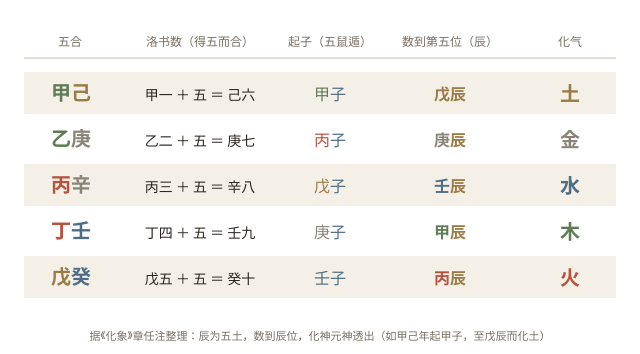

# 化象

> 【原文】化得真者只论化，化神还有几般话。

化得真的，只论化；而化神又有几种不同的说法。

> 【原注】如甲日主生于四季，单遇一位已土，在月时上合遇壬、癸、甲、乙、戊，而有一辰字，乃为化得真。又如丙辛生于冬月，戊癸生于夏月，乙庚生于秋月，丁壬生于春月，独自相合，又得龙以运之，此为真化矣。既化矣，又论化神。如甲己化土，土阴寒，要火气昌旺；土太旺，又要取水为财，木为官，金为食神 。随其所向，论其喜忌，再见甲乙，亦不作争合妒合论。盖真化矣，如烈女不更二夫，岁运遇之皆闲神也。

比如甲日主生在四季月，只遇一个己土在月或时上相合，不遇壬、癸、甲、乙、戊，而又有一个辰字，就是化得真。又如丙辛生在冬月，戊癸生在夏月，乙庚生在秋月，丁壬生在春月，单独相合，又得辰（龙）来运化，这是真化。既然化了，又要论化神：比如甲己化土，土阴寒，要火气昌旺；土太旺，又要取水为财、木为官、金为食神，随其意向，论其喜忌。再见甲乙，也不作争合、妒合论。因为真化了，就像烈女不嫁二夫，岁运遇到的都是闲神。

（译注：“合遇”当作“不遇”。）

> 【任氏曰】合化之原，昔黄帝礼天于圜邱，天降十干，爱命大挠作十二支以配之。故日干曰天干，其所由，合即天一、地二、天三、地四、天五、地六、天七、地八、天九、地十之义。依数推之，则甲一、乙二、丙三、丁四、戊五、己六、庚七、辛八、壬九、癸十也。如“洛书”以五居中，一得五为六，故甲与己合；二得五为七，故乙与庚合；三得五为八，故丙与辛合；四得五为九，故丁与壬合；五得五为十，故戊与癸合。合则化，化亦必得五土而后成，五土者辰也。辰土居春，时在三阳，生物之体，气辟而动，动则变，变则化矣。且十干之合，而至五辰之位，则化气之元神发露。故甲己起甲子，至五位逢戊辰而化土；乙庚到丙子，至五位逢庚辰而化金；丙辛起戊子，至五位逢壬辰而化水；丁壬起庚子，至五位逢甲辰而化木；戊癸起壬子，至五位逢丙辰而化火。此相合相化之真源，近世得传者少，只知逢龙而化，不知逢五而化，辰龙之说，供引之意，如果辰为真龙。则辰年生人为龙，可行雨，而寅年生人为虎，必伤人矣。至于化象作用，亦有喜忌配合之理，所以“化神还有几般话”也。非化斯神，喜见斯神，执一而论也，是化象亦要究其衰旺，审其虚实，察其喜忌，则吉凶有验，否泰了然矣。如化神旺而有余，宜泄化神之神为用；化神衰而不足，宜生助化神之神为用。如甲己化土，生于未戌月，土燥而旺，干透丙丁，支藏巳午。谓之有余，再行火土之运，必太过而不吉也。须从其意向，柱中有水，要行金运；柱中有金，要行水运；无金无水，土势太旺，秘要金泄之；火土过燥，要带水之金运以润之。生于丑辰月，土湿为弱，火虽有虚，水木无而实，或干支杂其金水，谓之不足，亦须从其意向。柱中有金，要行火运；柱中有水，要行土运；金水并见，过于虚湿，要带火之土运以实之，助起化神为吉也。至于争合妒合之说，乃谬论也，既合而化，如贞妇配义夫，从一而终，不生二心，见戊己是彼之同类，遇甲乙是我之本气，有相让之谊。合而不化，勉强之意，必非佳偶。见戊己多而起争妒之风，遇甲乙众而更强弱之性。甲己之合如此，余可类推。

合化的本源：从前黄帝在圜丘祭天，天降十干，于是命大挠作十二支来配它，所以日干叫天干。它们相合的由来，就是天一、地二、天三、地四、天五、地六、天七、地八、天九、地十的意义。依数推算，甲一、乙二、丙三、丁四、戊五、己六、庚七、辛八、壬九、癸十。如《洛书》以五居中：一得五为六，所以甲与己合；二得五为七，所以乙与庚合；三得五为八，所以丙与辛合；四得五为九，所以丁与壬合；五得五为十，所以戊与癸合。合则化，化也必须得五土而后成，五土就是辰。辰土居春，时在三阳，是生物之体，气开而动，动则变，变则化。而且十干相合，到第五位辰，化气的元神就显露了：所以甲己年起甲子，到第五位逢戊辰而化土；乙庚起丙子，到第五位逢庚辰而化金；丙辛起戊子，到第五位逢壬辰而化水；丁壬起庚子，到第五位逢甲辰而化木；戊癸起壬子，到第五位逢丙辰而化火。这是相合相化的真正本源，近世得到真传的人很少，只知逢龙而化，不知逢五而化。辰龙之说，只是借用的意思；如果辰真是龙，那么辰年生的人是龙，可以行雨，而寅年生的人是虎，必定伤人了。

至于化象的作用，也有喜忌配合之理，所以说“化神还有几般话”。并不是化成什么神，就喜见什么神，执一而论。化象也要推究衰旺，审察虚实，察看喜忌，吉凶才有应验，否泰才能了然。如果化神旺而有余，宜以泄化神之神为用；化神衰而不足，宜以生助化神之神为用。比如甲己化土，生在未、戌月，土燥而旺，天干透丙丁，地支藏巳午，叫有余，再走火土之运，必定太过而不吉，须从其意向：柱中有水，要走金运；柱中有金，要走水运；无金无水而土势太旺，必要金来泄它；火土过燥，要带水的金运来润它。生在丑、辰月，土湿为弱，火虚而水木实，或干支杂有金水，叫不足，也须从其意向：柱中有金，要走火运；柱中有水，要走土运；金水并见，过于虚湿，要带火的土运来充实它，助起化神就吉。

至于争合、妒合之说，是谬论。既然合而化，就像贞妇配义夫，从一而终，不生二心：见戊己是它的同类，遇甲乙是我的本气，有相让之谊。合而不化，是勉强之意，必非佳偶：见戊己多就起争妒之风，遇甲乙众就更显强弱之性。甲己之合是这样，其余可以类推。

（译注：“爱命”当作“爰命”，“供引之意”当作“借引之意”，“秘要”当作“必要”。）

*图 46-1　天干五合与“逢五而化”：合化须见辰（五土）。（译者补绘，原书无此图）*

> 【命例】乙丑 甲申 甲辰 己巳 ｜ 大运：癸未 壬午 辛巳 庚辰 己卯 戊寅

> 年月两干之甲乙，得当令之申金、丑内之辛金制化，不起争妒之风。时干己土临旺，与日主亲切而合，合神真实，乃谓真化。但秋金当令，化神泄气不足。至午运助化神，中乡榜；辛巳金火土并旺，癸黄甲，宴琼林，入翰苑，仕黄堂，庚辰合乙制化比劫，仕至藩臬。

年、月两干的甲、乙，得当令的申金、丑内的辛金制化，不起争妒之风；时干己土临旺（巳），与日主亲切而合，合神真实，叫真化。但秋金当令，化神（土）泄气不足。到午运助化神，考中举人；辛巳运金火土都旺，考中进士，宴琼林，入翰林，任知府；庚辰运合乙、制化比劫，官至布政使、按察使。

（译注：“癸黄甲”当作“登黄甲”。）

> 【命例】戊辰 壬戌 甲辰 己巳 ｜ 大运：癸亥 甲子 乙丑 丙寅 丁卯 戊辰

> 甲木生于季秋，土旺乘权，克去壬水，又无比劫，合神更真，化气有余。惜运走东北水木之地，功名仕路，不及前造，至丑运丁酉年，暗会金局，泄化神而吐秀，登科；戊戌年发甲，仕至州牧。

甲木生在季秋，土旺乘权，克去壬水，又无比劫，合神更真，化气有余。可惜运走东北水木之地，功名仕途不及前造；到丑运丁酉年，暗会金局，泄化神而吐秀，登科；戊戌年中进士，官至知州。

> 【命例】己卯 丁卯 壬午 甲辰 ｜ 大运：丙寅 乙丑 甲子 癸亥 壬戌 辛酉

> 壬水生于仲春，化象斯真。最喜甲木元神透露，化气有余。余则宜泄，斯化神吐秀，喜其坐下午，午生辰土，秀气流行。少年科甲，翰苑名高，惜乎中运水旺之地，未能显秩，终于县宰。

壬水生在仲春，（丁壬）化木确真。最喜甲木元神透露，化气有余；有余就宜泄，使化神吐秀，可喜坐下是午，午火生辰土，秀气流行。少年科甲，名高翰林；可惜中运水旺之地，未能显达，终于县令。

（译注：“余则宜泄，斯化神吐秀”当作“有余则宜泄，使化神吐秀”。）

> 【命例】己卯 丁卯 壬午 癸卯 ｜ 大运：丙寅 乙丑 甲子 癸亥 壬戌 辛酉

> 此与前造只换一卯字，化象更真，化神更有余。嫌其癸劫争财，年干己土，透隔无根，不能去其癸水。午火未能流行。此癸水，真乃夺标之客也。虽中乡榜，终不能出仕。

这一造与前造只换了一个卯字，化象更真，化神更有余。嫌的是癸水劫财争财，年干己土透出隔远无根，不能去掉癸水，午火未能流行。这个癸水，真是“夺标之客”。虽然考中举人，终究不能出仕。

> 【命例】丙戌 戊戌 癸巳 壬戌 ｜ 大运：己亥 庚子 辛丑 壬寅 癸卯 甲辰

> 癸水生于季秋，丙火透而通根，化火斯真。嫌其时透壬水克丙，只中乡榜，直至卯运，壬水绝地，挑知县，历三任而不升，亦壬水夺财之故也。

癸水生在季秋，丙火透出而通根，（戊癸）化火确真。嫌的是时上透出壬水克丙，只考中举人；直到卯运，壬水绝地，才被挑选为知县，历任三任而不得升迁，也是壬水夺财的缘故。
