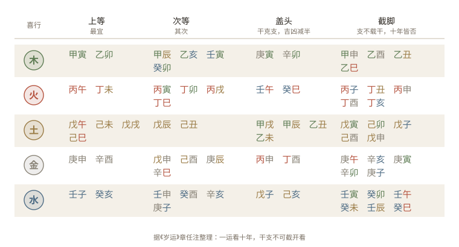

# 岁运

> 【原文】休囚系乎运，尤系乎岁，战冲视孰降，和好视孰切。

人的休咎与大运相关，更与流年相关；交战、相冲要看谁降服谁，和合、相好要看谁更切近。

> 【原注】日主譬如吾身，局中之神，譬之舟马引从之人，大运譬所到之地，故重地支，未尝无天干。太岁譬所遇之人，故重天干，未偿无地支。必先明一日主，配合七字，权其轻重，看喜行行何运，忌行何运。如甲日以气机看春，以人心看仁，以物理看木，大率看气机而余在其中。遇庚辛申酉字面，如春而行之于秋，新伐其生生这机，又看喜与不喜，而行运生甲伐甲之地，何断其休咎也。太岁一至，休咎即显，于是详论战冲和好之势，而得胜负适从之机，则休咎了然在目。

日主好比我自身，局中各神好比我的车船马匹和随从之人，大运好比我所到的地方，所以重地支，但也不是没有天干；太岁好比我所遇到的人，所以重天干，但也不是没有地支。必须先明了日主，配合其余七字，权衡轻重，看喜走什么运、忌走什么运。比如甲日，从气机看是春，从人心看是仁，从物理看是木，大体看气机而其余都在其中。遇庚辛申酉之类，就像春天而走到秋天，砍伐了它的生生之机；又要看喜与不喜，而行运是生甲还是伐甲之地，来断其吉凶。太岁一到，吉凶就显现了，于是详论战、冲、和、好之势，而得到胜负从违之机，吉凶就了然在目了。

（译注：“新伐”当作“斩伐”，“何断”当作“以断”。）

> 【任氏曰】富贵虽定乎格局，穷通实系乎运途，所命好不好运也。日主如我之身，局中喜神用神是我所用之人，运途乃我所临之地，故以地支为重。要天干不背，相生相扶为美，故一运看十年切勿上下截看，不可使盖头截脚。如上下截看，不论盖头截脚，则吉凶不验矣。

富贵虽由格局决定，穷通实在系于运途，所谓命好不如运好。日主好比我自身，局中的喜神用神是我所用之人，运途是我所到之地，所以以地支为重。要天干不相悖，相生相扶为美；所以一步运看十年，切勿上下截开来看，不可使其盖头、截脚。如果上下截开看，不论盖头截脚，吉凶就不应验了。

（译注：“所命好不好运也”当作“所谓命好不如运好也”。）

> 如喜行木运，必要甲寅乙卯，次则甲辰、乙亥、壬寅、癸卯：喜行火运，必要丙午丁未，次则丙寅、丁卯、丙戌、丁巳；喜行土运，必要戊午、己未戊戌、己巳，次则戊辰己丑；喜行金运，必要庚申辛酉，次则戌申、己酉、庚辰、辛巳；喜行水运，必要壬子癸亥，次则壬申、癸酉、辛亥、庚子。宁使天干生地支，弗使地支生天干；天干生地支而荫厚，地支生天干而气泄。

比如喜走木运，必要甲寅、乙卯，其次是甲辰、乙亥、壬寅、癸卯；喜走火运，必要丙午、丁未，其次是丙寅、丁卯、丙戌、丁巳；喜走土运，必要戊午、己未、戊戌、己巳，其次是戊辰、己丑；喜走金运，必要庚申、辛酉，其次是戊申、己酉、庚辰、辛巳；喜走水运，必要壬子、癸亥，其次是壬申、癸酉、辛亥、庚子。宁可天干生地支，不可地支生天干：天干生地支则荫厚，地支生天干则气泄。

> 何谓盖头？如喜木运而遇庚寅辛卯，喜火运而遇壬午癸巳，喜土运而遇甲戌、甲辰、乙丑、乙未，喜金运而遇丙申丁酉，喜水运而遇戊子己亥。何谓截脚？如喜木运而遇甲申、乙酉、乙丑、乙巳，喜火运而遇丙子、丁丑、丙申、丁酉、丁亥，喜土运而遇戊寅、乙卯、戊子、己酉、戊申，喜金运而遇庚午、辛亥、庚寅、辛卯、庚子，喜水运而遇壬寅、癸卯、壬午、癸未、壬辰、癸巳是也。

什么叫盖头？比如喜木运而遇庚寅、辛卯，喜火运而遇壬午、癸巳，喜土运而遇甲戌、甲辰、乙丑、乙未，喜金运而遇丙申、丁酉，喜水运而遇戊子、己亥。什么叫截脚？比如喜木运而遇甲申、乙酉、乙丑、乙巳，喜火运而遇丙子、丁丑、丙申、丁酉、丁亥，喜土运而遇戊寅、己卯、戊子、己酉、戊申，喜金运而遇庚午、辛亥、庚寅、辛卯、庚子，喜水运而遇壬寅、癸卯、壬午、癸未、壬辰、癸巳。

（译注：“乙卯”当作“己卯”。）

*图 61-1　大运干支的上等、次等、盖头与截脚。（译者补绘，原书无此图）*

> 盖干头喜支，运以重支，财吉凶减半；截脚脚喜干，支不载干，则十年皆否。假如喜行木运，而遇庚寅辛卯，庚辛酉为凶运，而金绝寅卯，谓之无根，虽有十分之凶，而减其半。如原局天干有丙丁透露，得回制之能，又减共半，或再遇太岁逢丙丁，制其庚辛，则无凶矣。寅卯本为吉运，因盖头有庚辛之克，虽有十分之吉，亦减其半。如原局地支有早点酉之冲，不但无吉，而反凶矣。

盖头是干克支：运以地支为重，则吉凶减半。截脚是支不载干，则十年都不好。比如喜走木运，而遇庚寅、辛卯：庚辛是凶，但金绝于寅卯，叫无根，虽有十分之凶，也减去一半；如果原局天干有丙丁透露，能回制庚辛，又减去一半；或者再遇太岁逢丙丁，制其庚辛，就无凶了。寅卯本是吉运，因为盖头有庚辛之克，虽有十分之吉，也减去一半；如果原局地支有申酉来冲，不但无吉，反而凶了。

（译注：“盖干头喜支”当作“盖头干克支”，“截脚脚喜干”当作“截脚支不载干”，“庚辛酉”当作“庚辛为”，“共半”当作“其半”，“早点酉”当作“申酉”。）

> 又如喜木运，遇甲申乙酉，木绝于申酉，谓之不载，故甲乙之运不吉。如原局天干又透庚辛，或太岁干头遇庚辛，必凶无疑所以十年皆凶。如原局天干透壬登，或太岁干头逢壬登，能泄金生木，则和平无凶矣。故运逢吉不见其吉，运逢凶不见其凶者，缘盖头截脚之故也。

又如喜木运，遇甲申、乙酉：木绝于申酉，叫不载，所以甲乙之运不吉。如果原局天干又透庚辛，或太岁天干遇庚辛，必凶无疑，所以十年都凶。如果原局天干透壬癸，或太岁天干逢壬癸，能泄金生木，就和平无凶了。所以运逢吉而不见其吉、运逢凶而不见其凶的，是盖头截脚的缘故。

（译注：“壬登”当作“壬癸”。）

> 太岁管一年否泰，如所遇之人，故以天干为重，然地支不可不究，虽有与神之生克，不可与日主运途之冲战。最凶者天克地冲，岁运冲克，日主旺相虽凶无碍，日主凶必罹凶咎。日犯岁君，日主旺相无咎，日主休囚必凶；岁君犯日，亦同此论，故太峧宜和，不可与大运一端论也。如运逢木吉，负逢木反凶者皆战冲不和之故也。依此而推 ，则吉凶无有不验矣。

太岁管一年的否泰，好比所遇之人，所以以天干为重；但地支也不可不究，虽与局中各神有生克，却不可与日主、运途相冲战。最凶的是天克地冲、岁运冲克：日主旺相，虽凶无碍；日主衰弱，必遭凶咎。日主冲犯岁君（太岁），日主旺相无咎，日主休囚必凶；岁君冲犯日主，也同此论。所以太岁宜和，不可与大运一样论。比如运逢木吉，而岁逢木反凶的，都是战冲不和的缘故。依此而推，吉凶无有不验。

（译注：“与神”当作“与局中之神”，“日主凶”当作“日主衰”，“太峧”当作“太岁”，“负逢木”当作“岁逢木”。）

> 【命例】庚辰 丁亥 庚辰 丁丑 ｜ 大运：戊子 己丑 庚寅 辛卯 壬辰 癸巳

> 庚辰日地，生于亥天干丁火并透，辰亥皆藏甲乙，足以用火。初运戊子己丑，晦火生金，未遂所愿。庚运丙午年，庚坐寅支截脚，天干两丁，足可敌一庚，又逢丙午年，捷。搒下知县，寅运官资颇丰；辛卯截脚，局中丁火回克，仕至郡守；壬辰水生库根，笃壬申年，两丁皆伤，不禄。

庚辰日主，生在亥月，天干丁火并透，辰、亥都藏甲乙，足以用火。初运戊子、己丑，晦火生金，未遂所愿。庚运丙午年：庚坐寅支，是截脚，天干两个丁足以敌一个庚，又逢丙午年，考中进士，榜下即用为知县；寅运宦资颇丰；辛卯运截脚，局中丁火回克，官至知府；壬辰运，水生库根，又逢壬申年，两个丁火都受伤，去世。

（译注：“日地”当作“日元”，“搒下”当作“榜下”，“笃壬申年”当作“又逢壬申年”。）

> 【命例】乙未 戊子 庚辰 丁丑 ｜ 大运：丁亥 丙戌 乙酉 甲申 癸未 壬午

> 庚辰日无，生于子月，未土破子水，天干木火，皆得辰未之余气，足以用木生火。丙运入泮。癸酉年行乙运，癸合戊化火，酉是丁火长生，均以此年必中，殊不知乙酉截脚之木，非木也；实金也。癸酉年水逢金生，又在冬令，焉能合戊化火？必克丁火无疑酉中纯金，乃火之死地，阴火长生之说，俗传之谬也；恐今八月又建辛酉，局中木火皆伤，防生不测之灾。竟卒于省中。

庚辰日主，生在子月；未土破子水，天干木火都得辰、未的余气，足以用木生火。丙运入学。癸酉年走乙运，人们都说癸合戊化火，酉是丁火长生，认为这年必中；殊不知乙酉是截脚之木，不是木，实际是金。癸酉年水逢金生，又在冬令，怎么能合戊化火？必定克丁火无疑。酉中纯是金，是火的死地；阴火长生于酉之说，是俗传的谬误。我说恐怕今年八月又建辛酉，局中木火都受伤，要防有不测之灾。结果竟然死在省城考场中。

（译注：“日无”当作“日元”，“均以”当作“均谓”，“恐今八月”当作“恐今年八月”。）

> 【命例】戊子 乙卯 丙寅 丁酉 ｜ 大运：丙辰 丁巳 戊午 己未 庚申 辛酉

> 丙寅日元，生于卯月，木焱工旺，土金皆伤，水亦休囚。细运丙辰丁巳，遗业消靡戊午己未燥土，不能生金泄炎，经营亏空万金，逃出外方；交庚申辛酉二十上，竟获居奇之利，发财十余万。

丙寅日主，生在卯月，木火都旺，土金都伤，水也休囚。初运丙辰、丁巳，遗业消散；戊午、己未燥土，不能生金泄火，经营亏空万金，逃往外地；交庚申、辛酉二十年，竟然获得囤积居奇之利，发财十余万。

（译注：“木焱工旺”当作“木火并旺”，“细运”当作“初运”，“二十上”当作“二十年”。）

> 【命例】丙申 癸巳 丙午 甲午 ｜ 大运：甲午 乙未 丙申 丁酉 戊戌 己亥

> 丙午日元，生于巳月午时，群比争财，逼干癸水。初运甲午刃劫猖狂，父母早亡；乙未助刃家业败尽；交丙申丁酉，贫乏不堪，交戊戌稍能立脚。

丙午日主，生在巳月午时，群比争财，逼干癸水。初运甲午，刃劫猖狂，父母早亡；乙未运助刃，家业败尽；交丙申、丁酉，贫乏不堪；交戊戌，才稍能立足。

> 【原文】何为战？

什么叫战？

> 【原注】如丙运庚年，谓之运伐岁。若日主喜庚，要丙降，得戊得丙者吉；日主喜丙，则岁不降运，得戊巳以和为妙。如庚坐寅午丙之力量大，则岁亦不得不降，降之亦保无祸，庚运丙年，谓之岁代运，日主喜庚，得戊己以和丙者吉；日主喜丙，则运不降岁，又不可用戊巳泄丙助庚。若庚坐寅午丙之力量大，则运自降岁，亦保无患 。

比如丙运庚年，叫运伐岁。如果日主喜庚，要丙火降服，得戊（己）、得壬的吉；日主喜丙，则岁不降服运，得戊己来和解为妙。如果庚坐寅午，丙火的力量大，岁就不得不降服，降服了也保无祸。庚运丙年，叫岁伐运：日主喜庚，得戊己来和解丙的吉；日主喜丙，则运不降服岁，又不可用戊己泄丙助庚。如果庚坐寅午，丙火的力量大，运自然降服于岁，也保无患。

（译注：原注讹字较多，如“得戊得丙”当作“得戊得壬”，“戊巳”当作“戊己”，“岁代运”当作“岁伐运”。）

> 【任氏曰】战者克也。如丙运庚处，谓之运克岁，日主喜庚，要丙坐子辰，庚坐申辰，又局中得戊己泄丙，得壬癸克丙则吉：如丙午寅，局中又无水土制化，必凶，如庚运丙年，谓之岁克运，日主喜庚则凶，喜丙则吉；喜庚者要庚坐申辰，丙坐子辰；又局中逢不土制化者吉，反此必凶，喜丙者依此而推。

战就是克。比如丙运庚年，叫运克岁：日主喜庚，要丙坐子辰，庚坐申辰，又局中得戊己泄丙、得壬癸克丙就吉；如果丙坐午寅，局中又没有水土制化，必凶。比如庚运丙年，叫岁克运：日主喜庚就凶，喜丙就吉。喜庚的，要庚坐申辰，丙坐子辰，又局中逢水土制化的吉，反之必凶。喜丙的依此而推。

（译注：“庚处”当作“庚年”，“如丙午寅”当作“如丙坐午寅”，“逢不土”当作“逢水土”。）

> 【命例】辛卯 甲午 丙辰 庚寅 ｜ 大运：癸巳 壬辰 辛卯 庚寅 己丑 戊子

> 丙火生于午月，旺刃当权，支全寅、卯、辰、土从木类，庚辛两不通根，初交癸己壬辰，金逢生助，家业饶裕，其乐自如：辛卯金截脚，刑丧破耗，家业十败八九。忍受运丙寅年克妻，庚坐寅支截脚，丙寅岁克运，又庚绝丙生，局中无制化之神，地甲午月木从火势，凶祸连绵，得疾而亡。

丙火生在午月，旺刃当权，地支全寅、卯、辰，土从木类，庚辛两字都不通根。初交癸巳、壬辰，金逢生助，家业富裕，其乐自如；辛卯运金截脚，刑丧破耗，家业十败八九。到庚运丙寅年，克妻；庚坐寅支是截脚，丙寅年岁克运，又庚绝丙生，局中没有制化之神，又逢甲午月木从火势，凶祸连绵，得病而亡。

（译注：“癸己”当作“癸巳”，“忍受运”当作“至庚运”，“地甲午月”当作“又逢甲午月”。）

> 【命例】辛卯 甲午 乙卯 乙酉 ｜ 大运：癸巳 壬辰 辛卯 庚寅 己丑 戊子

> 乙木生于午月，卯酉紧冲日禄，月干甲木临绝，五行无水，夏火当权泄气，伤官用劫，所忌者金。初运壬辰癸巳，印透生扶，平顺之境；辛卯运，惟辛酉年冲去卯木，刑丧克破；至庚运丙寅年，所忌者金，而丙火克去之，局中无土水泄制丙火，又炎逢生，金坐绝，入泮，得舒眉曲也。

乙木生在午月，卯酉紧冲日禄，月干甲木临绝，五行无水，夏火当权泄气，伤官用劫，所忌的是金。初运壬辰、癸巳，印透生扶，平顺之境；辛卯运，只有辛酉年冲去卯木，刑丧破耗；到庚运丙寅年，所忌的是金，而丙火克去了它，局中又没有土水来泄制丙火，又火逢生、金坐绝，考中秀才，得以舒展眉头。

（译注：“又炎逢生”当作“又火逢生”。）

> 【原文】何为冲？

什么叫冲？

> 【原注】如子运午年，谓这运冲岁，日主喜了，则要助子，又得年之干头，遇制午之神，或午之党多，干头遇戊甲字者必凶。如午运子年，谓这岁冲运，日主喜午而子之党多，干头助子者必凶；日主喜子，而午之党少，干头助子者必吉，若午重子轻，则岁不降，亦无咎。

比如子运午年，叫运冲岁。日主喜子，就要助子，又得流年的天干遇制午之神；如果午的党羽多，天干又遇戊、甲之类，必凶。比如午运子年，叫岁冲运：日主喜午而子的党羽多，天干又助子的，必凶；日主喜子，而午的党羽少，天干又助子的，必吉。如果午重子轻，岁不能降服运，也无咎。

（译注：“这”当作“之”，“喜了”当作“喜子”。）

> 【任氏曰】冲进破也。如子运午运，谓之运冲岁。日主喜子，要干关逢庚壬，之进之干头逢甲丙，亦无咎；如子之干头遇丙戊，午这干头遇庚壬，亦有咎，日主喜午，子之干头逢甲戊，午这干头遇甲丙，则吉；如子这干头遇庚壬，午之头遇甲丙，则凶。如午运子年谓这岁冲运，日主喜午要午之干头逢丙戊，子之干头遇甲丙，则吉；如午之干头遇丙戊，子之头遇庚壬，九凶。可类推。

冲就是破。比如子运午年，叫运冲岁：日主喜子，要子的天干逢庚、壬，午的天干逢甲、丙，也无咎（？）；如果子的天干遇丙、戊，午的天干遇庚、壬，也有咎（？）。日主喜午，子的天干逢甲、戊，午的天干遇甲、丙，就吉；如果子的天干遇庚、壬，午的天干遇甲、丙，就凶（？）。比如午运子年，叫岁冲运：日主喜午，要午的天干逢丙、戊，子的天干遇甲、丙，就吉；如果午的天干遇丙、戊，子的天干遇庚、壬，就凶。其余可以类推。

（译注：本段底本讹字甚多，如“冲进破”“干关”“之进之干头”“九凶”等，各条件的吉凶判断亦有互相矛盾处，照原文大意译出，并以“？”标存疑。）

> 【原文】何为和？

什么叫和？

> 【原注】如乙运庚处、庚运乙则和，日主喜金则喜，日主喜木则不吉；子运丑年，丑运子年，日主喜顤早吉，喜水则不吉。

比如乙运庚年、庚运乙年，就是和：日主喜金就喜，日主喜木就不吉。子运丑年、丑运子年：日主喜土就吉，喜水就不吉。

（译注：“庚处”当作“庚年”，“喜顤早吉”当作“喜土则吉”。）

> 【任氏曰】和者合也。如乙运庚处，庚运乙年，合而能化，喜金则吉，合而不化，反为羁绊，不顾日主之喜我，则不吉矣。喜庚亦然，所以喜庚乾必要木金得地，乙木无根，则合要化为美矣。若子丑之合，不化亦是克不，喜水者必不吉也。

和就是合。比如乙运庚年、庚运乙年：合而能化，喜金的吉；合而不化，反成羁绊，不顾日主对它的喜爱，就不吉了。喜庚也是这样，所以喜庚的，必须木金得地；乙木无根，合才能化为美。至于子丑之合，不化也是克水，喜水的必不吉。

（译注：“喜庚乾”当作“喜庚者”，“克不”当作“克水”。）

> 【原文】何为好？

什么叫好？

> 【原注】如庚运辛年，辛运庚年，申支酉年，酉支申年，则好。日主喜阳，则庚与申为好；喜阴，则辛与酉为好。凡此皆宜类推。

比如庚运辛年、辛运庚年，申运酉年、酉运申年，就是好。日主喜阳，庚与申为好；喜阴，辛与酉为好。凡此都宜类推。

（译注：“申支酉年，酉支申年”当作“申运酉年，酉运申年”。）

> 【任氏曰】好者，类相同也。如庚运申年，辛运酉年，是为真好，乃支之禄旺，自我本气归垣，如家室之可住。如庚运辛年，辛运庚年，乃天干之助，如朋友之帮扶，究竟不甚关切，必先要量运通根，自然依附为好；如运无根气，其风见势衰而无依附之情非为好也。

好，是同类相同。比如庚运申年、辛运酉年，是真好，是地支的禄旺，是我本气归垣，就像有家室可住。比如庚运辛年、辛运庚年，是天干相助，就像朋友帮扶，终究不太关切；必须先要大运通根，自然依附为好；如果大运无根气，那就见势衰而无依附之情，不能算好。

（译注：“量运”当作“运”，“其风”当作“其”。）
