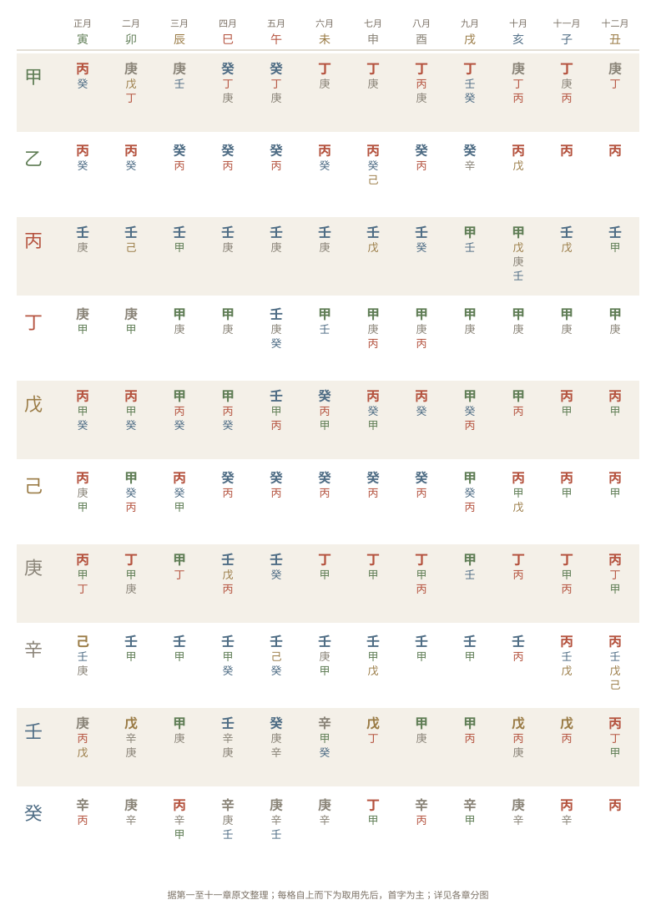

# 五行总论

> 五行者，本乎天地之间而不穷者也，故谓之行。

五行，是本于天地之间、运行不息而无穷尽的东西，所以叫作“行”。

> 北方阴极而生寒，寒生水。南方阳极而生热，热生火。东方阳散以泄而生风，风生木。西方阴止以收而生燥，燥生金。中央阴阳交而生温，温生土。其相生也所以相维，其相克也所以相制，此之谓有伦。

北方阴气到了极点而生寒，寒生水；南方阳气到了极点而生热，热生火；东方阳气散发宣泄而生风，风生木；西方阴气收止而生燥，燥生金；中央阴阳相交而生温，温生土。五行相生，是为了相互维系；相克，是为了相互制约，这就叫“有伦”（有秩序）。

> 火为太阳，性炎上。水为太阴，性润下。木为少阳，性腾上而无所止。金为少阴，性沉下而有所止。土无常性，视四时所乘，欲使相济得所，勿令太过弗及。

火是太阳，性质向上燃烧；水是太阴，性质向下滋润；木是少阳，性质向上生长而没有止境；金是少阴，性质向下沉降而有所止；土没有固定的性质，要看它在四季中所依附的时令，使各行相互调剂、各得其所，不要太过，也不要不足。

> 夫五行之性，各致其用。水者其性智，火者其性礼，木其性仁，金其性义，惟土主信，重宽厚博，无所不容：以之水，即水附之而行；以之木，则木托之而生；金不得土，则无自出；火不得土，则无自归。必损实以为通，致虚以为明，故五行皆赖土也。

五行的性质，各有各的作用。水的性情主智，火主礼，木主仁，金主义，只有土主信，厚重宽广、无所不容：放上水，水就依附它而流行；栽上木，木就托身于它而生长；金没有土，就无从产生；火没有土，就无处归藏。土必须减损自身的实以求通达，保持虚空以求明亮，所以五行都依赖土。

> 推其形色，则水黑、火赤、木青、土黄，此正色也。及其变易，则不然。常以生旺从正色，死绝从母色，成形冠带从妻色，病败从鬼色，旺墓从子色。

推究五行的颜色：水黑、火红、木青、土黄（金白），这是正色。到了变化的时候就不一样了：一般生旺时用正色，死绝时用生我者（母）的颜色，成形冠带时用我所克者（妻）的颜色，病败时用克我者（鬼）的颜色，旺墓时用我所生者（子）的颜色。

> 其数则水一、火二、木三、金四、土五。 生旺加倍，死绝减半。

五行的数：水一、火二、木三、金四、土五。生旺时加倍，死绝时减半。

> 以义推之，夫万物负阴而抱阳，冲气以和。过与不及，皆为乖道。故高者抑之使平，下者举之使崇，或益其不及，或损其太过。所以贵在折衷，归於中道，使无有余不足之累，即才官印食贵人驿马之微意也。行运亦如之，识其微意，则於命理之说，思过半矣。

按道理推究：万物背负着阴、怀抱着阳，以冲和之气达到和谐。太过和不及，都是违背常道的。所以高的要压低使之平，低的要抬高使之升，或者补其不足，或者损其太过。可贵的是折中，回归中道，使它没有有余或不足的牵累——这也就是财、官、印、食、贵人、驿马这些说法的精微用意。行运也是这样。懂得了这层用意，对于命理之学，也就明白一大半了。

（译注：本书讲“调候”，即根据日主生月的寒暖燥湿来取用神，核心思想就是这里所说的“折衷”“中道”。）

*图 0-1　十干十二月调候用神总表：汇总后面各章所列用神，便于查阅；“调候”就是按生月寒暖燥湿取用。（译者补绘，原书无此图）*
