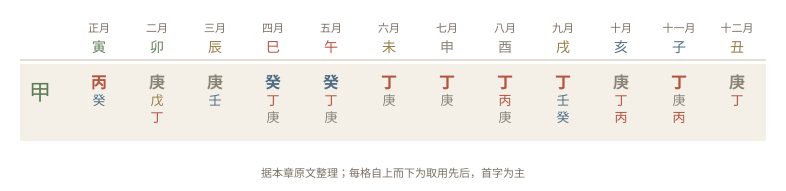
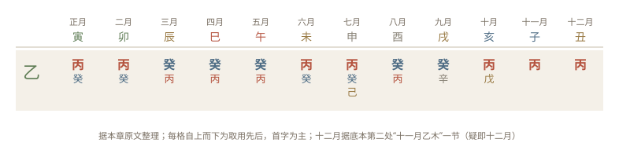

# 论木

> 木性腾上而无所止，气重则欲金任使，有金则有惟高惟敛之德。仍爱土重，则根蟠深固，土少则有枝茂根危之患。木赖水生，少则滋润，多则漂流。

木的性质是向上生长而没有止境；木气重时就需要金来修剪任用，有了金，就有既能高大又能收敛的品德。木还喜欢土厚，土厚则根盘得深而稳固；土少就有枝叶茂盛而根基危险的忧患。木依赖水来生，水少能滋润，水多就漂流。

> 甲戌、乙亥、木之源。甲寅、乙卯、木之乡。甲辰、乙巳、木之生。皆活木也。甲申、乙酉、木受克。甲午、乙未、木自死。甲子、乙丑、金克木。皆死木也。

甲戌、乙亥，是木的源头；甲寅、乙卯，是木的家乡；甲辰、乙巳，是木的生长——这些都是活木。甲申、乙酉，是木受克；甲午、乙未，是木自死；甲子、乙丑，是金克木——这些都是死木。

> 生木得火而秀，丙丁相同。死木得金而造，庚辛必利。生木见金自伤，死木得火自焚，无风自止，其势乱也。遇水返化其源，其势尽也。

活木遇火就秀发，丙火、丁火作用相同；死木遇金就能被造成器物，庚辛金必定有利。活木见金就自受损伤，死木遇火就自己焚烧——没有风也会自己熄灭，是因为它的气势已乱；遇到水反而回到它的源头（水生木），是因为它的气势已尽。

> 金木相等，格谓斲轮。若向秋生，反为伤斧，是秋生忌金重也。

金与木力量相当，这种格局叫“斲轮”（砍削成车轮，喻成器）。如果生在秋天，反而成了“伤斧”（被斧头砍伤），这是说秋生的木忌金太重。

> 木生於春，余寒犹存。喜火温暖，则无盘屈之患。藉水资扶，而有舒畅之美。春初不宜水盛，阴浓则根损枝枯。春木阳气烦燥，无水则叶槁根枯。是以水火二物，既济方佳。

木生在春天，残余的寒气还在。喜欢有火来温暖，就不会有盘曲难伸的毛病；借助水来滋养扶持，就有舒展畅茂之美。初春不宜水多，阴气太重就会根伤枝枯；春木阳气燥热时，没有水就会叶枯根槁。所以水与火两样东西，相互调剂才好。

> 土多而损力，土薄则财丰。忌逢金重伤残克伐，一生不闲。设使木旺，得金则良，终生获福。

（春木）土多就会耗损力量，土薄则财丰。忌讳遇到金重，被伤残克伐，一生不得清闲。假如木旺，得到金就好，一生享福。

> 夏月之木，根乾叶燥，盘而且直，屈而能伸。欲得水盛而成滋润之力，诚不可少。切忌火旺而招焚化之忧，故以为凶。

夏天的木，根干叶燥，枝干盘曲而又挺直，能屈能伸。需要水多来形成滋润之力，这是不可缺少的；最忌火旺，会招来焚烧化灰的忧患，所以为凶。

> 土宜在薄，不可厚重，厚则反为灾咎。恶金在多，不可欠缺，缺则不能琢削。重重见木，徒以成林，叠叠逢华，终无结果。

（夏木）土宜薄，不可厚重，厚了反而招灾；金不喜多，但也不可缺少，缺了就不能雕琢修削。木重重叠叠，只是长成一片树林；花开层层叠叠，终究结不出果实。

> 秋月之木，气渐凄凉，形渐凋败。初秋之时，火气未除，尤喜水土以相滋。中秋之令，果以成实，欲得刚金而修削。霜降後不宜水盛，水盛则木漂。寒露节又喜火炎，火炎则木实。木多有多材之美，土厚无自任之能。

秋天的木，气渐渐凄凉，形渐渐凋零。初秋时火气还没有退尽，尤其喜欢水和土来滋养；中秋时果实已经长成，需要刚金来修剪；霜降以后不宜水多，水多木就漂浮；寒露时节又喜欢火旺，火旺则木结实。木多有成材之美，土太厚则木没有自我担当的能力。

> 冬月之木，盘屈在地，欲土多而培养。恶水盛而忘形。金总多不能克伐。火重见温暖有功。归根复命之时。木病安能辅助，须忌死绝之地，只宜生旺之方。

冬天的木，盘屈在地下，需要土多来培养；讨厌水多而使木失去形体；金即使多，也不能克伐它；火多则有温暖之功。这是木归根复命的时候。木正在病中，怎么能去辅助别的？必须忌讳死绝之地，只适宜生旺之方。

## 三春甲木总论

春季三个月的甲木（总论）

> 春月之木，渐有生长之象。初春犹有余寒，当以火温暖，则有舒畅之美，水多变克，有损精神。重见生旺，必用庚金斲凿，可成楝梁。春末阳壮水渴，藉水资扶，则花繁叶茂。

春天的木，渐渐有了生长的气象。初春还有余寒，应当用火来温暖，就有舒展之美；水多反而成克，有损精神。木若重见生旺，必须用庚金来砍凿，才能成为栋梁。春末阳气壮盛而水分缺乏，借水来滋养扶持，就花繁叶茂。

> 初春无火，增之以水，则阴浓气弱，根损枝枯，不能华秀。春末失水，增之以火，则阳气太盛，燥渴相加，枝枯叶乾，亦不华秀。是以水火二物，要得时相济为美。

初春没有火，再添上水，就阴气浓重而阳气衰弱，根伤枝枯，不能开花秀发；春末缺水，再添上火，就阳气太盛，燥热干渴交加，枝枯叶干，也不能开花秀发。所以水火两样东西，要适时相互调剂才美。

## 三春甲木

春季的甲木

> 正月甲木，初春尚有余寒，得丙癸逢，富贵双全。癸藏丙透，名寒木向阳，主大富贵。倘风水不及，亦不失儒林俊秀。如无丙癸，平常人也。

正月的甲木，初春还有余寒，能遇到丙火、癸水，就富贵双全。癸水藏于地支而丙火透出天干，叫“寒木向阳”，主大富大贵；即使风水不够好，也不失为读书人中的俊秀之才。如果没有丙、癸，就是平常人。

> 正二月甲木，素无取从才从杀从化之理。或一派庚辛，主一生劳苦，克子刑妻，再支会金局，非贫即夭。如无丙丁，一派壬癸，又无戊己制之，名水泛木浮，死无棺椁。

正月、二月的甲木，向来没有取从财、从杀、从化格的道理。如果满局都是庚辛金，主一生劳苦，克子刑妻；地支再会成金局，不是贫穷就是短命。如果没有丙丁火，满局都是壬癸水，又没有戊己土来制，叫“水泛木浮”，死无棺椁。

> 如一派戊己，支会金局，为财多身弱，富屋贫人，终生劳苦，妻晚子迟。或无庚金，有丁透，亦属文星，为木火通明之象，又名伤官生财格，主聪明雅秀。

如果满局都是戊己土，地支又会成金局，就是财多身弱，好比住在富人家的穷人，一生劳苦，娶妻晚、得子迟。如果没有庚金而透出丁火，也属文星，是“木火通明”之象，又叫“伤官生财格”，主聪明文雅秀气。

> 一见癸水伤丁，但作厚道迂儒。或柱中多癸，滋助木神，伤灭丁火，其人奸雄枭险，曹操之徒，言清行浊，笑里藏刀。

（丁火透出时）一见癸水伤丁，就只是个厚道迂腐的读书人。如果柱中癸水多，滋助木气、伤灭丁火，这人就是奸雄阴险之辈，曹操一类人物，说得清高、做得浑浊，笑里藏刀。

> 若庚申、戊寅、甲寅、丙寅。一行金水运，发进士。或甲午日庚午时，此人必贵。但要好运相催，不宜制了庚丁。

比如庚申、戊寅、甲寅、丙寅这个命，一走金水运，就考中进士。又如甲午日、庚午时，这人必定贵。只是要有好运来推动，不宜把庚、丁制住。

> 或支成金局，多透庚辛，此又不吉，号曰木被金伤，若无丙丁破金，必主残疾。或支成火局，泄露太过，定主愚懦，常有啾唧灾病缠身，终有暗疾。

如果地支成金局、天干多透庚辛，这又不吉，叫“木被金伤”；如果没有丙丁火来破金，必主残疾。如果地支成火局，泄气太过，必主愚钝懦弱，常有小病小灾缠身，终有隐疾。

> 支成木局，得庚为贵，无庚必凶，若非僧道，男主鳏孤，女主寡独。支成水局，戊透为贵，如无戊制，不但贫贱，且死无棺木。故书曰：甲木若无根，全赖申子辰，干得才杀透，平步上青云。

地支成木局，得庚金为贵，没有庚金必凶，若不是出家为僧道，男命主鳏寡孤独，女命主守寡孤独。地支成水局，透出戊土为贵；如果没有戊土来制，不但贫贱，而且死无棺木。所以书上说：“甲木若无根，全赖申子辰，干得财杀透，平步上青云。”

> 凡三春甲木，用庚者，土为妻，金为子。用丁者，木为妻，火为子。

凡是春季的甲木，用庚金的，以土为妻、金为子；用丁火的，以木为妻、火为子。

（译注：本书论六亲以用神为子、生用神者为妻，与《子平真诠》以财为妻、官煞为子的方法不同。）

> 总之正二月甲木，有庚戊者上命。如有丁透，大富大贵之命也。

总之，正月、二月的甲木，有庚、戊的是上等之命；如果再透出丁火，就是大富大贵之命。

> 二月甲木，庚金得所，名阳刃驾杀，可云小贵，异途显达，或主武职，但要财资之。柱中逢才，英雄独压万人。若见癸水，困了才杀，主为光棍，重刃必定遭凶。性情凶暴。

二月的甲木（月令卯为阳刃），庚金得到合适的位置，叫“阳刃驾杀”，可以说是小贵，从科举以外的途径显达，或者主武职，但要有财来资助。柱中遇到财，就是英雄独压万人。如果见到癸水，困住了财和杀，就主为无赖之徒；阳刃重叠必定遭凶，性情凶暴。

> 书曰：木旺宜火之光辉，秋闱可试。木向春生，处世安然有寿。日主无依，却喜运行才地。

书上说：木旺宜有火的光辉，可以去参加乡试；木生于春天，处世安然而长寿；日主无所依靠时，却喜欢大运走财地。

> 三月甲木，木气相竭。先取庚金，次用壬水。庚壬两透，一榜堪图。但要运用相生，风水阴德，方许富贵。

三月的甲木，木气渐渐衰竭。先取庚金，次用壬水。庚、壬都透出，可以考中一榜（举人）。但要大运与用神相生，再加上风水和阴德，才能富贵。

> 或见一二庚金，独取壬水。壬透清秀之人，才学必富。

如果见到一两个庚金，就单取壬水。壬水透出，是清秀之人，才学必定丰富。

> 或天干透出二丙，庚藏支下，此钝斧无钢，富贵难求。若有壬癸破火，堪作秀才。

如果天干透出两个丙火，庚金藏在地支下，这是钝斧没有钢刃，富贵难求。如果有壬癸水来破火，可以做个秀才。

> 或柱中全无一水，戊己透干，支成土局，又作弃命从才，因人而致富贵，妻子有能。

如果柱中完全没有一点水，戊己土透出天干，地支又成土局，就作弃命从财看，靠别人而得富贵，妻子能干。

> 或见戊己，及比劫多者，名为杂气夺才，此人劳碌到老，无驭内之权。女命合此，女掌男权，贤能内助，若比劫重见，淫恶不堪。

如果见到戊己土，而比劫又多，叫“杂气夺财”，这人劳碌到老，在家中没有当家的权力。女命遇到这种情况，是女人掌男人的权，是贤能的内助；如果比劫重重出现，就淫恶不堪。

> 或支成金局，方可用丁，不然，三月无用丁之法。惟有先庚後壬取用。

如果地支成金局，才可以用丁火；不然的话，三月甲木没有用丁火的道理，只有先庚后壬来取用。

> 书曰：甲乙生寅卯，庚辛干上逢，离南推富贵，坎地却为凶。

书上说：“甲乙生寅卯，庚辛干上逢，离南推富贵，坎地却为凶。”（甲乙木生在寅卯月，天干又遇庚辛金，大运走南方火地可推富贵，走北方水地却凶。）

## 三夏甲木

夏季的甲木

> 四月甲木退气，丙火司权，先癸後丁。

四月的甲木，气已衰退，丙火当权，取用先癸水，后丁火。

> 庚金太多，甲反受病。若得壬水，方配得中和，此人性好清高，假装富贵。即荫袭显达，终日好作祸乱，善辨巧谈，喜作诗文。此理最验。

庚金太多，甲木反而受病；如果得到壬水，才配得中和。这人性好清高，装出富贵的样子；即使凭祖荫显达，也终日喜欢惹是生非，能言善辩，喜作诗文。这个道理最灵验。

> 如一庚二丙，稍有富贵。金多火多，又为下格。

如果是一个庚金、两个丙火，稍有富贵；金多火也多，又是下格。

> 或癸丁与庚齐透天干，此命可言科甲，即风水浅薄，亦有选拔之才。癸水不出，虽有庚金丁火，不过富中取贵异途官职而已。壬透可云一富，若全无点水，又无庚金丁火，一派丙戊，此无用之人也。

如果癸、丁与庚都透出天干，这个命可以说能考取功名，即使风水浅薄，也有被选拔的才能。癸水不透，虽然有庚金丁火，也不过是在富中取贵，从科举以外的途径做官而已。透出壬水，可以说是个富人。如果完全没有一点水，又没有庚金丁火，满局都是丙戊，这就是无用之人。

> 五六月甲木，木性虚焦，一理共推。五月先癸後丁庚金次之。六月三伏生寒，丁火退气。先丁後庚，无癸亦可。或五月乏癸，用丁亦可，要运行北地为隹。

五月、六月的甲木，木性虚弱焦枯，可以用同一个道理来推。五月先用癸水，后用丁火，庚金次之。六月三伏天阴气已生，丁火退气，先丁后庚，没有癸水也可以。如果五月缺癸水，用丁火也可以，但要大运走北方水地才好。

（译注：“为隹”当作“为佳”。）

> 总之五六月用丁火，虽运行北地，不致於死。却不利运行火地，号曰木化成灰必死。行西程又不吉，号曰伤官遇杀，不测灾来，惟东方则吉，北方次之。此五六月用丁之说也。

总之，五六月甲木用丁火的，即使大运走北方，也不至于死；却不利走火地，叫“木化成灰”，必死；走西方金地又不吉，叫“伤官遇杀”，会有不测之灾。只有东方木地吉，北方次之。这是五六月用丁火的说法。

> 凡用神太多，不宜克制，须泄之为妙。

凡是用神太多，不宜去克制它，要泄它的气才妙。

> 五六月甲木，木盛先庚，庚盛先丁。五月癸庚两透，为上上之格。六月庚丁两透，亦为上上之格。用神既透，木火通明，自然大富大贵。或丁火太多，癸水亦多，反作平人。

五六月的甲木：木盛的先用庚金，庚金盛的先用丁火。五月癸、庚都透出，是上上之格；六月庚、丁都透出，也是上上之格。用神透出，木火通明，自然大富大贵。如果丁火太多、癸水也多，反而是平常人。

> 若柱中多金，名曰杀重身轻，先富後贫，运不相扶，非贫即夭。或庚多，有一二丙丁制伏，又有壬癸透干，泄金之气，此又为先贫後富。

如果柱中金多，叫“杀重身轻”，先富后贫；大运再不相扶，不是贫穷就是短命。如果庚金多，有一两个丙丁火来制伏，又有壬癸水透干泄金之气，这又是先贫后富。

> 或满柱丙火，又加丁火，不见官杀，谓之伤官伤尽最为奇，反成清贵，定主才学过人，科甲有望，但岁运不宜见水。若柱中有壬水，运又逢水，必贫夭死。

如果满柱都是丙火，再加上丁火，不见官杀，叫作“伤官伤尽最为奇”，反而成为清贵之命，必主才学过人，科举有望；但岁运不宜见水。如果柱中有壬水，大运又遇水，必定贫穷短命。

> 但凡木火伤官者，聪明智巧，却是人同心异，多见多疑，虽不生事害人，每抱忌妒之想，女命一理同推。

凡是木火伤官的人，聪明灵巧，却是面和心不和，见多疑多；虽然不惹事害人，常怀嫉妒之心。女命同理推论。

> 或四柱多土，干上有乙木，切勿作弃命从才。

如果四柱土多，天干上有乙木，切不可当作弃命从财。

> 时月两透己土，名二土争合，男主奔流，女主淫贱。见二甲则不争矣，亦属平庸之辈。或四柱有辰，干见二己二甲，此人名利双全，大富大贵。

时干、月干都透出己土，叫“二土争合”（两个己土争合一个甲木），男命主奔波流荡，女命主淫贱。如果见到两个甲木就不争了，也只是平庸之辈。如果四柱有辰，天干见两个己土、两个甲木，这人名利双全，大富大贵。

> 若在六月，见辰支，名为逢时化合格。以癸水为妻，丁火为子。若二己一甲争合。取支中比劫为用。以甲为用者，壬癸为妻，甲乙为子。其余用庚者，土妻金子。用丁者，木妻火子。女命以妻作夫，用作子。十干皆同。

如果生在六月，地支见辰，叫“逢时化合格”（甲己化土），以癸水为妻、丁火为子。如果是两个己土争合一个甲木，就取地支中的比劫为用。以甲木为用的，壬癸为妻，甲乙为子；其余用庚金的，土妻金子；用丁火的，木妻火子。女命把“妻”当作“夫”、把用神当作子女。十干都是这样。

> 或是己土，不见戊土，乃为假从，其人一生缩首，反畏妻子。若无印绶，一生贫苦。六月尤可，五月决不可。

如果只有己土而不见戊土，是“假从”，这人一生畏首畏尾，反而怕妻子；如果没有印绶，一生贫苦。六月还可以，五月绝对不行。

*图 1-1　甲木十二月调候用神：据本章各节原文整理。（译者补绘，原书无此图）*

## 三秋甲木总论

秋季三个月的甲木（总论）

> 三秋甲木，木性枯槁，金土乘旺，先丁後庚，丁庚两全，将甲造为画戟，七月甲堪为戟，非丁火不能造庚，非庚不能造甲，丁庚两透，科甲定然。

秋季的甲木，木性枯槁，金和土正旺，取用先丁后庚。丁、庚两全，就能把甲木造成画戟（兵器）。七月的甲木可以造成戟，因为没有丁火不能炼庚金，没有庚金不能造甲木；丁、庚都透出，必定科举及第。

> 庚禄居申，杀印相生，运行金水，身伴明君。或庚透无丁，一富而已，主为人操心太重，不能坐享。或丁透庚藏，亦主青衿小富。或庚多无丁，残疾之人若为僧道，灾厄可免。

庚金的禄在申，杀与印相生，大运走金水，就能侍奉明君身边。如果庚透出而没有丁火，只是个富人，主为人操心太重，不能坐享其成。如果丁透出而庚藏于地支，也主读书人小富。如果庚金多而没有丁火，是残疾之人；如果出家为僧道，灾厄可以免除。

> 或四柱庚旺，支内水多，不作弃命从杀。见土多可作从才而看。

如果四柱庚金旺，地支内水多，不作弃命从杀；见土多的，可以作从财看。

> 庚多无癸，而壬水多，戊己亦多，此则专用一点丁火，方可制金以养群土，此命大富。丁藏富小，不显。丁露定作富豪。得二丁，不坐死绝，必然富贵双全，即风水不及，亦可富中取贵，纳粟奏名。

庚金多而没有癸水，壬水多，戊己土也多，这就要专用一点丁火，才可以制金而养众土，这个命大富。丁火藏于地支，富就小，不显达；丁火露出，必定是富豪。得到两个丁火，又不坐死绝之地，必然富贵双全；即使风水不够，也可以在富中取贵，捐纳得官。

> 或癸叠叠制伏丁火，虽满腹文章，终难显达。得运行火土，破癸，略可假就功名，岁运皆背，刀笔之徒。

如果癸水重重叠叠制伏丁火，即使满腹文章，终难显达；大运走火土之地破去癸水，略可勉强取得功名；岁运都不顺的，只是个刀笔小吏。

> 支成水局，戊己透干，制去癸水，存其丁火又可云科甲，但此等命，主为人心奸巧诈，好讼争非，因贪致祸。奸险之徒，决非安份之人也。

地支成水局，戊己土透干，制去癸水、保住丁火，又可以说能考取功名。但这种命，主为人心术奸巧狡诈，好打官司、搬弄是非，因贪心而招祸，是奸险之徒，绝不是安分守己的人。

## 三秋甲木

秋季的甲木

> 七月甲木，丁火为尊，庚金次之，庚金不可少。火隔水不能熔金，故丁火熔金，必赖甲木引助，方成洪炉。若有癸水阻隔，便灭丁火，壬水无碍，且能合丁，但须见戊土，方可制水存火。

七月的甲木，以丁火为最重要，庚金次之，庚金不可缺少。火被水隔开就不能熔金，所以丁火熔金，必须依赖甲木引火相助，才能成为洪炉。如果有癸水阻隔，就会灭掉丁火；壬水没有妨碍，还能与丁相合，但必须见到戊土，才能制水而保住火。

> 八月甲木，木囚金旺。丁火为先，次用丙火，庚金再次。

八月的甲木，木处于囚、金正旺。以丁火为先，其次用丙火，再其次用庚金。

> 一丁一庚，科甲定显。癸水一透，科甲不全。

一个丁、一个庚，必定科举显达；癸水一透出，功名就不完整。

> 丙庚两透，富大贵小。丙丁全无，僧道之命。

丙、庚都透出，富大贵小；丙丁火全无，是僧道之命。

> 丙透无癸，富贵双全。有癸制丙，寻常之人。

丙火透出而没有癸水，富贵双全；有癸水制丙，是寻常之人。

> 支成火局，可许假贵，戊己一透，可作富翁。

地支成火局，可以说是假贵（凭虚名而贵）；戊己土一透出，可以成为富翁。

> 或支成金局，干露庚金，为木被金伤，必主残疾，得丙丁破金，亦主老来暗疾。

如果地支成金局，天干又露庚金，是“木被金伤”，必主残疾；得到丙丁火破金，也主老来有隐疾。

> 或支成木局，干透比劫，反取庚金为先，次用丁火。

如果地支成木局，天干又透比劫，反而要取庚金为先，次用丁火。

> 九月甲木，木星凋零，独爱丁火，壬癸滋扶，丁壬癸透，戊己亦透，此命配得中和，可许一榜。庚金得所，科甲定然。

九月的甲木，木气凋零，唯独喜爱丁火，又要壬癸水来滋养扶持。丁、壬、癸透出，戊己也透出，这个命配得中和，可以考中一榜；庚金也得到合适的位置，必定科举及第。

> 或见一二比肩，无庚金制之，平常人也。倘运不得用，贫无立锥。一命，甲辰、甲戌、甲辰、甲戌、身伴明君，富贵寿考，此为天元一气，又名一才一用。遇比用才，专取季土。或见庚丙，可许入泮，白手成家。用火者，木妻火子，子肖妻贤。

如果见到一两个比肩，又没有庚金来制，是平常人；倘若大运又不得用，就穷得无立锥之地。有一个命：甲辰、甲戌、甲辰、甲戌，侍奉明君身边，富贵长寿。这叫“天元一气”，又叫“一财一用”：遇比肩而用财，专取四季月的土。如果见到庚、丙，可以考中秀才，白手起家。用火的，木妻火子，子孝妻贤。

> 或四柱木多，用丙用丁，皆不足异，端用庚金为妙。凡四季甲木，总不外乎庚金。譬如木为犁，能疏季土，非庚金为犁嘴，安能疏土虽用丙丁，癸庚决不可少也。九月却不取土妻庚子，当取水妻木子。

如果四柱木多，用丙用丁都不稀奇，只有用庚金才妙。凡是四季月（辰戌丑未月）的甲木，总离不开庚金。好比木是犁，能疏松四季月的土，但没有庚金做犁头，怎么能疏土？即使用丙丁，癸水、庚金也绝不可少。九月却不取土妻庚子，应当取水妻木子。

> 凡甲木，多见戊己，定作弃命从才而看。从才格，取火妻土子。

凡是甲木多见戊己土的，一定作弃命从财来看。从财格，取火为妻、土为子。

> 或见一派丙丁伤金，不过假道斯文，有壬癸破了丙丁，技艺之流。无壬癸破火，支又成火局，乃为枯朽之木，有庚亦何能为力，定作孤贫下贱之辈，男女一理。

如果见到满局丙丁火伤金，不过是假装斯文；有壬癸水破了丙丁，是靠技艺谋生的人。没有壬癸来破火，地支又成火局，就是枯朽之木，有庚金又有什么用？必定是孤贫下贱之辈，男女同理。

> 或有假伤官，得地逢生，此正合甲乙秋生贵元武之说，用水制伤官者，以金为妻，水为子。

如果有假伤官（火），得地逢生，这正合“甲乙秋生贵玄武”的说法（秋天的甲乙木以水为贵）；用水来制伤官的，以金为妻、水为子。

（译注：“元武”即“玄武”，清代避康熙讳改，指北方水。）

> 或丁戊俱多，总不见水，又为伤官生财格，亦可云富贵，此格取火为妻，土为子。

如果丁火、戊土都多，完全不见水，又是伤官生财格，也可以说富贵；这种格取火为妻、土为子。

> 凡甲多庚透，大贵。庚藏，小贵。若柱中多庚，则又以丁为奇，富贵人也。如庚申年、丙戌月、甲申日、壬申时，此主功名显达，有文学。若无庚丙年月，又无火星出干，虽曰好学，终困名场。

凡是甲木多而庚金透出的，大贵；庚金藏于地支的，小贵。如果柱中庚金多，就又以丁火为奇妙，是富贵之人。比如庚申年、丙戌月、甲申日、壬申时，主功名显达，有文学才华。如果年月没有庚、丙，又没有火透出天干，虽说好学，终究困于科场。

> 九月甲木，端用丁癸，见戊透必贵。如戊戌、壬戌、甲子、甲申，支成水局，干有壬水，正合贵元武之说。配得中和，一榜之命，家计丰足。但庚丁未透出干，不能馆选。

九月的甲木，专用丁火、癸水，见戊土透出必贵。比如戊戌、壬戌、甲子、甲申，地支成水局，天干有壬水，正合“贵玄武”的说法，配得中和，是考中一榜的命，家境富足；但庚、丁没有透出天干，不能入翰林。

> 甲乙比肩，又逢比劫运，主兄弟劫财争讼，刑妻损子。甲乙生正二月，无制无泄，主长发师姑。

甲乙木比肩多，又遇比劫运，主兄弟争财打官司，刑妻损子。女命甲乙木生在正月、二月，没有制也没有泄，主做带发修行的尼姑。

## 三冬甲木

冬季的甲木

> 十月甲木，庚丁为要，丙火次之。忌壬水泛身，须戊土制之。

十月的甲木，以庚金、丁火为要，丙火次之。忌壬水泛滥淹没日主，必须有戊土来制。

> 若庚丁两透，又加戊出干，名曰去浊留清，富贵之极，即乏丁火，亦稍有富贵。或甲多制戊，庚金无根，平常人也。庚戊若透，虽出比劫，必定富而寿。

如果庚、丁都透出，再加上戊土透干，叫“去浊留清”，富贵到极点；即使缺丁火，也稍有富贵。如果甲木多而制住戊土，庚金又无根，是平常人。庚、戊如果透出，即使出现比劫，也必定富而长寿。

> 或多比劫，只一庚出干，坐禄逢生乃为舍丁从庚，略富贵。或支见申亥，戊己得所，以救庚丁，可许科甲。若单己透，其力弱小，不过贡监而已。

如果比劫多，只有一个庚金透出天干，坐禄逢生，这是舍丁火而从庚金，略有富贵。如果地支见申、亥，戊己土得到合适的位置来救庚、丁，可以考取功名。如果只透出己土，力量弱小，不过是个贡生、监生罢了。

> 用庚，土妻金子。用丁，木妻火子。

用庚金的，土妻金子；用丁火的，木妻火子。

> 十一月甲木，木性生寒，丁先庚後，丙火佐之。癸水司权，为火金之病。庚丁两透，支见巳寅，科甲有准，风水不及，选拔有之。若癸透伤丁。无戊己辅救，残疾之人。或壬水重出，丁火全无者，庸人也，得丙方妙。

十一月的甲木，木性寒冷，先丁后庚，丙火辅佐。癸水当权，是火、金的病。庚、丁都透出，地支见巳、寅，科举有准；风水不够，也能被选拔。如果癸水透出伤丁，又没有戊己土来辅救，是残疾之人。如果壬水重重透出，丁火全无，是庸人；得到丙火才妙。

> 或支成水局，加以壬透，名为水泛木浮，死无棺木。

如果地支成水局，再加上壬水透出，叫“水泛木浮”，死无棺木。

> 总之十一月甲木，为寒枝，不比春木清茂，端取庚丁。透壬无丙，不过刀笔异途，武职有验。

总之，十一月的甲木是寒冷的枝条，比不上春木清新茂盛，专取庚、丁。透出壬水而没有丙火，不过是刀笔小吏或从科举以外的途径出身，做武职倒有应验。

> 用庚，土妻金子。用火，木妻火子。

用庚金的，土妻金子；用火的，木妻火子。

> 十二月甲木，天寒气冻，木性极寒，无生发之象，先用庚劈甲，方引丁火始得木火有通明之象，故丁次之。

十二月的甲木，天寒地冻，木性极寒，没有生发的气象。先用庚金劈开甲木，才能引燃丁火，木火才有通明之象，所以丁火次之。

> 庚丁两透，科甲恩封。庚透丁藏，小贵。丁透庚藏，小富贵。无庚者，贫贱。无丁者，寒儒。或有丁透重重，亦是富贵中人，但须比肩，能发丁之焰，自有德业才能。如无比肩，寻常之士，稍有衣食而已。或支多见水，即有比肩，亦属平常。

庚、丁都透出，科举及第、受朝廷封赏。庚透丁藏，小贵；丁透庚藏，小富贵。没有庚金的，贫贱；没有丁火的，是贫寒的读书人。如果丁火重重透出，也是富贵中人，但须有比肩（甲木）来助发丁火的火焰，自然有德行、事业和才能；如果没有比肩，是寻常人士，稍有衣食而已。如果地支多见水，即使有比肩，也属平常。

> 总之腊月甲木，虽有庚金，丁不可少。乏庚略可，乏丁无用。经云：甲木无根，男女夭寿。

总之，腊月的甲木，即使有庚金，丁火也不可缺少。缺庚金还勉强可以，缺丁火就没用了。经书上说：“甲木无根，男女夭寿。”

## 三春乙木总论

春季三个月的乙木（总论）

> 三春乙木，为芝兰蒿草之物，丙癸不可离也，春乙见丙，卉木向阳，万象回春，须癸滋养根基。丙癸齐透天干，无化合制克，自然登科及第，故书云：乙木根荄种得深，只须阳地不宜阴，漂浮只怕多逢水，克制何须苦用金。

春季的乙木，是芝兰、蒿草一类的东西，离不开丙火和癸水。春天的乙木见丙火，花草向阳，万物回春；又需要癸水来滋养根基。丙、癸都透出天干，又没有化合制克，自然科举及第。所以书上说：“乙木根荄种得深，只须阳地不宜阴，漂浮只怕多逢水，克制何须苦用金。”（乙木的根扎得深，只需要向阳之地，不宜阴湿；怕的是水多而漂浮，何必苦苦用金来克制。）

## 三春乙木

春季的乙木

> 正月乙木，必须用丙，因天气尤有余寒，非丙不暖，虽有癸水，恐凝寒气，故以丙火为先，癸水次之。

正月的乙木，必须用丙火，因为天气还有余寒，没有丙火就不暖；虽然有癸水，又怕凝结寒气，所以以丙火为先，癸水次之。

> 丙癸两透，科甲定然，或有丙无癸门户阐扬。或丙多乏癸，名曰春旱。独阳不长，浊富之人。或丙少癸多，又为困丙，终为寒士。或癸己多见，为湿土之木皆下格。

丙、癸都透出，必定科举及第；有丙火而没有癸水，也能光大门户。如果丙火多而缺癸水，叫“春旱”，孤阳不长，是浊富之人（富而不清贵）。如果丙火少而癸水多，又是“困丙”，终究是贫寒的读书人。如果癸水、己土多见，是长在湿土中的木，都是下格。

> 用丙者，木妻火子。用癸水见火多者，金妻水子。

用丙火的，木妻火子；用癸水而火多的，金妻水子。

> 二月乙木，阳气渐升，木不寒矣，以丙为君，癸为臣，丙癸两透，不透庚金，大富大贵。

二月的乙木，阳气渐渐上升，木不再寒冷，以丙火为君、癸水为臣。丙、癸都透出，又不透庚金，大富大贵。

> 或天干透庚，支下无辰，不能化金，得癸透养木亦为贵，若见水库，则为假化，平常人也。

如果天干透出庚金，地支没有辰，不能化金，得癸水透出养木，也是贵命；如果见到水库（辰），就成了假化，是平常人。

> 二月乙木，端用丙癸，或支成木局，有癸透乃作贵命，更得丙泄木气，上上之命，但须透癸。或水多困丙，多戊化癸，皆下格。

二月的乙木，专用丙火、癸水。如果地支成木局，有癸水透出就是贵命；再得丙火泄木之气，是上上之命，但须透出癸水。如果水多困住丙火，或戊土多而合化癸水，都是下格。

> 用丙者，木妻、火子。用癸者，金妻、水子。

用丙火的，木妻火子；用癸水的，金妻水子。

> 亥卯未逢於甲乙，富贵无疑。木全寅卯辰方，功名有准。活木忌埋根之铁，支下有庚辛，戕贼其根，木则朽矣。

甲乙木遇到亥卯未会局，富贵无疑；木全有寅卯辰方，功名有准。活木忌讳埋在根下的铁：地支下有庚辛金，残害它的根，木就朽了。

> 三月乙木，阳气愈炽，先癸後丙。

三月的乙木，阳气更加炽盛，取用先癸后丙。

> 癸丙两透，不见己庚，玉堂之客。见己庚者，平常之人。或一乙逢庚，不见己者，亦主小富贵，但不显达。或多水见己，只恐高才不第。见戊堪发异途。或庚己混杂，丙癸全，则为下格。

癸、丙都透出，不见己土、庚金，是翰林院的人物；见到己、庚的，是平常之人。如果一个乙木遇到庚金，而不见己土，也主小富贵，但不显达。如果水多而见己土，只怕是才高而科举不中；见戊土，可以从科举以外的途径发达。如果庚、己混杂，即使丙、癸俱全，也是下格。

> 或见水局，丙戊高透，亦主科甲。或柱中全无丙戊，支合水局，此离乡之命。

如果见到水局，而丙、戊高透，也主科举及第。如果柱中完全没有丙、戊，地支合成水局，这是离乡背井之命。

> 或见一派癸水，又有辛金，则作旺看。得一戊己制癸，亦可云小富贵。若一派壬水，不特贫贱，而且夭折。有一戊己，方云有寿，但终为技术之人。

如果见到满局癸水，又有辛金，就作旺看；得一个戊己土来制癸，也可以说小富贵。如果满局壬水，不但贫贱，而且夭折；有一个戊己土，才说得上有寿，但终究是靠技术谋生的人。

> 又或庚辰时月，名二庚争合，乃贫贱之辈。如年干见丁破庚，可云从化，亦不失武职之权。

又如月、时都是庚辰，叫“二庚争合”（两个庚争合一个乙），是贫贱之辈；如果年干见丁火破庚，可以说是从化，也不失武职之权。

> 用癸者，金妻水子。癸多用丙者，木妻火子。

用癸水的，金妻水子；癸水多而用丙火的，木妻火子。

## 三夏乙木总论

夏季三个月的乙木（总论）

> 三夏乙木，木性枯焦。四月专尚癸水。五六月先丙後癸，夏至前仍用癸水。先得丙透，支下又有丙火，名曰木秀火明。得一癸透，科甲中人。或透二丙一癸，可许采芹。

夏季的乙木，木性枯焦。四月专用癸水；五六月先丙后癸，夏至以前仍用癸水。先得丙火透出，地支又有丙火，叫“木秀火明”；得一个癸水透出，是科举中人。如果透出两个丙、一个癸，可以考中秀才。

> 或一派癸水，有丁无丙，平常之人。或一癸透干，异途显宦，难由科甲。癸居子辰，异路小职。或丙藏支下，癸透年干，己出月上，虽非科甲，异路功名。又或重重癸水，或支藏癸水，由行伍出身得功名。

如果满局癸水，有丁无丙，是平常之人。如果一个癸水透干，从科举以外的途径做到显赫的官，难以由科举出身。癸水坐于子、辰，从科举以外途径做个小官。如果丙火藏于地支，癸水透出年干，己土出在月干，虽然不是科举出身，也能从别的途径得功名。又如癸水重重，或者地支藏有癸水，由行伍出身而得功名。

## 三夏乙木

夏季的乙木

> 四月乙木，自有丙火，端取癸水为尊。四月乙木专用癸水，丙火酌用，虽以庚辛佐癸，须辛透为清。癸透、庚辛又透，科甲定然，独一点癸水、无金，是水无根，虽出天干，不过秀才小富，须要大运相扶。或土多困癸，贫贱之人。丙戊太多，支成火局，瞽目之流。

四月的乙木，月令本身有丙火，专取癸水为最重要。四月乙木专用癸水，丙火酌情使用；虽然用庚辛金来辅佐癸水，但须辛金透出才清。癸透，庚辛又透，必定科举及第；只有一点癸水、没有金，是水无根，即使透出天干，也不过是秀才、小富，需要大运相扶。如果土多困住癸水，是贫贱之人；丙火、戊土太多，地支又成火局，是盲人一类。

> 用癸者，金妻水子。

用癸水的，金妻水子。

> 乙逢双女木伤残，若见辛金寿必难，不得丙丁来制伏，岂知安乐不久长。

“乙逢双女木伤残，若见辛金寿必难，不得丙丁来制伏，岂知安乐不久长。”（乙木遇两个巳火（双女），木受伤残；再见辛金，寿命难保；若没有丙丁火来制伏辛金，安乐不能长久。）

（译注：“双女”指巳宫，巳为双女宫。）

> 五月乙木，丁火司权，禾稼俱旱。上半月属阳，仍用癸水。下半月属阴，三伏生寒，丙癸齐用。柱多金水，丙火为先，余皆用癸水为先。

五月的乙木，丁火当权，庄稼都旱。上半月属阳，仍用癸水；下半月属阴，三伏天阴气已生，丙火、癸水一起用。柱中金水多的，以丙火为先；其余都以癸水为先。

> 乙木重逢火位，名为气散之文，支成火局，泄乙精神，须用癸滋。癸透有根，富贵双全。或庚辛年上，癸透时干，定许科甲，无癸者常人。

乙木重重遇到火位，叫“气散之文”（文采而气散）；地支成火局，泄乙木的精神，须用癸水来滋养。癸水透出而有根，富贵双全。如果年上有庚辛金，时干透出癸水，必定科举及第；没有癸水的是平常人。

> 若见丙透，支成火局，阳焦木性，此人残疾，无癸必夭，见壬可解。或火土太多，其人愚贱，或为僧道门下闲人。

如果见丙火透出，地支又成火局，阳气烤焦木性，这人有残疾；没有癸水必定短命，见壬水可以化解。如果火土太多，这人愚笨卑贱，或者是寺庙道观里的闲人。

> 六月乙木，木性且寒，柱多金水，丙火为尊。支成水局，乙得无伤。癸水透干，大富大贵。无癸定作常人，运不行北，困苦一生。

六月的乙木，木性已有寒意；柱中金水多的，以丙火为最重要。地支成水局，乙木得以不受伤；癸水透出天干，大富大贵。没有癸水必定是平常人；大运不走北方，一生困苦。

> 凡五六月乙木，气退枯焦，用癸水切忌戊己杂乱，则为下格。或甲木高透，制伏土神名为去浊留清，可许俊秀。土多乏甲秀气脱空，庸人而已。

凡是五六月的乙木，气已衰退而枯焦，用癸水最忌戊己土来杂乱，否则就是下格。如果甲木高透，制伏土神，叫“去浊留清”，可以说是俊秀之才。土多而缺甲木，秀气落空，只是庸人。

> 或丙癸两透，加以甲透制戊，选拔定然。若不见丙癸，只有丁火，亦属常人，有壬、可充衣食。

如果丙、癸都透出，再加上甲木透出制戊，必定被选拔。如果不见丙、癸，只有丁火，也属平常人；有壬水，可以衣食充足。

> 或柱中无水，又无比劫出干，乃为弃命从才，富大贵小，能招贤德之妻。从才格以火为妻，土为子。

如果柱中没有水，又没有比劫透干，就是弃命从财，富大贵小，能娶到贤德的妻子。从财格以火为妻、土为子。

> 或一派戊土出干，不见比肩，名为才多身弱，终为富屋贫人。

如果满局戊土透干，不见比肩，叫“财多身弱”，终究是住在富人家的穷人。

> 或丙辛化水，嫖赌破家，终非承受之儿。

如果丙辛化水，就会嫖赌败家，终究不是能继承家业的儿子。

> 或一派乙木，不见丙癸，名为乱臣无主劳碌奔波，又加支多辛金，僧道之辈。

如果满局乙木，不见丙、癸，叫“乱臣无主”，劳碌奔波；再加上地支多辛金，是僧道之辈。

> 或一派甲木，无癸无丙，又无庚金，此人一生虚浮，总不诚实。有庚制甲，乃有谋之人，但嗜酒贪花，多欲败德，不修品行，男女一理。

如果满局甲木，没有癸、丙，又没有庚金，这人一生虚浮，总不诚实。有庚金制甲，是有谋略的人，但嗜酒好色，欲望多而败坏品德，不修品行，男女同理。

> 总之夏月之乙木，端用癸水，丙火酌用，庚辛次之。

总之，夏天的乙木，专用癸水，丙火酌情使用，庚辛金次之。

## 三秋乙木

秋季三个月的乙木

> 三秋乙木，金神司令，先丙後癸，惟九月端用癸水，恐丙暖戊土为病也。

秋季的乙木，金当令，取用先丙后癸；只有九月专用癸水，是怕丙火温暖了戊土，成为病。

> 七月乙木，庚金乘令，庚虽输情於乙妹，怎奈干乙难合支金。柱见庚多，乙难受载。或丙透干，又加巳出埋金，此格可云科甲。有己透、加丙，亦是上命。七月喜己土为用，或不见丙癸。己土必不可少，此则以火为妻，土为子。

七月的乙木，庚金当令。庚金虽然向乙“妹”示好（乙庚相合），无奈天干的乙难以与地支的金相合。柱中见庚金多，乙木难以承受。如果丙火透干，再加上地支有巳来埋住金，这种格局可以说能科举及第；有己土透出、再加丙火，也是上等之命。七月喜欢以己土为用；即使不见丙、癸，己土也必不可少，这就以火为妻、土为子。

> 或癸透、丙藏、庚少，此不用己，可许贡拔。无丙、有癸透者，不失刀笔门户。有支下庚多，癸又藏者，无丙己二神，平常人物。

如果癸水透出、丙火藏于地支、庚金少，这就不用己土，可以成为贡生、拔贡。没有丙火、有癸水透出的，不失为刀笔吏的门户。地支下庚金多、癸水又藏而不透，又没有丙、己两神的，是平常人物。

> 或生辰时，此为从化，反主富贵。凡化合格皆以所生之神为用。化金者，戊为用神，特忌丙丁煆炼破格。从化者以火为妻，土为子。其余以金为妻。妻必贤美。以水为子，子必克肖，但忌刑冲。凡命皆然，不特此也。

如果生在辰时，这是从化（乙庚化金），反而主富贵。凡是化合格，都以生化神的那一行为用：化金的，以戊土为用神，特别忌丙丁火来煅炼破格。从化的，以火为妻、土为子；其余的以金为妻，妻子必定贤惠美丽；以水为子，儿子必定贤能，但忌刑冲。凡命都是这样，不只此格。

> 秋乙逢金，非贫即夭。秋生乙木忌根枯，根既枯槁，贫苦到老。

秋天的乙木遇金，不是贫穷就是短命。秋生的乙木忌根枯；根一枯槁，就贫苦到老。

> 八月乙木，芝兰禾稼均退。以丹桂为乙木。在白露之後，桂蕊未开，端用癸水以滋桂萼。若秋分後，桂花已开，却喜向阳，又宜用丙，癸水次之，丙癸两透，科甲名臣。

八月的乙木，芝兰、庄稼都已衰退，这时以丹桂作为乙木的代表。在白露之后，桂花还没开，专用癸水来滋润桂花的花萼；如果在秋分之后，桂花已经开了，却喜欢向阳，又宜用丙火，癸水次之。丙、癸都透出，是科举出身的名臣。

> 或支成金局，宜暗藏丁，无丁制金，恐木被金伤。若无水火，此人劳碌。或得癸水，为子得母，其人一生丰盈。或丙癸两透，戊土杂出，亦主异路功名。

如果地支成金局，宜暗藏丁火；没有丁火来制金，就怕木被金伤。如果没有水火，这人劳碌。如果得到癸水，是“子得母”（木得水生），这人一生丰足。如果丙、癸都透出，戊土又杂出，也主从科举以外的途径得功名。

> 生秋分後，有丙无癸，亦略富贵。若有癸无丙，名利虚花。若四柱不见丙癸，下格。

生在秋分以后，有丙无癸，也略有富贵；如果有癸无丙，名利都是虚花。如果四柱不见丙、癸，是下格。

> 或癸在年（月）干，丙透时干，名为木火文星，定主上达。生於秋分後方佳。或生上半月无癸，姑用壬水，不然，枯木无用，必作贫人。又四柱多见戊己，下格。

如果癸水在年（或月）干，丙火透出时干，叫“木火文星”，必定显达，生在秋分以后才好。如果生在上半月而没有癸水，姑且用壬水；不然的话，枯木无用，必定是穷人。又如四柱多见戊己土，是下格。

> 用癸者，金妻、水子。用丙者，木妻、火子。用壬者，金妻水子。

用癸水的，金妻水子；用丙火的，木妻火子；用壬水的，金妻水子。

> 甲乙遇强金，魂归西土，青龙逢兑旺，且贫且贱。

“甲乙遇强金，魂归西土；青龙逢兑旺，且贫且贱。”（甲乙木遇到强金，性命难保；木遇到旺盛的西方金，又贫又贱。）

> 乙木生居酉，莫逢巳酉丑，富贵坎离宫，贫穷申酉守。木逢金旺巳伤，再遇金乡，岂不损寿。

“乙木生居酉，莫逢巳酉丑；富贵坎离宫，贫穷申酉守。”（乙木生在酉月，不要再遇巳酉丑金局；大运走北方水、南方火则富贵，守着申酉金地则贫穷。）木遇到金旺已经受伤，再走金乡，岂不损寿？

（译注：“巳伤”当作“已伤”。）

> 九月乙木，根枯叶落，必赖癸水滋养。如见甲申时，名为藤萝系甲，可秋可冬。若见癸水，又遇辛金发水之源，定主科甲。或有癸无辛，常人。有辛无癸，贫贱。或四柱壬多，水难生乙，亦是寻常之辈。

九月的乙木，根枯叶落，必须依赖癸水滋养。如果见甲申时，叫“藤萝系甲”（藤萝攀附甲木），秋冬皆宜。如果见癸水，又遇辛金作为水的源头，必定科举及第。如果有癸无辛，是平常人；有辛无癸，贫贱。如果四柱壬水多，水难以生乙木，也是寻常之辈。

> 或支多戊土，又逢天干，作从才看，无比劫方妙，一逢比劫，富屋贫人。

如果地支多戊土，又透出天干，作从财看，没有比劫才妙；一遇比劫，就是富人家的穷人。

> 用癸者，金妻、水子。但子女艰难，季土克制故也。

用癸水的，金妻水子；但子女艰难，因为九月戌土克制水的缘故。

## 三冬乙木

冬季三个月的乙木

> 十月乙木，木不受气，而壬水司令，取丙为用，戊土次之。丙戊两透，科甲定然。有丙无戊，虽不科甲，亦入儒林。支多丙火，运入火乡，亦主显达。

十月的乙木，木不受（天地之）气，而壬水当令，取丙火为用，戊土次之。丙、戊都透出，必定科举及第；有丙无戊，虽然不能科举及第，也能跻身读书人之列。地支多丙火，大运又走火乡，也主显达。

> 或水多无戊，乙性漂浮，流荡之徒。若不见丙巳，妻子难全，或一点壬水，即多见戊土，亦为不妙，得甲制戊，可许能干，但为人好生祸乱，构讼生非，男女一理。

如果水多而没有戊土，乙木漂浮，是流荡之徒。如果不见丙火、巳火，妻子难全。如果只有一点壬水，却多见戊土，也不好；得甲木来制戊，可以说能干，但为人好惹祸乱，打官司、生是非，男女同理。

> 支成木局，时值小阳，此又如春木同旺，若有癸出，须取戊为尊，加以丙透，科甲之人。若无丙戊二字，自成自败，终非承受之辈。

地支成木局，时值十月小阳春，这又和春天的木一样旺；如果有癸水透出，须以戊土为最重要，再加上丙火透出，是科举之人。如果没有丙、戊两字，自成自败，终究不是能继承家业的人。

> 十一月乙木，花木寒冻，一阳来复，喜用丙火解冻，则花木有向阳之意，不宜用癸以冻花木，故端用丙火。

十一月的乙木，花木寒冻，冬至一阳来复，喜用丙火解冻，花木就有向阳之意；不宜用癸水使花木受冻，所以专用丙火。

> 有一二点丙火出干，无癸制者，可许科甲。即丙藏支内，亦有选拔恩封，得此不贵，必因风水薄。或壬癸出干，有戊制，可作能人，即丙在支内，亦是俊秀。若壬透无戊，贫贱之人。

有一两点丙火透出天干，又没有癸水来制，可以科举及第；即使丙火藏在地支内，也有被选拔、受封赏的机会；有这样的配合而不贵，必定是风水薄的缘故。如果壬癸水透出天干，有戊土来制，可以是能干的人；即使丙火在地支内，也是俊秀之才。如果壬水透出而没有戊土，是贫贱之人。

> 支成水局，干透壬癸，丙丁全无，虽有戊制，贫乏到老，运至南方，稍有衣食。丁火有亦如无，丁乃灯烛之火，岂能解严寒之冻。设无丙丁，戊土多见，金水奔流，下贱。或有戊己无火，亦属常人，但不至下贱。或一派丁火，大奸大诈之徒。如无甲引丁，孤鳏到老。丁火见甲，必主麟趾振振，芝兰绕膝。

地支成水局，天干透出壬癸，丙丁火全无，即使有戊土来制，也贫乏到老；大运走到南方，才稍有衣食。丁火有也等于没有，因为丁火是灯烛之火，怎么能化解严寒的冰冻？假如没有丙丁，戊土多见，金水奔流，是下贱之命。如果有戊己而没有火，也属平常人，但不至于下贱。如果满局丁火，是大奸大诈之徒；如果没有甲木引丁，孤独到老；丁火见甲木，必主子孙繁盛、儿孙绕膝。

> 或成水局，壬癸两透，则木浮矣，不特贫贱，而且夭折，得一戊救方可。

如果地支成水局，壬、癸都透出，木就漂浮了，不但贫贱，而且夭折；得一个戊土来救才可以。

> 冬月之木，虽取戊制水，不可作用，端取丙火则可。用火者，木妻、火子。用土者，火妻、土子。

冬天的木，虽然取戊土来制水，但不能以戊土作为用神，专取丙火才可以。用火的，木妻火子；用土的，火妻土子。

> 乙木生於冬至之後，坐下木局，得丙透干者，富贵之造。即丁出干，亦有衣禄，须忌癸制丁。乙木生於冬月，己土透干，又有丙透，大富贵之造。

乙木生在冬至以后，坐下有木局，得丙火透干的，是富贵之命；即使是丁火透干，也有衣食俸禄，但须忌癸水来制丁。乙木生在冬月，己土透干，又有丙火透出，是大富贵之命。

> 十一月乙木，木寒宜丙，有寒谷回春之象，得一丙透，无癸出破格，不特科甲，定主名臣显宦。丙火藏支，食饩而已。干支无丙，一介寒儒。

十一月的乙木，木寒宜用丙火，有“寒谷回春”之象。得一个丙火透出，又没有癸水透出破格，不但科举及第，必定是名臣显宦。丙火藏于地支，只是个领取官府补贴的秀才而已。干支都没有丙火，是一介寒儒。

（译注：此节与上一节同标“十一月乙木”，按次序疑当为“十二月乙木”。）

> 或四柱多己，不逢比劫，乃为从才，富比王侯，若见比劫，贫无立锥。虽或一派戊己，见甲颇有衣禄。端以丙火为用，方妙。

如果四柱己土多，又不遇比劫，就是从财格，富比王侯；如果见到比劫，就穷得无立锥之地。即使满局戊己土，见甲木也颇有衣食俸禄。总以丙火为用，才妙。

*图 1-2　乙木十二月调候用神：据本章各节原文整理。（译者补绘，原书无此图）*
