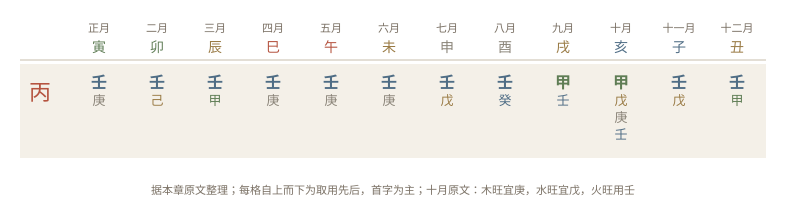

# 论丙火

## 三春丙火

春季三个月的丙火（总论）

> 三春丙火，秉象至威，阳回大地，侮雪欺霜，端用壬水，为扶阳，名曰天和地润，既济功成，正月用壬，庚辛为佐，二月端用壬水，三月土重晦光，取甲佐之为妙。

春季的丙火，禀受的气象最为威猛，阳气回到大地，能欺凌霜雪。专用壬水来辅助阳气，叫“天和地润”，水火既济，大功告成。正月用壬水，以庚辛金为辅佐；二月专用壬水；三月土重，遮掩火光，取甲木来辅佐最妙。

> 癸丙春生，不晴不雨之天，丙日春生，时月出癸，云雾迷蒙，不显不达，非若水辅丙也。

癸水和丙火同生在春天，就像不晴不雨的阴天。丙日生在春天，时干、月干透出癸水，好比云雾迷蒙，不能显达——这不像壬水那样能辅助丙火。

## 正月丙火

正月的丙火

> 正月丙火，三阳开泰，火气渐炎，取壬为尊，庚金佐之，壬庚两透，科甲定然，即壬透庚藏，亦有异途显达。

正月的丙火，三阳开泰，火气渐渐炎热，以壬水为最重要，庚金辅佐。壬、庚都透出，必定科举及第；即使壬透而庚藏，也能从科举以外的途径显达。

> 若一庚高透，支藏一二丙火，纳粟奏名，主为人慷慨英雄，有才迈众。

如果一个庚金高透，地支藏一两个丙火，可以捐纳得官，主为人慷慨，有英雄气，才能超众。

> 或一派庚辛混杂，常人，得时月两透庚金、无辛者，定主清贵，或辛年辛时，名为贪合，酒也之徒，女命一理。

如果满局庚辛金混杂，是平常人；时干、月干都透庚金而没有辛金的，必主清贵。如果年干、时干都是辛，叫“贪合”（丙辛相合），是贪恋酒色之徒，女命同理。

（译注：“酒也”疑当作“酒色”。）

> 或丙少壬多，而无戊制，名杀重身轻，斯人篌里藏刀，寻非痞棍，或见一戊制壬，反成富贵，宜见一二比肩方妙。

如果丙火少而壬水多，又没有戊土来制，叫“杀重身轻”，这人笑里藏刀，是惹是生非的痞棍。如果见一个戊土制住壬水，反而成为富贵之命；最好再见一两个比肩才妙。

（译注：“篌里藏刀”当作“笑里藏刀”。）

> 或一片戊土，甲不出干，终非大器，且恐孤贫，正月之丙，忌戊晦光，或支成火局，端取壬水为贵，无壬、癸亦姑用，若壬癸俱无，取戊以泄火气，但属平人。

如果满局戊土，甲木又不透干，终究成不了大器，还怕孤独贫穷——正月的丙火，忌戊土遮掩光芒。如果地支成火局，专取壬水为贵；没有壬水，癸水也姑且可用；如果壬、癸都没有，就取戊土来泄火气，但只是平常人。

> 或支成火局，吊作炎上而推，但不逢时耳，若不见东南岁运，反致孤贫。

如果地支成火局，可以作炎上格来推，只是不当令罢了；如果岁运不走东南木火之地，反而孤独贫穷。

（译注：“吊作”疑当作“可作”。）

> 或四柱有甲木，得康金暗制，可作秀才。

如果四柱有甲木，得庚金在暗中制住它，可以做个秀才。

（译注：“康金”当作“庚金”。）

> 无壬用癸者，略富贵，且官杀亦要旺有限，丙火无壬，多主贫贼，屡徵屡验。或火多无水，一至水必死。不然，定有灾咎，惟五月丙火，合炎上格，则不喜水破格、用癸无根，定主日疾。

没有壬水而用癸水的，略有富贵，而且官杀也要旺得有限度。丙火没有壬水，多主贫贱，屡试屡验。如果火多而没有水，一到水运必死；不然也必定有灾祸。只有五月的丙火合炎上格，才不喜欢水来破格；用癸水而癸水无根的，必主眼疾。

（译注：“贫贼”当作“贫贱”，“日疾”当作“目疾”。）

> 用壬者，金妻水子。用庚者，土妻金子。

用壬水的，金妻水子；用庚金的，土妻金子。

> 【命例】丙午 庚寅 丙午 庚寅

> 两间不杂，按察

两组干支（丙午、庚寅）各自重复而不混杂，官至按察使。

> 【命例】庚寅 戊寅 丙寅 壬辰

> 庚壬两透，词林

庚、壬都透出，入了翰林。

> 【命例】辛亥 庚寅 丙子 丁酉 ｜ 状元

> 【命例】丁酉 壬寅 丙子 戊戌

## 二月丙火

二月的丙火

> 二月丙火，阳气舒升，端用壬水，壬透天干，不见丁化，加以庚辛已亦透，壬水有根，定主科甲。

二月的丙火，阳气舒展上升，专用壬水。壬水透出天干，不见丁火来合化，再加上庚辛金也透出，壬水有根，必定科举及第。

（译注：“已亦透”当作“亦透”，“已”字疑衍或为“己”之讹。）

> 或无壬水，己土姑用，主有才学，虽不能成名，必衣食充足。

如果没有壬水，姑且用己土，主有才学，虽然不能成名，必定衣食充足。

> 或一派壬水，见一戊制，虽不科甲，亦有恩庇。或无戊透，则有辰戌丑未之戊，但辰宫癸水，贪合成火，不能制壬，此平常衣禄。若支下全无一戊，此系奔流之人，加以金多生水，下贱之命。

如果满局壬水，见一个戊土来制，虽然不能科举及第，也能得到恩荫庇护。如果没有戊土透出，就看辰戌丑未中藏的戊土；但辰宫里有癸水，戊癸贪合化火，不能制壬，这只是平常的衣食。如果地支下完全没有一个戊土，这是奔波流荡之人；再加上金多生水，是下贱之命。

> 或一派戊土，亦用壬水，运喜行木，见土不祥，行火亦不利。

如果满局戊土，也用壬水；大运喜欢走木地，见土不吉，走火地也不利。

> 或丙子日辛卯时，乃从化格，但不逢时贪才坏印，难招祖业。若得一二重丁火破辛，壬水得位，亦主富贵，虽不科甲，亦有异途，名传郡邑。合此格，主妻妾多子。或月时见二辛卯，日乃丙子，名为争合，年不透丁制辛，此人昏酒色，年透丁火，反吉。或支成木局，反因奸得才，因酒得名。

如果是丙子日、辛卯时，是从化格（丙辛化水），但不当令，贪财坏印，难以继承祖业。如果得一两重丁火来破辛金，壬水得位，也主富贵，虽然不能科举及第，也能从别的途径出身，名传一方。合这个格的，主妻妾多、儿子多。如果月、时见两个辛卯，日柱是丙子，叫“争合”；年干不透丁火来制辛，这人沉迷酒色；年干透出丁火，反而吉。如果地支成木局，反而因奸巧得财，因酒得名。

> 凡用壬者，金妻水子。

凡是用壬水的，金妻水子。

> 【命例】乙亥 己卯 丙申 己亥

> 【命例】己亥 丁卯 丙申 己亥

## 三月丙火

三月的丙火

> 三月丙火，气渐炎升，用壬水，或成土局，取甲木为辅，壬不可离，壬申两透，科甲定宜，惟忌庚出制甲，则秀才而已。

三月的丙火，火气渐渐炎热上升，用壬水。如果地支成土局，取甲木为辅助，但壬水不可离开。壬、甲都透出，必定科举及第；只忌庚金透出制甲，那就只是个秀才罢了。

（译注：“壬申两透”当作“壬甲两透”。）

> 无甲用庚，助壬水泄土气。

没有甲木就用庚金，帮助壬水，泄去土气。

> 壬透甲藏，富大贵小，有甲无壬，劳碌浊富，壬藏无甲，一介寒儒。壬甲两无，愚贱之辈，乙丁杂乱，定必属凡夫。

壬透而甲藏，富大贵小；有甲无壬，劳碌浊富；壬藏而无甲，是一介寒儒；壬、甲都没有，是愚笨卑贱之辈；乙木、丁火杂乱，必定是凡夫。

> 用壬者，金妻水子，用甲者，水妻木子。

用壬水的，金妻水子；用甲木的，水妻木子。

## 三夏丙火

夏季三个月的丙火（总论）

> 三夏丙火，阳威性烈，专用壬水。若亥宫壬水无力，回克泄气故也，仍用申宫长生之水，方云富贵。

夏季的丙火，阳气威猛，性情刚烈，专用壬水。亥宫里的壬水没有力量，是因为（亥中甲木）回头泄水之气的缘故；仍要用申宫中长生的壬水，才说得上富贵。

> 四月端用壬水，金为佐，五月亦端用壬。四五月壬透者富贵。丁多、兼看癸水，六月用壬，但借庚金为佐。

四月专用壬水，以金为辅佐；五月也专用壬水。四五月壬水透出的富贵。丁火多的，兼看癸水。六月用壬水，但要借庚金来辅佐。

> 阳刃合杀，威权万里，丁火羊刃太旺，正谓羊刃倒戈，无头之鬼，丙火用壬，生旺坐实方好，忌壬水太多，名杀重身轻。

阳刃（午中丁火）合杀，威权万里；丁火羊刃太旺，正是所谓“羊刃倒戈”，会成为无头之鬼。丙火用壬水，壬水要生旺、坐实才好；忌壬水太多，叫“杀重身轻”。

## 四月丙火

四月的丙火

> 四月丙火，建禄於巳，火势炎炎，宜专用壬水，解炎威之力，成既济之功。如无壬水，孤阳失辅，难透清光，得庚发水源，方为有根之水。壬庚两透，不见戊土，号曰湖水汪洋，广映太阳，光辉显著，文明之象，人合此格，不但科甲峥嵘，必有恩谥封荣。若不验，必暗损阴德。

四月的丙火，禄在巳，火势熊熊，宜专用壬水，化解炎热的威力，成就水火既济之功。如果没有壬水，孤阳失去辅助，难以透出清光；得庚金作水的源头，才是有根之水。壬、庚都透出，不见戊土，叫“湖水汪洋，广映太阳”，光辉显著，是文明之象。合这个格的人，不但科举出众，必定还有朝廷封赠的荣耀；如果不应验，必定是暗中损了阴德。

> 或无壬水，癸亦姑用，见庚透癸，不富必贵。但心性乖僻，巧谋善辩。

如果没有壬水，癸水也姑且可用；见庚金透出生癸，不富就贵，但心性乖僻，善于谋划、能言善辩。

> 或壬癸俱无，愚顽之辈，火炎无制，僧道之流。

如果壬、癸都没有，是愚顽之辈；火炎而无制，是僧道一类。

> 或一派庚金，不见比劫，有富无贵。

如果满局庚金，不见比劫，有富无贵。

> 或丙什日干，四柱多壬，不见戊制，名曰阴刑杀重，光棍之流。或支成水局，加之重重壬透，一无制伏，盗贼之命，如见己土，下贱鄙夫。

如果丙火日干，四柱壬水多，不见戊土来制，叫“阴刑杀重”，是光棍无赖一流。如果地支成水局，再加上壬水重重透出，毫无制伏，是盗贼之命；如果见己土，是下贱粗鄙之人。

（译注：“丙什”二字疑有讹，或当作“丙午”“丙子”。）

> 用壬者金妻水子。

用壬水的，金妻水子。

> 【命例】丁巳 乙巳 丙子 戊子 ｜ 庚运夺魁

> 【命例】乙未 辛巳 丙午 甲午

> 【命例】庚子 辛巳 丙寅 丙申

## 五月丙火

五月的丙火

> 五月丙火愈炎，得壬庚高透，方为上命。或一壬无庚，亦主页监，犹防戊己出干，丁壬化合，则为平人，即不透庚壬。或有申宫长生之水，济之坐禄之金，至妙，必入词林，又怕戊己杂乱，则为异路。

五月的丙火更加炎热，得到壬、庚高透，才是上等之命。如果只有一个壬水而没有庚金，也主贡生、监生；还要防戊己土透干，或丁壬合化，那就是平常人。即使庚、壬不透出天干，如果有申宫中长生的壬水，又有坐禄的庚金相助，也极妙，必入翰林；又怕戊己土杂乱，那就从科举以外的途径出身。

（译注：“页监”当作“贡监”。）

> 或成火局，不见滴水者，乃僧道鳏独之命，即有一二癸水，多遇火土，用之无力，瞽目之人，得戊己透火气，亦主刑克孤寡，行北运多凶，何也，所谓燥烈水激反凶。

如果地支成火局，不见一滴水，是僧道或鳏寡孤独之命。即使有一两个癸水，却多遇火土，用起来无力，是盲人。得戊己土透出泄火气，也主刑克孤寡；走北方水运多凶，为什么？这就是所谓“燥烈之火被水激，反而凶”。

> 或成炎上格，柱运不见庚辛，多见甲乙者，反主大富贵，然亦不可见水运。

如果成了炎上格，四柱和大运都不见庚辛金，又多见甲乙木，反而主大富贵；但也不可以走水运。

> 或有庚癸透者，衣禄充足，支火轻，无目疾，支见水者，异途。或成土局，又为泄太过，得壬滋甲出干，土被制而火得生扶，此必富贵寿考之格也。

如果庚、癸透出，衣食俸禄充足；地支火轻，就没有眼疾；地支见水的，从科举以外的途径出身。如果地支成土局，又是泄气太过；得壬水滋养透干的甲木，土被甲制而火得到生扶，这必定是富贵长寿之格。

> 【命例】庚寅 壬午 丙戌 己亥

> 【命例】戊戌 戊午 丙午 己丑

> 【命例】戊申 戊午 丙辰 甲午

## 六月丙火

六月的丙火

> 六月丙火退气，三代生寒，壬水为用，取庚辅佐。

六月的丙火，气已衰退，三伏天阴气已生，以壬水为用，取庚金辅佐。

（译注：“三代”当作“三伏”。）

> 庚壬两透，贴身相生，可云科甲名宦，若无庚有壬，不见戊出，小富小贵，见戊制壬则为贤而已。或己土出干混杂，此必庸夫俗子。或壬水浅，己土出干，其人贫困，无壬下格，贱而且顽，男女一理。

庚、壬都透出，紧贴着相生，可以说是科举出身的名臣。如果没有庚金而有壬水，又不见戊土透出，小富小贵；见戊土制壬，只是个贤良之人而已。如果己土透干混杂，必定是庸夫俗子。如果壬水浅薄，己土透干，这人贫困；没有壬水是下格，又贱又顽劣，男女同理。

> 或天干一派丙火，阳极生阴，干支两见庚壬。

如果天干满是丙火，阳极则生阴，（也要）干支都见庚、壬（才好）。

（译注：此句文意似不完整，疑有脱文。）

> 总之六月丙火用壬，不同余月用壬、喜运行西北，六月用壬，喜运行西南。

总之，六月的丙火用壬水，和其他月份不同：其他月用壬，喜大运走西北；六月用壬，喜大运走西南。

> 【命例】壬寅 丁未 丙申 壬辰

> 【命例】戊午 己未 丙戌 己亥

> 【命例】壬寅 丁未 丙申 戊戌

## 七月丙火

七月的丙火

> 七月丙火，太阳转西，阳气衰矣，日近西山，见土皆晦，惟日照湖海，暮夜光天，故仍用壬水辅映光辉。

七月的丙火，太阳转向西边，阳气衰弱了，太阳靠近西山，见到土就都晦暗；只有太阳照在湖海上，到了傍晚仍有光映天，所以仍用壬水来辅助映照它的光辉。

> 如壬多，取戊制方妙，有壬透干，又见戊土出干，可云科甲，如戊藏支内，不过生员，多壬无戊，平常人也。或戊多壬少，亦属常人，或多壬，一戊出制，所谓众杀猖狂，一仁可化，必主颢达，有权职。

如果壬水多，取戊土来制才妙。有壬水透干，又见戊土透干，可以说能科举及第；如果戊土藏在地支内，不过是个生员（秀才）；壬多而无戊，是平常人。如果戊多而壬少，也属平常人。如果壬水多，一个戊土透出来制，正所谓“众杀猖狂，一仁可化”，必主显达，有权位。

（译注：“颢达”当作“显达”。）

> 一派辛金，又为弃命从才，奇特之造，亦得恩荣，但多依亲戚而为进身之阶，从才者以水妻木子。

满局辛金，又是弃命从财，是奇特之命，也能得到恩宠荣耀，但多依靠亲戚作为进身的阶梯。从财格以水为妻、木为子。

> 【命例】壬戌 戊申 丙申 壬辰

> 【命例】乙未 甲申 丙申 庚寅

## 八月丙火

八月的丙火

> 八月丙火，日近黄昏，丙之余光，存於湖海，仍用壬水辅映。

八月的丙火，太阳接近黄昏，丙火的余光留在湖海之上，仍用壬水来辅助映照。

> 四柱多丙，一壬高透为奇，定主登科及第，富贵双全，一壬藏支，亦主秀才。或戊多困水，则假作斯文，若无壬水，癸亦可用，但功名不久。

四柱丙火多，一个壬水高透为奇，必主登科及第，富贵双全；一个壬水藏在地支，也主秀才。如果戊土多困住壬水，就只是假装斯文。如果没有壬水，癸水也可用，但功名不长久。

> 或见辛透，不能从化，贫苦到老，或见一丁制辛，为人奸诈，不识高低，女命合此，长舌淫贱。

如果见辛金透出，又不能从化，贫苦到老；如果见一个丁火制辛，为人奸诈，不知高低；女命合此，多嘴而淫贱。

> 或成金局，无辛出干，此非从才，乃朱门饿莩，如辛出干，不见比劫，此从才格，反主富贵，亲戚提拔，妻贤内助，用水者，金妻水子，从才者，水妻木子。

如果地支成金局，而没有辛金透干，这不是从财格，而是富贵人家里的饿殍；如果辛金透干，又不见比劫，这是从财格，反而主富贵，有亲戚提拔，妻子贤惠能干。用水的，金妻水子；从财的，水妻木子。

> 【命例】丙子 丁酉 丙午 丁酉

> 【命例】丙寅 丁酉 丙辰 丁酉

> 【命例】己卯 癸酉 丙子 戊子

## 九月丙火

九月的丙火

> 九月丙火，火气愈退，所忌土晦光，必须先用甲木，次取壬水。

九月的丙火，火气更加衰退，最忌土来遮掩光芒，必须先用甲木（疏土），其次取壬水。

> 甲壬两透，富贵非凡，苦无壬水，得癸透干，亦可，虽不科甲，异路功名，壬癸藏支，页监而已，甲藏壬透，无庚破甲，可许秀才。或庚戊困了水木，定是庸才，无甲壬癸者，下格。

甲、壬都透出，富贵非凡。苦于没有壬水，得癸水透干也可以，虽然不能科举及第，也能从别的途径得功名。壬癸藏在地支，只是贡生、监生而已。甲藏而壬透，又没有庚金破甲，可以做秀才。如果庚、戊困住了水和木，必定是庸才；没有甲、壬、癸的，是下格。

> 或一派火土，虽不太旺，亦自燥矣，如不离过继，亦主奔流，加以无庚辛壬癸出干，必为夭命。

如果满局火土，虽然不算太旺，也自然干燥了；如果不是离开本家过继给别人，也主奔波流荡；再加上没有庚辛壬癸透干，必定是短命。

> 或支成火局，炎上失时，若运入南方，一贫彻骨。

如果地支成火局，是不当令的炎上格；大运若走南方，就穷到骨子里。

> 用甲者，水妻木子，用壬者，金妻水子。

用甲木的，水妻木子；用壬水的，金妻水子。

> 【命例】己亥 甲戌 丙子 戊子

> 【命例】丙申 戊戌 丙午 戊戌

> 【命例】戊戌 壬戌 丙寅 壬辰

## 十月丙火

十月的丙火

> 十月丙火，太阳失令，得见甲戊庚出干，可云科甲，主为人性好清高，斯文领袖。

十月的丙火，太阳失令。能见甲、戊、庚透出天干，可以说能科举及第，主为人性好清高，是读书人中的领袖。

> 如辛透见辰，名化合逢时，主大贵。

如果辛金透出，地支见辰，叫“化合逢时”（丙辛化水得时），主大贵。

> 或壬多无甲，乃作弃命从杀，即不科甲，亦是宦僚。

如果壬水多而没有甲木，就作弃命从杀；即使不科举及第，也是个官员。

> 或壬多有甲无戊，郤非从杀，宜用己土混壬。

如果壬水多，有甲木而没有戊土，却不是从杀格，宜用己土来混浊壬水。

（译注：“郤”通“却”。）

> 总之十月丙火，木旺宜庚，水旺宜戊，火旺用壬，随宜酌用可也。

总之，十月的丙火，木旺宜用庚金，水旺宜用戊土，火旺就用壬水，根据情况酌情选用就可以了。

> 【命例】甲申 乙亥 丙戌 庚寅

> 【命例】壬辰 辛亥 丙戌 戊子

> 【命例】辛巳 己亥 丙子 壬辰

## 十一月丙火

十一月的丙火

> 十一月丙火，冬至一阳生，弱中复强，壬水为最，戊土佐之。

十一月的丙火，冬至一阳生，由弱中又转强，以壬水为最重要，戊土辅佐。

> 壬戊两透，科甲可许，无戊见己，异路功名。

壬、戊都透出，可以科举及第；没有戊土而见己土，从科举以外的途径得功名。

> 或无壬水，有癸出干，得金滋无伤，又有丙透以解冻，可许衣衿。

如果没有壬水，有癸水透干，得金来滋生而又没有损伤，又有丙火透出来解冻，可以成为秀才。

> 或一派壬，则端用戊土，此人虽不成名，文章迈众，但名利虚浮，何也，因戊晦光，又须甲木为药也，或无壬水，癸亦可用，但不甚显。

如果满局壬水，就专用戊土；这人虽然不能成名，文章却超过众人，但名利虚浮。为什么？因为戊土遮掩丙火的光芒，又须用甲木作为药来制戊。如果没有壬水，癸水也可以用，但不太显达。

> 或四柱多壬无甲，乃作弃命从杀，亦有云路。

如果四柱壬水多而没有甲木，就作弃命从杀，也有青云之路。

> 或水多、有甲、无戊，郤非从杀，宜用己土浊壬，十一月丙火，与十月颇同。

如果水多、有甲、无戊，却不是从杀格，宜用己土来混浊壬水。十一月的丙火，和十月大体相同。

> 【命例】辛亥 庚子 丙寅 庚寅

> 【命例】辛丑 庚子 丙子 癸巳

> 【命例】辛酉 庚子 丙戌 戊子

## 十二月丙火

十二月的丙火

> 十二月丙火，气进二阳，每雪欺霜，喜壬为用，己土司令，土多又不可少甲，壬甲两透，科甲堪宜，甲藏则秀才而已，或无甲得一壬透，富中取贵。

十二月的丙火，气进二阳，能欺凌霜雪，喜以壬水为用。己土当令，土多又不可缺少甲木。壬、甲都透出，适合科举及第；甲木藏在地支，只是个秀才而已。如果没有甲木，得一个壬水透出，是在富中取贵。

（译注：“每雪欺霜”当作“侮雪欺霜”。）

> 如见一派己土，不见甲乙，名假伤官，聪明性傲，名利虚浮。

如果见满局己土，不见甲乙木，叫“假伤官”，聪明而性情傲慢，名利虚浮。

> 或一派癸水，得己出干，必主自创基业，若制伏太过，又取辛金作用，得见癸透，此人即不成名，必清雅文墨之士。

如果满局癸水，得己土透干，必主白手自创基业；如果（己土）制伏太过，又取辛金为用；得见癸水透出，这人即使不成名，也必定是清雅的文人。

> 【命例】乙巳 己丑 丙申 癸巳

> 【命例】乙丑 己丑 丙午 庚寅

> 【命例】癸卯 乙丑 丙午 壬辰

> 【命例】己丑 丁丑 丙寅 庚寅

> 【命例】乙酉 己丑 丙寅 乙丑

*图 2-1　丙火十二月调候用神：据本章各节原文整理。（译者补绘，原书无此图）*
