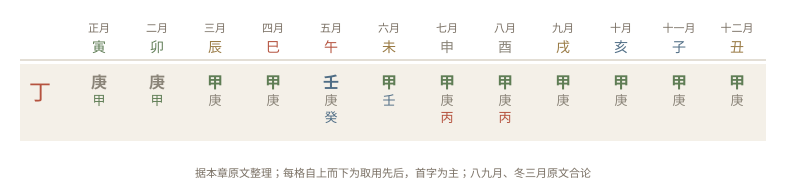

# 论丁火

## 三春丁火

春季三个月的丁火

## 正月丁火

正月的丁火

> 正月丁火，甲木当权，乃为母旺，非庚不能劈甲，何以引丁，姑用庚金。

正月的丁火，甲木当权，这是生我的“母”旺。没有庚金就不能劈开甲木，又怎么能引燃丁火？所以姑且用庚金。

> 或一派甲木，无庚制之，非贫即夭。或只一甲木、多见乙木者，必离之客，焉问妻儿。或见甲乙，生庚子时，又主妻甲子早，宜可采芹。

如果满局甲木，没有庚金来制，不是贫穷就是短命。如果只有一个甲木，却多见乙木，必定是离乡在外之客，哪里还谈得上妻儿。如果见甲乙木，又生在庚子时，主妻贤、得子早，还可以考中秀才。

（译注：“必离之客”疑脱“乡”字；“妻甲子早”疑当作“妻贤子早”。）

> 得壬化木，弱极复生，合此必主大贵，但此化合，反以不见庚破格为妙。

得壬水与丁相合化木，弱到极点又复生，合此格必主大贵；但这种化合，反而以不见庚金来破格为妙。

> 或有庚金壬癸，得己出干制之，此命不由科甲，亦有异途。

如果有庚金和壬癸水，得己土透干来制水，这个命即使不由科举出身，也能从别的途径发达。

> 或一派壬癸，不得寅时，又无庚金，必主穷困。

如果满局壬癸水，又不生在寅时，又没有庚金，必主穷困。

> 或丁年、壬月、丁日、壬时，男主大贵，女则不宜，此格以土为妻、金为子，但子女艰难，女命合此，淫贱，刑夫克子。

如果是丁年、壬月、丁日、壬时，男命主大贵，女命则不宜。这个格以土为妻、金为子，但子女艰难。女命合此，淫贱，刑夫克子。

> 或支火局，无滴水解炎，僧道之命，见甲出略可，总不可无水，水多亦不宜。

如果地支成火局，没有一滴水来解炎热，是僧道之命；见甲木透出略好一些。总之不可没有水，但水多也不宜。

> 【命例】庚辰 戊寅 丁未 壬寅

> 【命例】辛卯 庚寅 丁酉 癸卯

## 二月丁火

二月的丁火

> 二月丁火，湿乙伤丁，先庚後甲，非不能去乙，非甲不能引丁。庚甲两透，科甲定然，庚透甲藏，亦有生贡，甲透庚藏，异路功名。

二月的丁火，湿的乙木会伤丁火（湿木生不了火），取用先庚后甲：没有庚金不能去掉乙木，没有甲木不能引燃丁火。庚、甲都透出，必定科举及第；庚透而甲藏，也能成为生员、贡生；甲透而庚藏，从科举以外的途径得功名。

（译注：“非不能去乙”当作“非庚不能去乙”。）

> 或庚乙俱透，庚必输情於乙，未免贪合，运行金水，一贫彻骨。或庚透乙藏，则不能贪合，乙反引丁，即用乙亦无害．运入木火之乡，自然富贵，用乙者水妻木子。

如果庚、乙都透出，庚必定向乙示好，免不了贪合；大运走金水之地，穷到骨子里。如果庚透而乙藏，就不能贪合，乙木反而能引燃丁火，即使用乙木也无妨；大运走木火之乡，自然富贵。用乙木的，水妻木子。

> 若尽是乙木，不见一甲，此人富贵不久，因贪致祸，弄巧反拙，且不能承先人之业。

如果全是乙木，不见一个甲木，这人富贵不长久，因贪心而招祸，弄巧成拙，而且不能继承祖先的家业。

> 或支成木局，有庚透、主清贵，不见庚者、常人，二月乙木司权，必须有庚，有乙无庚，主贫苦无依，用庚者、土妻金子。

如果地支成木局，有庚金透出，主清贵；不见庚金的，是平常人。二月乙木当权，必须有庚金；有乙无庚，主贫苦无依。用庚金的，土妻金子。

> 得印旺杀高，大富大贵。或一派水，无一戊制，主贫苦无依。或乙少癸多，有戊去制，反吉。用土者、火妻土子。

印旺而七杀高透，大富大贵。如果满局是水，没有一个戊土来制，主贫苦无依。如果乙木少、癸水多，有戊土去制水，反而吉。用土的，火妻土子。

> 【命例】戊子 乙卯 丁巳 丁未

> 【命例】丁卯 癸卯 丁卯 庚子

> 【命例】庚辰 己卯 丁丑 甲辰

## 三月丁火

三月的丁火

> 三月丁火，戊土司令，泄弱丁气，先用甲木引丁制土，次看庚金，庚甲两透，定主科甲，或一藏一透，终非白丁。

三月的丁火，戊土当令，泄弱了丁火之气。先用甲木引燃丁火、制伏戊土，其次看庚金。庚、甲都透出，必主科举及第；或者一藏一透，也终究不是白丁。

> 或支成木局，取庚为先，得庚透，丁癸不透，亦有异路功名。

如果地支成木局，以庚金为先；得庚金透出，而丁、癸不透，也能从别的途径得功名。

> 或支成水局，加以壬透，名杀重身轻，必夭折天年。或遭凶死，或戊己两透，廊庙之客，若一甲破土，定是常人。

如果地支成水局，再加上壬水透出，叫“杀重身轻”，必定夭折，或者遭遇凶死。如果戊、己都透出（制水），是朝廷中的人物；如果有一个甲木破土，必定是平常人。

> 用甲者、水妻木子，用金者、土妻金子。

用甲木的，水妻木子；用金的，土妻金子。

## 三夏丁火

夏季三个月的丁火

## 四月丁火

四月的丁火

> 四月丁火乘旺，虽取甲引丁，必用庚劈甲，伐甲、方云木火通明，甲多、又取庚为先。

四月的丁火正旺，虽然取甲木来引丁，但必须用庚金劈开甲木；把甲木劈开，才说得上“木火通明”。甲木多的，又以庚金为先。

> 但四柱忌见癸水，癸水一见，泄庚、湿甲、伤丁，故以癸为病。

但四柱忌见癸水：癸水一出现，就会泄庚金、湿甲木、伤丁火，所以以癸水为病。

> 或癸水藏支，壬水出干制丙，不夺丁光，自是鴈塔题名，玉堂清贵。

如果癸水藏在地支，壬水透干制住丙火，不让丙火夺去丁火的光芒，自然是金榜题名，入翰林而清贵。

（译注：“鴈塔题名”即雁塔题名，唐代进士及第后在慈恩寺大雁塔题名，后用来指考中进士。）

> 或有庚无甲，戊透天干，此为伤官生才，又取戊为用，必主富贵，戊土出干，不见甲乙，又不见水，是伤官伤尽，八字清高，但不大贵，亦不大富，见水多木多，定是常人。

如果有庚无甲，戊土透出天干，这是伤官生财，又以戊土为用，必主富贵。戊土透干，不见甲乙木，又不见水，是“伤官伤尽”，八字清高，但不大贵，也不大富；见水多木多，必定是平常人。

> 或四柱多丙，不见壬癸，夺了丁光，此人贫苦，或丁年、巳月、丁巳日、丙午时，一丙不夺二丁，即不颢达，亦名播四邻。故书曰，丁火阴柔一烛灯，太阳相见夺光明，柱中若见甲木透，定许身安福自临。

如果四柱丙火多，又不见壬癸，夺了丁火的光芒，这人贫苦。如果是丁年、巳月、丁巳日、丙午时，一个丙火夺不了两个丁火，即使不显达，也名声传遍乡里。所以书上说：“丁火阴柔一烛灯，太阳相见夺光明；柱中若见甲木透，定许身安福自临。”（丁火柔弱，好比一盏烛灯，遇到太阳丙火就被夺去光明；柱中若见甲木透出，必定身安福至。）

（译注：“颢达”当作“显达”。）

> 【命例】甲午 己巳 丁丑 乙巳

> 【命例】辛酉 癸巳 丁巳 乙巳

## 五月丁火

五月的丁火

> 五月丁火，时归建禄，不宜乱用甲木。

五月的丁火，时令到了禄位（午），不宜胡乱用甲木。

> 遇年透隔位之壬，不贪丁合者，忠而且厚，或支成火局，干见火出，得庚壬两透者，科甲定然，土透制壬，常人。即壬藏支中，亦非白丁，但要运行西北，方可发达，得一癸透，名独杀当权，出人头地。

遇到年干透出隔位的壬水，不与丁火贪合的，为人忠厚。如果地支成火局，天干又见火透出，得庚、壬都透出的，必定科举及第；有土透出制住壬水，是平常人。即使壬水藏在地支中，也不是白丁，但要大运走西北，才能发达。得一个癸水透出，叫“独杀当权”，能出人头地。

> 若见寅辰亥卯字，化木生火，平常人物，丰衣足食，中年富，但刑克子息，劳而无功，或丙午月、丁未日、辛亥时，亥中有壬制丙，不致贫苦，若丙午时，则滴水难救炎火，必主僧道，若年支见子，虽不科甲，亦有衣衿。

如果见寅、辰、亥、卯这些字，（会合）化木生火，是平常人物，丰衣足食，中年富裕，但刑克子女，劳而无功。如果是丙午月、丁未日、辛亥时，亥中有壬水制丙，不至于贫苦；如果是丙午时，就一滴水也救不了炎火，必主为僧道。如果年支见子，虽然不能科举及第，也能做个秀才。

> 若干支无火局，有水透干，须用甲木，又要庚劈甲方明，木火通明，主大富贵，或木少火多，焚其木性，不能光透九霄，荣华不久。

如果干支不成火局，有水透干，须用甲木，又要庚金劈甲，火才明亮；木火通明，主大富贵。如果木少火多，烧尽了木性，火光不能直透九霄，荣华不长久。

> 或生月是禄，支皆生旺合局，右以火出，无滴水解炎，乃身旺无依，孤贫之格，女必为尼，即运北地，反主凶危。

如果生月是禄位，地支都是生旺之地并合成火局，又有火透出，没有一滴水解炎，这是身旺无依，属孤贫之格，女命必定为尼；即使大运走北方水地，反而主凶险。

（译注：“右以火出”当作“又以火出”。）

> 用壬者、金妻水子，用甲者、水妻木子。

用壬水的，金妻水子；用甲木的，水妻木子。

> 【命例】庚午 壬午 丁亥 戊申

> 【命例】辛巳 甲午 丁未 甲辰

> 【命例】癸卯 戊午 丁丑 甲辰

> 【命例】丙寅 甲午 丁丑 乙巳

> 【命例】丙子 甲午 丁酉 癸卯

## 六月丁火

六月的丁火

> 六月丁火，阴柔退气，但值三伏生寒，丁弱极矣，专取甲木，壬水次之。

六月的丁火，阴柔而气已衰退，又正值三伏天阴气已生，丁火弱到极点了。专取甲木，壬水次之。

> 若得甲出天干，支成木局，见亥中之壬，为木神有根，接引丁火，必然科甲，即不见木局，支见壬水，虽不大贵，亦有凌云之气，无庚不妙。

如果得甲木透出天干，地支成木局，又见亥中的壬水，是木有根，能接引丁火，必然科举及第。即使不成木局，地支见壬水，虽然不大贵，也有凌云之志；但没有庚金就不妙。

> 或支成水局，见水透干，则湿木性，不能引丁，必为平常人，有甲透、有才干。有庚透，无刑伤，若无甲木，假名假利。

如果地支成水局，又见水透干，就会使木湿，不能引燃丁火，必定是平常人。有甲木透出，有才干；有庚金透出，没有刑伤；如果没有甲木，名利都是假的。

> 或年月日时，皆一派丁未之类，此为纯阴，终无大用。

如果年、月、日、时都是丁未之类，这是纯阴之局，终究没有大用。

> 用甲者、水妻木子。

用甲木的，水妻木子。

> 【命例】丁卯 丁未 丁未 丙午

> 【命例】壬子 丁未 丁巳 丁未

## 三秋丁火

秋季三个月的丁火

## 七月丁火

七月的丁火

> 七月丁火，退气柔弱，端用甲木，金虽乘旺司权，无伤丁之理，仍取庚劈甲，为引火之物，或借丙暖金晒甲，不虑丙夺丁光，凡两丙夹丁者，夏月忌之，余月不忌，但此格少年困苦刑克中年富贵，必要地支见水制丙，方妙。

七月的丁火，气已衰退而柔弱，专用甲木。金虽然当令得势，却没有伤丁火的道理，仍取庚金劈开甲木，作为引火之物；或者借丙火来温暖金、晒干甲木，不必担心丙火夺丁火之光。凡是两个丙火夹着丁火的，夏天忌，其他月份不忌；但这种格局少年困苦、多刑克，中年才富贵，必须地支见水来制丙才妙。

> 三秋甲庚丙并用，仍分优劣，何也，七月甲丙，申中有庚，八月甲丙庚皆用，七八月或无甲木，乙亦可用，为枯草引灯，郤不离丙晒也，九月端用甲庚，大抵甲一庚，乙不离丙，其理极明，或见甲庚丙皆透，必主科甲，无甲用乙者，富贵皆小，且富而不贵者多。

秋季三个月的丁火，甲、庚、丙一起用，但仍有主次之分。为什么？七月用甲、丙，因为申中本有庚金；八月甲、丙、庚都用；七八月如果没有甲木，乙木也可以用，这是“枯草引灯”，却离不开丙火来晒干它；九月专用甲、庚。大抵甲木离不开庚金，乙木离不开丙火，这个道理很明白。如果见甲、庚、丙都透出，必主科举及第；没有甲木而用乙木的，富贵都小，而且多是富而不贵。

（译注：“甲一庚”疑当作“甲不离庚”。）

> 或一重壬水，又多见癸水，必以戊土为制，自然富贵光辉。

如果有一重壬水，又多见癸水，必须以戊土来制，自然富贵光辉。

> 或一派庚金，名才多身弱，主富屋贫人，妻多主事，或壬多泄庚，丁壬化杀，反成富贵，若庚多无壬，奔流下贱。

如果满局庚金，叫“财多身弱”，主是富人家的穷人，多由妻子当家。如果壬水多泄庚金之气，丁壬合化，化去七杀，反而成为富贵之命；如果庚金多而没有壬水，奔波流荡，下贱。

> 【命例】辛亥 丙申 丁丑 戊申

> 【命例】辛亥 丙申 丁卯 戊申

> 【命例】辛卯 丙申 丁酉 丙午

> 【命例】庚辰 甲申 丁未 丙午

## 八九月丁火

八月、九月的丁火

> 或八月一派辛金，不见庚金，又无比劫，比弃命从才，富而且贵，虽不科甲，亦有异途，从才者水为妻，不克，有正偏，木为子，不刑。

如果八月满局辛金，不见庚金，又没有比劫，这是弃命从财，富而且贵；虽然不能科举及第，也能从别的途径出身。从财格以水为妻，不相克，有正妻、偏妾；以木为子，没有刑伤。

（译注：“比弃命从才”当作“此弃命从才”。）

> 或九月一派戊土，泄丁火之气，不见甲木，为伤官伤尽，非寻常可比，或甲木透出，为文书清贵，秋闱可夺，用甲者，庚不可少，水妻木子。

如果九月满局戊土，泄丁火之气，不见甲木，是“伤官伤尽”，不是寻常之命可比。如果甲木透出，是掌文书的清贵之人，可以考中乡试。用甲木的，庚金不可缺少，水妻木子。

> 【命例】壬午 己酉 丁亥 庚戌

> 【命例】丁未 己酉 丁丑 辛亥

> 【命例】庚午 丙戌 丁未 壬寅

> 【命例】己亥 甲戌 丁卯 丙午

## 三冬丁火

冬季三个月的丁火

## 十月丁火

十月的丁火

> 三冬丁火微寒，端用庚甲，甲乃庚之良友，凡用甲木，庚不可少，无庚无甲，何能引丁，难云木火通明，冬丁有甲，不怕水多金多，可称上格，甲庚两透，科甲分明，见己则否，己多合甲，则为常人。

冬季的丁火微寒，专用庚金、甲木。甲木是庚金的好朋友，凡是用甲木，庚金不可缺少；没有庚也没有甲，怎么能引燃丁火？就难说“木火通明”了。冬天的丁火有甲木，不怕水多金多，可称上格。甲、庚都透出，分明是科举及第之命；见己土就不行了，己土多而合住甲木，就是平常人。

> 或一丙夺丁，必赖支内水救，若有支金发水之源，官拜乌台有准，金无癸水制丙，无用之徒，或有金无水，贫寒之士，有火无金，又主清高。

如果有一个丙火夺丁火之光，必须依赖地支内的水来救；如果地支还有金作为水的源头，必定官拜御史。有金而没有癸水来制丙，是无用之人；有金无水，是贫寒之士；有火无金，又主清高。

（译注：“乌台”指御史台。“金无癸水”疑当作“有金无癸水”。）

> 或时月二壬争合，取戊破之，有戊稍有富贵，无戊常人，设戊藏得所，不失衣衿。

如果时干、月干两个壬水争合丁火，取戊土来破它。有戊土的稍有富贵，没有戊土是平常人；假如戊土藏在地支而得其所，也不失为秀才。

> 或二丙夺丁，得年干有癸，支下带合，金水得所，亦必显达，纳粟奏名，必验。

如果两个丙火夺丁火之光，得年干有癸水，地支又带合局，金水得其所，也必定显达，能捐纳得官，必然应验。

> 【命例】癸亥 癸亥 丁亥 辛亥

> 【命例】乙卯 丁亥 丁未 庚戌

> 【命例】癸丑 癸亥 丁丑 丁未

> 【命例】庚戌 丁亥 丁卯 癸卯

## 十一月丁火

十一月的丁火

> 或仲冬水多癸旺，金无比印，此作弃命从杀，亦有异途功名，见丁比出干，难合格局，常人，且主骨肉浮云，六亲流水，戊出破癸，颇有兄弟妻儿，此格用戊，火妻土子，用甲，水妻木子。

如果仲冬（十一月）水多、癸水旺，又有金而没有比劫、印绶，这就作弃命从杀，也能从科举以外的途径得功名。见丁火比肩透干，就难合格局，是平常人，而且主骨肉亲情如浮云，六亲如流水。有戊土透出破癸，就颇有兄弟妻儿。这种格用戊土的，火妻土子；用甲木的，水妻木子。

> 或四柱多丙丁，又用癸制火，用癸者金妻水子。

如果四柱丙丁火多，又用癸水来制火；用癸水的，金妻水子。

> 三冬丁火，甲木为尊，庚金佐之，戊癸权宜酌用可也。

冬季三个月的丁火，以甲木为最重要，庚金辅佐，戊土、癸水根据情况酌情使用就可以了。

> 【命例】庚午 己丑 丁酉 甲辰

> 【命例】戊子 己丑 丁未 甲辰

> 【命例】壬辰 癸丑 丁巳 乙巳

> 【命例】辛卯 辛丑 丁卯 甲辰

（译注：本节以下四例月柱均为丑月，实为十二月之命，可与本节末“三冬丁火”的总论合看。）

*图 3-1　丁火十二月调候用神：据本章各节原文整理。（译者补绘，原书无此图）*
