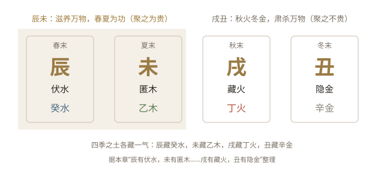

# 论土

> 五行之土，散在四维，故金木水火，依而成象，是四时皆有用有忌者，火，死酉也，水，旺子也，盖土赖火运，火死则土囚，土喜水才，水旺则土虚，土得金火，方成大器，土高无贵，空惹灰尘，土聚则滞，土散则轻。

五行中的土，分散在四方四隅（四季之末），所以金、木、水、火都依附它而成形，因此四季里土都有它的用处，也都有它的忌讳。火死在酉，水旺在子：土依靠火来运行，火死了土就被囚；土喜欢水作为财，但水旺了土就虚。土得到金和火，才能成大器；土太高没有贵气，只会白白扬起灰尘；土聚在一起就呆滞，土分散就轻浮。

> 辰戌丑未，土之正也，分阴分阳，主则不同，辰有伏水，未有匿木，滋养万物，春夏为功，戌有藏火，丑有隐金，秋火冬金，肃杀万物，土聚辰未为贵，聚丑戌不为贵，是土爱辰未，而不爱丑戌也明矣，若更五行有气，人命逢之，田产无比，晚年富贵悠悠，若土太实无水，燥则不和，无木则不疏通，土见火则焦，女命多不生长，土旺四季，惟土困弱，戌多为人好斗，多瞌睡，辰未人好食，丑人清省，丑为艮土，有癸水能润而膏，人命遇此，主能卓立。

辰、戌、丑、未是正宗的土，分阴分阳，各自所主不同。辰中伏有水，未中藏有木，能滋养万物，在春夏发挥作用；戌中藏有火，丑中隐有金，秋天的火、冬天的金，肃杀万物。土聚在辰、未为贵，聚在丑、戌不为贵——土喜爱辰未而不爱丑戌，这就很明白了。如果再加上五行都有生气，人命遇到，田产无人可比，晚年富贵悠然。如果土太实而没有水，燥了就不和谐；没有木就不能疏通；土见火就焦，女命多不能生育。土旺于四季，只有土本身困弱时（才需扶）。戌多的人好斗、贪睡；辰、未多的人贪吃；丑多的人清静简省。丑是艮土，有癸水能滋润而肥沃，人命遇到，主能卓然自立。

*图 4-1　辰戌丑未四库土所藏：辰未生养、戌丑肃杀。（译者补绘，原书无此图）*

## 春月之土

春天的土

> 生於春月，其势虚浮，喜火生扶，恶木太过，忌水泛滥，喜土比助，得金而制木为祥，金太多仍盗土气。

土生在春天，气势虚浮。喜欢火来生扶，讨厌木太过，忌讳水泛滥，喜欢土来比助；得金来制木为吉祥，但金太多仍会盗泄土气。

## 夏月之土

夏天的土

> 夏月之土，其势燥烈，得盛水滋润成功，忌旺火煆炼焦坼，木助火炎，水克无碍，金生水泛，妻才有益，见比肩蹇滞不通，如太过又宜木克。

夏天的土，气势燥烈。得到充足的水来滋润，才能成功；忌旺火煅烧，使土焦裂。木会助长火炎；水来受克也无妨；金能生水使水充沛，对妻财有益。见比肩就阻滞不通；如果土太过，又宜用木来克。

## 秋月之土

秋天的土

> 秋月之土，子旺母衰，金多而耗盗其气，木盛须制伏纯良，火重重而不厌，水泛泛而不祥，得比肩则能助力，至霜降不比无妨。

秋天的土，“儿子”（金）旺而“母亲”（土）衰。金多就会耗泄土气；木盛须制伏，才能纯良；火重重叠叠也不嫌多；水泛滥就不吉祥。得比肩就能助力；到了霜降以后（戌月土旺），没有比肩也无妨。

## 冬月之土

冬天的土

> 冬月之土，外寒内温，水旺才丰，金多子秀，火盛有荣，木无咎，再加比肩扶助为佳，更喜身主康强足寿。

冬天的土，外面寒冷而内里温暖。水旺则财丰；金多则子女秀出；火盛则有荣耀；木多也没有灾咎；再加上比肩扶助为佳，更喜欢日主康健强壮，就能长寿。

> 辰戌丑未，四土之神，惟未土为极旺，何也，辰土带木气克之，戌土之土，带金气泄之，此三土虽旺而不旺，故土临此三位，金多作稼穑格，不失中和，若未月土，则带火气也，带火以生之，所以为极旺也，若土临此旺未月，见四柱土重，多作火炎土燥，不可作稼穑看，但临此月之土，见金结局者，不贵即富也，书曰，土逢季月见金多，终为贵论，而在未月尤甚。

辰、戌、丑、未是四个土神，只有未土最旺。为什么？辰土带有木气来克它，戌土（与丑土）带有金气来泄它，这三个土虽说旺，其实不旺；所以土临这三个位置，金多可作稼穑格，不失中和。而未月的土带有火气，火来生它，所以最旺。如果土生在这个最旺的未月，又见四柱土重，多作“火炎土燥”论，不可作稼穑格看；但生在这个月的土，见金结成局的，不贵就富。书上说：“土逢季月见金多，终为贵论。”而在未月尤其如此。

（译注：“戌土之土”疑当作“戌丑之土”，与下文“此三土”相合。）
