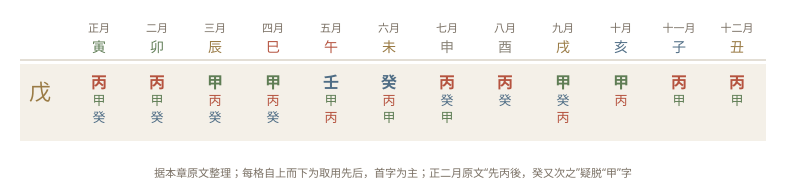

# 论戊土

## 三春戊土

春季三个月的戊土

> 三春戊土，无丙照暖，戊土不生，无甲疏劈，戊土不灵，无癸滋润，万物不长，正二月先丙後，癸又次之，三月先甲後丙，癸又次之，因戊土司权故也，有甲、丙、癸、三者齐透，必主一品当朝，或二透一藏，亦登金榜，二藏一透，也可异途。

春季的戊土，没有丙火照暖，戊土不能生发；没有甲木疏通，戊土不灵；没有癸水滋润，万物不能生长。正月、二月先丙后甲，癸水又次之；三月先甲后丙，癸水又次之，因为三月是戊土当令的缘故。甲、丙、癸三者都透出，必主做到一品大官；或者两透一藏，也能金榜题名；两藏一透，也可以从别的途径出身。

（译注：“先丙後”下疑脱“甲”字。）

## 正二月戊土

正月、二月的戊土

> 正二月即有甲癸，若无丙除寒，如万物生而不长，故无丙者，富贵艰辛，或有丙无甲癸者，名日春旱，如万物生而厄，无甲癸者，一生勤苦，劳而无功，或一丙火，有甲久癸，先泰後否，或支成火局，不见壬癸，僧道孤贫，癸透者贵，壬透者富。

正月、二月即使有甲、癸，如果没有丙火来除寒，就像万物生出来却长不大，所以没有丙火的，求富贵艰辛。如果有丙火而没有甲、癸，叫“春旱”，就像万物生出来却遭困厄；没有甲、癸的，一生勤苦，劳而无功。如果有一个丙火，有甲木而缺癸水，先顺后逆。如果地支成火局，不见壬癸，是僧道或孤贫之人；癸水透出的贵，壬水透出的富。

（译注：“名日”当作“名曰”，“久癸”疑当作“乏癸”。）

> 用水者要审水之多少，或一派，甲木无丙常人，得一庚透方妙，或支成水局，甲又出干，又有庚透，富贵双全。

用水的，要审察水的多少。如果满局甲木而没有丙火，是平常人，得一个庚金透出才妙。如果地支成水局，甲木又透干，又有庚金透出，富贵双全。

> 或无庚金，又无比印，难作从杀，定主遭凶，不然，必为盗贼，若日下坐午，不得善终。

如果（甲多而）没有庚金，又没有比劫、印绶，难作从杀，必主遭凶；不然，必定是盗贼。如果日支坐午，不得善终。

> 或一派乙木，为官杀会党，即有庚从，郤难制乙，此人内奸外直，口是心非，加一甲在内，无庚，必懒惰自甘，好食无厌，或丙多甲多，宜以癸庚参用。

如果满局乙木，是“官杀会党”；即使有庚金，却难制乙木（乙庚反合），这人内心奸诈、外表正直，口是心非。再加一个甲木在里面而没有庚金，必定懒惰自甘、贪吃无厌。如果丙火多、甲木多，宜以癸水、庚金参合使用。

## 三月戊土

三月的戊土

> 三月戊土司令，不见丙甲癸者，愚而且贱，毋癸透者、科甲，两癸透者、生员，甲癸俱藏者，只可云富，有癸异途。

三月戊土当令，不见丙、甲、癸的，又愚笨又卑贱。（甲）癸都透出的，科举及第；两个癸水透出的，是生员；甲、癸都藏在地支的，只能说是富；有癸水的，从科举以外的途径出身。

（译注：“毋癸透者”疑当作“甲癸透者”。）

> 若丙多无癸，旱田无水，不能种苗，旧谷已没，新谷未登，此先富後贵之造，或火多有壬透者，先贫後富，癸透先贱後荣，壬藏不过食足，癸藏不过名传，即此亦须运美，或支成火局，得癸透者，富贵天然，壬透富贵辛苦，何也，癸乃天上甘霖，壬乃江河波浪，所以有劳逸之殊。

如果丙火多而没有癸水，好比旱田无水，不能种苗，旧谷已经吃完，新谷还没收成，这是先富后贵（疑当作“先富后贫”）的命。如果火多而有壬水透出，先贫后富；癸水透出，先贱后荣；壬水藏在地支，不过衣食充足；癸水藏在地支，不过小有名声，而且这也要大运好才行。如果地支成火局，得癸水透出，富贵天成；壬水透出，富贵得来辛苦。为什么？癸水是天上的甘霖，壬水是江河的波浪，所以有劳逸之分。

> 支成木局，又甲乙出干，此名官杀会党，官杀无去留之义，得一庚透，扫除官杀，亦主富贵，无庚乃浅薄之人，宜用火泄木气，有一命、丁未、癸卯、戊寅、乙卯、癸丁透干，加以戊癸化火，将甲木暗，反得武科探花。

地支成木局，甲乙木又透干，这叫“官杀会党”，官杀没有去留之分。得一个庚金透出，扫除官杀，也主富贵；没有庚金，是浅薄之人，宜用火来泄木气。有一个命：丁未、癸卯、戊寅、乙卯，癸、丁透干，再加上戊癸合化火，把（寅中）甲木的气暗中化掉，反而考中武科探花。

> 或木多无比印透，作从杀而论，亦富贵。

如果木多而没有比劫、印绶透出，作从杀格论，也富贵。

> 或有比印，端看癸透，取癸而成贵格，无癸、无火、无金，名为土木自战，主腹主疾病，忧愁艰苦。

如果有比劫、印绶，专看癸水是否透出，取癸水而成贵格。没有癸、没有火、没有金，叫“土木自战”，主腹部疾病，一生忧愁艰苦。

（译注：“主腹主疾病”疑当作“主腹中疾病”。）

> 用甲者，水妻、木子，用丙者，木妻、火子。

用甲木的，水妻木子；用丙火的，木妻火子。

> 丙寅，庚寅，戊辰，庚申，丙癸．

丙寅、庚寅、戊辰、庚申（一例），用丙、癸。

> 【命例】癸未 乙卯 戊寅 丙辰

> 【命例】癸未 乙卯 戊寅 壬子

> 【命例】辛卯 癸卯 戊寅 壬子

> 【命例】己未 戊辰 戊寅 甲寅

## 四月戊土

四月的戊土

> 四月戊土，阳气发升，寒气内藏，外实内虚，不畏火炎，无阳气相催，万物不长，故先用甲疏劈，次取丙癸为佐。

四月的戊土，阳气升发，寒气藏在内里，外实内虚，不怕火炎；没有阳气推动，万物不长，所以先用甲木疏通，次取丙火、癸水为辅佐。

> 丙透甲出，廊庙之材，丙癸俱透，科甲之士，即透一位，支藏得所，终非白丁。

丙火、甲木都透出，是朝廷栋梁之材；丙、癸都透出，是科举出身之士；即使只透出一个，其余藏在地支而得其所，也终究不是白丁。

> 若一派丙火，为火炎土燥，僧道之流，得一癸透壬藏，功名有准，或支藏癸，衣食充足，但骨肉多刑。

如果满局丙火，是“火炎土燥”，是僧道一类；得一个癸水透出、壬水藏支，功名有准；或者地支藏有癸水，衣食充足，但骨肉多刑伤。

> 化合成局无破，富贵非轻。

（戊癸）化合成局而没有破坏，富贵不小。

> 或支成金局，干出癸水，此为奇格，正是土润金生，即不为桃浪之客，定有异路恩荣。

如果地支成金局，天干透出癸水，这是奇格，正是“土润金生”；即使不能科举及第，也必定从别的途径获得恩宠荣耀。

（译注：“桃浪”指科举及第，取桃花浪暖、鲤鱼跃龙门之意。）

> 此用癸水，金妻水子。

这是用癸水，金妻水子。

> 【命例】辛亥 癸巳 戊午 丙辰

> 【命例】癸丑 丁巳 戊午 丁巳

## 五月戊土

五月的戊土

> 五月戊土，仲夏火炎，先看壬水，次取甲木，丙火酌用，用癸力微。

五月的戊土，仲夏火炎，先看壬水，次取甲木，丙火酌情使用；用癸水力量微弱。

> 壬甲两透，名君臣庆会，自然桃浪先声，权高位显，又得辛透年干，官居一品，一命、辛未、甲午、戊寅、壬子，壬甲两透，印旺杀高，出将入相，名播四夷。

壬、甲都透出，叫“君臣庆会”，自然科举领先，权高位显；再得辛金透出年干，官居一品。有一个命：辛未、甲午、戊寅、壬子，壬、甲都透出，印旺杀高，出将入相，名扬四方。

> 若支成火局，即透癸水，不能大济，是一杯水济车薪火也，人命合此，即好学不倦，亦能成名，且主目疾，若得壬水出干，则此非比。

如果地支成火局，即使透出癸水，也不能大有帮助，这是“杯水车薪”。人命合此，即使好学不倦，也难成名（“亦能”疑当作“亦难”），而且主眼疾；如果得壬水透干，就不能与此相比了。

> 又或土木重重，全无滴水，僧道孤贫之辈。

又如土、木重重，完全没有一滴水，是僧道孤贫之辈。

> 用壬者，金妻水子。

用壬水的，金妻水子。

## 六月戊土

六月的戊土

> 六月戊土，遇夏乾枯，先看癸水，次用丙火甲木。

六月的戊土，遇夏天而干枯，先看癸水，其次用丙火、甲木。

> 癸丙两透，科甲中人，或有癸无丙，见甲可许秀才，无甲略富，或有丙无癸，假道斯文，衣食颇足，或癸透辛出，以刀笔之才，可谋异路，无癸丙者，常人，若又无甲，下贱之辈。

癸、丙都透出，是科举中人。如果有癸无丙，见甲木可以做秀才，没有甲木略富。如果有丙无癸，假装斯文，衣食颇足。如果癸水透出、辛金也透出，凭文书之才，可以从别的途径谋职。没有癸、丙的，是平常人；如果又没有甲木，是下贱之辈。

> 或土多得一甲出，不见庚辛，为人作事轩昂，性情谨慎，即不显扬，亦文章惊世。

如果土多而得一个甲木透出，不见庚辛金，为人做事气度轩昂，性情谨慎；即使不显达，文章也能惊世。

> 用癸者，金妻，水子，用丙者，木妻，火子，用甲者，水妻，木子。

用癸水的，金妻水子；用丙火的，木妻火子；用甲木的，水妻木子。

> 【命例】戊戌 己未 戊辰 癸丑

> 【命例】戊申 己未 戊午 辛酉

> 【命例】庚子 癸未 戊子 丁巳

## 七月戊土

七月的戊土

> 七月戊土，阳气渐入，寒气渐出，先丙後癸，甲木次之。

七月的戊土，阳气渐渐收入，寒气渐渐出来，先丙后癸，甲木次之。

> 丙癸甲透者，富贵极品，癸藏丙透，不仅秀才，丙申两透，癸水会局藏辰，亦不失富贵，无丙得癸甲透，此人清雅，家富千金，无癸甲者，常人，有丙火，妻肾子肖，若丙甲癸三者俱无，下流之命。

丙、癸、甲都透出的，富贵到极品；癸藏而丙透，不仅是秀才；丙、甲都透出，癸水会局藏在辰中，也不失富贵；没有丙火而得癸、甲透出，这人清雅，家富千金；没有癸、甲的，是平常人，但有丙火就妻贤子孝；如果丙、甲、癸三者都没有，是下流之命。

（译注：“丙申两透”当作“丙甲两透”，“妻肾子肖”当作“妻贤子肖”。）

> 或支成水局，休作弃命从才，宜取甲泄之，甲透者，稍有富贵，用神妻子同前。

如果地支成水局，不要作弃命从财看，宜取甲木来泄水；甲木透出的，稍有富贵。用神与妻子的取法同前。

> 【命例】壬寅 戊申 戊辰 壬午

> 【命例】庚寅 甲申 戊寅 癸丑

> 【命例】辛酉 丙申 戊子 丙辰

## 八月戊土

八月的戊土

> 八月戊土，金泄身寒，赖丙照暖，喜水滋润，先丙後癸，不必木疏。

八月的戊土，金泄土气而身寒，依赖丙火照暖，喜欢水来滋润，先丙后癸，不必用木来疏通。

> 丙癸两透，科甲中人，丙透癸藏，可许入泮，癸透丙藏，纳资得官，若丙藏又无癸，即多不透，此皆常人，癸丙全无，奔流之客。

丙、癸都透出，是科举中人；丙透癸藏，可以考中秀才；癸透丙藏，可以捐资得官；如果丙火藏而又没有癸水，或者即使多也不透出，都是平常人；癸、丙全无，是奔波流荡之人。

> 或四柱皆辛，无丙丁，此名伤官格为人清秀，即不能拾芥，亦可武庠，一见癸水，富而且贵。

如果四柱都是辛金，没有丙丁火，这叫伤官格，为人清秀；即使不能轻易取得功名，也可以考入武学。一见癸水，富而且贵。

（译注：“拾芥”喻取功名如拾地上草芥般容易。）

> 或支成水局，壬癸出干，此名才多身弱，愚懦无能，若天干有比劫分散才神，颇言衣食。

如果地支成水局，壬癸水透干，这叫“财多身弱”，愚钝懦弱无能；如果天干有比劫来分散财神，颇能衣食充足。

> 用神妻子同前，秋土生金极弱，须丙火丁火出干方妙。

用神与妻子的取法同前。秋天的土生金，自身极弱，须丙火、丁火透干才妙。

## 九月戊土

九月的戊土

> 九月戊土当权，不可专用丙，先看甲木，次取癸水，郤忌化合，见金先用癸水，後取丙火，配合支干，方成有生之土，定发云程。

九月戊土当权，不可专用丙火，先看甲木，次取癸水，却忌（戊癸）化合；见金的，先用癸水，后取丙火。干支配合好，才成为有生气的土，必定青云直上。

> 或无丙有癸，不见甲透者，衣衿小富，无癸丙，有甲者，衣食而已，若癸甲全无，虽有丙火，亦属平常，或为僧道。

如果没有丙火而有癸水，又不见甲木透出，是秀才、小富；没有癸、丙而有甲木的，衣食而已；如果癸、甲全无，即使有丙火，也属平常，或者为僧道。

> 或支成水局，壬癸透干，用戊止流，有比透反主富。

如果地支成水局，壬癸透干，就用戊土来止住水流；有比肩透出，反而主富。

> 支成火局，名土燥，不发。

地支成火局，叫“土燥”，不能发达。

> 得金水两透，此人清高，略可富贵，无水，一生困苦，妻子仝前。

得金、水都透出，这人清高，略有富贵；没有水，一生困苦。妻子的取法同前。

（译注：“仝”即“同”。）

> 【命例】己酉 甲戌 戊辰 丙辰

> 【命例】丁亥 庚戌 戊戌 癸亥

> 【命例】丙戌 戊戌 戊寅 壬子

> 【命例】丁酉 庚戌 戊寅 乙卯

> 【命例】丙子 戊戌 戊辰 己未

## 十月戊土

十月的戊土

> 十月戊土，时值小阳，阳气略出，先用甲木，次取丙火，非甲，土不灵，非丙，土不暖，安能发生万物，甲丙两出，富贵中人。

十月的戊土，时值小阳春，阳气略微出来，先用甲木，次取丙火：没有甲木，土不灵；没有丙火，土不暖，怎么能生发万物？甲、丙都透出，是富贵中人。

> 或甲得长生，遇支藏得地之水，一丙高透，亦主身贵扬名，支见庚金，入泮而已。

如果甲木得长生（亥），又遇地支藏有得地之水，一个丙火高透，也主身贵扬名；地支见庚金，只是秀才而已。

> 若不见庚金，甲木藏支，丙火高透，科甲有之，若有庚，丁出制，必异路功名，或为典吏。

如果不见庚金，甲木藏在地支，丙火高透，可以科举及第；如果有庚金，而有丁火透出来制，必定从别的途径得功名，或者做个典吏。

> 即庚丁不透，甲丙藏支，亦云富贵。

即使庚、丁不透出，甲、丙藏在地支，也可以说是富贵。

> 壬透得戊救丙，主富中取贵，丙甲俱无，必为僧道。

壬水透出，得戊土来救丙火，主在富中取贵；丙、甲都没有，必定为僧道。

> 【命例】癸卯 癸亥 戊辰 戊午

> 甲寅亥申

（另一例，底本只存“甲寅亥申”四字，疑有脱文。）

> 【命例】乙卯 丁亥 戊戌 丙辰

## 十一二月

十一月、十二月的戊土

> 十一二月严寒冰冻，丙火为尊，甲木为佐，丙甲两透，桃浪之人，丙出甲藏，采芹食　，丙藏甲出，佐杂前程，有丙无甲者，豪富，有甲无丙者，清贫，丙甲全无，下流之造。

十一月、十二月严寒冰冻，以丙火为最重要，甲木为辅佐。丙、甲都透出，是科举及第之人；丙透甲藏，是秀才、廪生；丙藏甲透，是佐杂小官的前程；有丙无甲的，豪富；有甲无丙的，清贫；丙、甲全无，是下流之命。

（译注：“采芹食　”底本缺一字，当作“采芹食饩”，指考中秀才并领取廪膳。）

> 或一派丙火，加以丙透，运值火土，弱中复强，又一壬透干，主清高荣禄，乏壬，僧道孤寒。

如果满局丙火，再加上丙火透出，大运又走火土，由弱转强，又有一个壬水透干，主清高荣禄；缺壬水，是僧道孤寒之人。

> 或一派水土寒滞，不见一丙，得一癸透月时，亦不失儒雅风流。

如果满局水土寒冷凝滞，不见一个丙火，得一个癸水透出月干或时干，也不失儒雅风流。

> 或一派壬水，不见比劫，可作从才而论，即有比劫，得甲出干，又主富贵，若寒土无丙，虽有甲木，亦是内虚外实之人。

如果满局壬水，不见比劫，可作从财论；即使有比劫，得甲木透干，又主富贵。如果寒土没有丙火，即使有甲木，也是内虚外实之人。

> 或二癸透月时，名为争合，终属劳碌之人，得一己出干制癸，反为忠义之士，合己从人而论。

如果两个癸水透出月干、时干，叫“争合”，终究是劳碌之人；得一个己土透干来制癸，反而是忠义之士，按“舍己从人”来论。

> 年月透辛金者，又属土金伤官，异路功名可许，以金为妻，水为子。

年干、月干透出辛金的，又属“土金伤官”，可以从科举以外的途径得功名，以金为妻、水为子。

> 【命例】壬子 壬子 戊子 壬子

> 【命例】癸卯 乙丑 戊申 癸丑

> 【命例】戊寅 甲子 戊辰 戊午

*图 5-1　戊土十二月调候用神：据本章各节原文整理。（译者补绘，原书无此图）*
