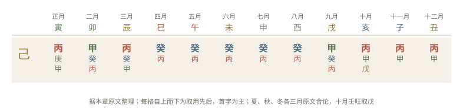

# 论己土

## 正月己土

正月的己土

> 正月己土，田园犹冻，盖因腊气未除，余寒未退，故丙为尊，得丙照暖，万物自生，忌见壬水，反为己病，何也，壬乃江湖之水，湖水一发，则田园洗荡，变为沙土，而根苗尽没矣，须戊作堤，以保园圃，壬多要见戊制，有戊出干者，定主玉堂金马，若乏制戊，必属平常。

正月的己土，田园还冻着，因为腊月的寒气没有消除、余寒没有退去，所以以丙火为最重要；得丙火照暖，万物自然生长。忌见壬水，反成己土的病。为什么？壬水是江湖之水，湖水一泛滥，田园就被冲刷，变成沙土，根苗全被淹没了；必须用戊土作堤，来保护园圃。壬水多就要见戊土来制；有戊土透干的，必主入翰林、做显官；如果缺少戊土来制，必属平常。

（译注：“乏制戊”疑当作“乏戊制”。）

> 或一派甲木，有庚出干，加以癸丙齐透，配得中和，亦名利双全。

如果满局甲木，有庚金透干，再加上癸、丙都透出，配得中和，也名利双全。

> 即丙生寅月，庚透天干，亦有俊秀。

即使只有丙火生在寅月，庚金透出天干，也是俊秀之才。

> 若甲多无庚，残疾废人，宜用丁泄。

如果甲木多而没有庚金，是残疾废人，宜用丁火来泄甲木之气。

> 或一派火，即不见水无碍，何也，正月己土湿，必丙燥暖，反主厚禄，加一癸透，科甲自然，戊透，反作常人。

如果满局是火，即使不见水也无妨。为什么？正月的己土湿，必须丙火来燥暖，反而主厚禄；再加一个癸水透出，自然科举及第；戊土透出，反而是平常人。

> 或一派戊土，有甲出制，又主荣显，如见乙出，虽多不能疏土，且乙多者奸诈小人。

如果满局戊土，有甲木透出来制，又主荣耀显达；如果见乙木透出，即使多也不能疏土，而且乙木多的是奸诈小人。

> 用丙者，木妻，火子。

用丙火的，木妻火子。

## 二月己土

二月的己土

> 二月己土，阳气渐升，虽禾稼未成，万物出土，田园未展，先取甲木疏之，忌合，次取癸水润之，甲癸出干，定主科甲，加以一丙出透，势压百僚，一见壬水，微末官职。

二月的己土，阳气渐渐上升，虽然庄稼还未长成，万物已经出土，田园还未铺展开来，先取甲木来疏通，忌甲己相合；其次取癸水来滋润。甲、癸透干，必主科举及第；再加一个丙火透出，权势压倒百官；一见壬水，只是微末小官。

> 或见庚制甲，壬水出干，比劫重重，此必俗子，丙透犹有小富，丙藏衣禄无亏。

如果见庚金制甲，壬水透干，比劫又重重，这必定是俗人；丙火透出，还有小富；丙火藏支，衣食不缺。

> 或支成木局，庚透富贵，若柱多乙木，乙又屈庚，庚必输情於乙，不能扫邪於正，此必狡诈之徒，运入东南，恐有不测，当用丁泄之，有丁者，小人而已，不致无良。

如果地支成木局，庚金透出则富贵。如果柱中乙木多，乙又使庚屈从，庚必定向乙示好，不能扫除邪气、归于正道，这必定是狡诈之徒；大运走东南，恐有不测之祸，应当用丁火来泄木。有丁火的，只是个小人而已，不至于丧尽天良。

> 无比印，从杀者贵。

没有比劫、印绶，从杀的贵。

> 若柱中无甲丙癸者，皆下格，妻子用神仝前。

如果柱中没有甲、丙、癸，都是下格。妻子与用神的取法同前。

> 【命例】癸卯 乙卯 己巳 庚午

> 【命例】癸卯 乙卯 己巳 乙丑

## 三月己土

三月的己土

> 三月己土，正栽培禾稼之时，先丙後癸，土暖而润，随用甲疏，三者俱透天干，必官居黄阁，或三者透一，科甲定然，但要得地，郤以庚金为病。

三月的己土，正是栽培庄稼的时候，先丙后癸，土暖而又湿润，随后用甲木来疏通。三者都透出天干，必定官居宰相；或者三者中透出一个，也必定科举及第，但要得地；却以庚金为病。

（译注：“黄阁”指宰相官署。）

> 或有丙甲无癸，亦可致富，但不贵显，或有癸而无甲丙，亦有衣衿，或有丙癸无甲，亦系才人，丙癸全无，流俗之辈。

如果有丙、甲而没有癸，也可以致富，但不贵显；如果有癸水而没有甲、丙，也能做个秀才；如果有丙、癸而没有甲，也是有才之人；丙、癸全无，是流俗之辈。

> 或一片乙木，无金制伏，贫而且夭也，妻子仝前。

如果满局乙木，没有金来制伏，既贫且夭。妻子的取法同前。

> 【命例】壬子 甲辰 己卯 丙寅

> 【命例】辛未 壬辰 己巳 甲子

> 【命例】壬子 甲辰 己卯 壬申

## 三夏己土

夏季三个月的己土

> 三夏己土，杂气才官，禾稼在田，最喜甘沛，取癸为要，次用丙火，夏无太阳，禾稼不长，故无癸曰旱田，无丙曰孤阴。

夏季的己土，财官杂气，庄稼在田里，最喜欢甘霖充沛，以癸水为要，其次用丙火；夏天没有太阳，庄稼也不长。所以没有癸水叫“旱田”，没有丙火叫“孤阴”。

> 或丙癸两透，又加辛金生癸，此富贵之格，名水火既济，鼎甲之人，郤忌戊癸化合。

如果丙、癸都透出，再加上辛金生癸水，这是富贵之格，叫“水火既济”，是科举前三名的人物；却忌戊癸化合。

> 或有丙无癸，有壬亦可，但不大发。

如果有丙无癸，有壬水也可以，但不会大发。

> 或一丙火烈土，加以丁火制辛，癸水无根，如七八月之间旱，则苗槁矣，此命孤苦零丁，或有甲木，又见丙火重重，无济水解炎，亦孤贫到老。

如果一个丙火炙烈土，再加上丁火制住辛金，癸水无根，就像（农历）七八月间的干旱，禾苗都枯槁了，这个命孤苦伶仃。如果有甲木，又见丙火重重，没有水来解炎，也孤贫到老。

> 如有壬水，又见庚辛，此又不作孤看，但恐目疾，心肾肝脏之灾，若壬水有根，辛金得地，又非此而论，或壬癸并出，破火润土，此人聪颖特达，富中取贵，又转祸为福也。

如果有壬水，又见庚辛金，这又不作孤贫看，但怕有眼疾以及心、肾、肝脏的病；如果壬水有根，辛金得地，又不这样论。如果壬、癸一起透出，破火润土，这人聪明颖悟、才识出众，在富中取贵，又是转祸为福了。

> 用癸者，金妻，水子，用丙者，木妻，火子。

用癸水的，金妻水子；用丙火的，木妻火子。

> 【命例】己巳 己巳 己巳 戊辰

> 【命例】乙巳 辛巳 己巳 辛未

> 【命例】乙丑 辛巳 己巳 庚午

> 【命例】丙申 癸巳 己亥 乙亥

## 三秋己土

秋季三个月的己土

> 三秋己土，万物收藏之际，外虚内实，寒气渐升，须丙火温之，癸水润之，不特此也，且癸能泄金，丙能制金，补土精神，则秋生之物咸茂矣，癸先丙後。

秋季的己土，正是万物收藏的时候，外虚内实，寒气渐渐上升，须用丙火来温暖，癸水来滋润。不仅如此，癸水还能泄金之气，丙火能制金，补益土的精神，这样秋天生长的东西都茂盛了。取用癸先丙后。

> 丙癸两透，雁塔题名，或无癸，有两丙透者，异途显达，或武职权高，或有丙火，不见壬癸，为假道斯文，终无诚实，或有壬癸无丙者，衣食充足，才能而已。

丙、癸都透出，金榜题名。如果没有癸水，有两个丙火透出，从科举以外的途径显达，或者做武职而权高。如果有丙火而不见壬癸，是假装斯文，终究不诚实。如果有壬癸而没有丙火，衣食充足，只是有些才能而已。

> 或支成金局，癸透有根，此人家畜万缗，富中取贵。

如果地支成金局，癸水透出有根，这人家财万贯，在富中取贵。

> 或支四库，甲透者富，乏甲者孤贫，或甲出无癸乏金，积德可全科甲，或会火局，无水救，乃大奸大恶之徒。

如果地支是辰戌丑未四库，甲木透出的富，缺甲木的孤贫。如果甲木透出而没有癸水、缺金，积德可以成就科举。如果会成火局，又没有水来救，是大奸大恶之徒。

> 或丙透癸藏，遇金颇有选援，加一壬辅，富贵慷慨，有贤声，见戊透者，主遭凶厄且贫。

如果丙透癸藏，遇金就颇有被选拔援引的机会；再加一个壬水辅助，富贵而慷慨，有贤名；见戊土透出的，主遭凶厄，而且贫穷。

> 八月支成金局，无丙丁出救，此人零丁孤苦，如得丙透丁藏，生己元神，此人名魁天下，五福完人。

八月地支成金局，没有丙丁火透出来救，这人伶仃孤苦；如果得丙火透出、丁火藏支，生扶己土的元神，这人名冠天下，是五福俱全的人。

> 总之三秋己土，先癸後丙，取辛辅癸，九月土盛，宜甲木疏之，余皆酌用。

总之，秋季的己土，先癸后丙，取辛金辅助癸水；九月土盛，宜用甲木来疏通，其余都酌情使用。

> 【命例】甲寅 癸酉 己未 壬申

> 【命例】己巳 甲戌 己丑 壬申

> 勾陈全备润下，劳碌奔波之客，土凝水竭，离乡背井之流。

勾陈（戊己土）俱全，又成润下（水局），是劳碌奔波之人；土凝结而水枯竭，是离乡背井之流。

> 勾陈得位会才官，无冲无破必然端，甲子北方寅卯木，管教环拱戴金冠，戊己喜亥卯未为官，申子辰为才，忌刑冲杀害。

“勾陈得位会财官，无冲无破必然端；甲子北方寅卯木，管教环拱戴金冠。”（土得位又会合财官，没有冲破，必然端正；有北方水与寅卯木环拱，定能戴上官帽。）戊己土喜亥卯未为官，申子辰为财，忌刑、冲、杀、害。

## 三冬己土

冬季三个月的己土

> 三冬己土，湿泥寒冻，非丙暖不生，取丙为尊，甲木参酌，戊土癸水不用，惟初冬壬旺，取戊制之，余皆用丙丁，但丁不能解冻除寒，不能大济。

冬季的己土，是寒冻的湿泥，没有丙火温暖就不能生发，以丙火为最重要，甲木参酌使用，戊土、癸水不用。只有初冬壬水旺，取戊土来制；其余都用丙丁火，但丁火不能解冻除寒，帮助不大。

> 或干透一丙，支藏一丙，如以甲透，科甲有准，即藏丙无制，亦主衣衿。

如果天干透一个丙火，地支藏一个丙火，再加上甲木透出，科举有准；即使只有丙火藏支而不受制，也主做秀才。

> 或多壬水，得戊透制之，此命安然富中取贵，不见戊土，富屋贫人，凡三冬己土，见壬水出干，为水浸湖田，此人孤苦，若见火不孤，见土不贫。

如果壬水多，得戊土透出来制，这个命安然在富中取贵；不见戊土，是富人家的穷人。凡是冬季的己土，见壬水透干，是“水浸湖田”，这人孤苦；如果见火就不孤，见土就不贫。

> 或一派癸，不见比劫，此为从才，反主富贵，虽不科甲，恩诰有之，若见比争，平常人物，妻子主事，从才者，木妻，火子。

如果满局癸水，不见比劫，这是从财格，反而主富贵；虽然不能科举及第，也有朝廷的封赠。如果见比劫来争，是平常人物，由妻子当家。从财格，木妻火子。

> 或一派戊己，取甲制之，甲透者富贵。

如果满局戊己土，取甲木来制，甲木透出的富贵。

> 或一片辛庚，须用丙火，还须丁火为助，丙藏，富贵奇特之命。

如果满局庚辛金，须用丙火，还须丁火来帮助；丙火藏支，是富贵奇特之命。

> 【命例】壬申 癸丑 己丑 甲戌

> 【命例】壬子 癸丑 己卯 己巳

*图 6-1　己土十二月调候用神：据本章各节原文整理。（译者补绘，原书无此图）*
