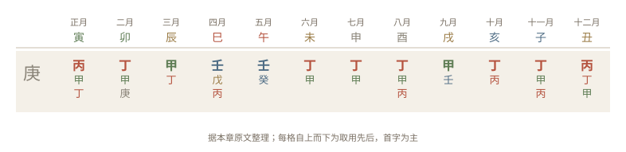

# 论金

> 金以至阴为体，中含至阳之精，乃能坚刚，独异众物，若独阴而不坚，冰雪是也，遇火则消矣，故金无火链，不能成器，金重火轻，执事繁难，金轻火重，煆炼消亡，金极火盛，为格最精，金火全，名曰铸印，犯丑字，即为损馍，金火多名为乘轩，遇死衰，反为不利，木火炼金，成名锐而退速，纯金遇水，逢富显以赢余，金能生水，火旺则金沉，土能生金，金多则土贱，金无水乾枯，水重，则沉沦无用，金无土死绝，土重，则埋没不显，两金两火，最上，两金两木，才足，一金生三，氻弱难胜，一金得三木，顽钝自损，金成则火灭，故金未成器，欲得见火，金已成器，不欲见火，金到申酉巳丑，亦可谓之成也，运喜西北，不利南方。

金以极阴为本体，其中含着极阳的精华，所以能坚硬刚强，与众物不同。如果只有阴而不坚硬，那就是冰雪，遇火就消融了。所以金没有火来锻炼，不能成器。金重火轻，做事繁难；金轻火重，就被熔炼消亡；金极强而火极盛，格局最为精妙。金火俱全，叫“铸印”；犯丑字，就是“损模”（毁坏模具）。金火多，叫“乘轩”（乘坐官车）；遇死衰之地，反而不利。木火炼金，成名快而退得也快；纯金遇水，能富贵显达而有盈余。金能生水，但火旺金就下沉；土能生金，但金多土就贱。金没有水就干枯，水重就沉沦无用；金没有土就死绝，土重就被埋没不显。两金两火，最上；两金两木，财足；一金生三水，力弱难以胜任；一金遇三木，顽钝而自损。金成器后火就该灭，所以金未成器时，想要见火；金已成器，就不想见火。金到申、酉、巳、丑，也可以说是成器了。大运喜走西北，不利南方。

（译注：“火链”当作“火炼”，“损馍”当作“损模”，“一金生三，氻弱难胜”当作“一金生三水，力弱难胜”。）

## 春月之金

春天的金

> 生於春月，余寒未尽，贵乎火气为荣，性柔体弱，欲得厚土辅助，水盛增寒，难施锋锐之势，木旺损力，有剉钝之厄，金来比助，扶持最妙，比而无火，失类非良。

金生在春天，余寒未尽，以有火气为贵为荣。春金性柔体弱，需要厚土来辅助；水盛会增加寒气，难以施展锋锐之势；木旺会损耗金的力量，有挫钝的灾厄。有金来比助扶持最妙；但有比肩而没有火，也不好。

## 夏月之金

夏天的金

> 夏月之金，尤为柔弱，形质未具，尤嫌死绝，火多而郤为不厌，水盛而滋润呈祥，见木而助么伤身，遇金而扶持精壮，土薄而最为有用，土厚而埋没无光。

夏天的金，更加柔弱，形质还没有具备，尤其嫌忌死绝之地。火多却不嫌弃（“不厌”疑当作“不美”）；水盛来滋润则吉祥；见木就助火伤身；遇金来扶持就精壮；土薄最有用，土厚就被埋没无光。

（译注：“助么”当作“助鬼”，即木生火来克金。）

## 秋月之金

秋天的金

> 秋月之金，当权得令，火来煆炼，遂成钟鼎之材，土多培养，反惹顽浊之气，见水则精神越秀，逢木则琢削施威，金助愈刚，刚过则决，气重愈旺，旺极则衰。

秋天的金，当权得令。火来锻炼，就成为钟鼎之材；土多来培养，反而招来顽浊之气；见水，精神更加秀发；遇木，就能雕琢削砍、施展威力；有金相助就更加刚强，但刚过了头就会折断；气重就更旺，但旺到极点就会衰。

## 冬月之金

冬天的金

> 冬月之金，形寒性冷，木多则难施琢削之功，水盛而未免沉潜之患，土能制水，金体不寒，火来助土，子母成功，喜比肩聚气相扶，欲官印温养为利。

冬天的金，形体寒冷，性情冰冷。木多就难以施展雕琢削砍之功；水盛则免不了沉没潜藏之患。土能制水，金体就不寒；火来生土，母（土）子（金）都能成功。喜比肩聚气相扶，要有官（火）印（土）来温养才有利。

## 正月庚金

正月的庚金

> 正月庚金，木旺之际，有土皆死，不能生金，且金之寒气未除，先用丙暖庚性，又虑土厚埋金，须甲疏泄，丙甲两透，科甲显荣，二者透一，亦有生监，丙藏甲透，异路功名。

正月的庚金，正当木旺之时，有土也都是死土，不能生金；而且金的寒气还没消除，先用丙火来温暖庚金的性质；又怕土厚埋金，须用甲木疏通。丙、甲都透出，科举显荣；二者透出一个，也能成为生员、监生；丙藏甲透，从科举以外的途径得功名。

> 或柱中土多，甲透者贵，甲藏者富，庚出则否。

如果柱中土多，甲木透出的贵，甲木藏支的富；有庚金透出（劈甲）就不行。

> 或丁火出干，加以戊己而无水者，又主富贵，何也，寅中甲木，引丁有根，无水为病，名官星有气，才旺生扶，故以富贵推之，如火多则用土，用土者火妻土子。

如果丁火透干，再加上戊己土而没有水，又主富贵。为什么？寅中的甲木引丁火，丁火有根，没有水来作病，叫“官星有气”，又有财旺来生扶，所以按富贵来推。如果火多就用土；用土的，火妻土子。

> 或支成炎局，壬透，有根者，大富贵，无根者，小富贵，乏水者，残疾之人。

如果地支成火局，壬水透出：有根的，大富贵；无根的，小富贵；缺水的，是残疾之人。

> 或木被金伤，无丙丁出制，支无丁火，此系平人，或丙遭癸困，无戊制者亦然。

如果木被金伤，没有丙丁火透出来制金，地支也没有丁火，这是平常人；如果丙火被癸水所困，又没有戊土来制癸，也是这样。

> 总之正月庚金，丙甲为上，丁火次之，春金多火，不夭则贫，阳金最喜火炼，煆炼太过，反主奔流。

总之，正月的庚金，以丙、甲为上，丁火次之。春天的金火多，不是短命就是贫穷。阳金最喜欢火炼，但锻炼太过，反而主奔波流荡。

> 【命例】壬子 壬寅 庚申 庚辰

> 【命例】辛巳 庚寅 庚戌 丙戌

## 二月庚金

二月的庚金

> 二月庚金，柱中自然有乙，当令之乙，见庚必留情於乙，此金有暗强之势，如秋金一理，故二月庚金，专用丁火，借甲引丁，借庚劈甲，无丁用丙者，富贵多出於勉强。

二月的庚金，柱中（月令卯）自然有乙木；当令的乙木见到庚金，庚必定对乙留情相合，这样庚金就有暗中转强的势头，与秋天的金同理。所以二月的庚金专用丁火，借甲木来引丁，借庚金来劈甲。没有丁火而用丙火的，富贵多出于勉强。

> 或丁在干，甲透引丁，支下再见一庚制甲，配得中和，必然大贵，如不见庚合者，虽丁甲两透，亦属平人，春丁不旺不衰，故用甲为佐丁之物，甲若无庚劈，则不能引丁，乙木虽多，又忌湿乙伤丁，难为丁母，故有丁甲无庚者，常人，有丁庚，甲不出干者，常人，或丁透无庚甲者，可许贡监，无丁有丙者，异路功名。

如果丁火在天干，甲木透出引丁，地支下再见一个庚金来劈甲，配得中和，必然大贵；如果不见庚金，即使丁、甲都透出，也属平常人。春天的丁火不旺不衰，所以用甲木作为辅佐丁火之物；甲木如果没有庚金来劈，就不能引丁。乙木虽多，又忌湿乙伤丁，难以作丁火之母。所以有丁、甲而没有庚的，是平常人；有丁、庚而甲不透干的，是平常人；丁透而没有庚、甲的，可以成为贡生、监生；没有丁而有丙的，从科举以外的途径得功名。

（译注：“不见庚合者”之“合”字疑衍。）

> 或一片甲乙，忌庚出帮破才，乃从才格，反主富贵，若见一比，又主孤贫。

如果满局甲乙木，忌庚金透出来帮身破财，这是从财格，反而主富贵；如果见一个比肩，又主孤贫。

> 从才者，火妻土子，用丁者，取甲为妻，若有庚制，难许同偕。

从财格，火妻土子；用丁火的，取甲木为妻，如果有庚金来制甲，难以夫妻偕老。

> 死金嫌盖顶之泥，重见戊己，如人压伏之象，须甲透为妙。

死金嫌忌“盖顶之泥”，重见戊己土，就像人被压伏一样，须甲木透出才妙。

> 【命例】庚申 己卯 庚寅 丁丑

> 【命例】庚午 己卯 庚子 甲申

> 【命例】辛酉 辛卯 庚寅 丁亥

> 【命例】丙申 辛卯 庚辰 丁亥

## 三月庚金

三月的庚金

> 三月庚金，戊土司令，无生金之理，有埋金之忧，故先甲後丁，不用庚劈甲，三月之庚，土旺金顽，顽金宜丁，旺土须甲，乏甲不能立业，乏丁焉能成名，二者少一，富贵不真，庚金无火，非夭则贫，身弱才多，富贵不久。

三月的庚金，戊土当令，没有生金的道理，反而有埋金的忧患，所以先甲后丁，不用庚金劈甲。三月的庚金，土旺而金顽，顽金宜用丁火，旺土须用甲木；缺甲木不能立业，缺丁火怎能成名？二者少一个，富贵就不真实。庚金没有火，不是短命就是贫穷；身弱财多，富贵不长久。

> 得丁甲丙透，不见比肩，科甲之命，但要好运相催，甲透丁藏，采芹拾芥，甲藏丁透，异路功名，丁甲俱藏，不受庚制，富中取富，刀笔起家，有甲无丁，平常之辈，有丁无甲，迂儒腐儒，丁甲两无，下贱之流。

得丁、甲、丙透出，不见比肩，是科举之命，但要好运来推动；甲透丁藏，能轻易考中秀才；甲藏丁透，从科举以外的途径得功名；丁、甲都藏，不受庚金所制，在富中取富，以文书起家；有甲无丁，平常之辈；有丁无甲，是迂腐的读书人；丁、甲两无，下贱之流。

（译注：“富中取富”疑当作“富中取贵”。）

> 或一甲，无丁，有丙，由行伍而得官职，须不见壬，癸，为妙。

如果有一个甲木，没有丁火，有丙火，由行伍出身而得官职，须不见壬、癸水才妙。

> 或支成土局，无木，贫贱僧道，见乙，奸诈小人。

如果地支成土局，没有木，是贫贱的僧道；见乙木，是奸诈小人。

> 或支成火局，癸水透，富贵，有丙丁出干，见壬制之，方吉，无制，残疾之人。

如果地支成火局，癸水透出，富贵；有丙丁火透干，要见壬水来制才吉；没有制，是残疾之人。

> 用甲者，水妻木子，用丁者，木妻火子。

用甲木的，水妻木子；用丁火的，木妻火子。

> 【命例】庚子 庚辰 庚申 壬午

## 四月庚金

四月的庚金

> 四月庚金，长生於巳，巳内有戊，丙不熔金，故不畏火炎，丙亦可作用，但先壬水，方得中和，故曰群金生夏，喜用勾陈，次取戊土，丙火佐之，三者皆全，登科及第，即透一二，亦非白丁。

四月的庚金，长生在巳；巳中有戊土，丙火熔不了金，所以不怕火炎，丙火也可以作用神；但要先用壬水，才能得到中和。所以说“群金生夏，喜用勾陈”（夏生的金喜用土）。其次取戊土，丙火辅佐。三者都全，登科及第；即使只透出一两个，也不是白丁。

> 或一派丙火，名曰假杀为权，须不见壬制者，此人假作清，高并无仁义，刑妻克子，有壬制者，又主荣华，壬藏支者，有富贵之名，而无其实。

如果满局丙火，叫“假杀为权”；如果不见壬水来制，这人假装清高，其实毫无仁义，刑妻克子；有壬水来制的，又主荣华；壬水藏在地支的，有富贵之名而无富贵之实。

> 或支成金局，变弱为强，用丙无力，用丁方妙，故丁透者吉，无丁，无用之人，或丁出三四，煆制太过，其人奔波。

如果地支成金局，由弱变强，用丙火无力，用丁火才妙；所以丁火透出的吉，没有丁火的是无用之人。如果丁火透出三四个，锻炼制伏太过，这人奔波劳碌。

> 四月庚金，须用壬丙戊，但非拘执先後，宜分病用药，妻子仝前。

四月的庚金，须用壬、丙、戊，但不必拘泥于先后顺序，宜根据病症来用药。妻子的取法同前。

> 偷戟成功，入火乡而反害，金逢火已损，再见火必伤，庚辛火旺怕南方，逢辰巳之乡，又为荣断。

“偷戟成功，入火乡而反害”（金已成器，再入火乡反而受害）：金遇火已经受损，再见火必定受伤。庚辛金在火旺之时怕走南方；遇辰、巳之地，又可以断为荣显。

## 五月庚金

五月的庚金

> 五月庚金，丁火旺烈，庚金败地，专用壬水，癸又次之。

五月的庚金，丁火旺烈，是庚金的败地，专用壬水，癸水次之。

> 壬透癸藏，支见庚辛，必然科甲，切忌戊己透干制水，则否，戊藏支内，不失儒林，或壬在支，有金生助，又得金神出干，明经之贵，或癸出带辛，异路之荣。

壬透癸藏，地支见庚辛金，必然科举及第；最忌戊己土透干制水，那就不行了；戊土藏在地支内，不失为读书人。如果壬水在地支，有金来生助，又得金透出天干，可以“明经”（通晓经学）而贵；如果癸水透出又带辛金，从科举以外的途径得荣耀。

> 或支成炎局，乏水者，奔波之客，有壬癸制者，捐纳之人，又见戊己透者则否，无壬癸制火者，又宜戊己出干补金泄火，庶不夭折孤贫。

如果地支成火局，缺水的是奔波之人；有壬癸水来制火的，是捐纳得官之人；又见戊己土透出（制水）的，就不行了。没有壬癸来制火的，又宜戊己土透干，补金泄火，才不至于夭折孤贫。

> 总之仲夏无水，非上格，或一派木火，无伤，印，比劫，又作从杀而论。

总之，仲夏的庚金没有水，不是上格。如果满局木火，没有伤官、印绶、比劫，又作从杀论。

> 己未，庚午，庚戌．

己未、庚午、庚戌（一例）。

（译注：底本此例只存年、月、日三柱，缺时柱。）

## 六月庚金

六月的庚金

> 六月庚金，三伏生寒，顽钝极矣，先用丁火，次取甲木。

六月的庚金，三伏天阴气已生，金顽钝到了极点，先用丁火，次取甲木。

> 丁甲两透名显身荣，忌癸伤丁，有甲无丁，庸俗，有丁无甲，生员，丁甲全无，下贱之人，木虽有，丁不透，支又见水，执鞭之士，丁火无伤，贸易之流。

丁、甲都透出，名显身荣；忌癸水伤丁。有甲无丁，庸俗；有丁无甲，是生员；丁、甲全无，是下贱之人。木虽有而丁不透，地支又见水，是给人执鞭赶车的人；丁火不受伤，是做买卖的人。

> 支会土局，甲先丁後，甲透者，文章显达，丁透者，刀笔扬名。

地支会成土局，先甲后丁；甲木透出的，以文章显达；丁火透出的，以文书扬名。

> 或柱多金，有二丁出制，异路功名。

如果柱中金多，有两个丁火透出来制，从科举以外的途径得功名。

> 【命例】丙辰 丁未 庚申 丁亥

> 【命例】丙午 乙未 庚寅 壬午

> 【命例】癸巳 己未 庚子 甲申

> 【命例】丙辰 乙未 庚辰 癸未

## 七月庚金

七月的庚金

> 七月庚金，刚锐极矣，专用丁火煆炼，次取木引丁，故曰，秋金锐锐最为奇，壬癸相逢总不宜，如逢木火来成局，试看福寿与天齐，如得丁甲两透，定步青云，若有丁无甲为俊秀，有甲无丁是平人，丁甲两无无用物，只堪门下作闲人。

七月的庚金，刚锐到了极点，专用丁火锻炼，其次取木来引丁。所以说：“秋金锐锐最为奇，壬癸相逢总不宜；如逢木火来成局，试看福寿与天齐。”（秋天的金锋锐最奇，遇到壬癸水总不相宜；如果遇到木火成局，福寿与天齐。）如果得丁、甲都透出，必定平步青云；有丁无甲，是俊秀之才；有甲无丁，是平常人；丁、甲两无，是无用之人，只能在别人门下做个闲人。

> 或支成水局，乏丁用丙，柱中即有丙火，不见甲木者，必主愚懦，何也，当时金水两旺，金生水以制火，何能发达，或见甲出引丁，可云生监，甲弱者，衣食充盈。

如果地支成水局，缺丁火就用丙火；柱中即使有丙火，不见甲木的，必主愚钝懦弱。为什么？当时金水两旺，金生水来制火，怎么能发达？如果见甲木透出引丁，可以说是生员、监生；甲木弱的，衣食充足。

> 或支成土局，先甲後丁。

如果地支成土局，先甲后丁。

> 支成火局，富贵中人，金刚木明，行商坐贾之人，金备申酉戌之地，富贵疑，金神入火乡，逢羊刃富贵荣华。

地支成火局，是富贵中人；金刚而木明，是经商做买卖的人。金齐备申酉戌之地（会成金方），富贵无疑；金神进入火乡，遇羊刃，富贵荣华。

（译注：“富贵疑”疑脱一字，当作“富贵无疑”。）

## 八月庚金

八月的庚金

> 八月庚金，刚锐支退，用丁甲，丙不可少，若丁甲透，又见一丙，功名显赫，且见羊刃无刑冲，丙杀藏支，名为羊刃架杀，主出将入相，直介忠臣。

八月的庚金，刚锐之气未退，用丁火、甲木，丙火也不可少。如果丁、甲透出，又见一个丙火，功名显赫；而且月令羊刃（酉）不受刑冲，丙火七杀藏在地支，叫“羊刃架杀”，主出将入相，是正直耿介的忠臣。

（译注：“刚锐支退”疑当作“刚锐未退”。）

> 或丙火重重，一丁高透，亦主科甲，丙出丁藏，异路之仕。

如果丙火重重，一个丁火高透，也主科举及第；丙透丁藏，从科举以外的途径做官。

> 或甲藏支，火透而水不透者，亦主清高，衣衿可望。

如果甲木藏在地支，火透出而水不透出，也主清高，可望做个秀才。

> 或丁藏支内，重见丙火者，此名假杀重重，虽羊刃帖身，郤难从杀也。

如果丁火藏在地支内，又重见丙火，这叫“假杀重重”；虽然有羊刃贴身，却难以从杀。

> 即一丙透，秀而不富，或支见重重甲乙，无用人也，总之旺金木衰，非火莫制，不见丙丁，艺术之辈。

即使一个丙火透出，也是秀而不富；如果地支见重重甲乙木，是无用之人。总之，金旺木衰，没有火就不能制金；不见丙丁火，只是靠手艺技术谋生的人。

> 【命例】丙子 丁酉 庚子 丙子

> 【命例】乙巳 乙酉 庚午 丁亥

> 【命例】己亥 癸酉 庚申 戊寅

## 九月庚金

九月的庚金

> 九月庚金，戊土司令，最怕土厚埋金，宜先用甲疏，後用壬洗，则金自出矣，忌见己土浊壬。

九月的庚金，戊土当令，最怕土厚埋金，宜先用甲木疏土，后用壬水洗金，金自然就显露出来了；忌见己土来混浊壬水。

> 壬甲两透，科甲相宜，或甲透壬藏，乡魁可望，甲藏壬透，廪贡堪谋，有甲无壬，犹有学问，有壬无甲，莫问衣衿，壬甲两无，则为下格。

壬、甲都透出，适宜科举及第；甲透壬藏，可望乡试夺魁；甲藏壬透，可以谋得廪生、贡生；有甲无壬，还有学问；有壬无甲，别指望做秀才；壬、甲两无，是下格。

> 或支成水局，丙透救之，此人才高迈众，名重乡闾，不见癸水，一榜可许。

如果地支成水局，丙火透出来救，这人才高出众，名重乡里；不见癸水，可以考中一榜。

> 或四柱戊多金旺，全无甲壬者，即有衣禄，亦不能久，或庚戊多无壬甲者，愚顽之辈。

如果四柱戊土多而金旺，完全没有甲、壬，即使有衣食俸禄，也不能长久；如果庚、戊多而没有壬、甲，是愚顽之辈。

> 【命例】辛酉 戊戌 庚申 甲申

> 【命例】庚寅 丙戌 庚戌 辛巳

> 【命例】辛酉 戊戌 庚申 辛巳

## 十月庚金

十月的庚金

> 十月庚金，水冷性寒，非丁莫造，非丙不暖。

十月的庚金，水冷而金性寒，没有丁火不能锻造成器，没有丙火不能温暖。

> 丁甲两透，支无水局，一榜有之，支藏丙火，桃浪之仙，支见亥子，得己出制，亦有功名。

丁、甲都透出，地支不成水局，可以考中一榜；地支又藏丙火，是科举及第之人；地支见亥子水，得己土透出来制，也有功名。

> 若见丙透无丁者，无显达，丁藏甲透，武职之人，以上不合者，庸俗。

如果见丙火透出而没有丁火，不能显达；丁藏甲透，是武职之人；以上都不合的，是庸俗之人。

> 如金水混杂，全无丙丁者，鄙夫，支成金局，无火者，僧道之命也，书曰，水冷金寒爱丙丁。

如果金水混杂，完全没有丙丁火，是粗鄙之人；地支成金局而没有火的，是僧道之命。书上说：“水冷金寒爱丙丁。”

> 【命例】丁亥 辛亥 庚子 壬午

> 【命例】壬辰 辛亥 庚辰 丙子

## 十一月庚金

十一月的庚金

> 十一月庚金，天气严寒，仍取丁甲，次取丙火照暖，或丁甲两透，丙在支中，必主科甲，即无丙火，亦有衣衿，有丁无甲，亦可富中取贵，有甲无丁，只作常人，或丙透丁藏，异途名望，丁藏有甲，武学可许。

十一月的庚金，天气严寒，仍取丁、甲，其次取丙火来照暖。如果丁、甲都透出，丙火在地支中，必主科举及第；即使没有丙火，也能做个秀才。有丁无甲，也可以在富中取贵；有甲无丁，只是平常人。如果丙透丁藏，从科举以外的途径获得名望；丁藏而有甲，可以考入武学。

> 或重重丙火，可许一富，但不清高，丙戊生寅，或丙底坐寅，有一二者，富真贵假，若见癸透，一介寒儒。

如果丙火重重，可以是个富人，但不清高；丙火、戊土生在寅（长生），或者丙火坐下有寅，有一两个这样的，富是真的、贵是假的；如果见癸水透出，是一介寒儒。

> 或支成水局，不见丙丁者，此乃伤官格，为人清雅，衣禄常盈，但子息艰难耳。

如果地支成水局，不见丙丁火，这是伤官格，为人清雅，衣食常常充足，只是子女艰难罢了。

> 或丙丁太多，名官煞混杂最无良，又怕身轻有损伤，如遇东南二运地，焉能挨得过时光，过於清冷，似有凄凉，柱中一派金水，不入火土之乡，主一生孤贫浪荡，难望有成也。

如果丙丁火太多，叫“官煞混杂最无良，又怕身轻有损伤；如遇东南二运地，焉能挨得过时光。”（官杀混杂最不好，又怕日主身轻受损；如果再走东南木火运，怎么熬得过去。）太过清冷，又似有凄凉之感：柱中满是金水，大运又不走火土之乡，主一生孤贫浪荡，难以指望有成就。

> 【命例】壬子 壬子 庚申 庚辰

> 【命例】辛亥 庚子 庚辰 癸未

> 【命例】乙卯 戊子 庚寅 戊寅

## 十二月庚金

十二月的庚金

> 十二月庚金，寒气太重，且多湿泥，愈寒愈冻，先取丙火解冻，次取丁火炼金，甲亦不可少。

十二月的庚金，寒气太重，而且多湿泥，越寒越冻，先取丙火解冻，次取丁火炼金，甲木也不可缺少。

> 丙丁甲透者，即不科甲，亦有恩荣，有丙无丁甲者，富中取贵，有丁甲无丙者，特达才人，有丙丁无甲者，白手成家，刀笔亨通，乏金更美，或支成金局无水，僧道之流。

丙、丁、甲都透出的，即使不科举及第，也有恩宠荣耀；有丙无丁甲的，在富中取贵；有丁甲无丙的，是才识出众之人；有丙丁无甲的，白手起家，文书事业亨通，缺金更好（“乏金”疑当作“乏水”）。如果地支成金局而没有水，是僧道之流。

> 【命例】庚辰 己丑 庚戌 癸未 ｜ 女命

> 【命例】己巳 丁丑 庚子 甲申

*图 7-1　庚金十二月调候用神：据本章各节原文整理。（译者补绘，原书无此图）*
