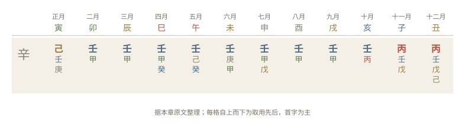

# 论辛金

## 正月辛金

正月的辛金

> 正月辛金，阳气舒而寒未除，不知正月建寅，中有长生之丙，解去寒气，忌甲木司权，辛金失令，取己土为身之本，欲得辛金发现，全赖壬水之功，己壬两透，支见庚制甲，科甲定然，或己土透干，支中有甲，异路恩荣，或己土不全，号曰君臣失势，富贵难全，或有丙火出干，亦主武学，或见壬，无己庚者，贫贱之徒。

正月的辛金，阳气舒展而寒气未除。殊不知正月建寅，寅中有长生的丙火，能解去寒气。忌甲木当权；辛金失令，取己土作为自身的根本；想要辛金显露光彩，全靠壬水的功劳。己、壬都透出，地支见庚金制甲，必定科举及第。如果己土透干，地支中有甲木，从科举以外的途径获得恩荣。如果己土不全，叫“君臣失势”，富贵难全。如果有丙火透干，也主考入武学。如果见壬水而没有己、庚，是贫贱之徒。

> 或支成火局，即壬水出干，不克己土，亦寻常之人，或庚壬两透，破局制火，必为显达之人。

如果地支成火局，即使壬水透干，因为壬水不克己土，也是寻常之人。如果庚、壬都透出，破火局、制火，必定是显达之人。

> 或支成水局，不见丙火，名为金弱沉寒，平常之士，书曰金水性寒寒到底，凄凉难免少年忧，得丙透照暖，反主富贵。

如果地支成水局，不见丙火，叫“金弱沉寒”，是平常之士。书上说：“金水性寒寒到底，凄凉难免少年忧。”得丙火透出照暖，反而主富贵。

> 故正月辛金，先己後壬，己为君，庚为佐，如用丙火须参看，用己，火妻土子，用壬，金妻水子。

所以正月的辛金，先己后壬：己土为君，庚金为佐；如果用丙火，须参酌来看。用己土的，火妻土子；用壬水的，金妻水子。

> 辛金珠玉，最怕红炉，辛逢卯日，子时，名曰朝阳。

辛金是珠玉，最怕红炉（火炼）。辛卯日、子时（戊子时），叫“朝阳”。

（译注：此即“六阴朝阳格”，辛日戊子时，以子遥合巳中丙火为官。）

> 【命例】丙辰 庚寅 辛酉 己丑

## 二月辛金

二月的辛金

> 二月辛金，阳和之际，壬水为尊，见戊己为病，得甲制伏，则辛金不致埋没，壬水不致混浊，合此者必身入玉堂，故二月庚金，有壬甲透者贵显，不则，乡绅，或壬坐亥支，不见土出，可能入芥，家亦小康，得申中之壬者，异途名望，无壬者常人，其生克之理，与正月辛金皆同。

二月的辛金，正当阳和之时，以壬水为最重要，见戊己土为病；得甲木来制伏，辛金就不至于被埋没，壬水也不至于混浊，合此的必定入翰林。所以二月的辛金，有壬、甲透出的贵显；否则也是乡绅。如果壬水坐亥，不见土透出，可以考中秀才，家境也小康；得申中壬水的，从科举以外的途径获得名望；没有壬水的是平常人。其中生克的道理，与正月辛金都相同。

（译注：“二月庚金”当作“二月辛金”；“入芥”疑当作“入泮”。）

> 或壬戊透，甲不出干，此为病不遇药，平常之人，得乙破戊，颇有衣衿，但假名假利，刻薄乖张。

如果壬、戊透出，甲木不透干，这是“有病不遇药”，是平常之人；得乙木来破戊，颇能做个秀才，但名利都是假的，为人刻薄乖张。

> 或一派壬水汪洋，名金水淘洗太过，不得中和，略有衣食，全无作为，如壬水重重，得戊反吉。

如果满局壬水汪洋，叫“金水淘洗太过”，不得中和，略有衣食，毫无作为；如果壬水重重，得戊土反而吉。

> 或支成木局，泄尽壬水，有庚富贵，无庚平人。

如果地支成木局，泄尽壬水，有庚金则富贵，没有庚金是平常人。

> 或支成火局，名官印相争，金水两伤，下流之格，得二壬出制，富贵反奇。

如果地支成火局，叫“官印相争”，金水两伤，是下流之格；得两个壬水透出来制，富贵反而奇特。

> 辛金生於春季，一派壬水，而无丙水，即能显达，家无宿舂，得壬丙齐透，方许大富大贵。

辛金生在春天，满局壬水而没有丙火，即使能显达，家里也没有隔夜之粮；得壬、丙都透出，才能大富大贵。

（译注：“丙水”当作“丙火”。“宿舂”指隔夜舂好的米。）

> 【命例】乙卯 己卯 辛酉 甲午

> 【命例】乙酉 己卯 辛卯 丙申

> 【命例】己未 丁卯 辛巳 己亥

> 【命例】甲午 丁卯 辛未 己亥

> 【命例】壬子 癸卯 辛卯 壬辰

## 三月辛金

三月的辛金

> 三月辛金，戊土司令，辛承正气，母旺子相，先壬後甲，壬甲两透，富贵必然，壬透甲藏，廪贡不失，甲透壬藏，富贵可云，壬甲皆无，平常之格。

三月的辛金，戊土当令，辛金承受正气，母（土）旺而子（金）相。先壬后甲：壬、甲都透出，必然富贵；壬透甲藏，不失为廪生、贡生；甲透壬藏，可以说是富贵；壬、甲都没有，是平常之格。

> 所忌者丙贪合也，如月时皆丙，名为争合，主慷慨风流，交四海，若癸出干制丙，可许采芹，或支坐亥子之乡，支又见申，即非玉堂，亦必高增禄位，若戊出干制水，不见甲乙，清闲之人。

所忌的是丙火贪合（丙辛合）。如果月干、时干都是丙，叫“争合”，主慷慨风流，结交四海；如果癸水透干制丙，可以考中秀才。如果地支坐亥子之乡，地支又见申，即使不入翰林，也必定禄位高升；如果戊土透干制水，不见甲乙木，是清闲之人。

> 又或支见四库，名土厚埋金，不见甲制，愚顽之辈。

又如地支见辰戌丑未四库，叫“土厚埋金”；不见甲木来制，是愚顽之辈。

> 或四柱火多，无水制伏，名火土杂乱，主作缁衣，见癸可解。

如果四柱火多，没有水来制伏，叫“火土杂乱”，主出家为僧（穿黑衣）；见癸水可以化解。

> 或比劫重重，壬癸浅弱，主夭，有甲出干，则贵，然无庚制方妙。

如果比劫重重，壬癸水浅弱，主夭折；有甲木透干则贵，但要没有庚金来制甲才妙。

## 四月辛金

四月的辛金

> 四月辛金，时道首夏，忌丙火之燥烈，喜壬水之洗淘，支成金局，水透出干，有木制戊，名一清澈底，科甲功名，癸透壬藏，富真贵假，若壬癸皆藏，戊己亦藏，略富，若壬癸俱无，反见火出，必主鳏独。

四月的辛金，时值初夏，忌丙火燥烈，喜壬水淘洗。地支成金局，水透出天干，有木来制戊，叫“一清彻底”，能科举得功名。癸透壬藏，富是真的、贵是假的；如果壬癸都藏，戊己也藏，略富；如果壬癸都没有，反而见火透出，必主鳏寡孤独。

（译注：“时道”疑当作“时值”。）

> 或支成火局，有制者吉，无制者凶，凡火旺无水，取土泄之。

如果地支成火局，有制的吉，无制的凶。凡是火旺而没有水的，取土来泄火。

> 若壬水藏亥，戊不出干，亦主上达，有戊常人，有一甲透，衣禄可求，若有甲无壬癸者，富贵虚浮，所谓羊质虎皮是也。

如果壬水藏在亥中，戊土不透干，也主显达；有戊土是平常人；有一个甲木透出，可以谋得衣禄。如果有甲木而没有壬癸，富贵虚浮，就是所谓“羊质虎皮”（外强中干）。

> 壬，癸，甲，三者全无，又不合格，斯为下品。

壬、癸、甲三者全无，又不合格局，这是下品。

> 【命例】乙未 辛巳 辛亥 乙未

## 五月辛金

五月的辛金

> 五月辛金，丁火司权，辛金失令，阴柔之极，不宜煆炼，须己壬兼用，何也，己为泥沙，壬为湖海，己无壬不湿，辛无己不生，故壬己并用，无壬，癸亦可用，但癸力小，或支成火局，即重见癸出，亦不济，得壬透破火方可，必主生员，若无壬，癸见戊，虽有午宫己土，燥泥成灰，金必煆熔，反遭埋没，必为僧道，有一二重比肩，不致孤独。

五月的辛金，丁火当权，辛金失令，阴柔到了极点，不宜锻炼，须己土、壬水兼用。为什么？己土是泥沙，壬水是湖海；己土没有壬水就不湿，辛金没有己土就不生，所以壬、己一起用。没有壬水，癸水也可用，但癸水力量小。如果地支成火局，即使重见癸水透出，也不济事，要得壬水透出破火才可以，必主生员。如果没有壬癸而见戊土，虽然有午宫中的己土，也是燥泥成灰，金必定被熔炼，反遭埋没，必为僧道；有一两重比肩，不至于孤独。

（译注：“若无壬，癸见戊”疑当作“若无壬癸，见戊”。）

> 五月辛金，壬，癸，己，三者皆用。

五月的辛金，壬、癸、己三者都用。

> 或壬己两透，支见癸水，不冲，定主显达，即己藏支，亦有廪贡，或无壬有己，须得异途，或癸出有庚，必主衣锦，叨受恩荣，若水土多者，见甲方妙。

如果壬、己都透出，地支见癸水，又不受冲，必主显达；即使己土藏支，也能做廪生、贡生。如果没有壬水而有己土，须从科举以外的途径出身。如果癸水透出又有庚金，必主衣锦荣归，蒙受恩荣。如果水土多，见甲木才妙。

> 庚辛生於夏月，要壬癸得地，若木多火多，不见金水，逢金水运必败。

庚辛金生在夏天，要壬癸水得地；如果木多火多，不见金水，遇金水运必败。

> 【命例】丙子 甲午 辛亥 壬辰

## 六月辛金

六月的辛金

> 六月辛金，己土当权，辅助太多，恐掩金光，先用壬水，取庚佐之，壬庚两透，科甲功名，即不出干，藏支得所，亦有荣华，但忌戊出，得甲制之，方吉，甲须隔位，恐贪己合，反掩金光，又寒壬水之流，下贱之格，又忌庚出制甲，或只有未中一己，见子壬水，又为湿泥，不可见甲，甲出，反作平人，总以一壬一己，见庚无甲，方妙，与五月用己壬同。

六月的辛金，己土当权，生助太多，恐怕遮掩了金的光芒。先用壬水，取庚金辅佐。壬、庚都透出，能科举得功名；即使不透干，藏在地支而得其所，也有荣华。但忌戊土透出，得甲木来制才吉；甲木须与己土隔位，怕甲己贪合，反而遮掩金光，又堵塞壬水的流动，成为下贱之格；又忌庚金透出制甲。如果只有未中一个己土，见子中壬水，又成了湿泥，不可见甲木，甲木透出反而是平常人。总以一壬一己、见庚而无甲才妙，与五月用己、壬相同。

（译注：“又寒壬水之流”当作“又塞壬水之流”。）

> 或丁乙出干，又有庚壬者，显贵，无壬者，否，或支成木局，得壬透，又有庚金发水之源，可云富贵。

如果丁火、乙木透干，又有庚、壬，显贵；没有壬水的，就不行。如果地支成木局，得壬水透出，又有庚金作为水的源头，可以说是富贵。

> 【命例】壬辰 丁未 辛丑 甲午

> 【命例】甲寅 辛未 辛未 丁酉

## 七月辛金

七月的辛金

> 七月辛金，值庚司令，不旺自旺，且壬水居申，四柱不见戊土，胎元戊藏申内，为壬岸，人命得此，为官清正，但不富耳。

七月的辛金，正值庚金当令，不求旺而自旺；而且壬水居于申中，四柱不见戊土，申中藏有戊土，作为壬水的堤岸。人命得此，为官清正，只是不富罢了。

> 或有土无甲，为有病无药，常人，有甲者，衣衿可望。

如果有土而没有甲木，是“有病无药”，是平常人；有甲木的，可望做个秀才。

> 或四柱金多，宜水泄之，若一金水，得一戊土，反为辛用，又宜甲制，自然富贵。

如果四柱金多，宜用水来泄；如果金水都有，得一个戊土，反而为辛金所用，又宜甲木来制，自然富贵。

> 或干支水多，重见戊土，逢生得位，福寿之造。

如果干支水多，重见戊土，又逢生得位，是福寿之命。

> 七月辛金，壬不在多，故书曰，水浅金多，号曰体全之象，壬水为尊，甲戊酌用可也，癸水不可为用。

七月的辛金，壬水不在于多，所以书上说：“水浅金多，号曰体全之象。”以壬水为最重要，甲、戊酌情使用就可以了；癸水不可作为用神。

> 【命例】甲午 壬申 辛卯 癸巳

## 八月辛金

八月的辛金

> 八月辛金，当权得令，旺之极矣，专用壬水淘洗，故云金见水以流通，如见戊己，则生扶太过，故以土为病，见甲制土，方妙，无戊，不宜用甲。

八月的辛金，当权得令，旺到了极点，专用壬水淘洗，所以说“金见水以流通”。如果见戊己土，就生扶太过，所以以土为病，见甲木来制土才妙；没有戊土，就不宜用甲木。

> 或四柱一点壬水，甲多泄水，此为用神无力，奸诈之徒，得庚制者，反主仁义，或三点辛金，一重壬水，多见甲木，有庚透者，主大富贵，不见丁为美，若见一丁，此人风雅清高，衣食饶裕而已。

如果四柱只有一点壬水，甲木多而泄水，这是用神无力，是奸诈之徒；得庚金来制甲的，反而主仁义。如果有三点辛金、一重壬水，多见甲木，有庚金透出，主大富贵；不见丁火为美；如果见一个丁火，这人风雅清高，衣食富足而已。

> 或一二比肩，壬甲皆一，无庚出干，亦有恩荣。

如果有一两个比肩，壬、甲各一个，没有庚金透干，也有恩荣。

> 若二三比肩，一点壬水，戊土多见，此为土厚埋金，此人愚懦，见一甲出，必为创立之人。

如果有两三个比肩、一点壬水，戊土多见，这是“土厚埋金”，这人愚钝懦弱；见一个甲木透出，必定是能开创事业的人。

> 或一派辛金，一位壬水，无庚杂乱，又主富中取贵。

如果满局辛金，一位壬水，没有庚金杂乱，又主在富中取贵。

> 或一派壬水泄金，无戊出制，为沙水同流，主奔波贫苦，若得支见一戊止流，其人颇有才略，艺术过人。

如果满局壬水泄金，没有戊土透出来制，是“沙水同流”，主奔波贫苦；如果得地支见一个戊土来止住水流，这人颇有才略，技艺过人。

> 或支成金局，干见比肩，无壬淘洗，此宜用丁，无丁必主凶顽无赖，若得一壬高透，以泄群金，又名一清到底，定有治国之材。

如果地支成金局，天干见比肩，没有壬水淘洗，这就宜用丁火；没有丁火，必主凶顽无赖。如果得一个壬水高透，来泄群金之气，又叫“一清到底”，必定有治国之才。

> 或支成金局，戊己透干，壬透无火，名白虎格，运行西北，富贵大显，子息艰难，或透丙火，虽有壬出，亦属平庸。

如果地支成金局，戊己土透干，壬水透出而没有火，叫“白虎格”，大运走西北，富贵大显，但子女艰难；如果透出丙火，即使有壬水透出，也属平庸。

> 或一二辛金，一派己土，定为僧道，或干透己土，支见庚甲，一生安闲。

如果一两个辛金、满局己土，必定为僧道；如果天干透出己土，地支见庚、甲，一生安闲。

> 或一派乙木，不见庚壬，为才多身弱，一见庚制，富贵可期。

如果满局乙木，不见庚、壬，是“财多身弱”；一见庚金来制，富贵可期。

> 金生秋月土重，贫无寸铁，六辛日透戊子时，运喜西方，阴若朝阳，切忌丙丁离位，庚辛局全巳酉丑，位重权高。

金生在秋天而土重，穷得连寸铁都没有。六辛日（辛日）透出戊子时，大运喜走西方，这是“六阴朝阳”，最忌丙丁火及南方离位。庚辛金局全巳酉丑，位重权高。

（译注：“阴若朝阳”当作“六阴朝阳”。）

> 【命例】己酉 癸酉 辛未 己亥

> 【命例】丁酉 己酉 辛酉 丙申

> 【命例】丁卯 己酉 辛亥 壬辰

## 九月辛金

九月的辛金

> 九月辛金，成土司令，母旺子相，须甲疏土，壬泄旺金，先壬後甲，壬甲两透，桃洞之仙，或壬透甲藏，又见者，平人，甲透，壬藏，戊在支内，异途之仕。

九月的辛金，戊土当令，母旺子相，须甲木疏土、壬水泄旺金，先壬后甲。壬、甲都透出，是科举及第之人。如果壬透甲藏，又见（戊土）的，是平常人；甲透壬藏，戊土在地支内，从科举以外的途径做官。

（译注：“成土”当作“戊土”；“桃洞”当作“桃浪”；“又见者”疑脱“戊”字。）

> 或辛日甲月，壬水在支，有庚自能去浊留清，秋闻一榜，若戊戌月，即有甲在支亦否。

如果辛日、甲月，壬水在地支，有庚金自然能去浊留清，能考中乡试一榜；如果是戊戌月，即使地支有甲木也不行。

（译注：“秋闻”当作“秋闱”，即乡试。）

> 总之土太多，甲不出干，莫问功名，一壬出，洗土助甲，虽不发达，富而可求。

总之，土太多而甲木不透干，别指望功名；有一个壬水透出，洗土助甲，虽然不发达，富是可以求得的。

> 或土多无壬甲，时月多透丙辛者，略贵，加以辰字在支，则荣显莫及。

如果土多而没有壬、甲，时干、月干多透出丙、辛，略贵；再加上地支有辰字（丙辛化水得辰），就荣显无比。

> 或木多土厚，无水者常人，或干上重见癸水，虽无淘洗之功，颇有清金之用，此命主富，辛苦。

如果木多土厚，没有水的，是平常人；如果天干上重见癸水，虽然没有淘洗之功，也颇有使金清澈的作用，这个命主富，但辛苦。

> 或己透无壬有癸，亦能滋生金力，衣衿之贵，但恐己多，不免浊富。

如果己土透出，没有壬水而有癸水，也能滋生金的力量，可得秀才之贵；但怕己土多，免不了浊富。

> 九月辛金，火土为病，水木为药。

九月的辛金，以火土为病，以水木为药。

> 【命例】丙戌 戊戌 辛未 壬辰

> 【命例】戊戌 壬戌 辛酉 戊子

> 【命例】丙戌 戊戌 辛未 丁酉

## 十月辛金

十月的辛金

> 十月辛金，时值小阳，阳渐升，寒气将降，先用壬水，次取丙火，壬丙两透，金榜题名，何也，盖辛金有壬水丙火，名金白水清，又在亥月故发。

十月的辛金，时值小阳春，阳气渐升，寒气将降，先用壬水，次取丙火。壬、丙都透出，金榜题名。为什么？因为辛金有壬水、丙火，叫“金白水清”，又生在亥月（壬水禄地），所以发达。

> 丙透壬藏，采芹之造，丙藏壬透，富有千金，壬丙在支，聪明之士。

丙透壬藏，是考中秀才的命；丙藏壬透，富有千金；壬、丙都在地支，是聪明之士。

> 戊壬存柱，积蓄之人，或壬多无戊，名辛水汪洋，反成贫贱，戊多壬少，又主成名。

戊、壬都在柱中，是善于积蓄的人。如果壬水多而没有戊土，叫“辛水汪洋”，反而贫贱；戊多壬少，又主成名。

> 或甲多戊少，因艺术而蓄金。

如果甲木多、戊土少，凭技艺而积蓄钱财。

> 若己多有戊，壬水被困，金被埋，不过诚实之人，或壬癸多无戊丙者，劳碌辛苦，十月辛金，先壬後丙，余皆参用。

如果己土多又有戊土，壬水被困，金被埋没，不过是个诚实之人；如果壬癸水多而没有戊、丙，劳碌辛苦。十月的辛金，先壬后丙，其余都参酌使用。

## 十一月辛金

十一月的辛金

> 十一月辛金，癸水司令，为寒冬雨露，切忌癸出冻金，而困丙火，壬丙两透，不见戊癸，衣锦腰金，即壬藏丙透，一榜堪图。

十一月的辛金，癸水当令，是寒冬的雨露，最忌癸水透出冻金、又困住丙火。壬、丙都透出，不见戊、癸，衣锦腰金（富贵显达）；即使壬藏丙透，也可以图谋考中一榜。

> 或壬多有戊，丙甲出干者，青云之客，若壬多无戊丙者，泄金太过，定主寒儒，或壬多，甲乙重重，无丙火者，贫寒。

如果壬水多而有戊土，丙火、甲木透干的，是青云直上的人；如果壬水多而没有戊、丙，泄金太过，必主寒儒；如果壬水多，甲乙木重重，没有丙火的，贫寒。

> 或支成水局，癸水出干，有二戊制者，富贵恩荣，无戊者常人。

如果地支成水局，癸水透干，有两个戊土来制，富贵恩荣；没有戊土的是平常人。

> 或支见亥子丑，干出比劫，无丙，名润下格，富贵双全，运喜西北，若无庚辛，又出甲乙，无戊丙者，必主僧道。

如果地支见亥子丑（北方水），天干透出比劫，没有丙火，叫“润下格”，富贵双全，大运喜走西北。如果没有庚辛金，又透出甲乙木，没有戊、丙的，必主为僧道。

> 或支成木局，有丁出干，又见戊者，功名特达，冬月辛金，须丙温暖，方妙。

如果地支成木局，有丁火透干，又见戊土的，功名特别显达。冬天的辛金，须丙火来温暖才妙。

## 十二月辛金

十二月的辛金

> 十二月辛金，寒冻之极，先丙後壬，炳不能解冻，无壬不能洗淘，丙壬两透，金马玉堂之客，壬丙俱藏，游庠食　之人，有丙无壬，富真贵假，有壬乏丙，贱而且贫，或丙多，无壬，有癸，市中贸易之流。

十二月的辛金，寒冻到了极点，先丙后壬：没有丙火不能解冻，没有壬水不能淘洗。丙、壬都透出，是入翰林、做显官的人；壬、丙都藏，是入学领廪膳的秀才；有丙无壬，富是真的、贵是假的；有壬缺丙，又贱又贫；如果丙火多，没有壬水而有癸水，是市井中做买卖的人。

（译注：“炳不能解冻”当作“无丙不能解冻”；“食　”底本缺一字，当作“食饩”。）

> 或水多，有戊己出干，又有丙丁，必主衣食充盈，一生安乐，十二月辛金，丙先壬後，戊己次之。

如果水多，有戊己土透干，又有丙丁火，必主衣食充足，一生安乐。十二月的辛金，丙先壬后，戊己次之。

> 【命例】乙丑 己丑 辛丑 戊子

> 【命例】丁丑 癸丑 辛卯 戊子

> 【命例】乙卯 己丑 辛未 丁酉

> 【命例】甲申 丁丑 辛卯 己亥

*图 8-1　辛金十二月调候用神：据本章各节原文整理。（译者补绘，原书无此图）*
