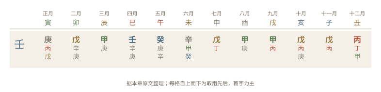

# 论壬水

## 正月壬水

正月的壬水

> 正月壬水，汪洋之象，能并百川之流，然水性柔弱，宜用庚金之源，庶不致汪洋无度，有庚丙戊三者齐透，科甲功名，或庚戊藏支，丙坐寅支者，亦有恩诰，即一庚透，贡监有之。

正月的壬水，有汪洋之象，能汇合百川之流；但此时水性柔弱，宜用庚金作为源头，才不至于汪洋而无节制。有庚、丙、戊三者都透出，能科举得功名；如果庚、戊藏在地支，丙火坐寅，也有朝廷封赠；即使只有一个庚金透出，也能做贡生、监生。

> 凡壬日无比肩羊刃者，不必用戊，专用庚金，以丙为佐。

凡是壬日没有比肩、羊刃的，不必用戊土，专用庚金，以丙火为辅佐。

> 或见比劫，又有庚辛，此弱极复旺，又宜制伏，成透，可云科甲，戊藏，则是秀才，然必丙透不合，为妙。

如果见比劫，又有庚辛金，这是弱极复旺，又宜用戊土来制伏：戊土透出，可以说能科举及第；戊土藏支，就是秀才；但必须丙火透出而不被合，才妙。

（译注：“成透”当作“戊透”。）

> 或支见多戊，又有甲出干，名一将当关，群邪自伏，主光明磊落，名重百寮。

如果地支多见戊土，又有甲木透干，叫“一将当关，群邪自伏”，主光明磊落，名重百官。

> 或支成火局，借不逢时，主名利皆虚，文章骇俗。

如果地支成火局，可惜不当令，主名利都虚，但文章惊世骇俗。

（译注：“借不逢时”当作“惜不逢时”。）

> 用庚者，土妻金子，用丙者，木妻火子，用戊者，火妻土子。

用庚金的，土妻金子；用丙火的，木妻火子；用戊土的，火妻土子。

> 【命例】己巳 丙寅 壬辰 庚子

## 二月壬水

二月的壬水

> 二月壬水，寒气初除，有并流之象，不用丙暖，专取戊土辛金，二月壬水，先戊後辛，庚金次之。

二月的壬水，寒气刚刚消除，有众流汇合之象，不用丙火来温暖，专取戊土、辛金。二月的壬水，先戊后辛，庚金次之。

> 戊辛两透，雁塔题名，戊透辛藏，亦有恩诰，或戊辛不透，有庚出干者，主富。

戊、辛都透出，金榜题名；戊透辛藏，也有朝廷封赠；如果戊、辛都不透，有庚金透干的，主富。

> 或支成木局，有庚透者，金榜题名，在水，者异途之任。

如果地支成木局，有庚金透出的，金榜题名；（庚金）在水中（藏于地支）的，从科举以外的途径做官。

（译注：“在水，者”疑有讹，或当作“庚在支者”。）

> 或木出火多，名木盛火炎，须比肩羊刃，尤宜水透，富贵恩荣，乏水者则否。

如果木透出而火多，叫“木盛火炎”，须有比肩、羊刃，尤其宜有水透出，富贵恩荣；缺水的就不行。

> 或比肩重重，又须戊土，书曰，土止流水福寿全，若戊不见，名水泛木浮，一生辛苦，再行水运，落水身亡。

如果比肩重重，又须用戊土。书上说：“土止流水福寿全。”如果不见戊土，叫“水泛木浮”，一生辛苦；再走水运，会落水身亡。

> 或甲乙重重无比肩者，此依人度日，全无作为，若见庚辛，饥寒可免。

如果甲乙木重重而没有比肩，这是依靠别人过日子，毫无作为；如果见庚辛金，可以免于饥寒。

## 三月壬水

三月的壬水

> 三月壬水，戊土司权，死有推山塞海之患，先用甲疏季土，次取庚金。

三月的壬水，戊土当权，就怕有推山填海的祸患，先用甲木疏通季月之土，次取庚金。

（译注：“死有”疑当作“恐有”。）

> 甲庚俱透，科甲定然，甲透庚藏，修齐品格，甲藏有根，可云俊秀，有癸滋甲，必主干城，独甲藏支，必富，独庚在柱，常人，无甲，刚暴之徒，乏庚，愚顽之辈。

甲、庚都透出，必定科举及第；甲透庚藏，品格端正，能修身齐家；甲藏而有根，可以说是俊秀之才；有癸水滋养甲木，必主成为国家栋梁；只有甲木藏支，必富；只有庚金在柱，是平常人；没有甲木，是刚暴之徒；缺庚金，是愚顽之辈。

> 或时干透丁者，此为化合，助火而不助水，见丁未一理。

如果时干透出丁火，这是丁壬化合（化木），助火而不助水；见丁未时也是同理。

> 或支成四库，乏甲者，名杀重身轻，终身有损。

如果地支成辰戌丑未四库，缺甲木的，叫“杀重身轻”，终身有损。

> 凡水旺多见庚金者，乃无用之人，须丙制之方妙。

凡是水旺而又多见庚金的，是无用之人，须丙火来制庚金才妙。

> 【命例】壬申 甲辰 壬辰 甲辰

## 四月壬水

四月的壬水

> 四月壬水，丙火司权，水弱极矣，专取壬水比肩为助，次取辛金发源，且暗合丙火，庚金为佐。

四月的壬水，丙火当权，水弱到了极点，专取壬水比肩来帮助，其次取辛金作为水源，而且辛金还能暗合丙火；庚金为辅佐。

> 壬辛两透，金榜有名，或癸辛两出，加以甲透，亦主异路之荣，无甲者，富贵门下之客。

壬、辛都透出，金榜有名；如果癸、辛都透出，再加上甲木透出，也主从科举以外的途径获得荣耀；没有甲木的，是富贵人家的门客。

> 如无壬，木少火多者，又作弃命从才格，因妻致富，癸透者残疾。

如果没有壬水，木少火多，又作弃命从财格，因妻子而致富；有癸水透出的残疾。

> 或四柱多金得地，则弱极复强，须用巳中戊土，亦主名利双全，或异途之贵，若见一甲藏寅，与己相刑，主有暗疾，名利皆虚，不能创立。

如果四柱金多而得地，就是弱极复强，须用巳中的戊土，也主名利双全，或者从科举以外的途径获得显贵；如果见一个甲木藏在寅中，寅与巳相刑，主有隐疾，名利都虚，不能开创事业。

（译注：“与己相刑”当作“与巳相刑”。）

> 或多甲乙，有庚出干者，贵，无庚者否。

如果甲乙木多，有庚金透干的，贵；没有庚金的，就不行。

> 或支成水局，大贵。

如果地支成水局，大贵。

> 【命例】壬寅 乙巳 壬午 乙巳

> 【命例】壬午 乙巳 壬申 乙巳

> 【命例】丙辰 癸巳 壬辰 壬寅

## 五月壬水

五月的壬水

> 五月壬水，丁旺壬弱，取癸为用，取庚为佐，无庚不能发水，无癸不能伤丁，五月壬水，辛癸亦可参用，其理与四月皆同。

五月的壬水，丁火旺而壬水弱，取癸水为用，取庚金为辅佐：没有庚金不能作为水的源头，没有癸水不能制伏丁火。五月的壬水，辛金、癸水也可参合使用，道理与四月相同。

> 庚癸两透，科甲必然，庚壬两透，官居极品，有庚无壬癸者，常人。

庚、癸都透出，必然科举及第；庚、壬都透出，官居极品；有庚而没有壬癸的，是平常人。

> 或支成火局，全无金水，名才多身弱，富屋贫人，若又甲乙多者，僧道之命。

如果地支成火局，完全没有金水，叫“财多身弱”，是富人家的穷人；如果甲乙木又多，是僧道之命。

> 【命例】庚午 壬午 壬寅 辛亥

> 【命例】丁酉 丙午 壬寅 甲辰

## 六月壬水

六月的壬水

> 六月壬水，己土当权，丁火退气，先用辛金癸水，次用甲木劈土，六月壬水，先辛後甲，次取癸水。

六月的壬水，己土当权，丁火退气，先用辛金、癸水，其次用甲木疏土。六月的壬水，先辛后甲，再次取癸水。

> 辛甲两透，富贵清高，甲藏辛透，贡监生员，辛藏甲透，异途武职，甲壬两透，无伤，有治国之贵，即甲藏壬出无破，是拾芥之才，或支多土火，又只清贫。

辛、甲都透出，富贵清高；甲藏辛透，是贡生、监生、生员；辛藏甲透，从科举以外的途径做武职。甲、壬都透出而不受伤，有治国之贵；即使甲藏壬透而不受破，也是取功名如拾草芥的人才。如果地支多土火，又只是清贫。

> 或一派己土，此假从杀格，为人奸诈，且主孤贫，得甲乙出制可救，凡土居生旺之地，须用木制方妙。

如果满局己土，这是假从杀格，为人奸诈，而且主孤贫；得甲乙木透出来制，可以挽救。凡是土处在生旺之地，须用木来制才妙。

> 或支成木局，泄水太过，当用金水为贵，以金为妻，水为子。

如果地支成木局，泄水太过，应当以金水为贵，以金为妻、水为子。

## 七月壬水

七月的壬水

> 七月壬水，庚金司令，壬得申之长生，源流自远，转弱为强，专用戊土，次取丁火佐戊制庚，但用辰戌之戊，不用申中受病之戊，戊丁俱透，科甲生员，戊透天干，丁藏午戌，恩封可待，特忌戊癸化合，即支见寅戌，年出丁火，可许衣衿，或丁戊两藏，富中取贵。

七月的壬水，庚金当令，壬水在申得长生，源远流长，由弱转强，专用戊土，其次取丁火辅佐戊土、制伏庚金。但要用辰戌中的戊土，不用申中受病的戊土。戊、丁都透出，能科举出身、成为生员；戊土透出天干，丁火藏在午戌中，可以等待恩封；特别忌戊癸化合。即使地支见寅戌（火局），年干透出丁火，也可以做秀才；如果丁、戊都藏在地支，在富中取贵。

> 或四柱多壬戊又透干，名假杀化权，阆苑之仙，支中见甲，亦不忌也，但太多者，常人，有庚居申，颇有衣禄。

如果四柱壬水多，戊土又透干，叫“假杀化权”，是神仙般清贵的人；地支中见甲木也不忌，但太多的是平常人；有庚金居于申中，颇有衣食俸禄。

> 或戊多而透，得一甲制，略贵，无甲常人，或一派甲木，又见火多，无庚出者，别祖离乡，随缘度日，盖申中之庚，不能救也。

如果戊土多而透出，得一个甲木来制，略贵；没有甲木是平常人。如果满局甲木，又见火多，没有庚金透出的，离开祖辈家乡，随缘度日，因为申中的庚金救不了。

> 七月壬水，栽用戊土，丁火为佐。

七月的壬水，专用戊土，丁火为辅佐。

（译注：“栽用”当作“专用”，下同。）

> 【命例】戊寅 庚申 壬辰 壬寅

> 【命例】丁亥 戊申 壬辰 丙午

> 【命例】癸酉 庚申 壬辰 辛亥

## 八月壬水

八月的壬水

> 八月壬水，辛金司权，正金白水清，忌戊土为病，专用甲木，甲木一透制戊，壬水澈底澄清，名高翰苑，若甲出时干，功名显达，设见庚破，又属常人，即甲藏支，无庚，秀才可许。

八月的壬水，辛金当权，正是“金白水清”，忌戊土为病，专用甲木。甲木一透出制住戊土，壬水就彻底澄清，名高翰林。如果甲木透出时干，功名显达；假如见庚金来破甲，又是平常人；即使甲木藏支，没有庚金，也可以做秀才。

> 或天干有壬，支见申亥，此非用甲，戊土作用，亥虽有甲，又有申中之金制甲，秀才一定，且富足多才。

如果天干有壬水，地支见申、亥，这就不用甲木，而以戊土为用；亥中虽有甲木，又有申中的金来制甲，必定是秀才，而且富足多才。

> 或无戊，多金水者，主人清才浊，困苦寒儒。

如果没有戊土，金水多的，主人清高而财浊，是困苦的寒儒。

> 无甲用金，发水之源，名独水三犯庚辛，号曰体全之象。

没有甲木就用金作为水的源头，叫“独水三犯庚辛”，号称“体全之象”。

> 八月壬水，栽用甲木，庚金次之，用甲者，水妻木子。

八月的壬水，专用甲木，庚金次之。用甲木的，水妻木子。

> 【命例】辛酉 丁酉 壬辰 壬寅

> 【命例】壬子 己酉 壬子 庚戌

> 【命例】丙子 丁酉 壬子 己酉

> 【命例】庚午 乙酉 壬子 甲辰

## 九月壬水

九月的壬水

> 九月壬水进气，其性将厚，若一派壬水，见一甲，制戌中之戊，戊又出干，斯用丙火，此格清贵极矣，正合一将当关，群邪自伏，或不见丙戊，亦不为妙。

九月的壬水，气势渐进，水性将要厚重。如果满局壬水，见一个甲木制住戌中的戊土，戊土又透干，这就用丙火，这种格局清贵到了极点，正合“一将当关，群邪自伏”。如果不见丙、戊，也不算妙。

> 或一派戊土，无一己庚杂乱，得一甲透时干，玉堂清贵，即甲透月上，亦主科甲，若支藏己土，一榜可图，或庚乏丁，贫贱之人。

如果满局戊土，没有一点己土、庚金杂乱，得一个甲木透出时干，是翰林清贵；即使甲木透在月干，也主科举及第；如果地支藏己土，可以图谋考中一榜；如果有庚金而缺丁火（制庚），是贫贱之人。

> 或丁透见甲，略贵。

如果丁火透出又见甲木，略贵。

> 或水多乏丙者，又用戊土，常人。

如果水多而缺丙火，又用戊土，是平常人。

> 九月壬水，栽用甲木，次用丙火，用土者，火妻土子。

九月的壬水，专用甲木，其次用丙火。用土的，火妻土子。

> 辛壬戊两

（底本残文：疑是一个命例的四个天干，“两”字有讹。）

> 丑戌戌寅

（底本残文：疑是同一命例的四个地支。合起来似为“辛丑、壬戌、戊戌、□寅”，但本章论壬水日主，干支次序应有错乱，或即“辛丑、戊戌、壬戌、□寅”。）

> 【命例】辛丑 戊戌 壬戌 甲辰

## 十月壬水

十月的壬水

> 十月壬水司权，至旺之极，取戊为用，若生辰日干，又见辰时，必须戊透，又须庚制甲，不伤戊土，戊庚两全，定主登科及第，，位显权高，或甲出制戊，不见庚救者，断之困穷，戊藏无制，可许生员，或戊庚两透无甲者，亦主荣显。

十月的壬水当权，旺到了极点，取戊土为用。如果生在壬辰日，又见辰时，必须戊土透出，又须庚金来制甲木，使之不伤戊土；戊、庚两全，必主登科及第，位显权高。如果甲木透出制戊，又不见庚金来救，断为困穷；戊土藏支而不受制，可以做生员；如果戊、庚都透出而没有甲木，也主荣显。

> 或支木局，有甲乙出干，得庚透者，富贵，无庚者，平常。

如果地支成木局，有甲乙木透干，得庚金透出的，富贵；没有庚金的，平常。

> 或支成水局，不见戊己，名润下格，运行西北，大富贵，行东南者，必危。

如果地支成水局，不见戊己土，叫“润下格”，大运走西北，大富贵；走东南的，必定危险。

> 或丙戊两透，行火土运，名利双全，或有丙无戊，可云衣禄，有戊无丙，难许推盈，十月壬水，专用戊丙，次取庚金。

如果丙、戊都透出，又走火土运，名利双全；如果有丙无戊，可以说有衣食俸禄；有戊无丙，难说丰盈。十月的壬水，专用戊、丙，其次取庚金。

> 【命例】庚子 丁亥 壬戌 庚戌

> 【命例】壬申 辛亥 壬子 辛亥

## 十一月壬水

十一月的壬水

> 十一月壬水，阳刃帮身，较前更旺，先取戊土，次用丙火，丙戊两透，富贵荣华，有戊无丙，略可言富，有丙无戊，好谋无成。

十一月的壬水，阳刃（子）帮身，比十月更旺。先取戊土，其次用丙火。丙、戊都透出，富贵荣华；有戊无丙，略可以说富；有丙无戊，好谋划却无成就。

> 或支成水局，丙不出干，即有戊土，亦系庸人，或丙透得所，即戊藏支，亦可显达，须运得用方妙。

如果地支成水局，丙火不透干，即使有戊土，也是庸人；如果丙火透出而得其所，即使戊土藏支，也可以显达，但须大运得用才妙。

> 或支成火局，一富而已。

如果地支成火局，只是个富人而已。

> 或比见月时，年见丁火，平常之辈，支成四库，富贵中人，或丁出时干，名为争合，主名利难成。

如果比肩见于月干、时干，年干见丁火，是平常之辈；地支成辰戌丑未四库，是富贵中人；如果丁火透出时干，叫“争合”，主名利难成。

> 或壬子日，丁未时，虽不能科甲，亦有恩荣，何也，盖用子中癸水为宫，号曰用神得地，亦主荣华。

如果是壬子日、丁未时，虽然不能科举及第，也有恩荣。为什么？因为用子中的癸水来制丁火（“为宫”疑当作“为官”或“制丁”），叫“用神得地”，也主荣华。

> 十一月壬水，丙戊并用。

十一月的壬水，丙、戊一起用。

> 【命例】壬寅 壬子 壬寅 壬寅

> 【命例】壬子 壬子 壬子 甲辰

## 十二月壬水

十二月的壬水

> 十二月壬水，旺极复衰，何也，上半月癸辛主事，故旺，专用丙火，下半月己土主事，故衰，亦用丙火，甲木佐之。

十二月的壬水，旺极而复衰。为什么？上半月癸水、辛金主事，所以旺，专用丙火；下半月己土主事，所以衰，也用丙火，以甲木辅佐。

> 有丙解冻，名利双全，丙透甲出，科甲之贵，然四柱无壬，方妙，无丙，单寒之士。

有丙火解冻，名利双全；丙火、甲木都透出，是科举之贵；但四柱再没有别的壬水才妙。没有丙火，是孤单贫寒之士。

> 或四柱多壬，戊透制之，衣衿可望。

如果四柱壬水多，有戊土透出来制，可望做个秀才。

> 或丁出时干，化合成木，月干又见丁火，无癸破格，亦主富贵。

如果丁火透出时干，丁壬化合成木，月干又见丁火，没有癸水破格，也主富贵。

> 或支成金局，不见丙丁，名金寒水冷，一世孤贫，见火略可，即丙透遇辛，亦不为妙，见丁颇吉。

如果地支成金局，不见丙丁火，叫“金寒水冷”，一生孤贫；见火就略好一些；即使丙火透出却遇辛金（丙辛合），也不算妙；见丁火颇吉。

> 腊月壬水，先取丙火，丁甲为佐，故水冷金寒爱丙丁，用火者，木妻火子。

腊月的壬水，先取丙火，以丁火、甲木为辅佐，所以说“水冷金寒爱丙丁”。用火的，木妻火子。

> 水旺居垣须有智，水土混杂必愚顽，壬癸路经南域，主健，富贵堪图，又云，惟有水木伤官格，才官相见始为欢。

“水旺居垣须有智，水土混杂必愚顽。”（水旺得位的人必有智慧，水土混杂的人必定愚顽。）壬癸水大运经过南方，主身体健康，富贵可图。又说：“惟有水木伤官格，财官相见始为欢。”（只有水木伤官格，见到财星官星才欢喜。）

*图 10-1　壬水十二月调候用神：据本章各节原文整理。（译者补绘，原书无此图）*
