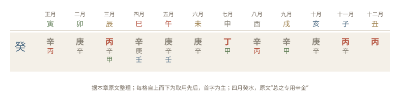

# 论癸水

## 正月癸水

正月的癸水

> 正月癸水，值三阳之後，雨露之精，其性至柔，先用辛金，生癸水之源，次用丙火照暖，名阴阳和合，万物发生，辛丙两透，金榜有名。

正月的癸水，正值三阳开泰之后，是雨露的精华，性质极其柔弱。先用辛金作为癸水的源头，其次用丙火照暖，叫“阴阳和合”，万物生发。辛、丙都透出，金榜有名。

> 或支成火局，辛金受伤，有壬出救者，富贵，无壬者，贫穷，或丙出天干，辛在酉丑，亦有衣衿，若辛丙皆无，贫寒下格，或辛透丙藏，恩荣之造，丙辛在柱，以富得官。

如果地支成火局，辛金受伤，有壬水透出来救的，富贵；没有壬水的，贫穷。如果丙火透出天干，辛金在酉、丑中，也能做个秀才；如果辛、丙都没有，是贫寒的下格。如果辛透丙藏，是蒙受恩荣之命；丙、辛都在柱中，因富而得官。

> 或戊透月上，坐辰时，不见比劫，丙丁出干，此为化合，定主腰金，见刑冲，则否。

如果戊土透在月干，又生辰时，不见比劫，丙丁火透干，这是戊癸化合（化火），必主腰佩金印、身居高位；见刑冲就不行。

> 或支成水局，宜有丙透，无壬者，衣禄不少，若见丙火重重，又作贵推。

如果地支成水局，宜有丙火透出；没有壬水的，衣食俸禄不少；如果见丙火重重，又作贵命来推。

> 正月癸水，辛金为主，庚金次之，丙亦可少，若无庚辛，虽有丙火，无用之人，或火多土多，残疾不免。

正月的癸水，以辛金为主，庚金次之，丙火也不可缺少（“可少”疑当作“不可少”）。如果没有庚辛金，即使有丙火，也是无用之人；如果火多土多，免不了残疾。

> 用辛者，土妻金子。

用辛金的，土妻金子。

## 二月癸水

二月的癸水

> 二月葵水，不刚不柔，乙木司令，泄弱元神，专用庚金为用，辛金次之，庚辛俱透，无丁出干者，贵由科甲，无庚辛者常人。

二月的癸水，不刚不柔；乙木当令，泄弱了癸水的元神，专用庚金为用神，辛金次之。庚、辛都透出，没有丁火透干的，由科举而贵；没有庚辛的，是平常人。

（译注：“葵水”当作“癸水”。）

> 或庚透辛藏，荣封有准，庚藏辛透，亦有衣衿，庚辛两藏，富中取贵，或刀笔扬名，或庚辛重见，有己丁出干者亦贵。

如果庚透辛藏，必有荣封；庚藏辛透，也能做个秀才；庚、辛都藏，在富中取贵，或者以文书扬名；如果庚辛重见，有己土、丁火透干的，也贵。

> 或支成木局，月时又见木者，为泄水太过，定主贫困多灾，即运入西方，亦属无用。

如果地支成木局，月干、时干又见木，是泄水太过，必主贫困多灾，即使大运走西方金地，也没有用。

> 【命例】丁未 癸卯 癸亥 癸丑

> 【命例】丁亥 癸卯 癸卯 癸丑

> 【命例】庚子 己卯 癸酉 庚申

## 三月癸水

三月的癸水

> 三月癸水，要分清明谷雨，清明後，火气未炽，专用丙火，为阴阳合谐，谷雨後，虽用丙火，尚宜辛甲佐之，如辛卯，壬辰，癸未，丙辰，生上半月，用丙火，显达，生下半月，必无伤辛金癸水，方妙，然丙亦不可少，用丙，木妻水子。

三月的癸水，要分清明和谷雨。清明以后，火气还不旺，专用丙火，使阴阳和谐；谷雨以后，虽然用丙火，还宜辛金、甲木辅佐。比如辛卯、壬辰、癸未、丙辰这个命，生在上半月，用丙火，显达；生在下半月，必须辛金、癸水不受伤才妙，但丙火也不可缺少。用丙火的，木妻火子（原文作“水子”）。

（译注：“木妻水子”按全书体例当作“木妻火子”。）

> 三月癸水，从化者多，得化者荣禄，不化者平常。

三月的癸水，从化（戊癸化火）的多；化得成的荣华富贵，化不成的平常。

> 或支成水局，又见己土，无木，乃假杀格，有甲出者，常人。

如果地支成水局，又见己土，没有木，是“假杀格”；有甲木透出的，是平常人。

> 或支坐四库，又得甲透，可谓显达名扬，无甲者僧道孤苦。

如果地支坐辰戌丑未四库，又得甲木透出，可以说是显达扬名；没有甲木的，是孤苦的僧道。

> 或支成木局，无金，名伤官生才格，主聪明博学，衣禄充饶。

如果地支成木局，没有金，叫“伤官生财格”，主聪明博学，衣食俸禄充足。

> 三月癸水，辛甲皆酌用，下半月，土妻金子。

三月的癸水，辛金、甲木都酌情使用；下半月（用辛金的），土妻金子。

> 【命例】丁酉 甲辰 癸亥 辛酉

> 【命例】丙寅 壬辰 癸巳 甲寅

> 【命例】戊午 丙辰 癸丑 辛酉

> 【命例】丙寅 壬辰 癸丑 丙辰

## 四月癸水

四月的癸水

> 四月癸水，喜辛金为用，无辛用庚，若辛高透，不见丁火，加以壬透，主科名荣贵，声播四夷，若有丁破格，贫无立锥，有壬可免，辛藏无丁，贡监衣衿。

四月的癸水，喜以辛金为用，没有辛金用庚金。如果辛金高透，不见丁火，再加上壬水透出，主科举成名、荣耀显贵，声名远播四方；如果有丁火破格，穷得无立锥之地，有壬水可以免除；辛金藏支而没有丁火，是贡生、监生或秀才。

> 或一派火土乏辛，即有巳庚，亦不能生水，又无比肩羊刃，必至熬乾癸水，损日无疑，艾壬两透，泄制火土，名劫印化晋，极贵之造，有丁见干者，则否，如有庚无壬，亦无丁破金者，堪入儒林，有庚无辛者，异路功名，总之四月癸水，专用辛金方妙。

如果满局火土而缺辛金，即使有巳中庚金，也不能生水，又没有比肩、羊刃，必定熬干癸水，日主受损无疑。如果庚、壬都透出，制火土、生癸水，叫“劫印化晋”，是极贵之命；有丁火透干的，就不行了。如果有庚无壬，也没有丁火破金，可以跻身读书人之列；有庚无辛，从科举以外的途径得功名。总之，四月的癸水，专用辛金才妙。

（译注：“艾壬两透”疑当作“庚壬两透”或“辛壬两透”。）

## 五月癸水

五月的癸水

> 五月癸水，至弱无根，必须庚辛为生身之本，但丁火司权，金难敌火，安能滋养癸水，宜见比劫，方得辛金之用，五月癸水，庚辛壬参酌并用可也。

五月的癸水，极弱而无根，必须以庚辛金作为生身的根本；但丁火当权，金难以抵挡火，又怎能滋养癸水？宜见比劫，才能得到辛金的作用。五月的癸水，庚、辛、壬参酌一起使用就可以了。

> 如庚辛透干，又见壬癸者，定主锺鼎名家，或有金透，支见申子辰者，亦主金榜挂名，或无水出干，支只一水，虽有庚辛，一富之造，故曰，水源会，富重贵轻，又曰，金水会夏天，富贵永无边，运行火土地，快乐似神仙。

如果庚辛金透干，又见壬癸水，必主出身钟鸣鼎食的名门望族；如果有金透出，地支见申子辰，也主金榜题名；如果没有水透干，地支只有一点水，即使有庚辛，也只是个富命。所以说：“水源会，富重贵轻。”又说：“金水会夏天，富贵永无边；运行火土地，快乐似神仙。”

> 或支成炎局，无壬出干，定主僧道，或二壬一庚同透，衣锦腰金。

如果地支成火局，没有壬水透干，必主为僧道；如果两个壬水、一个庚金一同透出，衣锦腰金。

> 或一派己土，无甲出制，此作从杀而论，又主大贵，凡从杀者，切不可破格方吉。

如果满局己土，没有甲木透出来制，这就作从杀论，又主大贵。凡是从杀的，切不可破格才吉。

## 六月癸水

六月的癸水

> 六月癸水，有上下月之分，下半月庚辛有气，上半月庚辛休囚，凡六癸日，多不验者，何也，俗士不知此理，因未中有乙巳同宫，破而不破，故癸水不能从杀，所以专用庚辛，如上半月金神衰弱，火气炎烈，宜比劫助身，可云富贵，与五月一理，下半月庚辛有气，即无比劫亦可，又忌丁透，即丁在支亦不吉，其生克制化，与五月略同。

六月的癸水，有上半月、下半月之分：下半月庚辛金有气，上半月庚辛金休囚。凡是六癸日，推算多不灵验，为什么？因为俗人不懂这个道理：未中有乙木与己土同宫，似破而不破，所以癸水不能从杀，因此专用庚辛金。如果上半月金衰弱，火气炎烈，宜比劫来帮身，可以说是富贵，与五月同理；下半月庚辛有气，即使没有比劫也可以。又忌丁火透出，即使丁火在地支也不吉。其中的生克制化，与五月大体相同。

（译注：“乙巳同宫”当作“乙己同宫”。）

> 【命例】乙酉 癸未 癸未 庚申

> 【命例】己未 辛未 癸未 丙辰

## 七月癸水

七月的癸水

> 七月癸水，正母旺子相之时，癸虽死申，殊不知申中有庚生之，名死处逢生，弱中复强，即运行西北，亦不死也，但庚司令，刚锐极矣，必取丁火为用，或丁透有甲，名有焰之火，必主科甲，或丁透无甲，又无壬癸，即有一二庚金，亦有生监，有二丁更妙，或金多乏丁制者，贫困之人。

七月的癸水，正是母（金）旺子（水）相的时候。癸水虽然死在申，殊不知申中有庚金来生它，叫“死处逢生”，由弱转强，即使大运走西北，也不会死。但庚金当令，刚锐到了极点，必须取丁火为用。如果丁火透出又有甲木，叫“有焰之火”，必主科举及第；如果丁透而无甲，又没有壬癸，即使有一两个庚金，也能做生员、监生，有两个丁火更妙；如果金多而缺丁火来制，是贫困之人。

> 或一丁坐午，名独才格，主金玉满堂，富中取贵，若在未戌，则是常人，或柱见二戌二未，又得丙丁藏支，干见甲出，无水，亦作富贵而推。

如果一个丁火坐午，叫“独财格”，主金玉满堂，在富中取贵；如果丁火坐在未、戌，就是平常人。如果柱中见两个戌、两个未，又得丙丁火藏在地支，天干见甲木透出，没有水，也按富贵来推。

> 【命例】丁酉 戊申 癸卯 甲寅

> 【命例】戊午 庚申 癸未 乙卯

> 【命例】辛酉 丙申 癸酉 辛酉

## 八月癸水

八月的癸水

> 八月癸水，辛金虚灵，非顽金可比，正金白水清，故取辛金为用，丙火佐之，名水暖金温，如丙与辛隔位同透，主科甲功名，或丙透辛藏，一榜之士，或土多克水，生意中心，八月癸水，丙辛怕用。

八月的癸水，辛金虚灵，不是顽金可比，正是“金白水清”，所以取辛金为用，丙火辅佐，叫“水暖金温”。如果丙火与辛金隔位一同透出（不相合），主科举得功名；如果丙透辛藏，是考中一榜之人；如果土多克水，是做生意的人。八月的癸水，丙、辛并用。

（译注：“生意中心”疑当作“生意中人”；“丙辛怕用”当作“丙辛并用”。）

> 【命例】庚寅 乙酉 癸亥 丙辰

> 【命例】辛酉 丁酉 癸巳 癸亥

## 九月癸水

九月的癸水

> 九月癸水，失令无根，戊土司权，克制太过，专用辛金发水之源，要比肩滋甲制戊方妙。

九月的癸水，失令无根，戊土当权，克制太过，专用辛金作为水的源头，还要比肩滋养甲木来制戊土才妙。

> 或辛甲两透，支见子癸，定主平步青云，或癸甲两透，富贵成名，或有甲辛无癸者，亦有恩封，或有甲癸无辛者，富大贵小，有甲无癸辛者，常人，二者俱无，贫贱之格。

如果辛、甲都透出，地支见子中癸水，必主平步青云；如果癸、甲都透出，富贵成名；如果有甲、辛而没有癸，也有恩封；如果有甲、癸而没有辛，富大贵小；有甲而没有癸、辛，是平常人；二者都没有，是贫贱之格。

> 或有甲见壬者，颇许衣衿。

如果有甲木又见壬水，颇能做个秀才。

> 九月癸水，辛甲并用。

九月的癸水，辛金、甲木一起用。

> 【命例】癸亥 丙戌 癸卯 甲寅

> 【命例】壬辰 庚戌 癸丑 癸亥

## 十月癸水

十月的癸水

> 十月癸水，旺中有弱，何也，因亥摇木，泄散元神，宜用庚辛为妙，得庚辛两透，不见丁伤者，功名有准。

十月的癸水，旺中有弱。为什么？因为亥中藏有甲木（长生），泄散了癸水的元神，宜用庚辛金才妙。得庚、辛都透出，不见丁火来伤，功名有准。

（译注：“摇木”疑当作“藏木”。）

> 或支成木局，有丁出干，为木旺火相，制住庚辛不生水，必主清寒，或成木局，干见丙丁，异路之荣。

如果地支成木局，有丁火透干，是木旺火相，制住庚辛金不能生水，必主清寒；如果成木局，天干见丙丁火，从科举以外的途径获得荣耀。

> 或一派壬水，不见戊制，名冬水汪洋，奔波到老，若得戊透，清贵堪夸。

如果满局壬水，不见戊土来制，叫“冬水汪洋”，奔波到老；如果得戊土透出，清贵值得称道。

> 或一派庚辛，得丁出制，主名利双全，若不见丁，又主贫薄。

如果满局庚辛金，得丁火透出来制，主名利双全；如果不见丁火，又主贫穷浅薄。

> 或四柱火多，名才多身弱，富屋贫人。

如果四柱火多，叫“财多身弱”，是富人家的穷人。

> 【命例】癸卯 癸亥 癸丑 癸亥

> 【命例】壬申 辛亥 癸亥 壬子

## 十一月癸水

十一月的癸水

> 十一月癸水，值冰冻之时，金水无交欢之象，专用丙火解冻，庶不致成冰，又要辛金滋扶，无丙有辛，不妙，凡冬季癸水，有丙透解冻，则金温水暖，两两相生，要不见壬透，自然登科及第，紫诰金章。

十一月的癸水，正值冰冻之时，金水没有相互欢合之象，专用丙火解冻，才不至于结成冰；又要辛金来滋扶。没有丙火而有辛金，不妙。凡是冬季的癸水，有丙火透出解冻，就金温水暖，两两相生；只要不见壬水透出（夺丙），自然登科及第，得到朝廷诰命和金印。

> 或一派壬水，无丙出干，寒困之士，一派癸水，孤贱之流，或支成水局，得丙火重出干者，又主蟒袍玉带之荣。

如果满局壬水，没有丙火透干，是寒困之士；满局癸水，是孤贱之流。如果地支成水局，得丙火重重透干，又主身穿蟒袍、腰系玉带的荣耀。

> 或支成金局，丙火无踪者，芒鞋革履之流。

如果地支成金局，丙火无踪，是穿草鞋的穷苦之人。

> 如辛年，丙月，癸日，有火者，主恩荣宠锡，绕膝芝兰，无火者，损资得贵，位重当朝。

如果是辛年、丙月、癸日，（时上）有火的，主蒙受恩荣赏赐，儿孙绕膝；没有火的，捐资得贵，也能位重当朝。

（译注：“损资”当作“捐资”。）

> 或一派戊己，名杀重身轻，非贫即夭。

如果满局戊己土，叫“杀重身轻”，不是贫穷就是短命。

> 用火者，木妻火子，用辛者，土妻金子。

用火的，木妻火子；用辛金的，土妻金子。

## 十二月癸水

十二月的癸水

> 十二月癸水，寒极成冰，万物不能舒泰，宜丙火解冻，或丙透年时，加以壬透，支中多戊，名水辅阳光，主显达名臣，无戊者，异途之职，若有丙无壬，黉门之客，有壬无丙，戊又出干者，皂隶之流。

十二月的癸水，寒极成冰，万物不能舒展，宜丙火解冻。如果丙火透出年干或时干，再加上壬水透出，地支中多戊土，叫“水辅阳光”，主成为显达的名臣；没有戊土的，从科举以外的途径任职；如果有丙无壬，是学校中的读书人；有壬无丙，戊土又透干的，是衙门里的差役。

> 或支见子丑，比肩出干，即有丙透，不能解冻，此属平常，或无癸水，有辛与合，亦不为美，有丁出，颇吉。

如果地支见子、丑，比肩透干，即使有丙火透出，也不能解冻，这属平常；如果没有癸水，有辛金与丙相合，也不算美；有丁火透出，颇吉。

> 或一片癸己会党，年透丁火，名雪後灯光，夜生者贵，日生者否，若无丁火，又主孤贫。

如果满局癸水、己土结党，年干透出丁火，叫“雪后灯光”，夜里出生的贵，白天出生的不贵；如果没有丁火，又主孤贫。

> 或支成水局，无丙者，四海为家，一生劳苦。

如果地支成水局，没有丙火，四海为家，一生劳苦。

> 或支成火局，有庚辛透者，衣食充足，无金出，孤苦零丁。

如果地支成火局，有庚辛金透出的，衣食充足；没有金透出，孤苦伶仃。

> 或支成金局，丙透得地，名金温水暖，彼此相生，定许光大门闾，声驰翰苑，乏丙者，即文章骇世，总为孙山。

如果地支成金局，丙火透出而得地，叫“金温水暖”，彼此相生，必定光大门楣，声名驰誉翰林；缺丙火的，即使文章惊世，也总是名落孙山。

> 或支成木局，泄水太过，主残病呻吟，得金出干辅救，技艺之流。

如果地支成木局，泄水太过，主残疾病痛、呻吟不止；得金透干来辅救，是靠技艺谋生的人。

> 凡冬月用丙，须丙火得地方妙，不然，即重重丙火出干，安能轻许富贵哉。

凡是冬天用丙火，须丙火得地才妙；不然，即使丙火重重透干，又怎能轻易断其富贵呢？

*图 11-1　癸水十二月调候用神：据本章各节原文整理。（译者补绘，原书无此图）*
