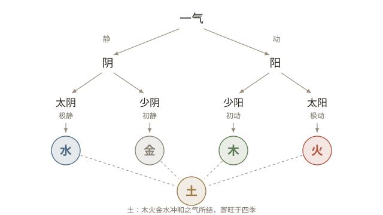
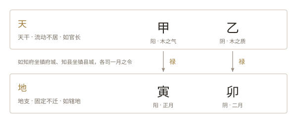

# 一、论十干十二支

> 天地之间，一气而已。惟有动静，遂分阴阳。有老少，遂分四象。

天地之间，归根结底只有一团“气”。因为气有动有静，才分出了阴和阳；阴阳又有老有少，于是分出了“四象”。

> 老者极动静之时，是为太阳太阴；少者初动初静之际，是为少阴少阳。有是四象，而五行具于其中矣。

“老”是动到极点、静到极点的时候，叫作太阳、太阴；“少”是刚刚开始动、刚刚开始静的时候，叫作少阳、少阴。有了这四象，五行也就包含在其中了。

> 水者，太阴也；火者，太阳也；木者，少阳也；金者，少阴也；土者，阴阳老少、木火金水冲气所结也。

水是太阴，火是太阳，木是少阳，金是少阴；而土，是阴阳老少、木火金水四者之气相互交冲调和后凝结而成的。

*图 1-1　一气分阴阳，阴阳分老少成四象，四象即水火木金，土为四者冲和之气所结。（译者补绘，原书无此图）*

> 有是五行，何以又有十干十二支乎？盖有阴阳，因生五行，而五行之中，各有阴阳。即以木论，甲乙者，木之阴阳也。甲者，乙之气；乙者，甲之质。

既然有了五行，为什么还要有十天干、十二地支呢？因为先有阴阳才生出五行，而每一行之中又各有阴阳。拿木来说，甲和乙就是木的一阳一阴：甲是乙的“气”，乙是甲的“质”——一个是无形的生机，一个是有形的实体。

> 在天为生气，而流行于万物者，甲也；在地为万物，而承兹生气者，乙也。

在天上表现为生发之气、流行贯通于万物之中的，是甲；在地上表现为万物本身、承接这股生气的，是乙。

> 又细分之，生气之散布者，甲之甲，而生气之凝成者，甲之乙；万木之所以有枝叶者，乙之甲，而万木之枝枝叶叶者，乙之乙也。

再细分下去：生气向四方散布的，是“甲中之甲”；生气凝聚成形的，是“甲中之乙”；树木之所以能长出枝叶的那股力量，是“乙中之甲”；而一枝一叶本身，则是“乙中之乙”。

> 方其为甲，而乙之气已备；及其为乙，而甲之质乃坚。有是甲乙，而木之阴阳具矣。

当它还是甲（气）的时候，乙所需要的气已经具备；等到成为乙（质）的时候，甲所化成的形体才变得坚实。有了甲乙两者，木的阴阳就齐全了。

> 何以复有寅卯者，又与甲乙分阴阳天地而言之者也。

那为什么又有寅、卯呢？这是把它们与甲乙对照，从天与地、阳与阴的角度来说的。

> 以甲乙而分阴阳，则甲为阳，乙为阴，木之行于天而为阴阳者也。以寅卯而阴阳，则寅为阳，卯为阴，木之存乎地而为阴阳者也。以甲乙寅卯而统分阴阳，则甲乙为阳寅卯为阴，木之在天成象而在地成形者也。

单看甲乙，甲为阳、乙为阴，这是木运行在天上时的阴阳；单看寅卯，寅为阳、卯为阴，这是木存在于地上时的阴阳；把甲乙寅卯合起来看，天干甲乙为阳、地支寅卯为阴，这就是木在天上形成气象、在地上形成形体。

> 甲乙行乎天，而寅卯受之；寅卯存乎地，而甲乙施焉。是故甲乙如官长，寅卯如该管地方。甲禄于寅，乙禄于卯，如府官之在郡，县官之在邑，而各司一月之令也。

甲乙在天上运行，由寅卯承接；寅卯固定在地上，接受甲乙的施予。所以甲乙好比长官，寅卯好比他们管辖的地方。甲的“禄”在寅，乙的“禄”在卯，就像知府坐镇府城、知县坐镇县城，各自主管一个月的时令。

*图 1-2　以木为例：甲乙在天流动如官长，寅卯在地固定如辖地；甲禄在寅，乙禄在卯。（译者补绘，原书无此图）*

> 甲乙在天，故动而不居。建寅之月，岂必当甲？建卯之月，岂必当乙？寅卯在地，故止而不迁。甲虽递易，月必建寅；乙虽递易，月必建卯。

甲乙在天上，所以流动不停：寅月（正月）不一定逢甲，卯月（二月）也不一定逢乙。寅卯在地上，所以固定不移：天干虽然年年轮换，正月一定是寅月，二月一定是卯月。

（译注：例如甲年正月是丙寅，乙年正月是戊寅——月份的天干每年都变，地支始终是寅。）

> 以气而论，甲旺于乙；以质而论，乙坚于甲。而俗书谬论，以甲为大林，盛而宜斩，乙为微苗，脆而莫伤，可为不知阴阳之理者矣。

从“气”来说，甲比乙旺盛；从“质”来说，乙比甲坚实。可是有些通俗命书错误地说：甲是参天大树，茂盛了就该砍伐；乙是细弱幼苗，脆弱得经不起伤害——这真是不懂阴阳的道理。

> 以木类推，余者可知，惟土为木火金水冲气，故寄旺于四时，而阴阳气质之理，亦同此论。欲学命者，必须先知干支之说，然后可以入门。

以木为例，其余各行都可以依此类推。只有土是木火金水交冲调和之气，所以分别寄旺在四季之中（即辰、未、戌、丑四个月），但阴阳、气质的道理与上面所说相同。想学命理的人，一定要先懂干支的道理，然后才能入门。
