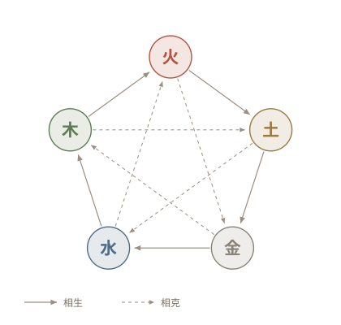
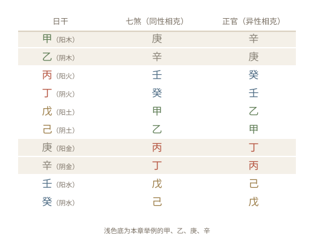

# 二、论阴阳生克

> 四时之运，相生而成，故木生火，火生土，土生金，金生水，水复生木，即相生之序，循环迭运，而时行不匮。

四季的运行，靠五行相生而形成：木生火，火生土，土生金，金生水，水又生木。按照这个相生的次序循环往复，时令就能运转不息。

> 然而有生又必有克，生而不克，则四时亦不成矣。克者，所以节而止之，使之收敛，以为发泄之机，故曰"天地节而四时成"。

然而有生就一定要有克；只生不克，四季也就形成不了。“克”的作用是节制，让发散出去的东西收敛起来，为下一次生发积蓄力量。所以《周易》说：“天地有所节制，四季才能形成。”

> 即以木论，木盛于夏，杀于秋，杀者，使发泄于外者藏收内，是杀正所以为生，大易以收敛为性情之实，以兑为万物所说，至哉言乎！

拿木来说：木在夏天最茂盛，到秋天就被肃杀。所谓“杀”，是让向外发散的生机收藏到内部，所以“杀”恰恰是为了“生”。《周易》把收敛看作万物性情的根本，说代表秋天的兑卦是“万物所喜悦”的，这话说得真是透彻！

> 譬如人之养生，固以饮食为生，然使时时饮食，而不使稍饥以待将来，人寿其能久乎？是以四时之运，生与克同用，克与生同功。

好比人养生，固然要靠饮食维持生命，可如果时时刻刻都在吃，从不让自己稍微饿一点、给后面留点余地，这人还能长寿吗？所以四季的运行中，生和克同样有用，克与生功劳相当。

*图 2-1　五行相生（实线）循环不息，相克（虚线）节制收敛。（译者补绘，原书无此图）*

> 然以五行而统论之，则水木相生，金木相克。以五行之阴阳而分配之，则生克之中，又有异同。此所以水同生木，而印有偏正；金同克木，而局有官煞也。

不过，如果只笼统地按五行来说，水与木是相生，金与木是相克；再把五行分出阴阳来配合，相生相克之中又有了差别。这就是为什么同样是水生木，“印”却分为偏印和正印；同样是金克木，命局里却分为正官和七煞。

> 印绶之中，偏正相似，生克之殊，可置勿论；而相克之内，一官一煞，淑慝判然，其理不可不细详也。

印绶当中，偏印与正印性质相近，它们的差别可以暂且不谈；而在相克之中，一个是官、一个是煞，善恶截然不同，其中的道理不能不仔细弄清楚。

> 即以甲乙庚辛言之。甲者，阳木也，木之生气也；乙者，阴木也，木之形质也。庚者，阳金也，秋天肃杀之气也；辛者，阴金也，人间五金之质也。

就拿甲、乙、庚、辛来说：甲是阳木，是木的生发之气；乙是阴木，是木的形体实质。庚是阳金，是秋天的肃杀之气；辛是阴金，是人间各种金属的实体。

> 木之生气，寄于木而行于天，故逢秋天为官，而乙则反是，庚官而辛杀也。

木的生发之气寄托在木中、运行于天上，与同属天上之气的庚金肃杀之气相遇，就要被它克制，所以甲以庚为七煞、以辛为正官；乙则正好相反，以庚为正官、以辛为七煞。

（译注：底本此句作“故逢秋天为官”，与下文“乙则反是，庚官而辛杀”及子平通例不合，疑有脱误。子平通例是：同性相克为七煞，异性相克为正官。译文按通例译出。）

> 又以丙丁庚辛言之。丙者，阳火也，融和之气也；丁者，阴火也，薪传之火也。

再拿丙、丁、庚、辛来说：丙是阳火，是温暖和煦之气；丁是阴火，是薪柴相传的灯火、炉火。

> 秋天肃杀之气，逢阳和而克去，而人间之金，不畏阳和，此庚以丙为杀，而辛以丙为官也。

秋天的肃杀之气，一遇到温暖的阳和之气就被化解了；而人间的金属并不怕阳光暖气。所以庚以丙为七煞，辛却以丙为正官。

> 人间金铁之质，逢薪传之火而立化，而肃杀之气，不畏薪传之火。此所以辛以丁为杀，而庚以丁为官也。即此以推，而余者以相克可知矣。

人间的金铁一遇到炉火就会熔化，而肃杀之气却不怕炉火。所以辛以丁为七煞，庚以丁为正官。照此类推，其余各干之间相克所成的官煞，也就可以明白了。

*图 2-2　十干的七煞与正官：同性相克为七煞，异性相克为正官。（译者补绘，原书无此图）*
