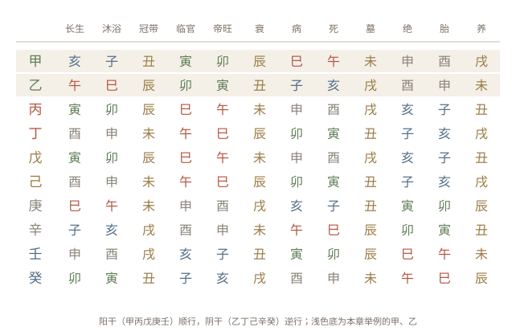
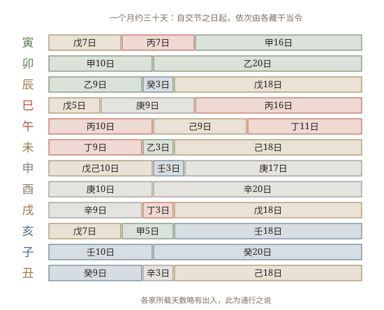

# 三、论阴阳生死（附支藏人元司令图表）

> 五行干支之说，已详论于干支篇。干动而不息，支静而有常。以每干流行于十二支之月，而生旺墓绝系焉。

五行与干支的道理，在《论十干十二支》一篇里已经详细讲过。天干流动不息，地支安静有常。每个天干流经十二地支所代表的十二个月，就有了长生、帝旺、墓、绝等不同的状态。

> 阳主聚，以进为进，故主顺；阴主散，以退为退，故主逆。长生沐浴等项，所以有阳顺阴逆之殊也。

阳主聚合，向前推进，所以顺行；阴主发散，向后退行，所以逆行。这就是长生、沐浴等十二个阶段，为什么有“阳干顺排、阴干逆排”的区别。

> 四时之运，功成者去，等用者进，故每流行于十二支之月，而生旺墓绝，又有一定。阳之所生，即阴之所死，彼此互换，自然之运也。

四季的运转，完成使命的退场，等待起用的登场。所以每个天干流经十二个月，生、旺、墓、绝都有固定的位置。阳干长生的地方，正是阴干死的地方，两者互换，这是自然的运行规律。

> 即以甲乙论，甲为木之阳，木之枝枝叶叶，受天生气，已经收藏饱足，可以为来克发泄之机，此其所以生于亥也。木当午月，正枝叶繁盛之候，而甲何以死？却不是外虽繁盛，而内之生气发泄已尽，此其所以死于午也。

以甲乙为例：甲是木中的阳。到了亥月（初冬），树木的枝枝叶叶已经把天地的生气收藏饱满，成为来年萌发的根本，所以甲木长生在亥。到了午月（仲夏），正是枝叶最繁茂的时候，甲为什么反而“死”了？因为外表虽然繁盛，内在的生气却已经发泄殆尽，所以甲木死在午。

（译注：“来克发泄”当作“来年发泄”。）

> 乙木反是，午月枝叶繁盛，即为之生，亥月枝叶剥落，即为之死。以质而论，自与气殊也。以甲乙为例，余可知矣。

乙木正好相反：午月枝叶繁茂，就是乙木的长生；亥月枝叶凋落，就是乙木的死。因为乙是从形质上论的，自然与从气上论的甲不同。以甲乙为例，其余各干可以类推。

> 支有十二月，故每干长生至胎养，亦分十二位。气之由盛而衰，衰而复盛，逐节细分，遂成十二。而长生沐浴等名，则假借形容之词也。

地支有十二个月，所以每个天干从长生到胎、养，也分成十二个阶段。气由盛到衰、由衰再盛，一节一节细分下来，就成了十二个。而“长生”“沐浴”这些名称，只是借来作比喻的说法。

> 长生者，犹人之初生也。沐浴者，犹人既生之后，而沐浴以去垢；如果核既为苗，则前之青壳，洗而去之矣。冠带者，形气渐长，犹人之年长而冠带也。临官者，由长而壮，犹人之可以出仕也。帝旺者，壮盛之极，犹人之可以辅帝而大有为也。

长生，像人刚刚出生。沐浴，像人出生后洗浴、去掉污垢；又像果核长成幼苗后，原来的青壳就脱落了。冠带，形体和气力渐渐长成，像人成年后戴冠束带。临官，由成长而壮大，像人可以出来做官了。帝旺，强盛到了极点，像人可以辅佐帝王、大有作为。

> 衰者，盛极而衰，物之初变也。病者，衰之甚也。死者，气之尽而无余也。墓者，造化收藏，犹人之埋于土者也。绝者，前之气已绝，后之气将续也。胎者，后之气续而结聚成胎也。养者，如人养母腹也。自是而后，长生循环无端矣。

衰，盛极而衰，是事物开始转变。病，衰得更厉害了。死，气已用尽、毫无剩余。墓，被造化收藏起来，像人被埋入土中。绝，前面的气已经断绝，后面的气即将接续。胎，后面的气接续上来，凝聚成胎。养，像胎儿在母腹中被养育。从此以后，又回到长生，循环往复，没有终点。

*图 3-1　十干十二长生表：阳干顺行，阴干逆行；甲长生在亥、死在午，乙长生在午、死在亥。（译者补绘，原书无此图）*

> 人之日主，不必生逢禄旺，即月令休囚，而年日时中, 得长禄旺，便不为弱，就使逢库，亦为有根。

一个人的日主（日柱天干），不一定非要生在禄旺的月份；即使月令处于休囚，只要年、日、时中遇到长生、禄、旺，就不算弱；就算只遇到墓库，也算有根。

> 时产谓投库而必冲者，俗书之谬也，但阳长生有力，而阴长生不甚有力，然亦不弱。若是逢库，则阳为有根，而阴为无用。盖阳大阴小，阳得兼阴，阴不能兼阳，自然之理也。

有些俗书说，日主入了墓库就一定要冲开才好，这是错误的。只是阳干的长生有力，阴干的长生不太有力，但也不算弱。如果遇到墓库，阳干算有根，阴干就没什么用。因为阳大阴小，阳可以兼顾阴，阴不能兼顾阳，这是自然之理。

（译注：“时产”疑当作“时师”，指当时的一般术士。）

*图 3-2　支藏人元司令：每月自交节之日起，各藏干依次当令的天数。（原书本章标题注明附有此图表，所据底本缺失；此图为译者依通行的《人元司令分野》补绘，各家天数略有出入）*
