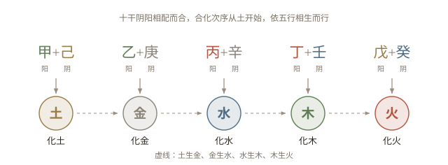

# 四、论十干配合性情

> 合化之义，以十干阴阳相配而成。河图之数，以一二三四五配六七八九十，先天之道也。

天干“合化”的道理，是由十个天干一阴一阳相互配对而形成的。河图的数理，是把一、二、三、四、五分别与六、七、八、九、十相配，这是先天的法则。

> 故始于太阴之水，而终于冲气之土，以气而语其生之序也。盖未有五行之先，必先有阴阳老少，而后冲气，故生以土。

所以从“气”的角度讲五行产生的次序，是从太阴之水开始，到冲和之气所结的土结束。因为在五行出现之前，一定先有阴阳老少，然后才有冲和之气，所以土是最后生成的。

> 终之既有五行，则万物又生于土，而水火木金，亦寄质焉，故以土先之。

可是五行一旦齐备，万物又都从土中生长出来，水火木金也都要依托土来成形，所以论合化时又把土放在最前面。

> 是以甲己相合之始，则化为土；土则生金，故乙庚化金次之；金生水，故丙辛化水又次之；水生木，故丁壬化木又次之；木生火，故戊癸化火又次之，而五行遍焉。先之以土，相生之序，自然如此。此十干合化之义也。

因此十干相合，从甲己开始，化为土；土生金，所以接下来是乙庚化金；金生水，所以再接下来是丙辛化水；水生木，所以再接着是丁壬化木；木生火，所以最后是戊癸化火——五行就都齐全了。以土为首，按相生的次序推下去，自然就是这样。这就是十干合化的道理。

*图 4-1　天干五合：甲己化土、乙庚化金、丙辛化水、丁壬化木、戊癸化火，依五行相生为序。（译者补绘，原书无此图）*

> 其性情何也？盖既有配合，必有向背。

那么，相合之后的“性情”又是怎样的呢？既然两个天干配成了一对，就一定有亲近谁、背离谁的分别。

> 如甲用辛官，透丙作合，而官非其官；甲用癸印，透戊作合，而印非其印；甲用己财，己与别位之甲作合，而财非其财。

比如甲日主以辛为正官，如果天干又透出丙，丙与辛相合，这个官就不再是甲的官了；甲以癸为正印，如果透出戊，戊与癸相合，这个印就不再是甲的印了；甲以己为正财，如果己被别的位置上的甲合去，这个财也就不再是日主的财了。

> 如年己月甲，年上之财，被月合去，而日主之甲乙无分；年甲月己，月上之财，被年合去，而日主之甲乙不与是也。

例如年干是己、月干是甲：年上的财被月干的甲合走了，日主（甲或乙）就分不到；又如年干是甲、月干是己：月上的财被年干的甲合走了，日主也沾不上边。说的就是这种情况。

> 甲用丙食与辛作合，而非其食，此四喜神因合而无用者也。

甲以丙为食神，如果丙与辛相合，这个食神也就不再为甲所用。以上是财、官、印、食四种喜神因为被合而失去作用的情形。

> 盖有所合则有所忌，逢吉不为吉，逢凶不为凶。

总之，一旦被合，就会有所牵绊：遇到吉神不能当作吉，遇到凶神也不能当作凶。

> 即以六亲言之，如男以财为妻，而被别干合去，财妻岂能亲其夫乎？女以官为夫，而被他干合去，官夫岂能爱其妻乎？此谓配合之性情，因向背而殊也。

就拿六亲来说：男命以财星为妻，如果财星被别的天干合去，这个妻子还怎么能亲近丈夫呢？女命以官星为夫，如果官星被别的天干合去，这个丈夫又怎么能疼爱妻子呢？这就是所谓“配合的性情因向背而不同”。
