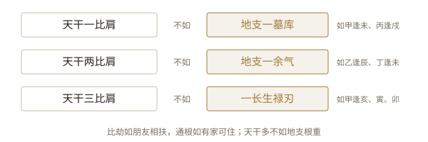

# 六、论十干得时不旺失时不弱

> 书云，得时俱为旺论，失时便作衰看，虽是至理，亦死法也。然亦可活看。

古书说：天干得时（生在当令的季节）就一律当作旺，失时就当作衰。这虽然是根本的道理，却是死板的方法，也可以灵活地看。

> 夫五行之气，流行四时，虽日干各有专令，而其实专令之中，亦有并存者在。假若春木司令，甲乙虽旺，而此时休囚之戊己，亦未尝绝于天地也。特时当退避，不能争先，而其实春土何尝不生万物，冬日何尝不照万国乎？

五行之气流行在四季之中，各个天干虽然各有自己当令的时候，但其实在某一行当令时，其他各行也同时存在。比如春天木当令，甲乙虽然旺，而此时处于休囚的戊己土，也并没有从天地间消失；只是时令上要退让，不能争先罢了。其实春天的土何尝不生养万物，冬天的太阳何尝不照耀天下呢？

> 旺衰强弱四字，昔人论命，每笼统互用，不知须分别看也。大致得时为旺，失时为衰；党众为强，助寡为弱。故有虽旺而弱者，亦有虽衰而强者，分别观之，其理自明。

“旺、衰、强、弱”这四个字，前人论命时常常笼统地混用，不知道要分开来看。大致说来：得时叫“旺”，失时叫“衰”；帮手多叫“强”，帮手少叫“弱”。所以有虽旺却弱的，也有虽衰却强的；分开来看，道理自然就清楚了。

> 春木夏火秋金冬水为得时，比劫印绶通根扶助为党众。甲乙木生于寅卯月，为得时者旺；干庚辛而支酉丑，则金之党众，而木之助寡 。干丙丁而支巳午，则火之党众，木泄气太重，虽秉令而不强也。

春天的木、夏天的火、秋天的金、冬天的水，都叫得时；比劫、印绶在地支通根扶助，叫党众（帮手多）。甲乙木生在寅卯月，是得时而旺；但如果天干透出庚辛、地支又有酉丑，那就是金的帮手多、木的帮手少；如果天干透出丙丁、地支又有巳午，那就是火的帮手多，木被泄气太重——这样即使木当令，也不能算强。

> 甲乙木生于申酉月，为失时则衰，若比印重叠，年日时支，又通根比印，即为党众，虽失时而不弱也。不特日主如此，喜用忌神皆同此论。

甲乙木生在申酉月，是失时而衰；但如果比劫、印绶重重叠叠，年、日、时的地支又有比劫、印绶作根，那就是帮手多，虽然失时却并不弱。不只日主是这样，喜神、用神、忌神也都按这个道理来论。

（译注：本章“旺衰强弱四字”一段，有的版本作徐乐吾评语，此底本混入正文。）

> 是故十干不论月令休囚，只要四柱有根，便能受财官食神而当伤官七煞。长生禄旺，根之重者也；墓库余气，根之轻者也。

所以十干不必管月令是否休囚，只要四柱中有根，就能承受财、官、食神，也能担当伤官、七煞。长生、禄、旺是重的根；墓库、余气是轻的根。

> 天干得一比肩，不如得支中一墓库，如甲逢未、丙逢戌之类。乙逢戌、丁逢丑、不作此论，以戌中无藏木，丑中无藏火也。

天干上多一个比肩，不如地支里有一个墓库，比如甲逢未、丙逢戌之类。乙逢戌、丁逢丑不能这样论，因为戌中没有藏木，丑中没有藏火。

> 得二比肩，不如得一余气，如乙逢辰、丁逢未之类。得三比肩，不如得一长生禄刃，如甲逢亥子寅卯之类。

天干上有两个比肩，不如地支里有一个余气，比如乙逢辰、丁逢未之类。天干上有三个比肩，不如地支里有一个长生、禄或刃，比如甲逢亥、子、寅、卯之类。

> 阴长生不作此论，如乙逢午、丁逢酉之类，然亦为明根，可比得一余气。盖比劫如朋友之相扶，通根如室家之可住；干多不如根重，理固然也。

阴干的长生不能这样论，比如乙逢午、丁逢酉之类；但也算明显的根，可以当作一个余气来看。比劫好比朋友的扶持，通根好比有自己的家可住；天干再多，也不如地支根重，道理本来如此。

*图 6-1　根与比肩的轻重：天干比肩多，不如地支有根。（译者补绘，原书无此图）*
