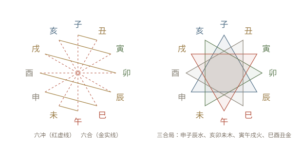

# 七、论刑冲会合解法

> 刑者，三刑也，子卯巳申之类是也。冲者，六冲也，子午卯酉之类是也。会者，三会也，申子辰之类是也。合者，六合也，子与丑合之类是也。

“刑”指三刑，比如子卯相刑、寅巳申相刑之类；“冲”指六冲，比如子午相冲、卯酉相冲之类；“会”指三方会局，比如申子辰会成水局之类；“合”指六合，比如子与丑相合之类。

（译注：本书所说的“会”即通常所称的“三合局”，与“寅卯辰”式的“三会方”不同。）

> 此皆以地支宫分而言，系对射之意也。三方为会，朋友之意也。并对为合，比邻之意也。至于三刑取庑，姑且阙疑，虽不知其所以然，于命理亦无害也。

这些都是就地支所在的方位来说的：冲，是两者正面相对、互相冲射的意思；三方相会，是朋友聚首的意思；两两相并为合，是邻居相亲的意思。至于三刑是怎么取出来的，姑且存疑；即使不知道其中的原理，对论命也没有妨碍。

*图 7-1　左：六冲（相对的两支）与六合（相邻成对的两支）；右：三合局。（译者补绘，原书无此图）*

> 八字支中，刑冲俱非美事，而三合六合，可以解之。

八字的地支中，刑和冲都不是好事，而三合、六合可以化解它们。

> 假如甲生酉月，逢卯则冲，而或支中有戌，则卯与戌合而不冲；有辰，则酉与辰合而不冲；有亥与未，则卯与亥未会而不冲；有巳与丑，则酉与巳丑会而不冲。是会合可以解冲也。

比如甲木生在酉月，遇到卯就会卯酉相冲；但如果地支中有戌，卯就去与戌相合而不冲；有辰，酉就去与辰相合而不冲；有亥和未，卯就与亥未会成木局而不冲；有巳和丑，酉就与巳丑会成金局而不冲。这就是会合可以解冲。

> 又如丙生子月，逢卯则刑，而或支中有戌，则与戌合而不刑；有丑，则子与丑合而不刑；有亥与未，则卯与亥未会而不刑；有申与辰，则子与申辰会而不刑。是会合可以解刑也。

又如丙火生在子月，遇到卯就会子卯相刑；但如果地支中有戌，卯就与戌相合而不刑；有丑，子就与丑相合而不刑；有亥和未，卯就与亥未会局而不刑；有申和辰，子就与申辰会局而不刑。这就是会合可以解刑。

> 又有因解而反得刑冲者，何也？假如甲生子月，支逢二卯相并，二卯不刑一子，而支又逢戌，戌与卯合，本为解刑，而合去其一，则一合而一刑，是因解而反得刑冲也。

又有因为化解反而招来刑冲的，这是为什么？比如甲木生在子月，地支有两个卯并列——两个卯不去刑一个子；可是地支又遇到戌，戌与卯相合，本来是为了解刑，结果只合走了一个卯，剩下一个卯就去刑子了。这就是因解而反得刑冲。

> 又有刑冲而会合不能解者，何也？假如子年午月，日坐丑位，丑与子合，可以解冲，而时逢巳酉，则丑与巳酉会，而子复冲午；子年卯月，日坐戌位，戌与卯合，可以解刑，而或时逢寅午，则戌与寅午会，而卯复刑子。是会合而不能解刑冲也。

又有刑冲遇到会合却化解不了的，这是为什么？比如子年午月，日支是丑：丑与子相合，本可以解子午冲；但时支又逢巳、酉，丑就去和巳酉会成金局，子又回头去冲午了。又如子年卯月，日支是戌：戌与卯相合，本可以解子卯刑；但时支又逢寅、午，戌就去和寅午会成火局，卯又回头去刑子了。这就是虽有会合却解不了刑冲。

> 更有刑冲而可以解刑者，何也？盖四柱之中，刑冲俱不为美，而刑冲用神，尤为破格，不如以另位之刑冲，解月令之刑冲矣。

更有用刑冲来化解刑冲的，这又是为什么？因为四柱之中刑冲都不好，而刑冲到用神尤其会破格；所以不如让别处的刑冲，来化解月令（用神所在）的刑冲。

> 假如丙生子月，卯以刑子，而支又逢酉，则又与酉冲不刑月令之官。甲生酉月，卯日冲之，而时逢子立，则卯与子刑，而月令官星，冲之无力，虽于别宫刑冲，六亲不无刑克，而月官犹在，其格不破。是所谓以刑冲而解刑冲也。

比如丙火生在子月，卯要来刑子；但地支又有酉，卯就去与酉相冲，不再刑月令的官星。又如甲木生在酉月，日支的卯要去冲酉；但时支又有子，卯就去与子相刑，对月令官星的冲就没有力量了。这样虽然在别的宫位发生刑冲，对应的六亲难免有些刑克，但月令的官星仍在，格局不破。这就是所谓“以刑冲解刑冲”。

（译注：“时逢子立”的“立”疑为衍字。）

> 如此之类，在人之变化而己。

诸如此类，全在于论命的人灵活变通了。
