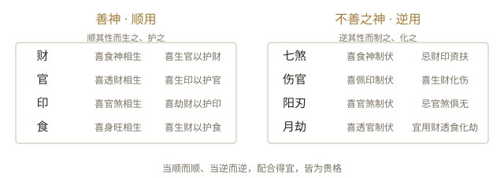

# 八、论用神

> 八字用神，专求月令，以日干配月令地支，而生克不同，格局分焉。

八字的用神，专门从月令（出生月份的地支）中求取：用日干去配月令地支，两者之间的生克关系不同，格局也就随之区分开来。

> 财官印食，此用神之善而顺用之者也；煞伤劫刃，用神之不善而逆用之者也。当顺而顺，当逆而逆，配合得宜，皆为贵格。

财、官、印、食神，是性质良善的用神，要顺着它来用；七煞、伤官、劫财、阳刃，是性质不善的用神，要逆着它来用（加以制化）。该顺的顺用，该逆的逆用，配合得当，都是贵格。

> 取用之法不一，约略归纳，可分为下列五种：

取用神的方法不止一种，大致归纳起来，可以分为以下五种：

（译注：自此至“此以通关为用也”的五种取用法，一般认为是民国徐乐吾的评注，此底本混入正文，并非沈孝瞻原文。）

> （一）扶抑。日元强者抑之，日元弱者扶之，此以扶抑为用神也。月令之神太强则抑之，月令之神太弱则扶之，此以扶抑月令为用神也。

（一）扶抑。日主太强就抑制它，日主太弱就扶助它，这是以扶抑日主为用神；月令之神太强就抑制它，太弱就扶助它，这是以扶抑月令为用神。

> （二）病药。以扶为喜，则以伤其扶者为病；以抑为喜，则以去其抑者为病。除其病神，即谓之药。此以病药取用神也。

（二）病药。如果以扶助为喜，那么损伤这个扶助的就是“病”；如果以抑制为喜，那么去掉这个抑制的就是“病”。能除掉病神的，就叫“药”。这是以病药来取用神。

> （三）调候。金水生于冬令，木火生于夏令，气候太寒太燥，以调和气候为急。此以调候为用神也。

（三）调候。金水生在冬天，木火生在夏天，气候太寒冷或太燥热，就要先调和气候。这是以调候为用神。

> （四）专旺。四柱之气势，偏于一方其势不可逆，惟有顺其气势为用，或从或化，及一方专旺等格局皆是也。

（四）专旺。四柱的气势完全偏向一方，势头不能违逆，只能顺着这股气势来取用，从格、化格以及一方专旺之类的格局都属于这一种。

> （五）通关。两神对峙，强弱均平，各不相下，须调和之为美，此以通关为用也。

（五）通关。两种力量对峙，强弱相当、互不相让，必须有一个从中调和才好，这是以通关为用神。

> 是以善而顺用之，则财喜食神以相生，生官以护财；官喜透财以相生，生印以护官；印喜官煞以相生，劫财以护印；食喜身旺以相生，生财以护食。

所以，对于善神要顺用：财喜欢有食神来生它，喜欢它去生官以护住自己；官喜欢天干透财来生它，喜欢它去生印以护住自己；印喜欢有官煞来生它，喜欢有劫财来护住印；食神喜欢日主身旺来生它，喜欢它去生财以护住自己。

> 不善而逆用之，则七煞喜食神以制伏，忌财印以资扶；伤官喜佩印以制伏，生财以化伤；阳刃喜官煞以制伏，忌官煞之俱无；月劫喜透官以制伏，利用财而透食以化劫。此顺逆之大路也。

对于不善之神要逆用：七煞喜欢有食神来制伏，忌讳财、印来资助它；伤官喜欢配印来制伏，或者生财来化解伤官；阳刃喜欢有官煞来制伏，最忌官煞都没有；月劫喜欢天干透官来制伏，也适宜用财，再透出食神来化解劫财。这就是顺用、逆用的大方向。

*图 8-1　用神的顺用与逆用：财官印食顺其性而生护，煞伤刃劫逆其性而制化。（译者补绘，原书无此图）*

> 今人不知专主提纲，然后将四柱干支，字字统归月令，以观喜忌，甚至见正官佩印，则以为官印双全，与印绶用官者同论；见财透食神，不以为财逢食生，而以为食神生财，与食神生财同论；

现在有些人不懂得要以月令（提纲）为主，再把四柱干支一个一个都归到月令上来看喜忌。于是见到正官格带印，就以为是“官印双全”，和印绶格用官当成一回事；见到财格透出食神，不认为是“财逢食生”，却说成“食神生财”，和食神生财格当成一回事；

> 见偏印透食，不以为泄身之秀，而以为枭神夺食，宜用财制，与食神逢枭同论；见煞逢食制而露印者，不以为去食护煞，而以为煞印相生，与印绶逢煞者同论；

见到偏印格透出食神，不认为是“泄身之秀”，却说成“枭神夺食、要用财来制枭”，和食神格遇枭当成一回事；见到七煞被食神制伏、天干又露出印的，不认为是“去食护煞”，却说成“煞印相生”，和印绶格遇煞当成一回事；

> 更有煞格逢刃，不以为刃可帮身制煞，而以为七煞制刃，与阳刃露煞者同论。此皆由不知月令而妄论之故也。

更有七煞格遇到阳刃，不认为是“阳刃可以帮身制煞”，却说成“七煞制刃”，和阳刃格露煞当成一回事。这些都是因为不懂以月令为主而乱论造成的。

> 然亦有月令无用神者，将若之何？如木生寅卯，日与月同，本身不可为用，必看四柱有无财官煞食透干会支，另取用神；然终以月令为主，然后寻用，是建禄月劫之格，非用而即用神也。

不过也有月令里取不出用神的情况，该怎么办？比如木日主生在寅卯月，日干与月令同属一行，自身不能作为用神，这就必须看四柱中有没有财、官、煞、食神透于天干或会于地支，另外取用神。但终究还是以月令为主，然后再去寻找用神——这就是建禄格、月劫格：月令本身不是用神，却同样是从月令出发来定用神。
