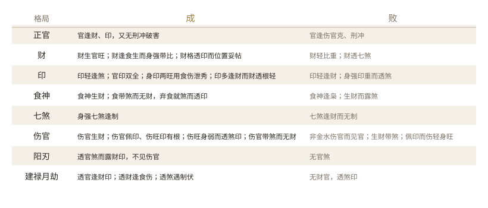

# 九、论用神成败救应

> 用神专寻月令，以四柱配之，必有成败。

用神专门从月令中寻找，再与四柱其他干支配合来看，就一定有成格与败格之分。

> 何谓成？如官逢财印，又无刑冲破害，官格成也。财生官旺，或财逢食生而身强带比，或财格透印而位置妥贴，两不相克，财格成也。

什么叫“成”？比如正官格遇到财和印，又没有刑、冲、破、害，正官格就成了。财格中财生官旺；或者财有食神来生，而日主身强又带比肩；或者财格透出印，而两者位置安排得当、互不相克——财格就成了。

> 印轻逢煞，或官印双全，或身印两旺而用食伤泄气，或印多逢财而财透根轻，印格成也。

印格中印轻而遇七煞来生；或者官、印都有；或者日主和印都旺，而用食神、伤官来泄秀；或者印多而遇财，财透出却根浅（只损印之太过而不伤印）——印格就成了。

> 食神生财，或食带煞而无财，弃食就煞而透印，食格成也。

食神格中食神生财；或者食神带七煞而没有财，于是舍弃食神、就用七煞，而天干透印——食神格就成了。

> 身强七煞逢制，煞格成也。

七煞格中日主身强，而七煞有制伏，七煞格就成了。

> 伤官生财，或伤官佩印而伤官旺，印有根，或伤官旺、身主弱而透煞印，或伤官带煞而无财，伤官格成也。

伤官格中伤官生财；或者伤官配印，而伤官旺、印有根；或者伤官旺、日主弱，而天干透出七煞和印；或者伤官带七煞而没有财——伤官格就成了。

> 阳刃透官煞而露财印，不见伤官，阳刃格成也。建禄月劫，透官而逢财印，透财而逢食伤，透煞而遇制伏，建禄月劫之格成也。

阳刃格透出官或煞，又露出财或印，而不见伤官，阳刃格就成了。建禄格、月劫格：透官而有财、印相辅；透财而有食神、伤官相生；透七煞而有制伏——建禄月劫格就成了。

> 财旺生官者，月令星旺，四柱有官，则财旺自生官；或月令财星而透食神，身强则食神泄秀，转而生财。财本忌比劫，有食神则不忌而喜，盖有食神化之也。

所谓“财旺生官”，是说月令的财星旺，四柱又有官，财旺自然生官。或者月令是财星而天干透出食神，日主身强，食神泄出日主的秀气，转而去生财。财本来忌讳比劫，但有了食神就不但不忌，反而喜欢，因为比劫被食神化成了生财之力。

> 或透印而位置妥贴者，财印不相碍也（参观财格佩印节）。如年干透印，时干透财，中隔比劫，则不相碍；隔官星则为财旺生官，亦不相碍，是为财格成也。

所谓“透印而位置妥帖”，是说财和印互不妨碍（参看财格带印一节）。比如年干透印、时干透财，中间隔着比劫，两者就不相碍；中间隔着官星，就成了财旺生官、官再生印，也不相碍。这也是财格成格。

*图 9-1　八格成败一览：据本章所列条件整理。（译者补绘，原书无此图）*

> 何谓败？官逢伤克刑冲，官格败也；财轻比重，财透七煞，财格败也；印轻逢财，或身强印重而透煞，印格败也；

什么叫“败”？正官遇到伤官克制或刑冲，正官格就败了；财轻而比劫重，或财透七煞，财格就败了；印轻而遇财，或者日主强、印又重，还透出七煞，印格就败了；

> 食神逢枭，或生财露煞，食神格败也；七煞逢财无制，七煞格败也；伤官非金水而见官，或生财而带煞，或佩印而伤轻身旺，伤官格败也；

食神遇到偏印（枭神），或者生财时又露出七煞，食神格就败了；七煞遇到财而没有制伏，七煞格就败了；伤官格不是金水伤官却见了官，或者生财而带七煞，或者配印而伤官轻、日主旺，伤官格就败了；

> 阳刃无官煞，刃格败也；建禄月劫，无财官，透煞印，建禄月劫之格败也。

阳刃格没有官煞，阳刃格就败了；建禄、月劫格没有财官，反而透出七煞和印，建禄月劫格就败了。

> 成中有败，必是带忌；败中有成，全凭救应。

成格之中又有败，一定是带了忌神；败格之中又能成，全靠有救应。

> 何谓带忌？如正官逢财而又逢伤；透官而又逢合；财旺生官而又逢伤逢合；印透食以泄气，而又遇财露；透煞以生印，而又透财，以去印存煞；

什么叫“带忌”？比如正官遇财，却又遇伤官；透出官星，却又被合；财旺生官，却又遇伤官或被合；印格透出食神泄秀，却又露出财；透七煞来生印，却又透出财，结果财去破印、留下七煞；

> 食神带煞印而又逢财；七煞逢食制而又逢印；伤官生财而财又逢合；佩印而印又遭伤，透财而逢煞，是皆谓之带忌也。

食神带着七煞和印，却又遇到财；七煞有食神制伏，却又遇到印（印夺食）；伤官生财，而财又被合；伤官配印，而印又受伤；伤官透财却又遇七煞——这些都叫“带忌”。

> 成中之败，亦变化万端，此不过其大概也。如财旺生官，美格也，身弱透官，即为破格。伤官见官，为格之忌，透财而地位配置合宜，则伤官生财来生官，反可以解，种种变化，非言说所能尽，在于熟习者之妙悟耳。

成中之败也变化万端，这里只是说个大概。比如财旺生官是美格，但日主身弱又透官，就成了破格。伤官见官是格局的大忌，但如果透出财、位置配置得当，伤官生财、财再生官，反而可以化解。种种变化，不是言语能说尽的，全靠熟练的人自己去领悟。

> 何谓救应？如官逢伤而透印以解之，杂煞而合煞以清之，刑冲而会合以解之；

什么叫“救应”？比如正官遇伤官，而透出印来制伤以解救；官煞混杂，而有合去七煞使之清纯；遇到刑冲，而有会合来化解；

> 财逢劫而透食以化之，生官以制之，逢煞而食神制煞以生财，或存财而合煞；

财遇劫财，而透出食神来化劫，或者生官来制劫；财遇七煞，而有食神制煞并转而生财，或者留下财而合去七煞；

> 印逢财而劫财以解之，或合财而存印；食逢枭而就煞以成格，或生财以护食；

印遇财，而有劫财来解救，或者合去财而保住印；食神遇枭神，而改就七煞以成格，或者生财来护住食神；

> 煞逢食制，印来护煞，而逢财以去印存食；伤官生财透煞而煞逢合；阳刃用官煞带伤食，而重印以护之；

七煞有食神制伏，印来护煞（夺食），而又遇到财来去掉印、保住食神；伤官生财而透出七煞，而七煞被合去；阳刃格用官煞，却带伤官、食神，而有重印来护住官煞；

> 建禄月劫用官，遇伤而伤被合，用财带煞而煞被合，是谓之救应也。

建禄、月劫格用官，遇到伤官而伤官被合去；用财而带七煞，而七煞被合去——这些都叫“救应”。

> 八字妙用，全在成败救应，其中权轻权重，甚是活泼。学者从此留心，能于万变中融以一理，则于命之一道，其庶几乎！

八字的妙用，全在于成、败与救应，其中轻重的权衡非常灵活。学命的人如果从这里用心，能在千变万化之中融会出一个道理，那么对于命理之道，也就差不多了！
