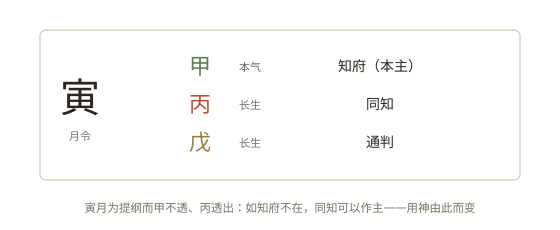

# 十、论用神变化

> 用神既主月令矣，然月令所藏不一，而用神遂有变化。如十二支中，除子午卯酉外，余皆有藏，不必四库也。

用神既然以月令为主，而月令地支里所藏的天干又不止一个，用神也就有了变化。十二地支中，除了子、午、卯、酉之外，其余都藏有不止一个天干，不只是辰戌丑未四库才这样。

> 即以寅论，甲为本主，如郡之有府，丙其长生，如郡之有同知，戊亦长生，如郡之有通判；假使寅月为提，不透甲而透丙，则如知府不临郡，而同知得以作主。此变化之由也。

就拿寅来说：甲是寅的本主，好比一个府的知府；丙在寅长生，好比府里的同知；戊也在寅长生，好比府里的通判。假如寅月作为提纲，天干不透甲而透出丙，就好比知府不在任，同知可以代为作主。这就是用神变化的由来。

*图 10-1　寅中所藏：甲为本主如知府，丙、戊为长生如同知、通判。（译者补绘，原书无此图）*

> 故若丁生亥月，本为正官，支全卯未，则化为印。己生申月，本属伤官。藏庚透壬，则化为财。凡此之类皆用神之变化也。

所以，比如丁火生在亥月，本来是正官格（亥中壬水为丁之正官）；如果地支卯、未都有，亥卯未会成木局，就化为印格。己土生在申月，本来是伤官格（申中庚金）；如果庚不透而透出壬水，就化为财格。诸如此类，都是用神的变化。

> 变之而善，其格愈美；变之不善，其格遂坏，何谓变之而善？如辛生寅月，逢丙而化财为官；壬生戌月逢辛而化煞为印。癸生寅月，不专以煞论。此二者以透出而变化者也。

变得好，格局就更美；变得不好，格局就坏了。什么叫“变得好”？比如辛金生在寅月（本为财格），透出丙火，就由财化为官；壬水生在戌月（本为七煞格），透出辛金，就由煞化为印。这两种是因天干透出而发生的变化。

> 癸生寅月，月令伤官秉令，藏甲透丙，会午会戌，则寅午戌三合，伤化为财；加以丙火透出，完全作为财论，即使不透丙而透戊土，亦作财旺生官论。盖寅午戌三合变化在前，不作伤官见官论也。

癸水生在寅月，月令伤官当令；寅中藏甲而透出丙，地支又会午、会戌，寅午戌三合火局，伤官就化为财；再加上丙火透出，完全按财格来论。即使不透丙而透出戊土，也按“财旺生官”来论——因为寅午戌三合的变化在先，就不再按“伤官见官”来论了。

（译注：上文“癸生寅月，不专以煞论”一句，与本段重复且文意不通，疑为评注混入或衍文。）

> 乙生寅月，月劫秉令，会午会戌，则劫化为食伤，透戊则为食伤生财，不作比劫争财论。此二者因会合而变化者。因变化而忌化为喜，为变之善者。

乙木生在寅月，月劫当令；如果地支会午、会戌，劫财就化为食伤；再透出戊土，就成了食伤生财，不再按“比劫争财”来论。这两种是因地支会合而发生的变化。因为变化而把忌神化成了喜神，这就是变得好的。

> 何谓变之而不善？如丙生寅月，本为印绶，甲不透干而会午会戌，则化为劫。丙生申月，本属偏财，藏庚透壬，会子会辰，则化为煞。如此之类亦多，皆变之不善者也。

什么叫“变得不好”？比如丙火生在寅月，本来是印绶格；如果甲木不透干，而地支会午、会戌，就化成了劫财。丙火生在申月，本来是偏财格；如果庚不透而透出壬水，地支又会子、会辰（申子辰水局），就化成了七煞。这类情况也很多，都是变得不好的。

> 又有变之而不失本格者。如辛生寅月，透丙化官，而又透甲，格成正财，正官乃其兼格也。

还有变化之后仍不失本来格局的。比如辛金生在寅月，透出丙火化为官，但又透出甲木，格局仍以正财论，正官只是兼带的格局。

> 乙生申月，透壬化印，而又透戊，则财能生官，印逢财而退位，虽通月令，格成伤官，戊官忌见。

乙木生在申月（本为正官格），透出壬水化为印；但又透出戊土，财能生官，印遇到财就退居次位——虽然印也通月令，格局仍以正官论。

（译注：底本此句作“格成伤官，戊官忌见”，与上下文不合，疑有讹误，今按文意译出。）

> 丙生寅月，午戌会劫，而又或透甲，或透壬，则仍为印而格不破。丙生申月，逢壬化煞，而又透戊，则食神能制煞生财，仍为财格，不失富贵。如此之类甚多，是皆变而不失本格者也。

丙火生在寅月，午戌会成劫财，但天干又透出甲或壬，就仍然按印格来论，格局不破。丙火生在申月，遇壬化为七煞，但又透出戊土，食神能制煞并生财，仍然是财格，不失富贵。这类情况很多，都是变化而不失本格的。

> 是故八字非用神不立，用神非变化不灵，善观命者，必于此细详之。

所以，八字没有用神就立不起来，用神不懂变化就不灵活。善于看命的人，一定要在这里仔细推敲。
