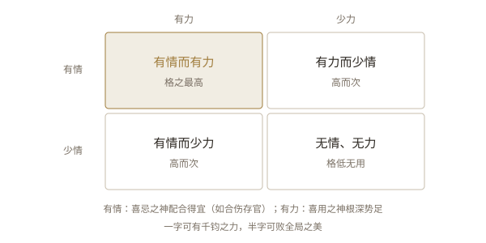

# 十二、论用神格局高低

> 八字既有用神，必有格局，有格局必有高低，财官印食煞伤劫刃，何格无贵？何格无贱？由极贵而至极贱，万有不齐，其变千状，岂可言传？然其理之大纲，亦在有情无情、有力无力之间而已。

八字有了用神，就一定有格局；有格局，就一定有高低。财、官、印、食、煞、伤、劫、刃，哪种格没有贵命？哪种格没有贱命？从极贵到极贱，千差万别，变化万状，怎么能用言语说尽？不过其中的大纲，也就在“有情还是无情”“有力还是无力”之间罢了。

> 如正官佩印，不如透财，而四柱带伤，反推佩印。故甲透酉官，透丁合壬，是谓合伤存官，遂成贵格，以其有情也。

比如正官格配印，本来不如透财；但如果四柱带伤官，反而要推崇配印。所以甲木以酉中辛金为正官，天干透出丁火（伤官），而有壬水来合住丁，这叫“合伤存官”，于是成为贵格——因为它有情。

> 财忌比劫，而与煞作合，劫反为用。故甲生辰月，透戊成格，遇乙为劫，逢庚为煞，二者相合，皆得其用，遂成贵格，亦以其有情也。

财本来忌讳比劫，但如果劫财与七煞相合，劫财反而成了有用之神。所以甲木生在辰月，透出戊土成财格，遇到乙是劫财，遇到庚是七煞，乙庚两者相合，各得其用，于是成为贵格——这也是因为有情。

> 身强煞露而食神又旺，如乙生酉月，辛金透，丁火刚，秋木盛，三者皆备，极等之贵，以其有力也。

日主身强、七煞透露，而食神又旺，比如乙木生在酉月，辛金（七煞）透出，丁火（食神）刚强，秋天的乙木又盛，三样都齐备，是极等的贵命——因为它有力。

> 官强财透，身逢禄刃，如丙生子月，癸水透，庚金露，而坐寅午，三者皆均，遂成大贵，亦以其有力也。

官星强、财透出，日主又坐禄刃，比如丙火生在子月，癸水（正官）透出，庚金（财）露出，而日主坐寅、午，三者势均力敌，于是成为大贵——这也是因为有力。

> 又有有情而兼有力，有力而兼有情者。如甲用酉官，壬合丁以清官，而壬水根深，是有情而兼有力者也。乙用酉煞，辛逢丁制，而辛之禄即丁之长生，同根月令，是有力而兼有情者也。是皆格之最高者也。

又有有情而兼有力、有力而兼有情的。比如甲木用酉中正官，壬水合住丁火使官星清纯，而壬水根又深，这是有情而兼有力。乙木用酉中七煞，辛金被丁火制住，而辛的禄在酉、丁的长生也在酉，两者同根于月令，这是有力而兼有情。这些都是格局中最高的。

> 如甲用酉官，透丁逢癸，癸克不如壬合，是有情而非情之至。

比如甲木用酉中正官，透出丁火，遇到的是癸水——癸水克丁，不如壬水合丁来得好，这是有情而情还不到极致。

> 乙逢酉逢煞，透丁以制，而或煞强而丁稍弱，丁旺而煞不昂，又或辛丁并旺而乙根不甚深，是有力而非力之全，格之高而次者也。

乙木生在酉月遇七煞，透出丁火来制，但或者七煞强而丁火稍弱，或者丁火旺而七煞不够强，又或者辛、丁都旺而乙木根不够深，这是有力而力还不够全，属于格局高而稍次的。

> 至如印用七煞，本为贵格，而身强印旺，透煞孤贫，盖身旺不劳印生，印旺何劳煞助？偏之又偏，以其无情也。

至于印格用七煞，本来是贵格；但如果日主身强、印又旺，再透出七煞，反而孤独贫穷。因为日主已旺，用不着印来生；印已旺，又何须七煞来助？偏上加偏，是因为无情。

> 伤官佩印，本秀而贵，而身主甚旺，伤官甚浅，印又太重，不贵不秀，盖欲助身则身强，制伤则伤浅，要此重印何用？是亦无情也。

伤官配印，本来既秀且贵；但如果日主很旺、伤官很浅、印又太重，就既不贵也不秀。因为要帮身，身已强；要制伤官，伤官又浅；要这么重的印有什么用？这也是无情。

> 又如煞强食旺而身无根，身强比重而财无气，或夭或贫，以其无力也。是皆格之低而无用者也。

又如七煞强、食神旺，而日主无根；或者日主强、比劫重，而财星无气——不是短命就是贫穷，因为无力。这些都是格局低而无用的。

*图 12-1　格局高低在于有情无情、有力无力：二者兼备为最高。（译者补绘，原书无此图）*

> 然其中高低之故，变化甚微，或一字而有千钧之力，或半字而败全局之美，随时观理，难以拟议，此特大略而已。

不过格局高低的缘故，变化非常微妙：有时一个字就有千钧之力，有时半个字就毁掉全局之美。要随时随地按道理去看，很难预先规定，这里说的只是大概而已。
