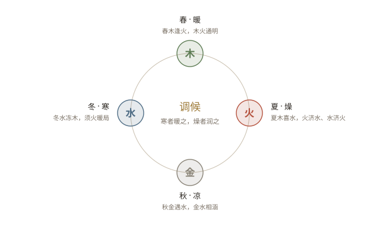

# 十四、论用神配气候得失

> 论命惟以月令用神为主，然亦须配气候而互参之。譬如英雄豪杰，生得其时，自然事半功倍；遭时不顺，虽有奇才，成功不易。

论命固然以月令用神为主，但也要结合气候来相互参照。好比英雄豪杰，生逢其时，自然事半功倍；时运不济，即使有奇才，也不容易成功。

> 是以印绶遇官，此谓官印双全，无人不贵。而冬木逢水，虽透官星，亦难必贵，盖金寒而水益冻，冻水不能生木，其理然也。

所以印绶格遇官，叫“官印双全”，没有不贵的。可是冬天的木遇到水（印），即使透出官星，也难保一定贵：因为冬天金寒、水更冷，冻住的水不能生木，道理就是这样。

> 身印两旺，透食则贵，凡印格皆然。而用之冬木，尤为秀气，以冬木逢火，不惟可以泄身，而即可以调候也。

日主与印都旺，透出食神就贵，凡是印格都是这样。而用在冬天的木上，更显得秀气，因为冬木遇到火（食伤），不仅可以泄出日主之气，还能调和气候。

> 伤官见官，为祸百端，而金水见之，反为秀气。非官之不畏夫伤，而调候为急，权而用之也。伤官带煞，随时可用，而用之冬金，其秀百倍。

伤官见官，会招来种种祸患；可是金水伤官（金日主生于冬天）见官，反而是秀气。这不是说官星不怕伤官，而是调和气候更为急迫，所以权衡之下取用官星（火）。伤官带七煞，任何季节都可以用；而用在冬天的金上，更是秀气百倍。

> 伤官佩印，随时可用，而用之夏木，其秀百倍，火济水，水济火也。

伤官配印，任何季节都可以用；而用在夏天的木上，秀气百倍，因为火与水互相调剂。

> 伤官用财，本为贵格，而用之冬水，即使小富，亦多不贵，冻水不能生木也。

伤官用财，本是贵格；可是用在冬天的水上，即使小有富足，也多半不贵，因为冻住的水生不了木。

> 伤官用财，即为秀气，而用之夏木，贵而不甚秀，燥土不甚灵秀也。

伤官用财本来就是秀气；可是用在夏天的木上，贵却不太秀，因为燥热的土（财）不太灵秀。

> 春木逢火，则为木为通明，而夏木不作此论；秋金遇水，则为金水相涵，而冬金不作此论。气有衰旺，取用不同也。

春天的木遇到火，叫“木火通明”，夏天的木就不这样论；秋天的金遇到水，叫“金水相涵”，冬天的金就不这样论。因为气有衰有旺，取用也就不同。

（译注：“木为通明”当作“木火通明”。）

> 春木逢火，木火通明，不利见官；而秋金遇水，金水相涵，见官无碍。

春木遇火、木火通明，不宜见官；而秋金遇水、金水相涵，见官却无妨。

> 假如庚生申月，而支中或子或辰，会成水局，天干透丁，以为官星，只要壬癸不透露干头，便为贵格，与食神伤官喜见官之说同论，亦调候之道也。

比如庚金生在申月，地支有子或辰，会成水局（食伤），天干透出丁火作为官星，只要壬癸水不透出天干，就是贵格。这和“金水食伤喜见官”的说法是一个道理，也是调候之道。

> 食神虽逢正印，亦谓夺食，而夏木火盛，轻用之亦秀而贵，与木火伤官喜见水同论，亦调候之谓也。

食神格即使遇到正印，也叫“夺食”；可是夏天的木火势太盛，稍微用一点印，反而秀而且贵。这和“木火伤官喜见水”是一个道理，也是调候的意思。

*图 14-1　调候：四季寒暖燥湿不同，冬喜火暖，夏喜水润，取用须兼顾气候。（译者补绘，原书无此图）*

> 此类甚多，不能悉述，在学者引伸触类，神而明之而已。

这类情况很多，不能一一叙述，全靠学命的人举一反三、融会贯通了。
