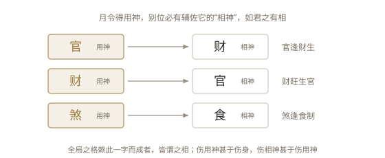

# 十五、论相神紧要

> 月令既得用神，则别位亦必有相，若君之有相，辅者是也。如官逢财生，则官为用，财为相；财旺生官，则财为用，官为相；煞逢食制，则煞为用，食为相。

月令中取得了用神，其他位置上也一定有辅佐它的“相神”，就像君主有宰相辅佐一样。比如正官得财生，官是用神，财就是相神；财旺生官，财是用神，官就是相神；七煞被食神制伏，七煞是用神，食神就是相神。

> 然此乃一定之法，非通变之妙。要而言之，凡全局之格，赖此一字而成者，均谓之相也。

不过这只是固定的说法，还不是变通的妙处。简要地说：凡是整个格局依靠某一个字才得以成立的，这个字都叫作相神。

*图 15-1　用神与相神：如君之有相；全局赖以成格的那个字即是相神。（译者补绘，原书无此图）*

> 伤用神甚于伤身，伤相甚于伤用。

用神受伤，比日主受伤更严重；相神受伤，又比用神受伤更严重。

> 如甲用酉官，透丁逢壬，则合伤存官以成格者，全赖壬之相；戊用子财，透甲并己，则合煞存财以成格者，全赖己之相；乙用酉煞，年丁月癸，时上逢戊，则合去癸印以使丁得制煞者，全赖戊之相。

比如甲木用酉中正官，天干透出丁火（伤官），又遇到壬水，壬合丁而合伤存官，格局得以成立，全靠壬水这个相神；戊土用子中正财，天干透出甲（七煞）和己，己合甲而合煞存财，格局得以成立，全靠己土这个相神；乙木用酉中七煞，年干丁（食神）、月干癸（印），时上逢戊，戊合去癸印，使丁火得以制煞，格局得以成立，全靠戊土这个相神。

> 癸生亥月，透丙为财，财逢月劫，而卯未来会，则化水为木而转劫以生财者，全赖于卯未之相。

癸水生在亥月，透出丙火为财，财遇月令劫财；而地支卯、未来会，亥卯未会成木局，把水化成木，使劫财转而生财，这全靠卯、未这两个相神。

> 庚生申月，透癸泄气，不通月令而金气不甚灵，子辰会局，则化金为水而成金水相涵者，全赖于子辰之相。如此之类，皆相神之紧要也。

庚金生在申月，透出癸水泄气，但癸水不通月令，金气不太灵秀；而地支子、辰与申会成水局，把金化为水，成就“金水相涵”，这全靠子、辰这两个相神。诸如此类，都可以看出相神的紧要。

> 相神无破，贵格已成；相神相伤，立败其格。

相神没有被破坏，贵格就成了；相神一旦受伤，格局立刻就败了。

> 如甲用酉官，透丁逢癸印，制伤以护官矣，而又逢戊，癸合戊而不制丁，癸水之相伤矣；丁用酉财，透癸逢己，食制煞以生财矣，而又透甲，己合甲而不制癸，己土之相伤矣。是皆有情而化无情，有用而成无用之格也。

比如甲木用酉中正官，透出丁火，又遇癸水印来制伤护官；可是又遇到戊土，癸去合戊而不再制丁，癸水这个相神就受伤了。丁火用酉中偏财，透出癸水（七煞），又遇己土（食神）制煞以生财；可是又透出甲木，己去合甲而不再制癸，己土这个相神就受伤了。这些都是由有情变成无情、由有用变成无用的格局。

> 凡八字排定，必有一种议论，一种作用，一种弃取，随地换形，难以虚拟，学命者其可忽诸？

凡是八字排定之后，必定有一套论断、一套作用、一套取舍，随着具体情况而变换，很难凭空设想。学命的人怎么能忽视这一点呢？
