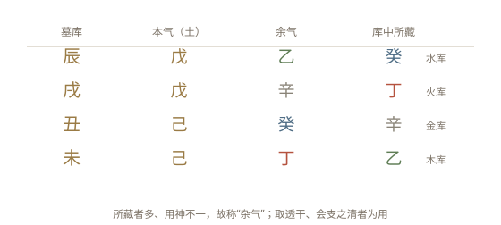

# 十六、论杂气如何取用

> 四墓者，杂气也，何以谓之杂气？以其所藏者多，用神不一，故谓之杂气也。

辰、戌、丑、未四墓，叫作“杂气”。为什么叫杂气？因为它们所藏的天干多，用神不止一个，所以叫杂气。

> 如辰本藏戊，而又为水库，为乙余气，三者俱有，于何取用？然而甚易也，透干会取其清者用之，杂而不杂也。

比如辰本身藏戊土，同时又是水的库，又是乙木的余气，三者都有，该取哪个为用呢？其实很容易：看哪个透出天干、哪个与地支会局，取其中清纯的来用，这样虽杂而不杂。

*图 16-1　四墓库的藏干：本气为土，另有前一季的余气与所主之库。（译者补绘，原书无此图）*

> 何谓透干？如甲生辰月，透戊则用偏财，透癸则用正印，透乙则用月劫是也。何谓会支？如甲生辰月，逢申与子会局，则用水印是也。

什么叫“透干”？比如甲木生在辰月：透出戊就用偏财，透出癸就用正印，透出乙就用月劫。什么叫“会支”？比如甲木生在辰月，地支遇到申与子，会成水局，就用水为印。

> 一透则一用，兼透则兼用，透而又会，则透与会并用。其合而有情者吉，其合而无情者则不吉。

透出一个就用一个，同时透出几个就兼用几个，既透干又会支，就透干与会支一并取用。它们配合得有情就吉，配合得无情就不吉。

> 何谓有情？顺而相成者是也。如甲生辰月，透癸为印，而又会子会申以成局，印绶之格，清而不杂，是透干与会支，合而有情也。

什么叫“有情”？顺势而互相成全的就是。比如甲木生在辰月，透出癸水为印，地支又会子、会申成水局，印绶格清而不杂，这是透干与会支配合得有情。

> 又如丙生辰月，透癸为官，而又逢乙以为印，官与印相生，而印又能去辰中暗土以清官，是两干并透，合而情也。

又如丙火生在辰月，透出癸水为官，又遇乙木为印，官与印相生，而乙木又能克去辰中暗藏的戊土（伤官），使官星清纯，这是两干并透、配合得有情。

（译注：“合而情也”当作“合而有情也”。）

> 又如甲生丑月，辛透为官，或巳酉会成金局，而又透己财以生官，是两干并透，与会支合而有情也。

又如甲木生在丑月，辛金透出为官，或者地支巳、酉与丑会成金局，又透出己土为财来生官，这是两干并透、与会支配合得有情。

> 何谓无情？逆而相背者是也。如壬生未月，透己为官，而地支会亥卯以成伤官之局，是透官与会支，合而无情者也。

什么叫“无情”？逆势而互相背离的就是。比如壬水生在未月，透出己土为官，而地支会亥、卯成木局（伤官），这是透出的官星与会支配合得无情。

> 又如甲生辰月，透戊为财，又或透壬癸以为印，透癸则戊癸作合，财印两失，透壬则财印两伤，又以贪财坏印，是两干并透，合而无情也。

又如甲木生在辰月，透出戊土为财，又透出壬或癸为印：透癸，则戊癸相合，财和印都失去作用；透壬，则财与印互相伤害，又成了贪财坏印。这是两干并透、配合得无情。

> 又如甲生戌月，透辛为官，而又透丁以伤官，月支又会寅会午以成伤官之局，是两干并透，与会支合而无情也。

又如甲木生在戌月，透出辛金为官，又透出丁火伤官，月支又与寅、午会成火局（伤官），这是两干并透、与会支配合得无情。

> 又有有情而卒成无情者，何也？如甲生辰月，逢壬为印，而又逢丙，印绶本喜泄身为秀，似成格矣，而火能生土，似又助辰中之戊，印格不清，是必壬干透而支又会申会子，则透丙亦无所碍。

又有起初有情、最终却变成无情的，这是为什么？比如甲木生在辰月，遇壬水为印，又遇丙火；印绶格本来喜欢泄身为秀，好像成格了；可是火能生土，又像是在帮辰中的戊土（财）破印，印格就不清了。必须是壬水透干、地支又会申、会子成水局，透出丙火才无妨碍。

> 又有甲生辰月，透壬为印，虽不露丙而支逢戌位，戌与辰冲，二者为月冲而土动，干头之壬难通月令，印格不成，是皆有情而卒无情，富而不贵者也。

又如甲木生在辰月，透出壬水为印，虽然没有露出丙火，但地支遇到戌，戌与辰相冲，月令被冲而土气发动，天干的壬水就难以通根月令，印格不成。这些都是起初有情、最终无情的，往往富而不贵。

> 又有无情而终有情者，何也？如癸生辰月，透戊为官，又有会申会子以成水局，透干与会支相克矣。然所克者乃是劫财，譬如月劫用官，何伤之有？

又有起初无情、最终却有情的，这是为什么？比如癸水生在辰月，透出戊土为官，地支又会申、会子成水局，透干的戊土与会成的水局相克。可是被戊土所克的是劫财（水局），这就像月劫格用官制劫，有什么伤害呢？

> 又如丙生辰月，透戊为食，而又透壬为煞，是两干并透，而相克也。然所克者乃是偏官，譬如食神带煞，煞逢食制，二者皆是美格，其局愈贵。是皆无情而终为有情也。

又如丙火生在辰月，透出戊土为食神，又透出壬水为七煞，两干并透而相克。可是被克的是七煞，这就像食神带煞、煞被食制，两者都是美格，格局反而更贵。这些都是起初无情、最终有情的。
