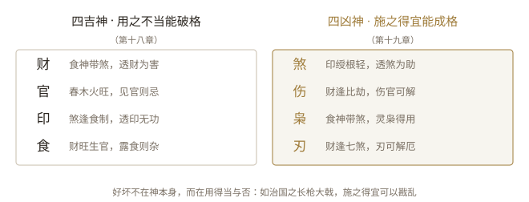

# 十九、论四凶神能成格

> 煞伤枭刃，四凶神也，然施之得宜，亦能成格。如印绶根轻，透煞为助，煞能成格也。财逢比劫，伤官可解，伤能成格也。食神带煞，灵枭得用，枭能成格也。财逢七煞，刃可解厄，刃能成格也。

七煞、伤官、枭神（偏印）、阳刃，是四种凶神；可是用得恰当，也能成就格局。比如印绶格的印根轻，透出七煞来生印相助——这是七煞能成格。财格遇到比劫争财，有伤官把比劫之气转化为生财——这是伤官能成格。食神格带七煞，煞强而食弱，这时灵动的枭神（偏印）得用，化煞生身——这是枭神能成格。财格遇到七煞（财生煞而攻身），有阳刃帮身抗煞，可以解除危难——这是阳刃能成格。

> 是故财不忌伤，官不忌枭，煞不忌刃，如治国长抢大戟，本非美具，而施之得宜，可以戡乱。

所以说，财不忌伤官，官不忌枭神，七煞不忌阳刃。就像治理国家用的长枪大戟，本来不是什么好东西，可是用得恰当，就能平定祸乱。

*图 19-1　四吉神用之不当能破格（第十八章），四凶神施之得宜能成格（本章）。（译者补绘，原书无此图）*
