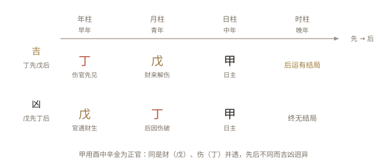

# 二十、论生克先后分吉凶

> 月令用神，配以四柱，固有每字之生克以分吉凶，然有同此生克，而先后之间，遂分吉凶者，尤谈命之奥也。

月令用神配合四柱，固然要根据每个字之间的生克来分吉凶；然而有时同样是这些生克，只因出现的先后不同，吉凶就有了分别，这更是论命的奥妙之处。

（译注：四柱从年到时，大致对应人生由早到晚，所以“先后”既指在四柱中的位置，也关乎一生前后的运势。）

> 如正官同是财伤并透，而先后有殊。假如甲用酉官，丁先戊后，则以财为解伤，即不能贵，后运必有结局。

比如正官格，同样是财与伤官都透出，先后不同就有差别。假如甲木用酉中正官，丁火（伤官）在前、戊土（财）在后，就是用财来化解伤官（伤生财、财生官），即使不能大贵，后来的运势也一定有个好结局。

> 若戊先而丁后时，则为官遇财生，而后因伤破，即使上运稍顺，终无结局，子嗣亦难矣。

如果戊土在前、丁火在时干，就是官星先得财生，而后被伤官破坏，即使前半生的运势稍顺，最终也没有好结局，子嗣方面也难如意。

*图 20-1　四柱由年至时如人生由早至晚：同是财伤并透，先后不同，吉凶迥异。（译者补绘，原书无此图）*

> 印格同是贪财坏印，而先后有殊。如甲用子印，己先癸后，即使不富，稍顺晚境；若癸先而己在时，晚景亦悴矣。

印格同样是“贪财坏印”，先后不同也有差别。比如甲木用子中正印，己土（财）在前、癸水（印）在后，即使不富，晚年也还算顺遂；如果癸水在前、己土在时干，晚年也就憔悴了。

> 食神同是财枭并透，而先后有殊。如壬用甲食，庚先丙后，晚运必亨，格亦富而望贵。若丙先而庚在时，晚运必淡，富贵两空矣。

食神格同样是财与枭神都透出，先后不同也有差别。比如壬水用甲木为食神，庚金（枭神）在前、丙火（财）在后，晚年运势必定亨通，格局也是富而有望贵。如果丙火在前、庚金在时干，晚年运势必定平淡，富贵两空。

> 七煞同是财食并透，而先后大殊。如己生卯月，癸先辛后，则为财以助用，而后煞用食制，不失大贵。

七煞格同样是财与食神都透出，先后不同差别更大。比如己土生在卯月（七煞），癸水（财）在前、辛金（食神）在后，就是先以财来助用神，而后七煞用食神来制，不失为大贵之命。

> 若辛先而癸在时，则煞逢食制，而财转食党煞，非特不贵，后运萧索，兼难永寿矣。

如果辛金在前、癸水在时干，就是七煞先被食神制住，而后财又转化食神去帮七煞，不仅不贵，后来的运势萧条冷落，还难以长寿。

> 丙生辛酉，年癸时己，伤因财间，伤之无力，间有小贵。假如癸己产并而中无辛隔，格尽破矣。

丙火生在辛酉月（正财），年干癸水为官、时干己土为伤官，伤官被中间的财（辛）隔开，伤官克官就没有力量，间或也有小贵。假如癸、己并列而中间没有辛金隔开，格局就彻底破了。

（译注：“产并”当作“并透”或“相并”。）

> 辛生申月，年壬月戊，时上丙官，不愁隔戊之壬，格亦许贵。假使年丙月壬而时戊，或年戊月丙而时壬，则壬能克丙，无望其贵矣。

辛金生在申月，年干壬水（伤官）、月干戊土（印）、时上丙火（正官），壬水被戊土隔住，不必担心它克丙，格局也可以称贵。假如年干丙、月干壬而时干戊，或者年干戊、月干丙而时干壬，壬水就能克丙火，就没有贵的指望了。

> 以上举官星为例，余如印畏财破，财惧比劫，食伤忌枭印，意义相同。救应之法，亦可例推矣。

以上主要以官星为例。其余如印怕财来破、财怕比劫来争、食伤忌枭印来夺，道理都相同。救应的方法，也可以依此类推。
