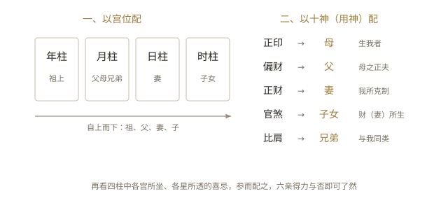

# 二十三、论宫分用神配六亲

> 人有六亲，配之八字，亦存于命。

人有六亲，把六亲配到八字上，也同样体现在命中。

> 其由宫分配之者，则年月日时，自上而下，祖父妻子，亦自上而下。以地相配，适得其宜，不易之位也。

按宫位来配：年、月、日、时自上而下，祖上、父母、妻子、子女也自上而下排列。按位置来配，恰好合宜，这是不变的位置。

> 其由用神配之者，则正印也母，身所自出，取其生我也。若偏财受我克制，何反为父？偏财者，母之正夫也，正印为母，则偏财为父矣。

按十神来配：正印为母亲，因为自身由母亲所生，取其“生我”之意。那么偏财是受我克制的，为什么反而是父亲？因为偏财是母亲（正印）的正夫——正印为母，克正印的偏财就是父亲了。

（译注：以甲日为例，正印为癸水，克癸水的戊土即偏财，戊癸相合，故偏财为母之夫。）

> 正财为妻，受我克制，夫为妻纲，妻则从夫。若官煞则克制乎我，何以反为子女也？官煞者，财所生也，财为妻妾，则官煞为子女矣。至于比肩为兄弟，又理之显然者。

正财为妻子，受我克制，因为“夫为妻纲”，妻子顺从丈夫。那么官煞是克制我的，为什么反而是子女？因为官煞是财所生的，财是妻妾，妻所生的官煞就是子女了。至于比肩为兄弟，道理更是显而易见。

*图 23-1　六亲的两种配法：以年月日时宫位配，以十神配。（译者补绘，原书无此图）*

> 其间有无得力，或吉或凶，则以四柱所存或年月或日时财官伤刃，系是何物，然后以六亲配之用神。局中作何喜忌，参而配之，可以了然矣。

至于六亲是否得力、是吉是凶，就要看四柱中年、月、日、时各宫所存的是财、官、伤官还是阳刃，再把六亲与用神对应起来，看它们在命局中是喜还是忌，相互参照，就可以明白了。
