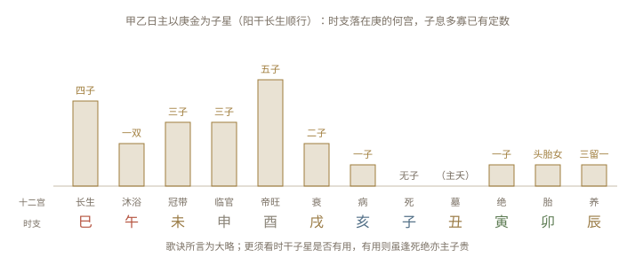

# 二十四、论妻子

> 大凡命中吉凶，于人愈近，其验益灵。富贵贫贱，本身之事，无论矣，至于六亲，妻以配身，子为后嗣，亦是切身之事。

大凡命中的吉凶，与本人关系越近，应验就越灵。富贵贫贱是本人自己的事，不用多说；至于六亲，妻子与自身相配，子女是后代，也都是切身的事。

> 故看命者，妻财子提纲得力，或年干有用，皆主父母身所自出，亦自有验。所以提纲得力，或年干有用，皆主父母双全得力。至于祖宗兄弟，不甚验矣。

所以看命时，……月令（提纲）得力，或者年干有用，都主父母双全、得父母之力，这也是有应验的。至于祖宗、兄弟，就不太应验了。

（译注：此段前半“妻财子提纲得力……皆主父母身所自出”文字错乱、语意不通，疑有脱误，今只译其可解之意。）

> 以妻论之，坐下财官，妻当贤贵；然亦有坐财官而妻不利，逢伤刃而妻反吉者，何也？此盖月令用神，配成喜忌。

先说妻子：日主坐下（日支）是财或官，妻子应当贤惠而贵气。可是也有坐下财官而妻子不好、坐下伤官阳刃而妻子反而好的，这是为什么？这是因为要结合月令用神来看它是喜是忌。

> 如妻宫坐财，吉也，而印格逢之，反为不美。妻坐官，吉也，而伤官逢之，岂能顺意？

比如妻宫（日支）坐财，本是吉的，可是印格遇到它（财来破印），反而不好。妻宫坐官，本是吉的，可是伤官格遇到它（伤官见官），怎么能顺心如意？

> 妻坐伤官，凶也，而财格逢之，可以生财，煞格逢之，可以制煞，反主妻能内助。

妻宫坐伤官，本是凶的，可是财格遇到它，伤官可以生财；七煞格遇到它，伤官可以制煞——反而主妻子能做贤内助。

> 妻坐阳刃，凶也，而或财官煞伤等格，四柱已成格局，而日主无气，全凭日刃帮身，则妻必能相关。其理不可执一。

妻宫坐阳刃，本是凶的，可是如果是财、官、煞、伤等格，四柱已经成格，而日主无气，全靠日支的阳刃帮身，那么妻子必定能帮扶丈夫。其中的道理不能死守一端。

（译注：“相关”疑当作“相助”。）

> 既看妻宫，又看妻星。妻星者，干头之财也。妻透而成局，若官格透财、印多逢财、食伤透财为用之类，即坐下无用，亦主内助。

看了妻宫，还要看妻星。妻星就是天干上透出的财。妻星透出而能成就格局，比如官格透财、印多而遇财、食伤格透财为用之类，即使日支无用，也主妻子是贤内助。

> 妻透而破格，若印轻财露、食神伤官、透煞逢财之类，即坐下有用，亦防刑克。

妻星透出却破坏格局，比如印轻而财露、食神格……、七煞透出又遇财之类，即使日支有用，也要防刑克妻子。

（译注：“食神伤官”一语，疑当作“食神逢枭”之类，或指伤官生财而带煞，底本文字不全。）

> 又有妻透成格，或妻宫有用而坐下刑冲，未免得美妻而难偕老。又若妻星两透，偏正杂出，何一夫而多妻？亦防刑克之道也。

又有妻星透出成格，或妻宫有用，但日支遭刑冲的，难免得了好妻子却难以白头偕老。又如妻星两个都透出，偏财正财杂出，一个丈夫怎么能有多个妻子？这也是要防刑克的。

> 至于子息，其看宫分与星所透喜忌，理与论妻略同。但看子息，长生沐浴之歌，亦当熟读，如"长生四子中旬半，沐浴一双保吉祥，冠带临官三子位，旺中五子自成行，衰中二子病中一，死中至老没儿郞，除非养取他之子，入墓之时命夭亡，受气为绝一个子，胎中头产养姑娘，养中三子只留一，男子宫中子细详"是也。

至于子女，看子女宫（时柱）和子星所透的喜忌，道理与论妻大致相同。不过看子女，“长生沐浴歌”也应当熟读。歌中说：长生有四个儿子（中旬生的减半）；沐浴有一对，保吉祥；冠带、临官都是三个儿子；帝旺五个儿子，自成一行；衰有两个，病有一个；死则到老没有儿子，除非领养别人的孩子；入墓之时命主夭亡；绝（受气）有一个儿子；胎则头胎生女儿；养有三个儿子只留得一个。男命看子女宫要仔细推详。

> 然长生论法，用阳而不用阴。如甲乙日只用庚金长生，巳酉丑顺数之局，而不用辛金逆数之子申辰。

不过按长生来论子女，只用阳干、不用阴干。比如甲乙日，只用庚金的长生（庚长生在巳，按巳酉丑方向顺数），而不用辛金逆数（辛长生在子，按子申辰方向逆数）。

> 虽书有官为女煞为男之说，然终不可以甲用庚男而用阳局，乙用辛男而阴局。盖木为日主，不问甲乙，总以庚为男辛为女，其理为然，拘于官煞，其能验乎？

虽然书上有“官为女、煞为男”的说法，但终究不能说甲日以庚为子就用阳局、乙日以辛为子就用阴局。因为只要是木日主，不论甲乙，一律以庚为儿子、辛为女儿，道理本来如此；拘泥于官、煞的分别，怎么能应验呢？

*图 24-1　子息长生歌：以甲乙日为例，看时支落在庚金十二宫的哪一宫。（译者补绘，原书无此图）*

> 所以八字到手，要看子息，先看时支。如甲乙生日，其时果系庚金何宫？或生旺，或死绝，其多寡已有定数，然后以时干子星配之。

所以八字到手，要看子女，先看时支。比如甲乙日生，看出生时辰的地支落在庚金的哪一宫：是生旺，还是死绝，子女多少已有定数；然后再结合时干的子星来看。

> 如财格而时干透食，官格而时干透财之类，皆谓时干有用，即使时逢死绝，亦主子贵，但不甚繁耳。若又逢生旺，则麟儿绕膝，岂可量乎？

比如财格而时干透出食神、官格而时干透出财之类，都叫时干有用；即使时支逢死绝，也主子女显贵，只是人数不多罢了。如果时支又逢生旺，那就是儿孙绕膝，福分不可限量。

> 若时干不好，子透破局，即逢生旺，难为子息。若又死绝，无所望矣。此论妻子之大略也。

如果时干不好，子星透出而破坏格局，即使时支逢生旺，也难有好子女；如果时支又逢死绝，就没什么指望了。这就是论妻子、子女的大概。
