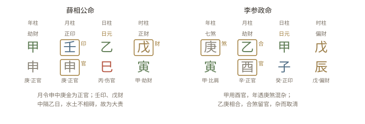

# 三十一、论正官

> 官以克身，虽与七煞有别，终受彼制，何以切忌刑冲破害，尊之若是乎？岂知人生天地间，必无矫焉自尊之理，虽贵极天子，亦有天祖临之。正官者分所当尊，如在国有君，在家有亲，刑冲破害，以下犯上，乌乎可乎？

正官是克制日主的，虽然和七煞有区别，终究也是受它管制，为什么最忌讳刑冲破害、要这样尊崇它呢？要知道人生在天地之间，绝没有骄傲自大、唯我独尊的道理，即使贵为天子，上面也还有天和祖宗。正官是本分上应当尊敬的，就像在国有君主、在家有父母；对它刑冲破害，就是以下犯上，怎么可以呢？

> 以刑冲破害为忌，则以生之护之为喜矣。存其喜而去其忌则贵，而贵之中又有高低者，何也？以财印并透者论之，两不相碍，其贵也大。

既然以刑冲破害为忌，那就以生它、护它为喜。保住喜神、去掉忌神就贵；而贵之中又有高低，这是为什么？以财、印都透出的来说，两者互不妨碍，就是大贵。

> 如薛相公命，甲申、壬申、乙巳，戊寅，壬印戊财，以乙隔之，水与土不相碍，故为大贵。

比如薛相公的命：甲申、壬申、乙巳、戊寅。月令申中庚金为正官；壬水为印、戊土为财，中间隔着乙木日主，水与土互不相碍，所以是大贵之命。

> 若壬戌、丁未、戊甲、乙卯，杂气正官，透干会支，最为贵格，而壬财丁印，二者相合，仍以孤官无辅论，所以不上七品。

又如壬戌、丁未、戊申、乙卯这个命：未中乙木为杂气正官，透干、会支（卯未会木），本是最好的贵格；可是壬水为财、丁火为印，两者相合，财印都失去作用，仍然按孤官无辅来论，所以官做不过七品。

（译注：“戊甲”当作“戊申”。）

> 若财印不以两用，则单用印不若单用财，以印能护官，亦能泄官，而财生官也。

如果财与印不能同时用，那么单用印不如单用财：因为印虽能护官，也会泄官之气，而财是生官的。

> 若化官为印而透财，则又为甚秀，大贵之格也。如金状元命，乙卯、丁亥、丁未、庚戌，此并用财印，无伤官而不杂煞，所谓去其忌而存其喜者也。

如果官星化成了印，又透出财，那就更加秀气，是大贵之格。比如金状元的命：乙卯、丁亥、丁未、庚戌。亥中壬水为官，而亥卯未会成木局，化官为印，时上透庚金为财，财、印并用，又没有伤官、不混七煞，这就是所谓“去其忌而存其喜”。

> 然而遇伤在于佩印，混煞贵乎取清。

不过遇到伤官，就要靠配印来解救；遇到官煞混杂，就贵在把它取清。

> 如宣参国命，己卯、辛未、壬寅、辛亥，未中己官透干用清，支会木局，两辛解之，是遇伤而佩印也。

比如宣参国的命：己卯、辛未、壬寅、辛亥。未中己土为官，透出天干而用得清纯；地支亥卯未会成木局（伤官），有两个辛金（印）来解救，这就是遇伤官而配印。

> 李参政命，庚寅、乙酉、甲子、戊辰，甲用酉官，庚金混杂，乙以合之，合煞留官，是杂煞而取清也。

李参政的命：庚寅、乙酉、甲子、戊辰。甲木用酉中正官，年干庚金（七煞）混杂进来，有乙木把庚合住，合煞留官，这就是官煞混杂而取清。

*图 31-1　正官格命例：天干上方、地支下方的小字为十神（地支取本气），金框为本章所论的关键字。（译者补绘，原书无此图）*

> 至于官格透伤用印者，又忌见财，以财能去印，未能生官，而适以护伤故也。

至于正官格透出伤官而用印的，又忌讳见财：因为财能去掉印，还来不及生官，反倒恰好护住了伤官。

> 然亦有逢财而反大贵者，如范太傅命，丁丑、壬寅、己巳、丙寅，支具巳丑，会金伤官，丙丁解之，透壬岂非破格？

不过也有遇财反而大贵的，比如范太傅的命：丁丑、壬寅、己巳、丙寅。月令寅中甲木为官；地支巳、丑会成金局（伤官），有丙丁火（印）来解救；可是又透出壬水（财），岂不是破格了吗？

> 却不知丙丁并透，用一而足，以丁合壬而财去，以丙制伤而官清，无情而愈有情。此正造化之妙，变幻无穷，焉得不贵？

殊不知丙丁都透出，只用一个就够了：用丁火去合壬水，财就去掉了；用丙火去制伤官，官就清了。看似无情，反而更加有情。这正是造化的奥妙，变幻无穷，怎么能不贵呢？
