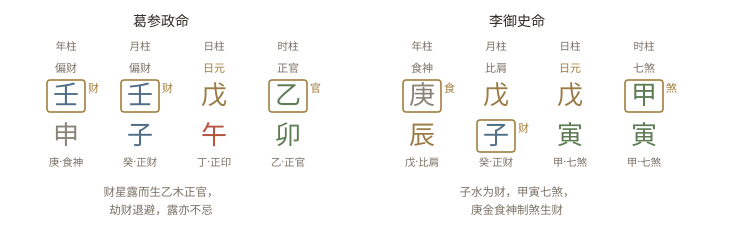

# 三十三、论财

> 财为我克，使用之物也，以能生官，所以为美。为财帛，为妻妾，为才能，为驿马，皆财类也。

财是被我所克的，是我可以使用的东西；因为它能生官，所以是美好的。财帛、妻妾、才能、驿马，都属于财这一类。

> 财喜根深，不宜太露，然透一位以清用，格所最喜，不为之露。即非月令用神，若寅透乙、卯透甲之类， 一亦不为过，太多则露矣。

财喜欢根深，不宜太露。但透出一位、用得清纯，正是格局最喜欢的，不算太露。即使不是月令用神，比如寅中透出乙、卯中透出甲之类，透出一个也不算过分；透得太多才算露。

> 然而财旺生官，露亦不忌，盖露不忌，盖露以防劫，生官则劫退，譬如府库钱粮，有官守护，即使露白，谁敢劫之？

然而财旺而能生官，即使透露也不忌讳。因为财露所怕的是被劫，而财能生官，官能制劫，劫财就退避了。好比官府库房里的钱粮，有官兵守护，即使露了白，谁敢来抢呢？

（译注：“盖露不忌，盖露以防劫”有重复，当作“盖露以防劫”。）

> 如葛参政命，壬申、壬子、戊午、乙卯，岂非财露？唯其生官，所以不忌也。

比如葛参政的命：壬申、壬子、戊午、乙卯。两个壬水都透出，难道不是财露吗？正因为财能生时上的乙木正官，所以不忌。

> 财格之贵局不一，有财旺生官者，身强而不透伤官，不混七煞，贵格也。

财格的贵局不止一种。有财旺生官的：日主身强，又不透伤官、不混七煞，是贵格。

> 有财用食生者，身强而不露官，略带一位比劫，益觉有情，如壬寅、壬寅、庚辰、辛巳，杨待郎之命是也。透官身弱，则格坏矣。

有财用食神来生的：日主身强而不露官星，略带一位比劫，更显得有情。比如壬寅、壬寅、庚辰、辛巳，杨侍郎的命就是。如果透出官星而日主又弱，格局就坏了。

（译注：“待郎”当作“侍郎”。）

> 有财格佩印者，盖孤财不贵，佩印帮身，即印取贵。如乙未、甲申、丙申、庚寅，曾参政之命是也，然财印宜相并，如乙未、己卯、庚寅、辛巳，乙与己两不相能，即有好处，小富而已。

有财格配印的：因为孤财不贵，配印来帮身，就借印取贵。比如乙未、甲申、丙申、庚寅，曾参政的命就是。不过财与印要相互并立、互不相碍；比如乙未、己卯、庚寅、辛巳，乙木（财）与己土（印）互相妨碍，即使有好处，也只是小富而已。

> 有用食而兼用印者，食与印两不相碍，或有暗官而去食护官，皆贵格也。如吴榜

有用食神又兼用印的：食神与印互不相碍；或者有暗藏的官星，用印去掉食神以护官——都是贵格。比如吴榜……

> 眼命，庚戌、戊子、戊子、丙辰，庚与丙隔两戊而不相克，是食与印不相碍也。

……眼的命：庚戌、戊子、戊子、丙辰。庚金（食神）与丙火（印）中间隔着两个戊土而不相克，这就是食与印不相碍。

（译注：底本此处“吴榜眼”三字被换行拆开，原文照录。）

> 如平江伯命，壬辰、乙巳、癸巳、辛酉，虽食印相克，而欲存巳戊官，是去食护官也。反是则减福矣。

又如平江伯的命：壬辰、乙巳、癸巳、辛酉。辛金（印）虽然克乙木（食神），但目的是要保住巳中戊土官星，这就是去食护官。反过来就减福了。

> 有财用伤官者，财不甚旺而比强，辂露一位伤官以化之，如甲子、辛未、辛酉、壬辰，甲透未库，逢辛为劫，壬以化劫生财，汪学士命是也，

有财格用伤官的：财不太旺而比劫强，略露一位伤官来化解比劫。比如甲子、辛未、辛酉、壬辰：甲木从未库中透出为财，遇辛金为比劫，壬水（伤官）来化比劫而生财，这是汪学士的命。

（译注：“辂露”当作“略露”。）

> 财旺无劫而透伤，反为不利，盖伤官本非美物，财轻透劫，不得已而用之。旺而露伤，何苦用彼？徒使财遇伤而死生官之具，安望富贵乎？

如果财旺又没有比劫，却透出伤官，反而不利。因为伤官本来不是好东西，只是财轻而透劫时不得已才用它；财已经旺了还露出伤官，何苦去用它呢？只会让财遇到伤官，白白断送了生官的工具，还指望什么富贵呢？

> 有财带七煞者，或合煞存财，或制煞生财，皆贵格也，如毛状元命，乙酉、庚辰、甲午、戊辰，合煞存财也；李御史命，庚辰、戊子、戊寅、甲寅，制煞生财也。

有财格带七煞的：或者合去七煞以保存财，或者制住七煞而生财，都是贵格。比如毛状元的命：乙酉、庚辰、甲午、戊辰，这是合煞存财（乙庚相合）；李御史的命：庚辰、戊子、戊寅、甲寅，这是制煞生财（庚金食神制甲寅七煞）。

*图 33-1　财格命例：小字为十神，金框为本章所论的关键字。（译者补绘，原书无此图）*

> 有财用煞印者，党煞为忌，印以化之，格成富局，若冬土逢之亦贵格。如赵侍郎命，乙丑、丁亥、乙亥，化煞而即以解冻，又不露财以杂其印，所以贵也。若财用煞印而印独，财煞并透，非特不贵，亦不富也。

有财格用煞、印的：财去帮煞是忌，用印来化解，格局就成了富局；如果是冬天的土遇到这种配合，也是贵格。比如赵侍郎的命：乙丑、丁亥、乙亥……，丁火之印既化煞，又解了冬天的寒冻，又不露财来扰乱印，所以贵。如果财格用煞印而印只有一个，财与煞又都透出，不但不贵，连富也做不到。

（译注：赵侍郎命底本只列三柱，缺一柱。）

> 至于壬生午月，癸生巳月，单透财而亦贵，又月令有暗官也。如丙寅、癸巳、癸未、壬戌，林尚书命是也。

至于壬水生在午月、癸水生在巳月，只透出财也能贵，因为月令里暗藏着官星（午中己土、巳中戊土）。比如丙寅、癸巳、癸未、壬戌，林尚书的命就是。

> 又壬生巳月，单透财而亦贵，以其透丙藏戊，弃煞就财，美者存在赠者弃也。如丙辰、癸巳、壬戌、壬寅，王太仆命是也。

又如壬水生在巳月，只透出财也能贵：因为透出丙火（财）而藏着戊土（七煞），舍弃七煞而就财，好的留下、坏的舍去。比如丙辰、癸巳、壬戌、壬寅，王太仆的命就是。

（译注：“美者存在赠者弃”当作“美者存而憎者弃”。）

> 至于劫刃太重，弃财就煞，如一尚书命，丙辰、丙申、丙午、壬辰，此变之又变者也。

至于劫财、阳刃太重，就舍弃财而用七煞，比如某位尚书的命：丙辰、丙申、丙午、壬辰。这是变了又变的情形。
