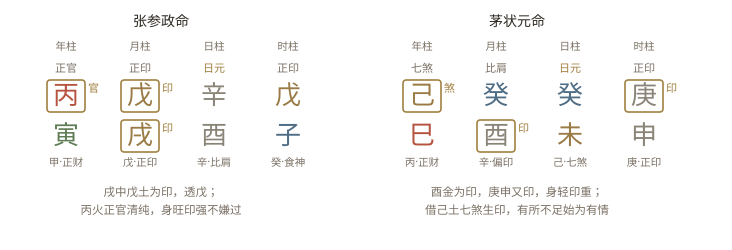

# 三十五、论印绶

> 印绶喜其生身，正偏同为美格，故财与印不分偏正，同为一格而论之。

印绶之所以可喜，在于它能生扶日主；正印、偏印同样都是美格。所以财与印都不分偏正，各作为一格来论。

> 印绶之格局亦不一，有印而透官者，正官不独取其生印，而即可以为用，与用煞者不同。故身旺印强，不愁太过，只要官星清纯，如丙寅、戊戌、辛酉、戊子，张参政之命是也。

印绶格的局面也不止一种。有印而透官的：正官不仅可以生印，本身也可以作为用神，这和用七煞的不同。所以即使日主旺、印也强，也不担心太过，只要官星清纯就好。比如丙寅、戊戌、辛酉、戊子，张参政的命就是。

> 然亦有带伤食而贵者，则如朱尚书命，丙戌、戊戌、辛未、壬辰，壬为戊制，不伤官也。又如临淮侯命，乙亥、己卯、丁酉、壬寅，己为乙制，己不碍官也。

不过也有带伤官食神而贵的。比如朱尚书的命：丙戌、戊戌、辛未、壬辰，壬水（伤官）被戊土制住，就伤不了丙火官星。又如临淮侯的命：乙亥、己卯、丁酉、壬寅，己土（食神）被乙木制住，就妨碍不了壬水官星。

> 有印而用伤食者，身强印旺，恐其太过，泄身以为秀气。如戊戌、乙卯、丙午、乙亥，李状元命也，若印浅身轻，而用层层伤食，则寒贫之局矣。

有印而用伤官食神的：日主强、印又旺，担心太过，就用伤食泄出日主之气作为秀气。比如戊戌、乙卯、丙午、乙亥，是李状元的命。如果印浅、日主轻，却用层层伤食，那就是寒酸贫穷的格局了。

> 有用偏官者，偏官本非美物，藉其生印，不得已而用之。故必身重印轻，或身轻印重，有所不足，始为有性。如茅状元命，己巳、癸酉、癸未、庚申，此身轻印重也。马参政命，壬寅、戊申、壬辰、壬寅，此身重印轻也。若身印并重而用七煞，非孤则贫矣。

有用偏官（七煞）的：偏官本来不是好东西，只是借它来生印，不得已才用它。所以一定要日主重而印轻、或日主轻而印重，有所不足，才算有情。比如茅状元的命：己巳、癸酉、癸未、庚申，这是日主轻而印重。马参政的命：壬寅、戊申、壬辰、壬寅，这是日主重而印轻。如果日主与印都重，还用七煞，不是孤独就是贫穷。

（译注：“始为有性”当作“始为有情”。）

*图 35-1　印绶格命例：小字为十神，金框为本章所论的关键字。（译者补绘，原书无此图）*

> 有用煞而兼带伤食者，则用煞而有制，生身而有泄，不论身旺印重，皆为贵格。

有用七煞而兼带伤官食神的：用七煞而有制伏，生身而又有泄秀，不论日主是否旺、印是否重，都是贵格。

> 有印多而用财者，印重身强，透财以抑太过，权而用之，只要根深，无防财破。如辛酉、丙申、壬申、辛亥，汪侍郎命是也。若印轻财重，又无劫财以救，则为贪财破印，贫贱之局也。

有印多而用财的：印重、日主强，透出财来抑制太过，这是权宜之用；只要印根深，就不怕财来破。比如辛酉、丙申、壬申、辛亥，汪侍郎的命就是。如果印轻而财重，又没有劫财来救，那就是贪财破印，是贫贱的格局。

（译注：“无防”当作“无妨”。）

> 即或印重财轻而兼露伤食，财与食相生，轻而不轻，即可就富，亦不贵矣。

即使是印重财轻，但同时露出伤官食神，财与食神相生，财虽轻而实际不轻，即使能够致富，也不会贵。

> 然亦有带食而贵者，何也？如庚寅、乙酉、癸亥、丙辰，此牛监薄命，乙合庚而不生癸，所以为贵，若合财存食，又可类推矣。如己未、甲戌、辛未、癸巳，此合财存食之贵也。

不过也有带食神而贵的，这是为什么？比如庚寅、乙酉、癸亥、丙辰，这是牛监簿的命：乙木（食神）与庚金（印）相合，庚金被合住，既不再去生癸水，也不会来夺食，所以为贵。至于合去财而保留食神的，也可以类推。比如己未、甲戌、辛未、癸巳，这是合财存食而贵的。

（译注：“监薄”当作“监簿”，官名。）

> 又有印而兼透官煞者，或合煞，或有制，皆为贵格。如辛亥、庚子、甲辰、乙亥，此合煞留官也；壬子、癸卯、丙子、己亥、此官煞有制也。

又有印格而官、煞都透出的：或者合去七煞，或者有制伏，都是贵格。比如辛亥、庚子、甲辰、乙亥，这是合煞留官（乙庚相合）；壬子、癸卯、丙子、己亥，这是官煞有制（己土制壬癸）。

> 至于化印为劫；弃之以就财官，如赵知府命，丙午、庚寅、丙午、癸已，则变之又变者矣。

至于印化为劫财，就舍弃它而去取财官，比如赵知府的命：丙午、庚寅、丙午、癸巳。这是变了又变的情形。

（译注：“癸已”当作“癸巳”。）

> 更有印透七煞，而劫财以存煞印，亦有贵格，如庚戌、戊子、甲戌、乙亥是也。然此格毕竟难看，宜细详之。

更有印格透出七煞，而用劫财（护印抗财）来保存煞与印的，也有贵格，比如庚戌、戊子、甲戌、乙亥。不过这种格局毕竟难以看准，应当仔细推详。
