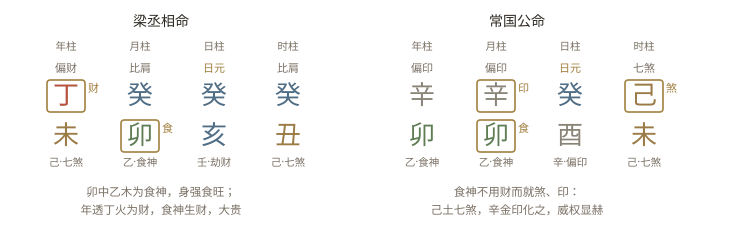

# 三十七、论食神

> 食神本属泄气，以其能生正财，所以喜之。故食神生财，美格也。财要有根，不必偏正叠出，如身强食旺而财透，大贵之格。

食神本来是泄日主之气的，因为它能生正财，所以讨人喜欢。所以食神生财是美格。财要有根，不必偏财正财重叠出现；如果日主强、食神旺而财又透出，就是大贵之格。

> 若丁未、癸卯、癸亥、癸丑，梁丞相之命是也；己未、壬申、戊子、庚申，谢阁老之命是也。

比如丁未、癸卯、癸亥、癸丑，是梁丞相的命；己未、壬申、戊子、庚申，是谢阁老的命。

> 藏食露伤，主人性刚，如丁亥、癸卯、癸卯、甲寅，沈路分命是也。偏正叠出，富贵不巨，职甲午、丁卯、癸丑、丙辰，龚知县命是也。

食神藏于地支而伤官露于天干，主为人性格刚强，比如丁亥、癸卯、癸卯、甲寅，沈路分的命就是。偏财、正财重叠出现，富贵就不大，比如甲午、丁卯、癸丑、丙辰，龚知县的命就是。

（译注：“职甲午”的“职”当作“如”。）

> 夏木用财，火炎土燥，贵多就武。如己未、已巳、甲寅、丙寅，黄都督之命是也。

夏天的木用财，火炎土燥，即使贵也多是武职。比如己未、己巳、甲寅、丙寅，黄都督的命就是。

> 若不用财而就煞印，最为威权显赫。如辛卯、辛卯、癸酉、己未，常国公命是也。

如果食神格不用财，而改就七煞与印，最是威权显赫。比如辛卯、辛卯、癸酉、己未，常国公的命就是。

> 若无印绶而单露偏官，只要无财，亦为贵格，如戊戌、壬戌、丙子、戊戌，胡会元命是也。

如果没有印绶而只露出偏官（七煞），只要没有财，也是贵格。比如戊戌、壬戌、丙子、戊戌，胡会元的命就是。

*图 37-1　食神格命例：小字为十神，金框为本章所论的关键字。（译者补绘，原书无此图）*

> 若金水食神而用煞，贵而且秀，如丁亥、壬子、辛巳、丁酉，舒尚书命是也。

如果是金水食神（金日主生于冬季）而用七煞，既贵且秀，比如丁亥、壬子、辛巳、丁酉，舒尚书的命就是。

> 至于食神忌印，夏火太炎而木焦，透印不碍，如丙午、癸巳、甲子、丙寅，钱参政命是也。食神忌官，金水不忌，即金水伤官可见官之谓。

至于食神忌印：如果夏天火太炎、木被烤焦，透出印（水）也无妨，比如丙午、癸巳、甲子、丙寅，钱参政的命就是。食神忌官，但金水食神不忌，也就是“金水伤官可以见官”的意思。

> 至若单用食神，作食神有气，有财运则富，无财运则贫。

至于单用食神的，按食神有气来论：有财运就富，没有财运就贫。

> 更有印来夺食，透财以解，亦有富贵，须就其全局之势而断之。至于食神而官煞竞出，亦可成局，但不甚贵耳。

更有印来夺食，而透出财来解救的，也有富贵，要根据全局的形势来判断。至于食神格而官煞都透出的，也可以成局，只是不太贵。

> 更有食神合煞存财，最为贵格。

更有食神合去七煞而保存财的，是最贵的格局。

> 至若食神透煞。本忌见财，而财先煞后，食以间之，而财不能党煞，亦可就贵。如刘提台命，癸酉、辛酉、己卯、乙亥是也。其余变化，不能尽述，类而推之可也。

至于食神格透出七煞，本来忌讳见财；但如果财在前、煞在后，中间有食神隔开，财就不能去帮煞，也可以成贵。比如癸酉、辛酉、己卯、乙亥，刘提台的命就是。其余的变化，不能一一叙述，依此类推就可以了。
