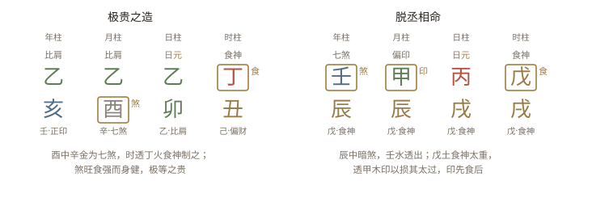

# 三十九、论偏官

> 煞以攻身，似非美物，而大贵之格，多存七煞。盖控制得宜，煞为我用，如大英雄大豪杰，似难驾驭，而处之有方，则惊天动地之功，忽焉而就。此王侯将相所以多存七煞也。

七煞是攻击日主的，似乎不是好东西；然而大贵之格，却多带有七煞。因为只要控制得当，七煞就能为我所用，就像大英雄、大豪杰，看似难以驾驭，但只要对待得法，惊天动地的功业转眼就能成就。这就是王侯将相的命中多有七煞的原因。

> 七煞之格局亦不一：煞用食制者，上也，煞旺食强而身健，极为贵格。如乙亥、乙酉、乙卯、丁丑，极等之贵也。

七煞格的局面也不止一种：七煞用食神来制的，是上等；七煞旺、食神强而日主又健，是极贵之格。比如乙亥、乙酉、乙卯、丁丑，就是极等的贵命。

> 煞用食制，不要露财透印，以财能转食生煞，而印能去食护煞也。

七煞用食神来制，就不要露财、透印：因为财能把食神转化为生煞之力，而印能去掉食神、护住七煞。

> 然而财先食后，财生煞而食以制之，或印先食后，食太旺而印制，则格成大贵。如脱丞相命，壬辰、甲辰、丙戌、戊戌，辰中暗煞，壬以透之，戊坐四支，食太重而透甲印，以损太过，岂非贵格？若煞强食泄而印露，则破局矣。

然而如果财在前、食神在后，财生煞而食神来制；或者印在前、食神在后，食神太旺而有印来制，格局就成为大贵。比如脱丞相的命：壬辰、甲辰、丙戌、戊戌。辰中暗藏七煞（壬水），而壬水透出；戊土坐于四支，食神太重，透出甲木（印）来损其太过，难道不是贵格吗？如果七煞强、食神又被泄（不能制煞），而印又露出，那就破局了。

> 有七煞用印者，印能护煞，本非所宜，而印有情，便为贵格。如何参政命，丙寅、戊戌、壬戌、辛丑，戊与辛同通月令，是煞印有情也。

有七煞用印的：印能护煞，本来不太合适；但如果印有情，就是贵格。比如何参政的命：丙寅、戊戌、壬戌、辛丑，戊土（七煞）与辛金（印）同样通根于月令戌，这就是煞印有情。

> 亦有煞重身轻，用食则身不能当，不若转而就印，虽不通根月令，亦为无情而有情。格亦许贵，但不大耳。

也有七煞重而日主轻的：如果用食神制煞，日主承受不了（食神也泄身），不如转而就印化煞生身。即使印不通根月令，也算无情中的有情，格局也可以称贵，只是不大。

*图 39-1　偏官（七煞）格命例：小字为十神，金框为本章所论的关键字。（译者补绘，原书无此图）*

> 有煞而用财者，财以党煞，本非所喜，而或食被制，不能伏煞，而财以去印存食，便为贵格。

有七煞格而用财的：财会帮煞，本来不讨喜；但如果食神被（印）所制，不能制伏七煞，而用财去掉印、保住食神，就是贵格。

> 如周丞相命，戊戌、甲子，丁未、庚戌，戊被制不能伏煞，时透庚财，即以清食者，生不足之煞。生煞即以制煞，两得其用，尤为大贵。

比如周丞相的命：戊戌、甲子、丁未、庚戌。年干戊土（伤官）被甲木（印）制住，不能制伏七煞（子中癸水）；时上透出庚金（财），既去甲以清理食伤，又去生不足的七煞。生煞的同时又能（让食伤）制煞，两方面都得其用，尤其是大贵。

> 又有身重煞轻，煞又化印，用神不清，而借财以清格，亦为贵格。如甲申、乙亥、丙戌、庚寅，刘运使命是也。

又有日主重、七煞轻，七煞又化为印，用神不清，于是借财来清理格局的，也是贵格。比如甲申、乙亥、丙戌、庚寅，刘运使的命就是。

> 更有杂气七煞，干头不透财以清用，亦可取贵。

更有杂气七煞，天干不透财，用神清纯，也可以取贵。

> 有煞而杂官者，或去官，或去煞，取清则贵。如岳统制命，癸卯、丁巳、庚寅、庚辰，去官留煞也。

有七煞而混杂正官的：或者去掉官，或者去掉煞，取得清纯就贵。比如岳统制的命：癸卯、丁巳、庚寅、庚辰，这是去官留煞（癸水克去丁火正官，留下巳中丙火七煞）。

> 夫官为贵气，去官何如去煞？岂知月令偏官，煞为用而官非用，各从其重。若官格杂煞而去官留煞，不能如是之清矣。

正官是贵气，去官怎么比得上去煞？殊不知月令是偏官，以七煞为用神，正官并不是用神，所以各按轻重来取舍。如果是正官格混杂了七煞，却去官留煞，就不能这样清纯了。

> 如沈郎中命，丙子、甲午、辛亥、辛卯，子冲午而克煞，是去煞留官也。

比如沈郎中的命：丙子、甲午、辛亥、辛卯，子冲午而克去午中丁火七煞，这是去煞留官。

> 有煞无食制而用印当者，如戊辰、甲寅、戊寅、戊午、赵员外命是也。

有七煞而没有食神制伏、用印来抵挡的，比如戊辰、甲寅、戊寅、戊午，赵员外的命就是。

（译注：“用印当者”疑当作“用刃当煞者”：此造甲寅七煞，时支午为戊土阳刃，属以刃当煞。）

> 至书有制煞不可太过之说，虽亦有理，然运行财印，亦能发福，不可执一也，乃若弃命从煞，则于外格详之。

至于书上有“制煞不可太过”的说法，虽然也有道理，但如果大运走财、印之地，也能发福，不可死守一端。至于弃命从煞，则在外格中详细论述。
