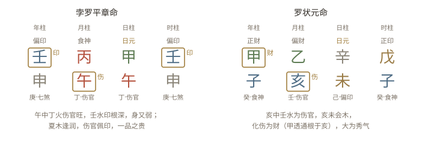

# 四十一、论伤官

> 伤官虽非吉神，实为秀气，故文人学士，多于伤官格内得之。而夏木见水，冬金见火，则又为秀之尤秀者也。其中格局比他格多，变化尤多，在查其气候，量其强弱，审其喜忌，观其纯杂，微之又微，不可执也。

伤官虽然不是吉神，却实在是秀气所在，所以文人学士多出自伤官格。而夏天的木见水、冬天的金见火，更是秀中之秀。伤官格的局面比其他格多，变化更多，关键在于察看气候、衡量强弱、审度喜忌、观察纯杂，精微之又精微，不可拘执。

（译注：本章标题在底本目录中误作“四十二”，实为第四十一章。）

> 故有伤官用财者，盖伤不利于民，所以为凶，伤官生财，则以伤官为生官之具，转凶为吉，故最利。只要身强而有根，便为贵格，如壬午、己酉、戊午、庚申，史春芳命也。

所以有伤官用财的：伤官之所以为凶，是因为它不利于“民”（伤克官星）；而伤官生财，就让伤官成了生官的工具，转凶为吉，所以最有利。只要日主强而有根，就是贵格。比如壬午、己酉、戊午、庚申，是史春芳的命。

> 至于化伤为财，大为秀气，如罗状元命，甲子、乙亥、辛未、戊子，干头之甲，通根于亥，然又会未成局，化水为木，化之生财，尤为有情，所以伤官生财，冬金不贵，以冻水不能生木。若乃化木，不待于生，安得不为殿元乎？

至于伤官化为财，更是大为秀气。比如罗状元的命：甲子、乙亥、辛未、戊子。天干的甲木通根于亥，而亥又与未会成木局，把水（伤官）化成木（财），比伤官去生财更有情。所以说伤官生财，冬天的金并不贵，因为冻住的水不能生木；而这里水直接化成了木，不必靠生，怎么能不中状元呢？

> 至于财伤有情，与化伤为财者，其秀气不相上下，如秦龙图命，己卯、丁丑、丙寅、庚寅，己与庚同根月令是也。

至于财与伤官有情的，秀气与化伤为财的不相上下。比如秦龙图的命：己卯、丁丑、丙寅、庚寅，己土（伤官）与庚金（财）同样通根于月令丑，就是这样。

> 有伤官佩印者，印能制伤，所以为贵，反要伤官旺，身稍弱，始为秀气。

有伤官配印的：印能制伤官，所以贵；但反而要伤官旺、日主稍弱，才显得秀气。

> 如孛罗平章命，壬申、丙午、甲午、壬申、伤官旺，印根深，身又弱，又是夏木逢润，其秀百倍，所以一品之贵。

比如孛罗平章的命：壬申、丙午、甲午、壬申。伤官旺，印的根又深，日主又弱，又是夏天的木遇到水的滋润，秀气百倍，所以是一品之贵。

> 然印旺极深，不必多见，偏正叠出，反为不秀，故伤轻身重而印绶多见，贫穷之格也。

不过印只要旺而根深，不必多见；偏印正印重叠出现，反而不秀。所以伤官轻、日主重而印绶又多见的，是贫穷之格。

*图 41-1　伤官格命例：小字为十神，金框为本章所论的关键字。（译者补绘，原书无此图）*

> 有伤官兼用财印者，财印相克，本不并用，只要干头两清而不相碍；又必生财者，财太旺而带印，佩印者印太重而带财，调停中和，遂为贵格。

有伤官格兼用财与印的：财与印相克，本来不能并用；只要天干上两者都清而不相妨碍就行。还必须是：生财的，财太旺而带印；配印的，印太重而带财——调停到中和，就成为贵格。

> 如丁酉、己酉、戊子、壬子，财太重而带印，而丁与壬隔以戊已，两不碍，且金水多而觉寒，得火融和，都统制命也。

比如丁酉、己酉、戊子、壬子：财太重而带印，而丁火（印）与壬水（财）中间隔着戊、己，两不相碍；而且金水多而偏寒，得丁火来融和，这是都统制的命。

（译注：“戊已”当作“戊己”，下同。）

> 又如壬戌、己酉、戊午、丁巳，印太重而隔戊已，而丁与壬不相碍，一丞相命也。反是则财印不并用而不秀矣。

又如壬戌、己酉、戊午、丁巳：印太重，而中间隔着戊、己，丁火与壬水不相碍，这是一位丞相的命。反过来，财与印就不能并用，也就不秀了。

> 有伤官用煞印者，伤多身弱，赖煞生印以帮身而制伤，如己未、丙子、庚子、丙子，蔡贵妃也。

有伤官格用煞、印的：伤官多、日主弱，依赖七煞生印来帮身并制伤官。比如己未、丙子、庚子、丙子，是蔡贵妃的命。

> 煞因伤而有制，两得其宜，只要无财，便为贵格，如壬寅、丁未、丙寅，夏阁老命是也。

七煞因伤官而得到制伏，两方面都得其宜；只要没有财，就是贵格。比如壬寅、丁未、丙寅……，夏阁老的命就是。

（译注：夏阁老命底本只列三柱，缺一柱。）

> 有伤官用官者，他格不用，金水独宜，然要财印为辅，不可伤官并透。

有伤官格用官的：其他伤官格都不能用官，只有金水伤官适宜；但要有财、印辅助，不能伤官与官星同时透出。

> 如戊申、甲子、庚午、丁丑，藏癸露丁，戊甲为辅，官又得禄，所以为丞相之格。若孤官无辅，或官伤并透，则发福不大矣。

比如戊申、甲子、庚午、丁丑：伤官癸水藏于子中，官星丁火露于时干，有戊土（印）、甲木（财）为辅，丁火官星又坐午得禄，所以是丞相之格。如果孤官无辅，或者官与伤官都透出，发福就不大了。

> 若冬金用官，而又化伤为财，则尤为极秀极贵。如丙申、己亥、辛未、己亥，郑丞相命是也。

如果冬天的金用官，又把伤官化成了财，那就更是极秀极贵。比如丙申、己亥、辛未、己亥，郑丞相的命就是。

> 然亦有非金水而见官，何也？化伤为财，伤非其伤，作财旺生官而不作伤官见官，如甲子、壬申、己亥、辛未，章丞相命也。

然而也有不是金水伤官而见官的，这是为什么？因为伤官化成了财，伤官已不再是伤官，按财旺生官来论，而不按伤官见官来论。比如甲子、壬申、己亥、辛未，是章丞相的命。

> 至于伤官而官煞并透，只要干头取清，金水得之亦清，不然则空结构而已。

至于伤官格而官、煞都透出的：只要天干上能够取清，金水伤官得之也算清；不然的话，只是空有格局的架子罢了。
