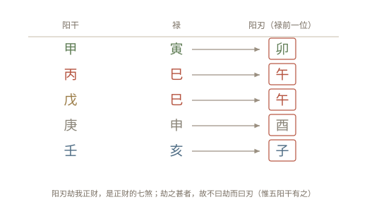

# 四十三、论阳刃

> 阳刃者，劫我正财之神，乃正财之七煞也。禄前一位，惟五阳有之，故为阳刃。不曰劫而曰刃，劫之甚也。

阳刃，是劫夺我正财的神，也就是正财的七煞。它位于禄的前一位，只有五个阳干才有，所以叫阳刃。不叫“劫”而叫“刃”，是因为它劫夺得更厉害。

*图 43-1　五阳干的禄与阳刃：刃在禄前一位。（译者补绘，原书无此图）*

> 刃宜伏制，官煞皆宜，财印相随，尤为贵显。夫正官而财印相随美矣，七煞得之，夫乃甚乎？

阳刃应当被制伏，正官、七煞都适合用来制它；如果再有财、印相随，就更加显贵。正官有财、印相随，固然是美事；七煞得到财、印，难道不是太过了吗？

> 岂知他格以煞能伤身，故喜制伏，忌财印；阳刃用之，则赖以制刃，不怕伤身，故反喜财印，忌制伏也。

殊不知在其他格局里，七煞会伤害日主，所以喜欢有制伏、忌讳财印来生扶它；而阳刃格用七煞，正是依靠它来制刃，不怕它伤身，所以反而喜欢财印、忌讳把七煞制伏。

> 阳刃用官，透刃不虑；阳刃露煞，透刃无成。盖官能制刃，透而不为害；刃能合煞，则有何功？

阳刃格用正官的，透出阳刃也不用担心；阳刃格露出七煞的，再透出阳刃就不成格了。因为正官能制刃，刃透出也不为害；而阳刃能合住七煞，七煞被合，还有什么功用呢？

> 如丙生午月，透壬制刃，而又露丁，丁与壬合，则七煞有贪合忘克之意，如何制刃？故无功也。

比如丙火生在午月（阳刃），透出壬水（七煞）来制刃，可是又露出丁火，丁与壬相合，七煞就贪恋相合而忘了去克，怎么还能制刃呢？所以无功。

> 然同是官煞制刃，而格亦有高低，如官煞露而根深，其贵也大；官煞藏而不露，或露而根浅，其贵也小。

同样是官煞制刃，格局也有高低：官煞透露而根深的，贵就大；官煞藏而不露，或者露而根浅的，贵就小。

> 若己酉、丙子、壬寅、丙午，官透有力，旺财生之，丞相命也。又辛酉、甲午、丙申、壬辰，透煞根浅，财印助之，亦丞相命也。

比如己酉、丙子、壬寅、丙午：壬水生子月为阳刃，年透己土正官有力，又有旺财（丙火）来生它，这是丞相的命。又如辛酉、甲午、丙申、壬辰：丙火生午月为阳刃，时透壬水七煞，虽然根浅，有财（辛）、印（甲）来帮助，也是丞相的命。

> 然亦有官煞制刃带伤食而贵者，何也？或是印护，或是煞太重而裁损之，官煞轻而取清之，如穆同知命，甲午、癸酉、庚寅、戊寅，癸水伤寅午之官，而戊以合之，所谓印护也，

然而也有官煞制刃而又带伤官食神、却依然贵的，这是为什么？或者是有印来护，或者是七煞太重而用食伤来裁减，或者是官煞轻而用来取清。比如穆同知的命：甲午、癸酉、庚寅、戊寅，癸水（伤官）要伤寅午中的官星，而戊土（印）合住癸水，这就是所谓“印护”。

> 如贾平章命，甲寅、庚午、戊申、甲寅，煞两透而根太重，食以制之，所谓裁损也。

又如贾平章的命：甲寅、庚午、戊申、甲寅，七煞（甲）两个透出而根又太重，用庚金食神来制它，这就是所谓“裁损”。

> 如丙戌、丁酉、庚申、壬午，官煞竞出 ，而壬合丁官，煞纯而不杂。况阳刃之格，利于留煞，所谓取清也。

又如丙戌、丁酉、庚申、壬午：官（丁）、煞（丙）都透出，而壬水合住丁火正官，七煞就纯而不杂了。况且阳刃格本来就利于留煞，这就是所谓“取清”。

> 其于丙生午月，内藏己土，可以克水，尤宜带财佩印，若戊生午月，干透丙火，支会火局，则化刃为印，或官或煞，透则去刃存印其格愈清。倘或财煞并透露，则犯去印存煞之忌，不作生煞制煞之例，富贵两空矣。

至于丙火生在午月，午中藏有己土，可以克水（官煞），所以尤其适宜带财配印。如果戊土生在午月，天干透出丙火，地支会成火局，就把阳刃化成了印；这时透出官或煞，都能去掉刃、保住印，格局更清。倘若财和煞都透露出来，就犯了“去印存煞”的忌讳，不能按“生煞制煞”的例子来论，富贵两空。

> 更若阳刃用财，格所不喜，然财根深而用伤食，以转刃生财，虽不比建禄月劫，可以取贵，亦可就富。不然，则刃与财相搏，不成局矣。

至于阳刃格用财，是格局所不喜欢的。但如果财根深，又用伤官食神把阳刃之力转化为生财，虽然不能像建禄、月劫格那样取贵，也可以致富。不然的话，阳刃与财互相争斗，就不成格局了。
