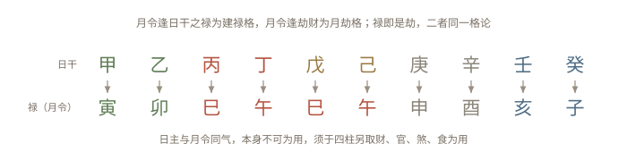

# 四十五、论建禄月劫

> 建禄者，月建逢禄堂也，禄即是劫。或以禄堂透出，即可依以用者，非也。故建禄与月劫，可同一格，不必加分，皆以透干支，别取财官煞食为用。

所谓建禄，是月令（月建）恰好是日干的禄地；禄其实就是劫财。有人认为禄透出天干就可以依靠它来作用神，这是错的。所以建禄格与月劫格可以作为同一格来论，不必区分，都要看天干地支所透所会，另外取财、官、煞、食为用神。

*图 45-1　十干建禄表：月令为日干之禄即建禄格。（译者补绘，原书无此图）*

> 禄格用官，干头透出为奇，又要财印相随，不可孤官无辅。有用官而印护者，如庚戌、戊子、癸酉、癸亥，金丞相命是也。有用官而财助者，如丁酉、丙午、丁巳、壬寅，李知府命是也。

建禄格用官的，以官星透出天干为奇妙，又要有财、印相随，不能孤官无辅。有用官而有印护的，比如庚戌、戊子、癸酉、癸亥，是金丞相的命；有用官而有财助的，比如丁酉、丙午、丁巳、壬寅，是李知府的命。

> 有官而兼带财印者，所谓身强值三奇，尤为贵气。三奇者，财官印也，只要以官隔之，使财印两不相伤，其格便大，如庚午、戊子、癸卯、丁巳，王少师命是也。

有用官而兼带财、印的，就是所谓“身强值三奇”，尤其贵气。三奇就是财、官、印；只要用官星把财和印隔开，使财印互不相伤，格局就大。比如庚午、戊子、癸卯、丁巳，是王少师的命。

> 禄劫用财，须带食伤，盖月令为劫而以财作用，二物相克，必以伤食化之，始可转劫生财，如甲子、丙子、癸丑、壬辰，张都统命是也。

建禄月劫格用财的，必须带食神伤官。因为月令是劫财而以财为用，两者相克，一定要用伤食来化解，才能把劫财转化为生财之力。比如甲子、丙子、癸丑、壬辰，是张都统的命。

> 至于化劫为财，与化劫为生，尤为秀气。如己未、己巳、丁未、辛丑，丑与巳会，即以劫财之火为金局之财，安得不为大贵？所谓化劫为财也。

至于把劫财化为财、或把劫财化为生财之物，更显得秀气。比如己未、己巳、丁未、辛丑：丑与巳相会成金局，就把劫财之火（巳）变成了金局之财，怎么能不大贵？这就是所谓“化劫为财”。

> 如高尚书命，庚子、甲申、庚子、甲申，即以劫财之金，化为生财之水，所谓化劫为生也。

又如高尚书的命：庚子、甲申、庚子、甲申，申子会成水局，就把劫财之金化成了生财之水，这就是所谓“化劫为生”。

> 禄劫用煞，必须制伏，如娄参政命，丁巳、壬子、癸卯、己未，壬合丁财以去其党煞，卯未会局以制伏是也。

建禄月劫格用七煞的，必须有制伏。比如娄参政的命：丁巳、壬子、癸卯、己未，壬水合去丁火之财，以免财去帮煞；卯未会成木局（食神）来制伏己土七煞。

> 至用煞而又逢财，本为不美，然能去煞存财，又成贵格。戊辰、癸亥、壬午、丙午，合煞存财，袁内阁命是也。

至于用七煞而又遇到财，本来不美；但如果能去掉七煞、保住财，又成贵格。比如戊辰、癸亥、壬午、丙午，戊癸相合，合煞存财，是袁内阁的命。

> 其禄劫之格，无财官而用伤食，泄其太过，亦为秀气。唯春木秋金，用之则贵，盖木逢火则明，金生水则灵。

建禄月劫格没有财官、而用伤官食神来泄其太过的，也是秀气。只有春天的木、秋天的金这样用才贵，因为木遇火就光明，金生水就灵秀。

> 如张状元命，甲子、丙寅、甲子、丙寅，木火通明也；又癸卯、庚申、庚子、庚辰，金水相涵也。

比如张状元的命：甲子、丙寅、甲子、丙寅，是木火通明；又如癸卯、庚申、庚子、庚辰，是金水相涵。

> 更有禄劫而官煞竞出，必取清方为贵格。如一平章命，辛丑、庚寅、甲辰、乙亥、合煞留这也；如辛亥、庚寅、甲申、丙寅，制煞留官也。

更有建禄月劫格而官、煞都透出的，必须取清才是贵格。比如某平章的命：辛丑、庚寅、甲辰、乙亥，乙庚相合，是合煞留官；又如辛亥、庚寅、甲申、丙寅，丙火制庚金七煞，是制煞留官。

（译注：“合煞留这”当作“合煞留官”。）

> 倘或两官竞出，亦须制伏，所谓争正官不可无伤也。

倘若两个官星都透出，也需要制伏，这就是所谓“争正官不可无伤”。

> 若夫用官而孤官无辅，格局更小，难于取贵，若透伤食便不破格。然亦有官伤并透而贵者，何也？如己酉、乙亥、壬戌、庚子，庚合乙而去伤存官，王总兵命也。

如果用官而孤官无辅，格局就更小，难以取贵；如果再透出伤官食神，格局就破了。然而也有官与伤官都透出而贵的，这是为什么？比如己酉、乙亥、壬戌、庚子，庚金合住乙木（伤官），去伤存官，是王总兵的命。

（译注：底本“若透伤食便不破格”与上下文相反，当作“若透伤食便破格”。）

> 用财而不透伤食，便难于发端，然干头透一位而不杂，地支根多，亦可取富，但不贵耳。

用财而不透伤官食神，就难以发达；不过天干透出一位财而不杂，地支根又多，也可以致富，只是不贵。

> 用官煞重而无制伏，运行制伏，亦可发财，但不可官煞太重，致令身危也。

用官煞而官煞重又没有制伏的，大运走到制伏之地，也可以发财；但不能官煞太重，以致危及日主。
