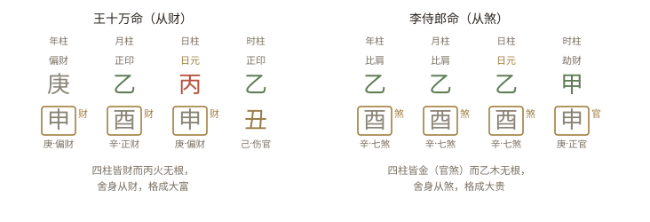

# 四十七、论杂格

> 杂格者，月令无用，以外格而用之，其格甚多，故谓之杂。大约要干头无官无煞，方成格，如有官煞，则自有官煞为用，列外格矣。

所谓杂格，是月令中没有可用之神，于是借用外格来取用；这类格局名目很多，所以叫“杂”。大致要天干上没有官、没有煞，才能成格；如果有官煞，自然就以官煞为用神，不必列入外格了。

> 若透财尚可取格，然财根深，或财透两位，则亦以财为重，不取外格也。

如果透出财，尚且可以取外格；但如果财根深，或者财透出两位，那也就以财为重，不取外格了。

> 试以诸格论之，有取五行一方秀气者，取甲乙全亥卯未、寅卯辰，又生春月之类，本是一派劫财，以五行各得其全体，所以成格，喜印露而体纯。

试把各种杂格来论一论。有取五行一方秀气的：比如甲乙日主，地支全有亥卯未或寅卯辰，又生在春月之类，本来是一派劫财，因为这一行得到了完整的全体，所以成格；喜欢印透露而格局纯粹。

> 如癸亥、乙卯、乙未、壬午，吴相公命是也。运亦喜印绶比劫之乡，财食亦吉，官煞则忌矣。

比如癸亥、乙卯、乙未、壬午，吴相公的命就是。大运也喜走印绶、比劫之乡，财、食运也吉，官煞运就犯忌。

> 有从化取格者，要化出之物，得时乘令，四支局全。如丁壬化木，地支全亥卯未、寅卯辰，而又生于春月，方为大贵。

有取从化格的：要化出来的那一行得时当令，四柱地支成局齐全。比如丁壬化木，地支全有亥卯未或寅卯辰，又生在春月，才是大贵。

> 否则，亥未之月亦是木地，次等之贵，如甲戌、丁卯、壬寅、甲辰，一品贵格命也。运喜所化之物，与所化之印绶，财伤亦可，不利官煞。

否则，生在亥月、未月也算木地，是次一等的贵。比如甲戌、丁卯、壬寅、甲辰，是一品贵格的命。大运喜走所化之物（木）以及它的印绶（水），财、伤运也可以，不利官煞。

> 有倒冲成格者，以四柱列财官而对面以冲之，要支中字多，方冲得动。譬如以弱主邀强官，主不众则宾不从。

有倒冲成格的：四柱没有财官，就用对面的地支去冲出财官；要地支中同一个字多，才冲得动。好比弱小的主人要邀请强大的官员，主人这边人不多，客人就不会来。

> 如戊午、戊午、戊午、戊午，是冲子财也；甲寅、庚午、丙午、甲午，是冲子官也。运忌填实，余俱可行。

比如戊午、戊午、戊午、戊午，是用午冲出子中的财（癸水）；甲寅、庚午、丙午、甲午，是用午冲出子中的官（癸水）。大运忌讳“填实”（直接遇到子），其余的运都可以走。

> 有朝阳成格者，戊去朝丙，辛日得官，以丙戊同禄于巳，即以引汲之意。要干头无木火，方成其格，盖有火则无待于朝，有木财触戊之怒，而不为我朝。

有朝阳成格的（六辛朝阳）：用戊土去朝丙火，使辛日得到官星，因为丙、戊同禄于巳，就有牵引汲取的意思。要天干上没有木火才能成格：因为有火就用不着去朝；有木（财）会触怒戊土，戊土就不为我去朝了。

> 如戊辰、辛酉、戊子，张知县命是也。运喜土金水，木运平平，火则忌矣。

比如戊辰、辛酉、戊子……，张知县的命就是。大运喜土金水，木运平平，火运就犯忌。

（译注：此命底本只列三柱；第四十八章徐注所引作“戊辰、辛酉、辛酉、戊子”。）

> 有合禄成格者，命无官星，借干支以合之。戊日庚申，以庚合乙，因其主而得其偶。如己未、戊辰、戊辰、庚申，蜀王命是也。

有合禄成格的：命中没有官星，借天干地支去合来。比如戊日庚申时，用庚去合乙（戊之正官），这是凭借主人去求得配偶。比如己未、戊辰、戊辰、庚申，是蜀王的命。

> 癸日庚申，以申合巳，因其主而得其朋，如己酉、癸未、癸未、庚申，赵丞相命是也。

癸日庚申时，用申去合巳（巳中戊土为癸之正官），这是凭借主人去求得朋友。比如己酉、癸未、癸未、庚申，是赵丞相的命。

> 运亦忌填实，不利官煞，理会不宜以火克金，使彼受制而不能合，余则吉矣。

大运也忌讳填实，不利官煞；照理也不宜用火去克金，使庚、申受制而不能去合；其余的运就都吉。

> 有弃命保财者，四柱皆财而身无气，舍而从之，格成大贵。若透印则身赖印生而不从，有官煞则亦无从财兼从煞之理，其格不成。

有弃命从财的：四柱全是财而日主无气，就舍弃自身而顺从财，格成大贵。如果透出印，日主依赖印生就不肯从；如果有官煞，也没有既从财又从煞的道理，格局就不成。

（译注：“保财”当作“从财”。）

> 如庚申、乙酉、丙申、乙丑，王十万命造也。运喜伤食财乡，不宜身旺。有弃命从煞者，四柱皆煞，而日主无根，舍而从之，格成大贵。若有伤食，则煞受制而不从，有印则印以化煞而不从。

比如庚申、乙酉、丙申、乙丑，是王十万的命。大运喜走伤食、财乡，不宜身旺。有弃命从煞的：四柱全是煞，而日主无根，就舍弃自身而顺从七煞，格成大贵。如果有伤食，七煞受制就不能从；如果有印，印会化煞，也不能从。

> 如乙酉、乙酉、乙酉、甲申，李侍郎命是也。运喜财官，不宜身旺，食伤则尤忌矣。

比如乙酉、乙酉、乙酉、甲申，李侍郎的命就是。大运喜财、官，不宜身旺，食伤运尤其犯忌。

*图 47-1　弃命从财与弃命从煞：四柱一派财或官煞而日主无根，舍己而从。（译者补绘，原书无此图）*

> 有井栏成格者，庚金生三七月，方用此格。以申子辰冲寅午戌，财官印绶，合而冲之，若透丙丁，有巳午，以现有财官，而无待于冲，乃非井拦之格矣。

有井栏叉成格的：庚金生在三月、七月才用这个格。用申子辰去冲寅午戌，冲出其中的财、官、印。如果透出丙丁、或有巳午，已经现成有财官，就用不着去冲，那就不是井栏叉格了。

> 如戊子、庚申、庚申、庚申，郭统制命也。运喜财，不利填实，余亦吉也。

比如戊子、庚申、庚申、庚申，是郭统制的命。大运喜财，不利填实，其余的运也吉。

> 有刑合成格者，癸日甲寅时，寅刑巳而得财官，格与合禄相似，但合禄则喜以合之，而刑合则硬以致之也。

有刑合成格的：癸日甲寅时，用寅去刑巳，刑出巳中的财官；这和合禄格相似，只是合禄是欢喜地合来，而刑合是硬生生地招来。

> 命有庚申，则木被冲克而不能刑；有戊己字，则现透官煞而无待于刑，非此格矣。如乙未、癸卯、癸卯、甲寅，十二节度使命是也。运忌填实，不利金乡，余则吉矣。

命中如果有庚、申，木被冲克就不能去刑；有戊、己字，已经现透官煞，就用不着刑，就不是这个格了。比如乙未、癸卯、癸卯、甲寅，是十二节度使的命。大运忌填实，不利金乡，其余的就吉。

> 有遥合成格者，巳与丑会，本同一局，丑多则会巳而辛丑处官，亦合禄之意也。如辛丑、辛丑、辛丑、庚寅，章统制命是也。

有遥合成格的：巳与丑相会，本来同属一局（巳酉丑金局），丑多就去会巳，而辛日从中得到官星（巳中丙火），这也是合禄的意思。比如辛丑、辛丑、辛丑、庚寅，是章统制的命。

（译注：“辛丑处官”疑当作“辛日得官”。）

> 若命是有子字，则丑与子合而不遥，有丙丁戊己，则辛癸之官煞已透，而无待于遥，另有取用，非此格矣。

如果命中有子字，丑就与子相合而不去遥会巳；如果有丙丁戊己，辛日、癸日的官煞已经透出，就用不着遥合，另有取用，就不是这个格了。

> 至于甲子遥已，转辗求俣，似觉无情，此格可废，因罗御史命，聊复存之。为甲申、甲戌、甲子、甲子，罗御史命是也。

至于“甲子遥巳”格，辗转相求，似乎很无情，这个格本来可以废除；只因为有罗御史的命例，姑且保留。罗御史的命是：甲申、甲戌、甲子、甲子。

（译注：“遥已”当作“遥巳”；“求俣”疑当作“求偶”；“为甲申”的“为”当作“如”。）

> 若夫拱禄、拱贵、趋乾、归禄、夹戌、鼠贵、骑龙、日贵、日德、富禄、魁罡、金神、时墓、两干不杂、干支一气、五行俱足之类，一切无理之格，既置勿取。

至于拱禄、拱贵、趋乾、归禄、夹戌、鼠贵、骑龙、日贵、日德、富禄、魁罡、金神、时墓、两干不杂、干支一气、五行俱足之类，一切没有道理的格局，都弃置不取。

> 即古人格内，亦有成式，总之意为牵就，硬填入格，百无一是，徒误后学而已。

即使古人的格局中也有这些成例，总之都是有意牵强附会，硬塞进格局里去，百无一是，只会贻误后来的学者罢了。

> 乃若天地双飞，虽富贵亦有自有格，不全赖此。而亦能增重基格，即用神不甚有用，偶有依以为用，亦成美格。然而有用神不吉，即以为凶，不可执也。

至于“天地双飞”（四柱天干相同、地支相同之类），即使富贵，也自有它本来的格局，不全靠这个；不过它也能增加原格局的分量。即使用神不太有用，偶尔依靠它来取用，也能成为美格。然而如果用神不吉，就当作凶来论，不可拘执。

（译注：“基格”当作“其格”。）

> 其于伤官伤尽，谓是伤尽，不宜一见官，必尽力以伤之，使之无地容身，现行伤运，便能富贵，不知官有何罪，而恶之如此？

至于“伤官伤尽”的说法：认为伤官要伤尽，一点官星都不能见，一定要竭尽全力去伤它，让它无处容身；再走伤官运，就能富贵。不知道官星有什么罪，要这样憎恶它？

> 况见官而伤，则以官非美物，而伤以制之，又何伤官之谓凶神，而见官之为祸百端乎？

况且如果见官就去伤它，那就是把官当成坏东西、用伤官来制它——那为什么又说伤官是凶神、而伤官见官会招来种种祸患呢？

> 予用是术以历试，但有贫贱，并无富贵，未轻信也，近亦见有大贵者，不知何故。然要之极贱者多，不得不观其人物以衡之。

我用这个说法去一一检验过，只见到贫贱的，没见过富贵的，所以不轻易相信；近来也见到有大贵的，不知道是什么缘故。不过总的来说，极其贫贱的居多，不得不结合这个人的实际情况来衡量。

> 徐注：用伤官之忌见官星，亦犹用官之忌伤，用印之忌财，用财之忌劫也。何格无喜忌，岂独伤官？况官星有喜见不喜见之别乎？至于格局之不可解者甚多。我人学识不足，未穷奥妙，知之为知之，不知为不知，正不必曲为讳饰也。

【徐乐吾注】用伤官的忌见官星，就像用官的忌见伤官、用印的忌见财、用财的忌见劫财一样。哪个格没有喜忌，难道只有伤官格？况且官星还有喜见、不喜见的区别呢。至于格局中解释不通的地方还有很多。我们学识不够，没有穷尽其中的奥妙，知道就是知道、不知道就是不知道，正不必曲意掩饰。

（译注：此段为民国徐乐吾的评注，非沈孝瞻原文。）
