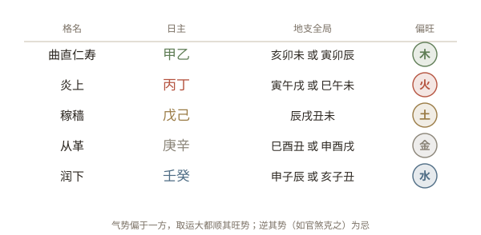

# 四十八、附论杂格取运

> 徐注：杂格不一，大都气势偏旺，出于五行常理之外。昔人评命，泥于财官之说，四柱无财可取，则不惜遥合倒冲，牵强附会，以期合于财官，未免可嗤。命理不外乎五行，气势虽为偏旺，而偏旺之中，仍有正理可取，详《滴天髓征义》。偏旺之格，取运大都须顺其气势，虽干支喜忌，须察四柱之配合，而顺势取运，大致有定。兹就本篇所引各造。约略言之：

【徐乐吾注】杂格名目不一，大都是气势偏旺、超出五行常理之外的。前人评命，拘泥于财官之说，四柱中没有财官可取，就不惜用遥合、倒冲之类牵强附会，以求合于财官，未免可笑。命理离不开五行；气势虽然偏旺，但偏旺之中仍有正理可取，详见《滴天髓征义》。偏旺的格局，取运大都要顺其气势；虽然干支的喜忌还要察看四柱的配合，但顺势取运，大致是确定的。现就本篇所引的各个命造，简略说明如下：

（译注：本章全章为民国徐乐吾的评注，非沈孝瞻原文；下面各例取自上一章。）

> 曲直仁寿格

曲直仁寿格（木一方专旺）

> 癸亥 乙卯 乙未 壬午

四柱：年癸亥，月乙卯，日乙未，时壬午。

> 甲寅 癸丑 壬子 辛亥 庚戌 己酉

大运：甲寅、癸丑、壬子、辛亥、庚戌、己酉。

> 甲乙日主，支全亥卯未或寅卯辰，乃曲直仁寿格也。气势偏旺于木，宜行水木火运，官煞运最忌，财运亦不宜。丙丁日主，支全寅午戌、或巳午未，为炎上格。戊已日主，支全辰戌丑未为稼穑格。庚辛日主，支全巳酉丑或申酉戌，为从革格。壬癸日主支全甲子辰或亥子丑，为润下格。五种意义相同。

甲乙日主，地支全有亥卯未或寅卯辰，就是曲直仁寿格。气势偏旺于木，宜走水、木、火运；官煞运最忌，财运也不宜。丙丁日主地支全有寅午戌或巳午未，是炎上格；戊己日主地支全有辰戌丑未，是稼穑格；庚辛日主地支全有巳酉丑或申酉戌，是从革格；壬癸日主地支全有申子辰或亥子丑，是润下格。五种格局的道理相同。

（译注：“支全甲子辰”当作“支全申子辰”；“戊已”当作“戊己”。）

*图 48-1　五种一方专旺格：气势偏于一方，取运大都顺其旺势。（译者补绘，原书无此图）*

> 化气格：

化气格

> 甲戌 丁卯 壬寅 甲辰

四柱：年甲戌，月丁卯，日壬寅，时甲辰。

> 戊辰 己巳 庚午 辛未 壬申 癸酉

大运：戊辰、己巳、庚午、辛未、壬申、癸酉。

> 丁壬化木，生于春月，时逢甲辰，木之元神透出，乃化木格。气势偏于木也。化神喜行旺地，最宜东方寅卯辰比劫乡，而忌官煞，日主还原之地亦忌，其中略分别，如丁壬化木，日元壬水，行亥子丑印地，生起化神亦吉；若甲已化土，而行寅卯辰，克我化神，为大忌也。化气格有甲己化土、乙庚化金、丙辛化水、丁壬化木、戊癸化火五种，意义略同。

丁壬化木，生在春月，时逢甲辰，木的元神透出，这就是化木格，气势偏于木。化神喜走旺地，最宜东方寅卯辰比劫之乡，忌官煞，也忌日主还原（回到本来五行）之地。其中略有分别：比如丁壬化木，日元是壬水，走亥子丑印地，能生起化神，也吉；而甲己化土若走寅卯辰，克我化神，就是大忌。化气格有甲己化土、乙庚化金、丙辛化水、丁壬化木、戊癸化火五种，道理大致相同。

> 倒冲格：

倒冲格

> 戊午 戊午 戊午 戊午

四柱：年戊午，月戊午，日戊午，时戊午。

> 己未 庚申 辛酉 壬戌 癸亥 甲子

大运：己未、庚申、辛酉、壬戌、癸亥、甲子。

> 两神成象，而气势偏于火土，为从旺格。最宜金运，泄土之气，但火炎土燥，究嫌偏枯，宜带水之土以护之。如庚辰辛丑等运为最佳，若见水运，如以一杯水救车薪之火。立见其灾。所谓倒冲最忌填实，即此意也。木运逆土之性，增火之焰，亦不相宜。

火土两神成象，气势偏于火土，是从旺格。最宜金运，泄土之气；但火炎土燥，终究嫌偏枯，宜走带水的土运来护持，如庚辰、辛丑等运最好。如果遇到水运，就像一杯水去救一车柴的火，立刻见灾——所谓“倒冲最忌填实”，就是这个意思。木运违逆土性、助长火焰，也不相宜。

> 甲寅 庚午 丙午 甲午

四柱：年甲寅，月庚午，日丙午，时甲午。

> 辛未 壬申 癸酉 甲戌 乙亥 丙子

大运：辛未、壬申、癸酉、甲戌、乙亥、丙子。

> 庚金无根，置之不论，气偏木火，格成炎上，最宜土运泄火之气。说见前仁寿格。

庚金无根，置之不论；气势偏于木火，格成炎上，最宜土运泄火之气。说明见前面的曲直仁寿格。

> 以上两造皆俗所谓倒冲格也。

以上两个命造，都是俗称的倒冲格。

> 朝阳格：

朝阳格

> 戊辰 辛酉 辛酉 戊子

四柱：年戊辰，月辛酉，日辛酉，时戊子。

> 壬戌 癸亥 甲子 乙丑 丙寅 丁卯

大运：壬戌、癸亥、甲子、乙丑、丙寅、丁卯。

> 此金水伤官，原无官星，气势偏于金水，以顺其性。行土金水运为美，火运为忌。带水之木尚可行，而带火之木则不宜见。此俗所谓朝阳格也。

这是金水伤官，原本没有官星，气势偏于金水，要顺其性。走土、金、水运为美，火运为忌；带水的木运尚可走，带火的木运就不宜见。这就是俗称的朝阳格。

> 合禄格：

合禄格

> 己未 戊辰 戊辰 庚申

四柱：年己未，月戊辰，日戊辰，时庚申。

> 丁卯 丙寅 乙丑 甲子 癸亥 壬戌

大运：丁卯、丙寅、乙丑、甲子、癸亥、壬戌。

> 此土金食神也。比劫重重，气势偏于土金，以金运泄土之秀为最吉，水运亦美，火运为忌，木亦不美，所谓土盛木折也。俗以庚合乙为官星，称为合禄格，又不要明见，喜财以生之。取运略同。

这是土金食神格。比劫重重，气势偏于土金，以金运泄土之秀气为最吉，水运也好；火运为忌，木运也不好，即所谓“土盛木折”。俗说以庚合乙为官星，称为合禄格，又说官星不要明见、喜财来生它。取运大致相同。

> 合禄格：

合禄格

> 己酉 辛未 癸未 庚申

四柱：年己酉，月辛未，日癸未，时庚申。

> 庚午 己巳 戊辰 丁卯 丙寅 乙丑

大运：庚午、己巳、戊辰、丁卯、丙寅、乙丑。

> 俗亦名之为合禄格，以申合巳中戊土为官星也。月令偏官，年上透出，时上庚印化煞为用（见论偏官篇），格正局清，有何不美？若取巳中戊土官星，岂非官煞混杂耶？

俗说也把它叫作合禄格，认为是用申合出巳中戊土为官星。其实月令是偏官（未中己土），又在年上透出，时上庚金为印，化煞为用（见论偏官篇），格正局清，有什么不好？如果去取巳中戊土为官星，岂不成了官煞混杂吗？

> 从财格：

从财格

> 庚申 乙酉 丙申 己丑

四柱：年庚申，月乙酉，日丙申，时己丑。

> 丙戌 丁亥 戊子 己丑 庚寅 辛卯

大运：丙戌、丁亥、戊子、己丑、庚寅、辛卯。

> 乙从庚化，不作印论，丙火临申，坐于病地，四柱无根，时上己丑又来生金，气势偏于金旺，为弃命从财格也。运宜行土金水，南方火乡最忌，木亦不利。

乙木随庚金而化，不作印论；丙火临申，坐于病地，四柱无根，时上己丑又来生金，气势偏于金旺，是弃命从财格。大运宜走土、金、水，南方火乡最忌，木运也不利。

（译注：此造时柱，上一章作“乙丑”，此作“己丑”。）

> 从煞格：

从煞格

> 乙酉 乙酉 乙酉 甲申

四柱：年乙酉，月乙酉，日乙酉，时甲申。

> 甲申 癸未 壬午 辛巳 庚辰 己卯

大运：甲申、癸未、壬午、辛巳、庚辰、己卯。

> 乙木无根，气势偏于金，为弃命从煞格。金运最美，水土亦吉。木运为乙木逢根，火运逆其旺势，皆忌见。与上从财格大致相同。

乙木无根，气势偏于金，是弃命从煞格。金运最好，水、土运也吉；木运使乙木得根，火运违逆其旺势，都忌见。与上面的从财格大致相同。

> 井栏叉格：

井栏叉格

> 戊子 庚申 庚申 庚辰

四柱：年戊子，月庚申，日庚申，时庚辰。

> 辛酉 壬戌 癸亥 甲子 乙丑 丙寅

大运：辛酉、壬戌、癸亥、甲子、乙丑、丙寅。

> 此俗所谓井栏叉格。庚金乘旺泄秀，支全申子辰水局。气势偏于金水，当顺其势以取运。土金水运均美，木运亦可，行火运逆其旺势不利。

这就是俗称的井栏叉格。庚金乘旺而泄秀，地支全有申子辰水局，气势偏于金水，应当顺其气势来取运。土、金、水运都好，木运也可以，走火运违逆其旺势，不利。

（译注：此造时柱，上一章作“庚申”，此作“庚辰”。）

> 遥合格：

遥合格

> 辛丑 辛丑 辛丑 庚寅

四柱：年辛丑，月辛丑，日辛丑，时庚寅。

> 庚子 己亥 戊戌 丁酉 丙申 乙未

大运：庚子、己亥、戊戌、丁酉、丙申、乙未。

> 此俗所谓丑遥巳格。土金成局，生于十二月，时上寅木无气，不能为用。势象偏于土金，宜土金水运，木火逆其旺势为不宜。与遥巳格取运相同也。

这就是俗称的“丑遥巳”格。土金成局，生在十二月，时上寅木无气，不能为用。气象偏于土金，宜走土、金、水运，木、火违逆其旺势，不宜。与遥巳格的取运相同。

> 丑遥巳禄格（又名刑合）：

丑遥巳禄格（又名刑合）

> 乙未 癸卯 癸卯 甲寅

四柱：年乙未，月癸卯，日癸卯，时甲寅。

> 壬寅 辛丑 庚子 己亥 戊戌 丁酉

大运：壬寅、辛丑、庚子、己亥、戊戌、丁酉。

> 《喜忌篇》云，"癸日进逢寅位，岁月怕戊已二方"，以寅刑出巳中戊土为格，其实乃从儿格也。气势偏于木，行运最喜木火。从格忌见比劫，而从儿有食伤引化，不忌比劫，此为不同之点。官煞大忌，印运亦忌。

《喜忌篇》说：“癸日进逢寅位，岁月怕戊己二方”，意思是用寅刑出巳中戊土为官，作为格局。其实这是从儿格，气势偏于木，行运最喜木火。一般从格忌见比劫，而从儿格有食伤引化，不忌比劫，这是不同之处。官煞运大忌，印运也忌。

（译注：“戊已”当作“戊己”。此标题“丑遥巳禄格（又名刑合）”与下一条疑互有错置：此造即上一章的“刑合格”。）

> 子遥巳禄格（又名遥合格）：

子遥巳禄格（又名遥合格）

> 甲申 甲戌 甲子 甲子

四柱：年甲申，月甲戌，日甲子，时甲子。

> 乙亥 丙子 丁丑 戊寅 己卯 庚辰

大运：乙亥、丙子、丁丑、戊寅、己卯、庚辰。

> 《喜忌篇》云，"甲子日再遇子时，畏庚辛申酉丑午，以子遥合巳为格"，其实月令偏财，用财损印，何必另取格局？戌藏丁火，生起财星，遇运透清为美，庚辛申酉官煞生印为忌，午冲子、丑刑戌均为忌也。

《喜忌篇》说：“甲子日再遇子时，畏庚辛申酉丑午”，意思是用子遥合巳作为格局。其实这个命月令是偏财（戌中戊土），用财损印，何必另取格局？戌中藏丁火，能生起财星，大运遇到把它透清的就好；庚辛申酉是官煞生印，为忌；午冲子、丑刑戌，也都是忌。
